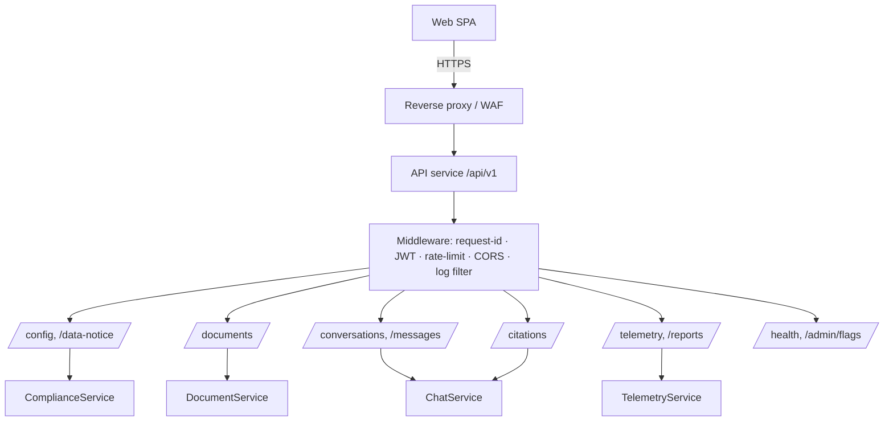
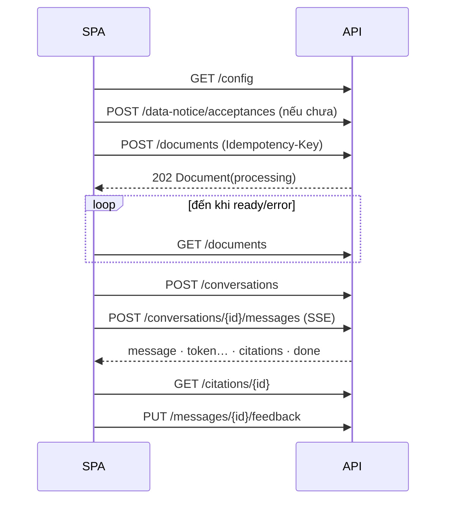

# Thiết kế API (SDD) — Công cụ “Chat với tài liệu”

**Chuẩn áp dụng:** IEEE 1016-2009; OpenAPI 3.0; RFC 7807 (Problem Details)
**Số tài liệu / Phiên bản:** SDD-API-DOCCHAT-001 / v0.1 — Bản nháp
**Ngày lập:** 2026-10-21
**Nguồn đầu vào:** [PRD.md](../requirements/PRD.md), [BRD.md](../requirements/BRD.md), [UIUX_Blueprint_SDD.md](UIUX_Blueprint_SDD.md) (hợp đồng IF-01…IF-10, mục 3.5.4), [SAD.md](SAD.md); prompt [apiDesign_prompt.md](../../design/apiDesign_prompt.md)

> **Quy ước:** **[Đề xuất]** = quyết định thiết kế do tài liệu này đưa ra, cần xác nhận. **[TBD: OQ-xxx]** = kế thừa câu hỏi mở, không phải quyết định. Phạm vi: **API công khai cho SPA (first-party)**; không có API đối tác/bên thứ ba trong MVP. Tài liệu API này thay thế vai trò “hợp đồng khái niệm” của Blueprint 3.5.4.

---

## 1. Bối cảnh và phạm vi

### 1.1 Định danh
| Thuộc tính | Giá trị |
|---|---|
| Hệ thống | Công cụ “Chat với tài liệu” (tên tạm, `OQ-002`) |
| Phiên bản API | `v1` (URI: `/api/v1`) — semver tài liệu 0.1.0 |
| Chủ sở hữu | [TBD: OQ-001] |
| Đặc tả máy đọc được | Phụ lục A (OpenAPI 3.0 rút gọn); bản đầy đủ sinh từ mã FastAPI tại `/api/v1/openapi.json` |

### 1.2 Ranh giới
| Loại | Mô tả |
|---|---|
| Người tiêu thụ API | Web SPA (first-party) — duy nhất trong MVP |
| Kênh | HTTPS REST (JSON) + SSE cho streaming |
| Hệ thống ngoài mà API gọi | LLM, Embedding, Identity Provider (xem SAD 2.3) |
| Ranh giới tin cậy | Trình duyệt (không tin cậy) → Reverse proxy/WAF → API → DB/Object storage riêng tư |
| Ngoài phạm vi | API đối tác, webhook, GraphQL, gRPC, đa-tenant, chia sẻ tài liệu giữa người dùng |

### 1.3 Giả định và ràng buộc
| Loại | Mô tả |
|---|---|
| Kỹ thuật | OpenAPI 3.0; JSON UTF-8; thời gian ISO-8601 UTC; ID là UUID v4 |
| Bảo mật | Bearer JWT; cơ chế đăng nhập cụ thể `[TBD: OQ-014]` |
| Dữ liệu | Giới hạn tệp/câu hỏi đọc từ `GET /config`, không hard-code (`OQ-008`) |
| Mạng | SPA ↔ API qua mạng văn phòng ổn định; SSE đi qua proxy không buffer |
| Quyền riêng tư | Không đưa nội dung tài liệu/câu hỏi vào URL, query string, header tùy biến hoặc log |

---

## 2. Bên liên quan và mối quan tâm

### 2.1 Người tiêu thụ API
| Consumer | Loại | Mục tiêu | Khối lượng dự kiến [Đề xuất] | SLA [Đề xuất] |
|---|---|---|---|---|
| Web SPA | First-party | Tải PDF, hỏi đáp streaming, xem nguồn | Vài chục người dùng, ≤ 30 câu hỏi/phút/người | Token đầu ≤ 5s p95; API thường ≤ 300ms p95 |
| Dashboard đánh giá (Minh) | First-party | Đọc số liệu tổng hợp | Thấp | ≤ 2s |

### 2.2 Mối quan tâm → yêu cầu API
| Mối quan tâm (Blueprint 2.2) | Yêu cầu API | Tiêu chí chấp nhận |
|---|---|---|
| CN-01 Tải PDF, trạng thái | `POST /documents` trả `202` nhanh; `GET /documents` có `status` | Tệp có trong danh sách ≤ 2s |
| CN-02 Trả lời nhanh | SSE; sự kiện `token` đầu sớm | p95 ≤ 5s với ≤ 10 PDF |
| CN-03 Kiểm chứng nguồn | `citations[]` có cấu trúc; `GET /citations/{id}` | ≥ 90% trả lời có trích dẫn hợp lệ |
| CN-04 Không bịa | Cờ `grounded`; mã trạng thái trả lời “không tìm thấy” | `grounded=false` ⇒ không cần trích dẫn |
| CN-05 Phục hồi lỗi | Idempotency; trạng thái `interrupted`; lỗi RFC 7807 có `retryable` | Không mất câu hỏi/tệp |
| CN-06 Thông báo/xóa dữ liệu | `GET/POST /data-notice`, `DELETE /documents/{id}` | Xóa ≤ 2 thao tác UI |
| CN-07 Cô lập | Mọi tài nguyên thuộc `user_id` của token; truy cập chéo → `404` | 0 rò rỉ (US-402) |
| CN-08 Đo lường | `POST /telemetry/events` allow-list | 100% sự kiện PRD 5.2 |
| CN-12 Dừng/tạo lại (P1) | `POST /messages/{id}/stop`; `POST .../regenerate` | — |

### 2.3 Kịch bản chất lượng API
| Thuộc tính | Kịch bản [Đề xuất] |
|---|---|
| Hiệu năng | Endpoint không-AI p95 ≤ 300ms; `POST /documents` trả `202` ≤ 2s với tệp trong giới hạn |
| Khả dụng | Phụ thuộc mục tiêu MVP `OQ-011`; kill switch trả `503 QA_DISABLED` có chủ đích |
| Bảo mật | JWT validate ≤ 10ms (cache JWKS); rate limit 30 câu hỏi/phút và 20 tải lên/giờ theo người dùng |
| Tin cậy | `POST` tạo tài nguyên idempotent theo `Idempotency-Key` (24h) |
| Phiên bản | URI `/api/v1`; thay đổi phá vỡ ⇒ `/api/v2`; hỗ trợ song song ≥ 1 phiên bản trong thử nghiệm |
| Tài liệu | OpenAPI tự sinh + ví dụ trong Phụ lục |
| Quan sát | `X-Request-Id` trả về mọi phản hồi; trace OpenTelemetry; log không chứa nội dung |

### 2.4 Ma trận ràng buộc API
| Ràng buộc | Yêu cầu | Chuẩn | Xác minh |
|---|---|---|---|
| Đặc tả | OpenAPI 3.0 | OpenAPI | Validator trong CI |
| Xác thực | `Authorization: Bearer <JWT>` (OIDC) `[TBD: OQ-014]` | RFC 6750 | Kiểm thử bảo mật |
| Rate limit | Theo người dùng; trả `429` + `Retry-After` | RFC 6585 | Kiểm thử tải |
| Phân trang | Cursor (`limit`, `cursor`) cho danh sách có thể tăng | — | Review |
| Lỗi | `application/problem+json` | RFC 7807 | Contract test |
| Idempotency | Header `Idempotency-Key` cho `POST /documents`, `POST /conversations` | Best practice | Test |
| CORS | Chỉ origin của SPA; không `*` | RFC 6454 | Kiểm thử bảo mật |
| Nén/nội dung | `Accept`/`Content-Type` rõ ràng; SSE `text/event-stream` | HTTP/1.1 | Test |

---

## 3. Các góc nhìn thiết kế

### 3.1 Composition View — Phân rã API


### 3.2 Logical View — Tài nguyên

| Tài nguyên | Mô tả | Khóa | Quan hệ |
|---|---|---|---|
| `Document` | Tệp PDF của người dùng | `id` | 1—n `Chunk` (nội bộ, không lộ qua API) |
| `Conversation` | Phiên hội thoại | `id` | 1—n `Message` |
| `Message` | Câu hỏi hoặc câu trả lời | `id` | 1—n `Citation`; n—n `Document` (selected_for) |
| `Citation` | Trích dẫn (tệp, trang, snippet) | `id` | n—1 `Message`; n—0..1 `Document` |
| `DataNotice` | Thông báo dữ liệu + trạng thái xác nhận | `version` | — |
| `AppConfig` | Giới hạn/cờ cho UI | — | — |

Quy ước: danh từ số nhiều, `kebab-case` cho đường dẫn, `camelCase` cho trường JSON (khớp mô hình client trong Blueprint 3.4).

### 3.3 Interface View — Danh mục endpoint

Tất cả đường dẫn có tiền tố `/api/v1`. Cột “IF” ánh xạ về Blueprint 3.5.4.

| IF | Phương thức & đường dẫn | Mục đích | Story | Phản hồi thành công |
|---|---|---|---|---|
| IF-01 | `GET /config` | Giới hạn, cờ (`qaEnabled`), `noticeVersion`, `noticeAccepted` | US-401, OQ-008 | `200 AppConfig` |
| IF-01 | `GET /data-notice` | Nội dung thông báo hiện hành `[TBD: OQ-012/013]` | US-401 | `200 DataNotice` |
| IF-02 | `POST /data-notice/acceptances` | Xác nhận thông báo | US-401 | `201` |
| IF-03 | `POST /documents` | Tải PDF (multipart) | US-101 | `202 Document` |
| IF-04 | `GET /documents` | Danh sách + trạng thái | US-102 | `200 {items, nextCursor}` |
| IF-04 | `GET /documents/{id}` | Một tài liệu (poll trạng thái) | US-102 | `200 Document` |
| IF-05 | `DELETE /documents/{id}` | Xóa tài liệu và dữ liệu liên quan | US-103 | `204` |
| — | `POST /conversations` | Tạo hội thoại | US-201 | `201 Conversation` |
| IF-06 | `POST /conversations/{id}/messages` | Hỏi đáp, **SSE** | US-201…203 | `200 text/event-stream` |
| IF-06 | `GET /conversations/{id}/messages` | Lịch sử (nếu lưu bền, `OQ-012`) | US-204 (P1) | `200 {items}` |
| IF-07 | `POST /messages/{id}/stop` | Dừng sinh | US-205 (P1) | `202` |
| IF-06 | `POST /messages/{id}/regenerate` | Tạo lại sau gián đoạn/lỗi | PRD 4.2 | `200 SSE` |
| IF-08 | `GET /citations/{id}` | Đoạn nguồn | US-302 | `200 Citation` |
| IF-09 | `PUT /messages/{id}/feedback` | Đánh giá (idempotent) | US-502 (P1) | `204` |
| IF-10 | `POST /telemetry/events` | Gửi lô sự kiện | US-501 | `202` |
| — | `GET /reports/mvp-metrics` | MET-001/002 tổng hợp (vai trò `evaluator`) | US-501 | `200` |
| — | `GET /health/live`, `/health/ready` | Liveness/readiness (không cần JWT) | PRD 5.1 | `200` |
| — | `PUT /admin/flags/qa-enabled` | Kill switch (vai trò `ops`) | PRD 5.1 | `204` |

### 3.4 Chi tiết hợp đồng chính

#### 3.4.1 Mô hình dữ liệu

```json
// Document
{ "id": "uuid", "name": "baogia.pdf", "sizeBytes": 1258291, "uploadedAt": "2026-10-21T08:15:00Z",
  "status": "processing",            // uploading | upload_failed | processing | ready | error
  "pageCount": null, "errorCode": null }          // errorCode: PDF_PASSWORD | PDF_CORRUPT | NO_TEXT | ...

// Message (AI)
{ "id": "uuid", "conversationId": "uuid", "role": "ai", "text": "...", "status": "complete",
  "grounded": true, "createdAt": "…",
  "citations": [ { "id": "uuid", "documentId": "uuid", "documentName": "baogia.pdf", "page": 4, "valid": true } ],
  "feedback": null }

// Citation (chi tiết)
{ "id": "uuid", "documentId": "uuid|null", "documentName": "baogia.pdf", "page": 4,
  "snippet": "Thanh toán trong 30 ngày kể từ ngày…", "valid": true }
```
`Message.status`: `sending | streaming | complete | interrupted | failed | stopped` (Blueprint 3.7).

#### 3.4.2 `POST /documents` (IF-03)

- **Request:** `multipart/form-data` với phần `file` (PDF); header `Idempotency-Key: <uuid do client sinh>`.
- **Kiểm tra:** JWT hợp lệ; đã xác nhận thông báo hiện hành; `Content-Type` + chữ ký `%PDF-`; kích thước ≤ `maxFileSize`; số tệp ≤ `maxFiles`.
- **Phản hồi:** `202 Accepted` + `Location: /api/v1/documents/{id}` + `Document(status=processing)`. Gửi lại cùng `Idempotency-Key` ⇒ trả bản ghi cũ, không tạo trùng (PRD 4.2).
- **Lỗi:** `400 INVALID_FILE_TYPE`, `403 NOTICE_NOT_ACCEPTED`, `413 FILE_TOO_LARGE`, `409 LIMIT_EXCEEDED`, `429 RATE_LIMITED`.
- Nhiều tệp: SPA gửi tuần tự/song song ≤ 3; mỗi tệp một yêu cầu để lỗi một tệp không ảnh hưởng tệp khác (AC-001).

#### 3.4.3 `POST /conversations/{id}/messages` (IF-06, SSE)

**Request**
```json
{ "question": "Điều khoản thanh toán là gì?", "documentIds": ["uuid", "uuid"], "clientMessageId": "uuid" }
```
- `documentIds`: ≤ 10, đều thuộc người dùng và `status=ready`; rỗng ⇒ dùng mọi tài liệu `ready`.
- `question`: không rỗng, ≤ `maxQuestionLength` (UI giả định 2000, `[TBD]`).
- `clientMessageId` giúp idempotent khi mạng chập chờn.

**Response:** `200`, `Content-Type: text/event-stream`, `Cache-Control: no-cache`, `X-Accel-Buffering: no`.

| Sự kiện SSE | Dữ liệu | Ý nghĩa |
|---|---|---|
| `message` | `{ "messageId": "uuid", "status": "streaming" }` | Gửi đầu tiên, sau khi lưu câu hỏi |
| `token` | `{ "text": "Thanh toán " }` | Mảnh văn bản (render tăng dần) |
| `citations` | `{ "citations": [ {id, documentId, documentName, page, valid} ] }` | Gửi một lần khi kết thúc sinh |
| `done` | `{ "messageId": "uuid", "status": "complete", "grounded": true, "citationCount": 2 }` | Kết thúc thành công |
| `error` | `{ "code": "LLM_TIMEOUT", "stage": "generate", "retryable": true, "messageId": "uuid" }` | Lỗi giữa chừng; phần đã gửi được giữ, `status=interrupted` hoặc `failed` |
| `ping` | `{}` mỗi 15s | Giữ kết nối qua proxy |

**Ví dụ luồng**
```
event: message
data: {"messageId":"8b1c…","status":"streaming"}

event: token
data: {"text":"Thanh toán trong 30 ngày "}

event: citations
data: {"citations":[{"id":"c1…","documentId":"d1…","documentName":"baogia.pdf","page":4,"valid":true}]}

event: done
data: {"messageId":"8b1c…","status":"complete","grounded":true,"citationCount":1}
```
- Khi không có đoạn đạt ngưỡng: chỉ `token` (“không tìm thấy trong tài liệu đã tải”) + `done` với `grounded=false`, `citationCount=0`.
- **Lỗi trước khi mở stream** (JWT, kill switch, sở hữu `documentIds`, rate limit) trả JSON `problem+json` thông thường (không phải SSE): `401`, `403`, `404`, `422`, `429`, `503 QA_DISABLED`.
- Client đóng kết nối ⇒ server hủy yêu cầu LLM, đặt `interrupted`.

#### 3.4.4 `GET /citations/{id}` (IF-08)
`200 Citation` (xem 3.4.1). Nếu tài liệu đã bị xóa: `200` với `valid=false`, `snippet=null`, `documentId=null`, `documentName=null` (UI hiện “Nguồn không còn khả dụng”, không để trống — PRD 4.2). Citation của người dùng khác ⇒ `404`.

#### 3.4.5 `POST /telemetry/events` (IF-10)
```json
{ "events": [ { "name": "answer_completed", "ts": "2026-10-21T08:20:00Z", "sessionId": "uuid", "appVersion": "0.1.0",
               "props": { "totalMs": 4200, "citationCount": 2, "grounded": true } } ] }
```
- Tên sự kiện và thuộc tính **chỉ trong allow-list** (PRD 5.2; Blueprint 3.6). Thuộc tính lạ hoặc chuỗi tự do dài ⇒ loại bỏ và đếm; trả `202 {accepted, rejected}`.
- Server tự thêm `userHash` (băm một chiều); client không gửi `user_id`.

#### 3.4.6 Mô hình lỗi (RFC 7807)
```json
{ "type": "https://docs.example/errors/file-too-large", "title": "Tệp vượt giới hạn", "status": 413,
  "code": "FILE_TOO_LARGE", "detail": "Giới hạn tối đa là 20 MB.", "retryable": false, "requestId": "…" }
```
`detail` dễ hiểu, không chứa nội dung tài liệu/câu hỏi (Blueprint 2.5).

| HTTP | `code` | Khi nào | UI xử lý |
|---|---|---|---|
| 400 | `INVALID_FILE_TYPE`, `VALIDATION_ERROR` | Sai định dạng/trường | Toast + nêu giới hạn |
| 401 | `UNAUTHENTICATED`, `SESSION_EXPIRED` | Thiếu/hết hạn JWT | Overlay đăng nhập, giữ `Draft` |
| 403 | `NOTICE_NOT_ACCEPTED`, `FORBIDDEN` | Chưa xác nhận thông báo / thiếu vai trò | Mở SCR-01 |
| 404 | `NOT_FOUND` | Không tồn tại **hoặc thuộc người khác** | Làm mới danh sách |
| 409 | `LIMIT_EXCEEDED`, `DOCUMENT_NOT_READY` | Vượt số tệp; chọn tệp chưa sẵn sàng | Thông báo |
| 413 | `FILE_TOO_LARGE`, `QUESTION_TOO_LONG` | Vượt giới hạn | Chặn + giải thích |
| 422 | `NO_READY_DOCUMENTS` | Chưa có tệp `ready` | Hướng dẫn tải PDF |
| 429 | `RATE_LIMITED` | Vượt hạn mức (`Retry-After`) | Thử lại sau |
| 502/504 | `LLM_UNAVAILABLE`, `LLM_TIMEOUT` | Dịch vụ AI lỗi | Giữ câu hỏi + [Thử lại] |
| 503 | `QA_DISABLED` | Kill switch | Banner SCR-08 |

### 3.5 Interaction View
Luồng tải lên và hỏi đáp: [sequence_diagram_upload.drawio](sequence_diagram_upload.drawio), [sequence_diagram_chat.drawio](sequence_diagram_chat.drawio). Tóm tắt trình tự gọi API của SPA:



### 3.6 State Dynamics View
- `Document.status`: `uploading → processing → ready | error`; `upload_failed` chỉ có ở client (chưa tới server). Chuyển trạng thái chỉ do server (worker) thực hiện.
- `Message.status`: `sending → streaming → complete | interrupted | failed | stopped`; `regenerate` tạo **message AI mới** liên kết cùng câu hỏi, giữ bản cũ để kiểm toán.

### 3.7 Information View — Bảo mật & quyền riêng tư của dữ liệu API
- Token (JWT): `sub` = định danh người dùng; `roles` ∈ {`user`, `evaluator`, `ops`}; thời hạn ngắn, làm mới theo IdP `[TBD: OQ-014]`.
- Mọi truy vấn lọc theo `user_id` từ token (không nhận `userId` từ client).
- Không có nội dung trong URL/query; `documentIds` ở body.
- Log truy cập chỉ ghi: phương thức, đường dẫn đã chuẩn hóa (`/documents/{id}`), trạng thái, độ trễ, `requestId`.

---

## 4. Quyết định thiết kế và lý do

| ID | Quyết định | Lý do | Mối quan tâm |
|---|---|---|---|
| API-01 | REST + SSE, không WebSocket | Một chiều, đơn giản, qua proxy dễ; dừng sinh bằng yêu cầu riêng | CN-02, CN-12 |
| API-02 | `POST /documents` bất đồng bộ (`202`) + polling | Xử lý PDF ≤ 60s; không giữ kết nối dài | CN-01 |
| API-03 | Mỗi tệp một yêu cầu | Lỗi một tệp không ảnh hưởng tệp khác (AC-001) | CN-01 |
| API-04 | Trích dẫn là dữ liệu có cấu trúc, không nhúng trong text | Kiểm chứng/đo lường được; tránh LLM tự bịa nguồn | CN-03 |
| API-05 | `404` cho tài nguyên của người khác | Không lộ sự tồn tại (US-402) | CN-07 |
| API-06 | `Idempotency-Key` + `clientMessageId` | Mạng chập chờn không tạo trùng | CN-05 |
| API-07 | Telemetry allow-list ở server | Không rò nội dung dù client lỗi | CN-08 |
| API-08 | Giới hạn đọc từ `/config` | `OQ-008` chưa chốt | — |
| API-09 | Phiên bản trong URI `/api/v1` | Đơn giản, dễ định tuyến | — |

---

## 5. Truy vết

| Story P0 | Endpoint |
|---|---|
| US-101 | `POST /documents` |
| US-102 | `GET /documents`, `GET /documents/{id}` |
| US-103 | `DELETE /documents/{id}` |
| US-201 | `POST /conversations`, `POST /conversations/{id}/messages` |
| US-202 | SSE `done.grounded`, ngưỡng truy xuất (SAD ADR-04) |
| US-203 | `documentIds[]` nhiều tệp; `citations[]` nhiều tài liệu |
| US-301 | SSE `citations`; `Message.citations` |
| US-302 | `GET /citations/{id}` |
| US-401 | `GET /data-notice`, `POST /data-notice/acceptances`, `403 NOTICE_NOT_ACCEPTED` |
| US-402 | JWT + lọc `user_id`; `404` chéo người dùng |
| US-501 | `POST /telemetry/events`, `GET /reports/mvp-metrics` |

---

## 6. Rủi ro và câu hỏi mở

| ID | Nội dung | Tác động | Liên kết |
|---|---|---|---|
| R-API-01 | Cơ chế xác thực/phát hành token chưa chốt | Đổi middleware, `roles` claim, luồng làm mới | OQ-014 |
| R-API-02 | Giới hạn kích thước/số lượng/độ dài câu hỏi | Giá trị trong `AppConfig`, mã lỗi 413/409 | OQ-008 |
| R-API-03 | Hội thoại lưu bền hay theo phiên | Có/không `GET …/messages`, vòng đời `Conversation` | OQ-012 |
| R-API-04 | `task_marked_done` (MET-001/002) chưa có điều khiển UI | Thêm sự kiện telemetry hoặc endpoint `POST /tasks/{id}/done` | OQ-005 |
| R-API-05 | Hạn mức rate limit chỉ là đề xuất | Điều chỉnh sau thử nghiệm | OQ-011 |

---

## Phụ lục A — OpenAPI 3.0 (rút gọn)

```yaml
openapi: 3.0.3
info: { title: Chat with Document API, version: 0.1.0 }
servers: [ { url: /api/v1 } ]
security: [ { bearerAuth: [] } ]
components:
  securitySchemes:
    bearerAuth: { type: http, scheme: bearer, bearerFormat: JWT }
  responses:
    Problem:
      description: Lỗi (RFC 7807)
      content: { application/problem+json: { schema: { $ref: '#/components/schemas/Problem' } } }
  schemas:
    Document:
      type: object
      required: [id, name, sizeBytes, uploadedAt, status]
      properties:
        id: { type: string, format: uuid }
        name: { type: string }
        sizeBytes: { type: integer, format: int64 }
        uploadedAt: { type: string, format: date-time }
        status: { type: string, enum: [uploading, processing, ready, error] }
        pageCount: { type: integer, nullable: true }
        errorCode: { type: string, nullable: true }
    Citation:
      type: object
      required: [id, page, valid]
      properties:
        id: { type: string, format: uuid }
        documentId: { type: string, format: uuid, nullable: true }
        documentName: { type: string, nullable: true }
        page: { type: integer }
        snippet: { type: string, nullable: true }
        valid: { type: boolean }
    AskRequest:
      type: object
      required: [question]
      properties:
        question: { type: string, minLength: 1 }
        documentIds: { type: array, maxItems: 10, items: { type: string, format: uuid } }
        clientMessageId: { type: string, format: uuid }
    Problem:
      type: object
      required: [type, title, status, code]
      properties:
        type: { type: string }
        title: { type: string }
        status: { type: integer }
        code: { type: string }
        detail: { type: string }
        retryable: { type: boolean }
        requestId: { type: string }
paths:
  /documents:
    post:
      summary: Tải PDF (IF-03)
      parameters:
        - { name: Idempotency-Key, in: header, required: true, schema: { type: string, format: uuid } }
      requestBody:
        required: true
        content:
          multipart/form-data:
            schema: { type: object, required: [file], properties: { file: { type: string, format: binary } } }
      responses:
        '202': { description: Accepted, content: { application/json: { schema: { $ref: '#/components/schemas/Document' } } } }
        '400': { $ref: '#/components/responses/Problem' }
        '403': { $ref: '#/components/responses/Problem' }
        '413': { $ref: '#/components/responses/Problem' }
        '429': { $ref: '#/components/responses/Problem' }
    get:
      summary: Danh sách tài liệu (IF-04)
      parameters:
        - { name: limit, in: query, schema: { type: integer, default: 50, maximum: 100 } }
        - { name: cursor, in: query, schema: { type: string } }
      responses:
        '200': { description: OK }
  /documents/{id}:
    parameters: [ { name: id, in: path, required: true, schema: { type: string, format: uuid } } ]
    get: { summary: Một tài liệu, responses: { '200': { description: OK }, '404': { $ref: '#/components/responses/Problem' } } }
    delete: { summary: Xóa tài liệu (IF-05), responses: { '204': { description: Deleted }, '404': { $ref: '#/components/responses/Problem' } } }
  /conversations/{id}/messages:
    parameters: [ { name: id, in: path, required: true, schema: { type: string, format: uuid } } ]
    post:
      summary: Hỏi đáp, trả lời dạng SSE (IF-06)
      requestBody: { required: true, content: { application/json: { schema: { $ref: '#/components/schemas/AskRequest' } } } }
      responses:
        '200': { description: 'SSE: message, token, citations, done, error, ping', content: { text/event-stream: { schema: { type: string } } } }
        '401': { $ref: '#/components/responses/Problem' }
        '429': { $ref: '#/components/responses/Problem' }
        '503': { $ref: '#/components/responses/Problem' }
  /citations/{id}:
    parameters: [ { name: id, in: path, required: true, schema: { type: string, format: uuid } } ]
    get:
      summary: Lấy đoạn nguồn (IF-08)
      responses:
        '200': { description: OK, content: { application/json: { schema: { $ref: '#/components/schemas/Citation' } } } }
        '404': { $ref: '#/components/responses/Problem' }
```
