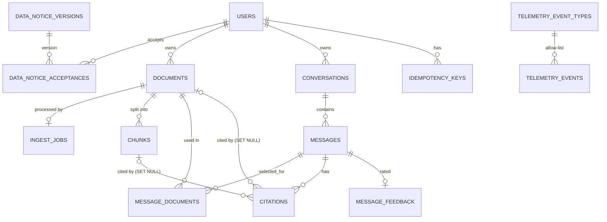

# Thiết kế CSDL quan hệ (SQL) — Công cụ “Chat với tài liệu”

**Số tài liệu / Phiên bản:** DB-SQL-DOCCHAT-001 / v0.1 — Bản nháp
**Ngày lập:** 2026-10-21
**Nền tảng:** PostgreSQL 16 (+ extension `vector`/pgvector — phần vector chi tiết ở [Database_Design_VectorDB.md](Database_Design_VectorDB.md))
**Nguồn đầu vào:** [PRD.md](../requirements/PRD.md), [BRD.md](../requirements/BRD.md), [SAD.md](SAD.md), [API_Design.md](API_Design.md), [UIUX_Blueprint_SDD.md](UIUX_Blueprint_SDD.md); prompt [databaseDesign_SQL_prompt.md](../../design/databaseDesign_SQL_prompt.md)

> **Quy ước:** **[Đề xuất]** = quyết định thiết kế cần xác nhận; **[TBD: OQ-xxx]** = câu hỏi mở kế thừa, không phải quyết định. Các số liệu quy mô là ước lượng khởi điểm cho MVP.
> **Lựa chọn loại CSDL:** BRD/PRD không yêu cầu NoSQL hay đồ thị. Dữ liệu có quan hệ rõ (người dùng → tài liệu → chunk → trích dẫn), cần ACID và xóa cascade ⇒ **PostgreSQL** (cả dữ liệu quan hệ lẫn vector). Hai prompt `databaseDesign_NoSQL` và `databaseDesign_GraphrDB` không áp dụng cho MVP (SAD ADR-02).

---

## 1. Yêu cầu

### 1.1 Yêu cầu nghiệp vụ → dữ liệu
| Yêu cầu | Dữ liệu cần lưu |
|---|---|
| BR-001 / US-101…103 Tải, liệt kê, xóa PDF | `documents`, `ingest_jobs`, tệp gốc ở object storage (`storage_key`) |
| BR-002, BR-003 / US-201…203 Hỏi đáp | `conversations`, `messages`, `message_documents`, `chunks` |
| US-301, US-302 Nguồn dẫn | `citations` (tham chiếu `chunks`) |
| US-401 Thông báo dữ liệu | `data_notice_versions`, `data_notice_acceptances` |
| US-402 Cô lập người dùng | `user_id` trên mọi bảng dữ liệu + Row-Level Security |
| US-403 Nhật ký (P1) | `audit_log` (chỉ thêm) |
| US-501, US-502 Đo lường, phản hồi | `telemetry_events`, `message_feedback`, view `vw_mvp_metrics` |
| PRD 5.1 Kill switch, giới hạn | `app_config` |

### 1.2 Khối lượng và hiệu năng [Đề xuất]
| Tham số | Ước lượng | Ghi chú |
|---|---|---|
| Người dùng | ≤ 50 (thử nghiệm) | `OQ-006` |
| Tài liệu / người dùng | ≤ 50; ≤ 10 dùng trong một câu hỏi | PRD 5.1 |
| Chunk / tài liệu | ~300 (100 trang × 3) | `OQ-008` |
| Tổng chunk | ≤ 750k | 50 × 50 × 300 |
| Dung lượng chunk (text ~3 KB + vector 4 KB) | ≈ 5 GB + chỉ mục HNSW | Xem Vector DB 4.3 |
| Tin nhắn | ≤ 200k/năm | — |
| Telemetry | ≤ 50 sự kiện/người/phiên | — |
| Truy vấn | Truy xuất top-k ≤ 300ms p95; CRUD ≤ 50ms p95 | Góp vào token đầu ≤ 5s |
| Sao lưu | Hằng ngày + WAL liên tục (RPO ≤ 15 phút) | `OQ-011` |
| Lưu giữ | Tài liệu/chunk: đến khi xóa hoặc hết hạn `[TBD: OQ-012]`; audit: dài hạn | — |

### 1.3 Bảo mật
- Mã hóa: TLS tới DB; mã hóa đĩa AES-256 (at-rest).
- Cô lập: `user_id` + RLS (SAD ADR-07); vai trò DB tách biệt (`app_api`, `app_worker`, `app_report`, `migrator`).
- Không lưu nội dung câu hỏi/tài liệu trong `telemetry_events`/`audit_log`.
- Audit: bảng chỉ thêm, chặn UPDATE/DELETE bằng trigger.

---

## 2. Mô hình thực thể – quan hệ



| Quan hệ | Bản số | Ràng buộc tham chiếu |
|---|---|---|
| users — documents | 1 : 0..* | `ON DELETE CASCADE` |
| documents — chunks | 1 : 0..* | `ON DELETE CASCADE` (xóa tài liệu ⇒ xóa luôn vector) |
| documents — ingest_jobs | 1 : 0..1 | `ON DELETE CASCADE` |
| conversations — messages | 1 : 0..* | `ON DELETE CASCADE` |
| messages — citations | 1 : 0..* | `ON DELETE CASCADE` |
| citations — chunks / documents | n : 0..1 | `ON DELETE SET NULL` ⇒ `valid=false` (“Nguồn không còn khả dụng”) |
| messages — documents | n : n | bảng nối `message_documents`, cascade hai phía |
| messages — message_feedback | 1 : 0..1 | `ON DELETE CASCADE` |

---

## 3. Quy ước đặt tên [Đề xuất]
| Đối tượng | Quy ước | Ví dụ |
|---|---|---|
| Bảng | `snake_case`, số nhiều | `documents` |
| Cột | `snake_case`, số ít | `page_start` |
| Khóa chính | `id` (UUID v4; `bigserial` cho bảng log) | `id` |
| Khóa ngoại | `{bảng_đơn}_id` | `document_id` |
| Chỉ mục | `idx_{bảng}_{cột}` | `idx_documents_user_status` |
| View | `vw_{mục_đích}` | `vw_mvp_metrics` |
| Hàm | `fn_{hành_động}_{đối_tượng}` | `fn_search_chunks` |
| Trigger | `trg_{bảng}_{hành_động}_{thời_điểm}` | `trg_documents_delete_before` |
| Charset / Collation | UTF-8; `und-x-icu` hoặc mặc định `C.UTF-8` | Hỗ trợ tiếng Việt đầy đủ |

---

## 4. Định nghĩa bảng (DDL)

Toàn bộ script nằm trong schema `docchat`. Thứ tự chạy: 4.1 → 4.2 → … → 8 (xem mục 11, migration).

### 4.1 Khởi tạo, kiểu và tiện ích

```sql
CREATE EXTENSION IF NOT EXISTS vector;          -- pgvector (>= 0.7)
CREATE SCHEMA IF NOT EXISTS docchat;
SET search_path = docchat, public;

CREATE TYPE document_status AS ENUM ('processing', 'ready', 'error');   -- 'uploading'/'upload_failed' chỉ tồn tại ở client
CREATE TYPE message_role    AS ENUM ('user', 'ai');
CREATE TYPE message_status  AS ENUM ('sending', 'streaming', 'complete', 'interrupted', 'failed', 'stopped');
CREATE TYPE job_status      AS ENUM ('queued', 'running', 'done', 'failed');
CREATE TYPE feedback_rating AS ENUM ('up', 'down');
CREATE TYPE user_role       AS ENUM ('user', 'evaluator', 'ops');

-- ID người dùng của giao dịch hiện tại (API/worker đặt bằng SET LOCAL app.user_id = '<uuid>')
CREATE FUNCTION fn_app_user_id() RETURNS uuid
LANGUAGE sql STABLE AS $$ SELECT NULLIF(current_setting('app.user_id', true), '')::uuid $$;

CREATE FUNCTION fn_touch_updated_at() RETURNS trigger
LANGUAGE plpgsql AS $$ BEGIN NEW.updated_at := now(); RETURN NEW; END $$;
```

### 4.2 Người dùng, thông báo dữ liệu, cấu hình

```sql
CREATE TABLE users (
    id               uuid PRIMARY KEY DEFAULT gen_random_uuid(),
    external_subject text        NOT NULL,                    -- `sub` của IdP [TBD: OQ-014]
    role             user_role   NOT NULL DEFAULT 'user',
    created_at       timestamptz NOT NULL DEFAULT now(),
    last_seen_at     timestamptz,
    CONSTRAINT uq_users_external_subject UNIQUE (external_subject)
);

CREATE TABLE data_notice_versions (
    version      text        PRIMARY KEY,                     -- ví dụ '2026-10-v1'
    content      text        NOT NULL,                        -- nội dung [TBD: OQ-012/013]
    published_at timestamptz NOT NULL DEFAULT now(),
    is_current   boolean     NOT NULL DEFAULT false
);
CREATE UNIQUE INDEX uq_data_notice_current ON data_notice_versions (is_current) WHERE is_current;

CREATE TABLE data_notice_acceptances (
    user_id    uuid        NOT NULL REFERENCES users(id) ON DELETE CASCADE,
    version    text        NOT NULL REFERENCES data_notice_versions(version),
    accepted_at timestamptz NOT NULL DEFAULT now(),
    PRIMARY KEY (user_id, version)
);

CREATE TABLE app_config (
    key        text        PRIMARY KEY,
    value      jsonb       NOT NULL,
    updated_at timestamptz NOT NULL DEFAULT now(),
    updated_by uuid
);
CREATE TRIGGER trg_app_config_touch_before BEFORE UPDATE ON app_config
    FOR EACH ROW EXECUTE FUNCTION fn_touch_updated_at();
```

### 4.3 Tài liệu và hàng đợi xử lý

```sql
CREATE TABLE documents (
    id               uuid PRIMARY KEY DEFAULT gen_random_uuid(),
    user_id          uuid            NOT NULL REFERENCES users(id) ON DELETE CASCADE,
    name             text            NOT NULL CHECK (char_length(name) BETWEEN 1 AND 255),
    size_bytes       bigint          NOT NULL CHECK (size_bytes > 0),
    page_count       integer         CHECK (page_count > 0),
    status           document_status NOT NULL DEFAULT 'processing',
    error_code       text,                                   -- PDF_PASSWORD | PDF_CORRUPT | NO_TEXT | ...
    storage_key      text            NOT NULL,               -- khóa trong object storage
    content_sha256   char(64),
    uploaded_at      timestamptz     NOT NULL DEFAULT now(),
    processed_at     timestamptz,
    CONSTRAINT uq_documents_storage_key UNIQUE (storage_key),
    CONSTRAINT ck_documents_error CHECK ((status = 'error') = (error_code IS NOT NULL)),
    CONSTRAINT ck_documents_ready CHECK (status <> 'ready' OR (page_count IS NOT NULL AND processed_at IS NOT NULL))
);
CREATE INDEX idx_documents_user_uploaded ON documents (user_id, uploaded_at DESC);
CREATE INDEX idx_documents_user_status   ON documents (user_id, status);

CREATE TABLE ingest_jobs (
    id            bigserial PRIMARY KEY,
    document_id   uuid        NOT NULL REFERENCES documents(id) ON DELETE CASCADE,
    status        job_status  NOT NULL DEFAULT 'queued',
    attempts      integer     NOT NULL DEFAULT 0 CHECK (attempts >= 0),
    run_after     timestamptz NOT NULL DEFAULT now(),
    locked_at     timestamptz,
    locked_by     text,
    last_error    text,                                      -- chỉ mã lỗi, KHÔNG nội dung tài liệu
    created_at    timestamptz NOT NULL DEFAULT now(),
    CONSTRAINT uq_ingest_jobs_document UNIQUE (document_id)
);
CREATE INDEX idx_ingest_jobs_queue ON ingest_jobs (run_after, id) WHERE status = 'queued';

CREATE TABLE idempotency_keys (
    user_id     uuid        NOT NULL REFERENCES users(id) ON DELETE CASCADE,
    scope       text        NOT NULL,                        -- 'document_upload' | 'conversation_create' | 'message_create'
    key         uuid        NOT NULL,
    resource_id uuid        NOT NULL,
    created_at  timestamptz NOT NULL DEFAULT now(),
    PRIMARY KEY (user_id, scope, key)
);
CREATE INDEX idx_idempotency_created ON idempotency_keys (created_at);
```

### 4.4 Chunk và embedding

```sql
-- Chiều vector (1024) là tham số theo mô hình embedding [TBD: OQ-008, OQ-012]; đổi mô hình ⇒ migration + re-embed.
CREATE TABLE chunks (
    id          uuid PRIMARY KEY DEFAULT gen_random_uuid(),
    document_id uuid         NOT NULL REFERENCES documents(id) ON DELETE CASCADE,
    user_id     uuid         NOT NULL REFERENCES users(id) ON DELETE CASCADE,   -- phi chuẩn hóa để lọc/RLS nhanh
    ordinal     integer      NOT NULL CHECK (ordinal >= 0),
    page_start  integer      NOT NULL CHECK (page_start >= 1),
    page_end    integer      NOT NULL,
    text        text         NOT NULL CHECK (char_length(text) > 0),
    token_count integer      NOT NULL CHECK (token_count > 0),
    embedding   vector(1024) NOT NULL,
    embedding_model text     NOT NULL,                      -- tên + phiên bản mô hình đã tạo vector (phục vụ re-embed)
    created_at  timestamptz  NOT NULL DEFAULT now(),
    CONSTRAINT uq_chunks_doc_ordinal UNIQUE (document_id, ordinal),
    CONSTRAINT ck_chunks_pages CHECK (page_end >= page_start)
);
CREATE INDEX idx_chunks_user_document ON chunks (user_id, document_id);
CREATE INDEX idx_chunks_embedding_hnsw ON chunks USING hnsw (embedding vector_cosine_ops) WITH (m = 16, ef_construction = 64);
-- Chi tiết điều chỉnh (ef_search, iterative scan, lọc theo user/document): xem Database_Design_VectorDB.md
```

### 4.5 Hội thoại, tin nhắn, trích dẫn, phản hồi

```sql
CREATE TABLE conversations (
    id               uuid PRIMARY KEY DEFAULT gen_random_uuid(),
    user_id          uuid        NOT NULL REFERENCES users(id) ON DELETE CASCADE,
    created_at       timestamptz NOT NULL DEFAULT now(),
    last_activity_at timestamptz NOT NULL DEFAULT now()
);
CREATE INDEX idx_conversations_user_activity ON conversations (user_id, last_activity_at DESC);

CREATE TABLE messages (
    id                uuid PRIMARY KEY DEFAULT gen_random_uuid(),
    conversation_id   uuid           NOT NULL REFERENCES conversations(id) ON DELETE CASCADE,
    user_id           uuid           NOT NULL REFERENCES users(id) ON DELETE CASCADE,
    role              message_role   NOT NULL,
    text              text           NOT NULL DEFAULT '',
    status            message_status NOT NULL,
    grounded          boolean,                                   -- chỉ có nghĩa với role='ai'
    parent_message_id uuid           REFERENCES messages(id) ON DELETE SET NULL,  -- câu hỏi mà câu trả lời này đáp
    client_message_id uuid,
    error_code        text,
    created_at        timestamptz    NOT NULL DEFAULT now(),
    completed_at      timestamptz,
    CONSTRAINT uq_messages_client UNIQUE (conversation_id, client_message_id),
    CONSTRAINT ck_messages_grounded CHECK (role = 'ai' OR grounded IS NULL),
    CONSTRAINT ck_messages_text_len CHECK (char_length(text) <= 20000)
);
CREATE INDEX idx_messages_conversation_created ON messages (conversation_id, created_at);
CREATE INDEX idx_messages_user ON messages (user_id);

CREATE TABLE message_documents (                                  -- tài liệu được chọn cho câu hỏi (selected_for)
    message_id  uuid NOT NULL REFERENCES messages(id)  ON DELETE CASCADE,
    document_id uuid NOT NULL REFERENCES documents(id) ON DELETE CASCADE,
    user_id     uuid NOT NULL REFERENCES users(id)     ON DELETE CASCADE,
    PRIMARY KEY (message_id, document_id)
);
CREATE INDEX idx_message_documents_document ON message_documents (document_id);

CREATE TABLE citations (
    id            uuid PRIMARY KEY DEFAULT gen_random_uuid(),
    message_id    uuid    NOT NULL REFERENCES messages(id) ON DELETE CASCADE,
    user_id       uuid    NOT NULL REFERENCES users(id)    ON DELETE CASCADE,
    ordinal       integer NOT NULL CHECK (ordinal >= 1),        -- nhãn [S1], [S2]…
    document_id   uuid    REFERENCES documents(id) ON DELETE SET NULL,
    chunk_id      uuid    REFERENCES chunks(id)    ON DELETE SET NULL,
    document_name text,                                          -- bản chụp để hiển thị; bị xóa (NULL) khi tài liệu bị xóa
    page          integer NOT NULL CHECK (page >= 1),
    valid         boolean GENERATED ALWAYS AS (chunk_id IS NOT NULL) STORED,
    CONSTRAINT uq_citations_message_ordinal UNIQUE (message_id, ordinal)
);
CREATE INDEX idx_citations_message  ON citations (message_id);
CREATE INDEX idx_citations_document ON citations (document_id) WHERE document_id IS NOT NULL;
CREATE INDEX idx_citations_chunk    ON citations (chunk_id)    WHERE chunk_id    IS NOT NULL;

CREATE TABLE message_feedback (
    message_id  uuid PRIMARY KEY REFERENCES messages(id) ON DELETE CASCADE,
    user_id     uuid            NOT NULL REFERENCES users(id) ON DELETE CASCADE,
    rating      feedback_rating NOT NULL,
    reason_code text,
    created_at  timestamptz     NOT NULL DEFAULT now()
);
```

> Snippet không được sao chép vào `citations`: nội dung đọc qua `JOIN chunks`. Khi tài liệu bị xóa, `chunk_id` thành `NULL` ⇒ `valid=false` và không còn nội dung nào sót lại (US-103, RSK-002).

### 4.6 Telemetry và nhật ký kiểm toán

```sql
CREATE TABLE telemetry_event_types (                              -- allow-list (PRD 5.2, Blueprint 3.6)
    name          text PRIMARY KEY,
    allowed_props text[] NOT NULL                                  -- thuộc tính được phép
);

CREATE TABLE telemetry_events (
    id          bigserial PRIMARY KEY,
    ts          timestamptz NOT NULL,
    received_at timestamptz NOT NULL DEFAULT now(),
    name        text        NOT NULL REFERENCES telemetry_event_types(name),
    user_hash   char(64)    NOT NULL,                              -- băm một chiều có muối, không phải user_id
    session_id  uuid        NOT NULL,
    app_version text        NOT NULL,
    props       jsonb       NOT NULL DEFAULT '{}'::jsonb,
    CONSTRAINT ck_telemetry_props_size CHECK (pg_column_size(props) <= 2048)
);
CREATE INDEX idx_telemetry_name_ts ON telemetry_events (name, ts);
CREATE INDEX idx_telemetry_session ON telemetry_events (session_id, ts);

CREATE TYPE audit_action AS ENUM ('notice_accepted', 'document_uploaded', 'document_deleted');

CREATE TABLE audit_log (
    id        bigserial PRIMARY KEY,
    ts        timestamptz  NOT NULL DEFAULT now(),
    user_id   uuid         NOT NULL,                               -- cố ý KHÔNG có FK: giữ vết sau khi người dùng bị xóa
    action    audit_action NOT NULL,
    entity_id uuid,
    metadata  jsonb        NOT NULL DEFAULT '{}'::jsonb            -- chỉ kích thước/thời điểm; KHÔNG tên tệp hay nội dung
);
CREATE INDEX idx_audit_user_ts ON audit_log (user_id, ts);
```

---

## 5. Cô lập dữ liệu: Row-Level Security và vai trò

```sql
CREATE ROLE app_api    NOLOGIN;   -- dịch vụ API (đăng nhập qua vai trò con có mật khẩu/khóa)
CREATE ROLE app_worker NOLOGIN;   -- ingestion worker
CREATE ROLE app_report NOLOGIN;   -- báo cáo MET-001/002
-- migrator là chủ sở hữu bảng, chỉ dùng khi chạy migration

GRANT USAGE ON SCHEMA docchat TO app_api, app_worker, app_report;

-- Quyền theo bảng (tối thiểu cần thiết)
GRANT SELECT, INSERT, UPDATE ON users                        TO app_api;
GRANT SELECT                  ON data_notice_versions        TO app_api;
GRANT SELECT, INSERT          ON data_notice_acceptances     TO app_api;
GRANT SELECT                  ON app_config                  TO app_api, app_worker;
GRANT UPDATE                  ON app_config                  TO app_api;           -- kill switch: chỉ vai trò ops ở tầng ứng dụng
GRANT SELECT, INSERT, DELETE  ON documents                   TO app_api;
GRANT SELECT, UPDATE          ON documents                   TO app_worker;
GRANT SELECT, INSERT          ON ingest_jobs                 TO app_api;
GRANT SELECT, UPDATE          ON ingest_jobs                 TO app_worker;
GRANT SELECT, INSERT, DELETE  ON idempotency_keys            TO app_api;
GRANT SELECT                  ON chunks                      TO app_api;
GRANT SELECT, INSERT, DELETE  ON chunks                      TO app_worker;
GRANT SELECT, INSERT, UPDATE  ON conversations, messages     TO app_api;
GRANT SELECT, INSERT          ON message_documents, citations TO app_api;
GRANT UPDATE (document_name)  ON citations                   TO app_api;           -- trigger xóa tài liệu xóa tên tệp khỏi citations
GRANT SELECT, INSERT, UPDATE  ON message_feedback            TO app_api;
GRANT INSERT                  ON telemetry_events            TO app_api;
GRANT SELECT                  ON telemetry_event_types       TO app_api;
GRANT INSERT                  ON audit_log                   TO app_api, app_worker;
GRANT USAGE, SELECT ON ALL SEQUENCES IN SCHEMA docchat       TO app_api, app_worker;

-- Bật RLS (kể cả với chủ sở hữu)
DO $$
DECLARE t text;
BEGIN
  FOREACH t IN ARRAY ARRAY['documents','chunks','conversations','messages','message_documents','citations','message_feedback','idempotency_keys']
  LOOP
    EXECUTE format('ALTER TABLE %I ENABLE ROW LEVEL SECURITY', t);
    EXECUTE format('ALTER TABLE %I FORCE ROW LEVEL SECURITY',  t);
    EXECUTE format('CREATE POLICY p_%1$s_owner ON %1$I TO app_api USING (user_id = fn_app_user_id()) WITH CHECK (user_id = fn_app_user_id())', t);
  END LOOP;
END $$;

-- Worker xử lý tài liệu của mọi người dùng, nhưng chỉ trên các bảng cần thiết
CREATE POLICY p_documents_worker ON documents TO app_worker USING (true) WITH CHECK (true);
CREATE POLICY p_chunks_worker    ON chunks    TO app_worker USING (true) WITH CHECK (true);
-- ingest_jobs, telemetry_events, audit_log không có RLS: không cấp quyền cho vai trò không liên quan
```

Quy tắc ứng dụng: mỗi giao dịch của API bắt đầu bằng `SET LOCAL app.user_id = '<uuid từ JWT>'`; quên đặt ⇒ `fn_app_user_id()` trả `NULL` ⇒ không thấy dòng nào (an toàn theo mặc định). Kiểm thử bắt buộc: hai người dùng A, B (US-402).

---

## 6. Quan hệ và hành động tham chiếu (tổng hợp)

| FK | Hành động | Lý do |
|---|---|---|
| `documents.user_id → users` | CASCADE | Xóa người dùng ⇒ xóa dữ liệu |
| `chunks.document_id → documents` | CASCADE | Xóa tài liệu ⇒ xóa vector |
| `ingest_jobs.document_id → documents` | CASCADE | Dọn hàng đợi |
| `messages.conversation_id → conversations` | CASCADE | — |
| `citations.message_id → messages` | CASCADE | — |
| `citations.chunk_id / document_id` | SET NULL | Giữ lịch sử trả lời, đánh dấu nguồn không còn |
| `messages.parent_message_id` | SET NULL | — |
| `data_notice_acceptances.version` | RESTRICT (mặc định) | Không xóa phiên bản đã có xác nhận |
| `telemetry_events.name` | RESTRICT | Chỉ sự kiện trong allow-list |

---

## 7. Chỉ mục và hiệu năng

| Chỉ mục | Phục vụ truy vấn | Ghi chú |
|---|---|---|
| `idx_documents_user_uploaded (user_id, uploaded_at DESC)` | `GET /documents` | Sắp xếp mới nhất lên đầu (Blueprint 3.4) |
| `idx_documents_user_status` | Đếm tệp `ready` | Composer bật/tắt |
| `idx_ingest_jobs_queue` (partial) | Worker nhận việc | `FOR UPDATE SKIP LOCKED` |
| `idx_chunks_user_document` | Lọc trước/sau khi ANN | Kết hợp HNSW, xem Vector DB |
| `idx_chunks_embedding_hnsw` | Tìm vector gần nhất (cosine) | `m=16, ef_construction=64` |
| `idx_messages_conversation_created` | Tải hội thoại | — |
| `idx_citations_*` (partial) | Xóa/vô hiệu hóa nguồn | — |
| `idx_telemetry_name_ts` | Báo cáo phễu, MET | — |

Chiến lược: không dùng full-text index trong MVP (truy xuất bằng vector). Nếu cần tìm kiếm lai (hybrid) sau này: thêm cột `tsvector` + GIN trên `chunks.text` (xem Vector DB mục 9).

---

## 8. View, hàm, trigger

### 8.1 View

```sql
-- Danh sách tài liệu cho UI (RLS tự áp dụng khi truy vấn qua app_api)
CREATE VIEW vw_document_overview WITH (security_invoker = true) AS
SELECT d.id, d.user_id, d.name, d.size_bytes, d.uploaded_at, d.status, d.page_count, d.error_code
FROM documents d;

-- Tác vụ thử nghiệm để tính MET-001 / MET-002 (PRD 5.2: task_marked_done)
CREATE VIEW vw_met_tasks AS
SELECT props->>'task_id'                AS task_id,
       user_hash,
       (props->>'elapsed_ms')::bigint   AS elapsed_ms,
       (props->>'success')::boolean     AS success,
       ts
FROM telemetry_events
WHERE name = 'task_marked_done';

-- Báo cáo MVP: trung vị thời gian tác vụ thành công (MET-001) và tỷ lệ thành công (MET-002)
CREATE VIEW vw_mvp_metrics AS
SELECT count(*)                                                             AS tasks_total,
       count(*) FILTER (WHERE success)                                      AS tasks_success,
       round(100.0 * count(*) FILTER (WHERE success) / NULLIF(count(*), 0), 1) AS met002_success_pct,
       percentile_cont(0.5) WITHIN GROUP (ORDER BY elapsed_ms) FILTER (WHERE success) AS met001_median_ms
FROM vw_met_tasks;

-- Phễu chính theo PRD 5.2
CREATE VIEW vw_funnel AS
SELECT name, count(DISTINCT session_id) AS sessions
FROM telemetry_events
WHERE name IN ('session_started','data_notice_accepted','upload_succeeded','document_ready','question_submitted','answer_completed','citation_opened')
GROUP BY name;

GRANT SELECT ON vw_met_tasks, vw_mvp_metrics, vw_funnel TO app_report;
```

> `vw_mvp_metrics` chỉ có ý nghĩa sau khi định nghĩa “thành công”, baseline và cách lấy mẫu được duyệt (`OQ-005`); nếu chưa, báo cáo phải ghi “chưa thể kết luận” (AC-004).

### 8.2 Hàm

```sql
-- Nhận một việc trong hàng đợi (worker); an toàn khi nhiều worker chạy song song
CREATE FUNCTION fn_claim_ingest_job(p_worker text) RETURNS SETOF ingest_jobs
LANGUAGE sql AS $$
  WITH c AS (
    SELECT id FROM ingest_jobs
    WHERE status = 'queued' AND run_after <= now()
    ORDER BY id
    FOR UPDATE SKIP LOCKED
    LIMIT 1
  )
  UPDATE ingest_jobs j
     SET status = 'running', locked_at = now(), locked_by = p_worker, attempts = j.attempts + 1
    FROM c
   WHERE j.id = c.id
  RETURNING j.*;
$$;

-- Tìm top-k chunk gần nhất trong phạm vi người dùng/tài liệu; loại kết quả dưới ngưỡng
-- SECURITY INVOKER: RLS của app_api vẫn áp dụng; p_user_id chỉ để lọc tường minh và dùng chỉ mục
CREATE FUNCTION fn_search_chunks(
    p_user_id   uuid,
    p_query     vector(1024),
    p_doc_ids   uuid[],
    p_k         integer DEFAULT 8,
    p_min_score double precision DEFAULT 0.0
) RETURNS TABLE (chunk_id uuid, document_id uuid, document_name text, page_start integer, page_end integer, text text, score double precision)
LANGUAGE sql STABLE AS $$
  SELECT * FROM (
    SELECT c.id, c.document_id, d.name, c.page_start, c.page_end, c.text,
           1 - (c.embedding <=> p_query) AS score
      FROM chunks c
      JOIN documents d ON d.id = c.document_id AND d.status = 'ready'
     WHERE c.user_id = p_user_id
       AND (p_doc_ids IS NULL OR c.document_id = ANY (p_doc_ids))
     ORDER BY c.embedding <=> p_query
     LIMIT p_k
  ) r
  WHERE r.score >= p_min_score;
$$;

-- Xóa tài liệu hết hạn theo chính sách lưu giữ [TBD: OQ-012]
CREATE FUNCTION fn_purge_expired_documents(p_retention interval) RETURNS integer
LANGUAGE plpgsql AS $$
DECLARE n integer;
BEGIN
  WITH del AS (DELETE FROM documents WHERE uploaded_at < now() - p_retention RETURNING id)
  SELECT count(*) INTO n FROM del;      -- trigger trg_documents_delete_before tự ghi audit 'document_deleted'
  RETURN n;   -- API/worker xóa tiếp các PDF gốc tương ứng ở object storage
END $$;

CREATE FUNCTION fn_purge_idempotency_keys() RETURNS integer
LANGUAGE plpgsql AS $$
DECLARE n integer;
BEGIN
  DELETE FROM idempotency_keys WHERE created_at < now() - interval '24 hours';
  GET DIAGNOSTICS n = ROW_COUNT;
  RETURN n;
END $$;
```

> Với vai trò `app_api`, `fn_purge_expired_documents` cần chạy bởi tác vụ định kỳ dưới vai trò riêng có quyền xóa xuyên người dùng (ví dụ `app_worker` được cấp thêm `DELETE ON documents` và `p_documents_worker`). Lịch chạy và `p_retention` do `OQ-012` quyết định.

### 8.3 Trigger

```sql
-- (1) Xóa tài liệu: xóa tên tệp khỏi citations (chunk_id/document_id tự về NULL nhờ FK) và ghi audit
CREATE FUNCTION fn_documents_delete_before() RETURNS trigger
LANGUAGE plpgsql AS $$
BEGIN
  UPDATE citations SET document_name = NULL WHERE document_id = OLD.id;
  INSERT INTO audit_log (user_id, action, entity_id, metadata)
  VALUES (OLD.user_id, 'document_deleted', OLD.id, jsonb_build_object('size_bytes', OLD.size_bytes, 'status', OLD.status));
  RETURN OLD;
END $$;
CREATE TRIGGER trg_documents_delete_before BEFORE DELETE ON documents
    FOR EACH ROW EXECUTE FUNCTION fn_documents_delete_before();

-- (2) Ghi audit khi tải lên
CREATE FUNCTION fn_documents_insert_after() RETURNS trigger
LANGUAGE plpgsql AS $$
BEGIN
  INSERT INTO audit_log (user_id, action, entity_id, metadata)
  VALUES (NEW.user_id, 'document_uploaded', NEW.id, jsonb_build_object('size_bytes', NEW.size_bytes));
  RETURN NEW;
END $$;
CREATE TRIGGER trg_documents_insert_after AFTER INSERT ON documents
    FOR EACH ROW EXECUTE FUNCTION fn_documents_insert_after();

-- (3) Ghi audit khi xác nhận thông báo
CREATE FUNCTION fn_notice_accept_after() RETURNS trigger
LANGUAGE plpgsql AS $$
BEGIN
  INSERT INTO audit_log (user_id, action, metadata) VALUES (NEW.user_id, 'notice_accepted', jsonb_build_object('version', NEW.version));
  RETURN NEW;
END $$;
CREATE TRIGGER trg_notice_acceptances_insert_after AFTER INSERT ON data_notice_acceptances
    FOR EACH ROW EXECUTE FUNCTION fn_notice_accept_after();

-- (4) Audit chỉ thêm
CREATE FUNCTION fn_audit_immutable() RETURNS trigger
LANGUAGE plpgsql AS $$ BEGIN RAISE EXCEPTION 'audit_log is append-only'; END $$;
CREATE TRIGGER trg_audit_log_mutate_before BEFORE UPDATE OR DELETE ON audit_log
    FOR EACH ROW EXECUTE FUNCTION fn_audit_immutable();

-- (5) Cập nhật hoạt động hội thoại
CREATE FUNCTION fn_messages_insert_after() RETURNS trigger
LANGUAGE plpgsql AS $$
BEGIN
  UPDATE conversations SET last_activity_at = now() WHERE id = NEW.conversation_id;
  RETURN NEW;
END $$;
CREATE TRIGGER trg_messages_insert_after AFTER INSERT ON messages
    FOR EACH ROW EXECUTE FUNCTION fn_messages_insert_after();

-- (6) Kiểm tra allow-list thuộc tính telemetry (phòng thủ nhiều lớp; ứng dụng đã lọc trước)
CREATE FUNCTION fn_telemetry_props_check() RETURNS trigger
LANGUAGE plpgsql AS $$
DECLARE allowed text[]; bad text;
BEGIN
  SELECT allowed_props INTO allowed FROM telemetry_event_types WHERE name = NEW.name;
  SELECT k INTO bad FROM jsonb_object_keys(NEW.props) AS k WHERE k <> ALL (allowed) LIMIT 1;
  IF bad IS NOT NULL THEN
    RAISE EXCEPTION 'telemetry property % not allowed for event %', bad, NEW.name USING ERRCODE = 'check_violation';
  END IF;
  RETURN NEW;
END $$;
CREATE TRIGGER trg_telemetry_events_insert_before BEFORE INSERT ON telemetry_events
    FOR EACH ROW EXECUTE FUNCTION fn_telemetry_props_check();
```

Lưu ý: audit trigger (1) ghi `audit_log` dưới quyền của người gọi; do `app_api` có `INSERT` trên `audit_log` nên hợp lệ. Xóa tài liệu cũng cần xóa PDF gốc ở object storage — thực hiện ở tầng ứng dụng sau khi giao dịch DB commit (xóa mềm trạng thái không dùng).

---

## 9. Kiểu dữ liệu và ràng buộc — giải thích lựa chọn
| Quyết định | Lý do |
|---|---|
| UUID v4 cho khóa chính tài nguyên công khai | Không đoán được ID (US-402); `gen_random_uuid()` tích hợp từ PG13 |
| `bigserial` cho `ingest_jobs`, `telemetry_events`, `audit_log` | Ghi tuần tự tốc độ cao, không lộ ra API |
| `timestamptz` | Tránh nhầm múi giờ; lưu UTC |
| `ENUM` cho trạng thái | Khớp máy trạng thái trong Blueprint 3.7; thêm giá trị bằng `ALTER TYPE … ADD VALUE` |
| `text` thay vì `varchar(n)` | PostgreSQL không có lợi thế `varchar`; giới hạn bằng `CHECK` |
| `CHECK (status='error') = (error_code IS NOT NULL)` | Đảm bảo lỗi luôn có mã để UI hiển thị lý do |
| `citations.valid` là cột sinh | Không thể sai lệch với `chunk_id` |
| Cột `user_id` phi chuẩn hóa ở `chunks`, `citations`… | Áp RLS và lọc ANN không cần JOIN |
| `audit_log` không FK | Giữ vết khi dữ liệu liên quan bị xóa (nhưng không chứa nội dung) |

---

## 10. Dữ liệu khởi tạo (seed)

```sql
INSERT INTO telemetry_event_types (name, allowed_props) VALUES
 ('session_started',            ARRAY['entry_source']),
 ('data_notice_accepted',       ARRAY['notice_version']),
 ('upload_started',             ARRAY['file_size','file_index']),
 ('upload_succeeded',           ARRAY['file_size','duration_ms']),
 ('upload_failed',              ARRAY['error_code','file_size']),
 ('document_ready',             ARRAY['page_count','processing_ms']),
 ('document_processing_failed', ARRAY['error_code']),
 ('document_deleted',           ARRAY['document_age_days']),
 ('question_submitted',         ARRAY['question_length','docs_selected_count']),
 ('answer_first_token',         ARRAY['latency_ms']),
 ('answer_completed',           ARRAY['total_ms','citation_count','grounded']),
 ('answer_failed',              ARRAY['error_code','stage']),
 ('answer_stopped',             ARRAY['elapsed_ms']),
 ('citation_opened',            ARRAY['citation_index']),
 ('answer_feedback',            ARRAY['rating','reason_code']),
 ('task_marked_done',           ARRAY['task_id','elapsed_ms','success']),
 ('copy_answer',                ARRAY['answer_id']);

-- Giá trị mặc định; con số thật phụ thuộc OQ-008/OQ-011/OQ-012
INSERT INTO app_config (key, value) VALUES
 ('qa_enabled',          'true'),
 ('max_file_size_bytes', '20971520'),      -- 20 MB   [TBD: OQ-008]
 ('max_files_per_user',  '50'),            --          [TBD: OQ-008]
 ('max_question_length', '2000'),          --          [TBD]
 ('accepted_types',      '["application/pdf"]'),
 ('retrieval_top_k',     '8'),
 ('retrieval_min_score', '0.30'),          -- hiệu chỉnh bằng bộ câu hỏi chuẩn [TBD: OQ-009]
 ('retention_days',      'null');          -- [TBD: OQ-012]

INSERT INTO data_notice_versions (version, content, is_current)
VALUES ('draft-0', 'Nội dung thông báo dữ liệu chờ phê duyệt của pháp chế/bảo mật [TBD: OQ-012, OQ-013].', true);
```

Dữ liệu mẫu cho kiểm thử (môi trường dev/staging; **không** dùng dữ liệu thật):
```sql
INSERT INTO users (id, external_subject, role) VALUES
 ('00000000-0000-0000-0000-0000000000a1', 'test|lan',  'user'),
 ('00000000-0000-0000-0000-0000000000b2', 'test|minh', 'evaluator'),
 ('00000000-0000-0000-0000-0000000000c3', 'test|ops',  'ops');

-- Bộ kiểm thử cô lập (US-402): đăng nhập Lan, tạo document; đặt app.user_id = Minh/Lan khác ⇒ SELECT phải trả 0 dòng
-- BEGIN; SET LOCAL ROLE app_api; SET LOCAL app.user_id = '00000000-0000-0000-0000-0000000000b2';
-- SELECT count(*) FROM documents;   -- kỳ vọng 0
```

---

## 11. Migration và phiên bản hóa

| Phiên bản | Nội dung | Công cụ [Đề xuất] |
|---|---|---|
| `V001__extensions_types.sql` | 4.1 | Alembic hoặc Flyway |
| `V002__core_tables.sql` | 4.2 – 4.6 | |
| `V003__rls_roles.sql` | Mục 5 | Chạy bởi `migrator` |
| `V004__views_functions_triggers.sql` | Mục 8 | |
| `V005__seed_reference.sql` | Mục 10 (chỉ bảng tham chiếu/cấu hình) | |
| `V006__vector_index_tuning.sql` | Điều chỉnh HNSW sau khi đo | Xem Vector DB |

Nguyên tắc: migration chỉ tiến (forward-only), mỗi bản chạy trong một giao dịch (trừ `CREATE INDEX CONCURRENTLY`); thay đổi chiều vector ⇒ bảng/cột mới + re-embed + chuyển đổi (không `ALTER` tại chỗ trên dữ liệu thật); mọi migration được chạy thử trên bản sao staging trước.

---

## 12. Quản trị cơ sở dữ liệu

### 12.1 Sao lưu & phục hồi
| Hạng mục | Cấu hình [Đề xuất] |
|---|---|
| Sao lưu đầy đủ | Hằng ngày (pg_basebackup hoặc snapshot) |
| WAL archiving | Liên tục; PITR trong 7 ngày; RPO ≤ 15 phút |
| Kiểm thử phục hồi | Hằng tháng trên staging; RTO mục tiêu ≤ 1 giờ `[TBD: OQ-011]` |
| Xóa dữ liệu & bản sao lưu | Thời hạn giữ bản sao lưu phải khớp chính sách xóa `[TBD: OQ-012]` |

### 12.2 Bảo trì
- `autovacuum` bật; điều chỉnh ngưỡng cho `chunks`, `telemetry_events`.
- `REINDEX CONCURRENTLY idx_chunks_embedding_hnsw` khi phân mảnh sau khi xóa nhiều tài liệu.
- Tác vụ định kỳ: `fn_purge_idempotency_keys()` (hằng giờ), `fn_purge_expired_documents()` (hằng ngày, khi có `retention_days`), `ANALYZE` sau ingest lớn.
- Phân vùng `telemetry_events` theo tháng nếu vượt ~10 triệu dòng (chưa cần cho MVP).

### 12.3 Truy vấn giám sát
```sql
-- Hàng đợi ingest tồn đọng và công việc kẹt
SELECT status, count(*), min(created_at) AS oldest FROM ingest_jobs GROUP BY status;
SELECT id, document_id, locked_by, locked_at FROM ingest_jobs WHERE status = 'running' AND locked_at < now() - interval '10 minutes';

-- Tài liệu theo trạng thái
SELECT status, count(*) FROM documents GROUP BY status;

-- Kích thước bảng và chỉ mục
SELECT relname, pg_size_pretty(pg_total_relation_size(oid)) AS total
FROM pg_class WHERE relnamespace = 'docchat'::regnamespace AND relkind = 'r' ORDER BY pg_total_relation_size(oid) DESC;

-- Truy vấn chậm (cần pg_stat_statements)
SELECT calls, round(mean_exec_time::numeric, 1) AS mean_ms, left(query, 80) AS q
FROM pg_stat_statements ORDER BY mean_exec_time DESC LIMIT 10;   -- chú ý: câu truy vấn đã tham số hóa, không chứa nội dung người dùng
```

### 12.4 Khuyến nghị điều chỉnh hiệu năng
- `shared_buffers` ≈ 25% RAM; `work_mem` vừa phải (tránh nhân với số kết nối); `maintenance_work_mem` lớn khi dựng HNSW.
- Dùng pooler (PgBouncer, chế độ transaction) — lưu ý `SET LOCAL app.user_id` hoạt động đúng trong chế độ transaction.
- `log_min_duration_statement = 500ms`; **tắt** `log_statement = 'all'` và không ghi tham số truy vấn (tránh lọt nội dung câu hỏi vào log — PRD 5.1).

---

## 13. Truy vết

| Story / yêu cầu | Phần tử CSDL |
|---|---|
| US-101, US-102 | `documents`, `ingest_jobs`, `idempotency_keys`, `idx_documents_user_uploaded` |
| US-103 | `ON DELETE CASCADE`, `trg_documents_delete_before`, `audit_log` |
| US-201…203 | `conversations`, `messages`, `message_documents`, `chunks`, `fn_search_chunks` |
| US-202 | `messages.grounded`, `app_config.retrieval_min_score` |
| US-301, US-302 | `citations` (cột sinh `valid`), JOIN `chunks` |
| US-401 | `data_notice_versions`, `data_notice_acceptances` |
| US-402 | `user_id` + RLS (mục 5), vai trò tách biệt |
| US-403 | `audit_log` |
| US-501 | `telemetry_events`, `telemetry_event_types`, `vw_mvp_metrics`, `vw_funnel` |
| US-502 | `message_feedback` |
| PRD 5.1 kill switch | `app_config.qa_enabled` |

## 14. Rủi ro và câu hỏi mở
| ID | Nội dung | Tác động | Liên kết |
|---|---|---|---|
| R-DB-01 | Thời hạn lưu/xóa, bản sao lưu | Giá trị `retention_days`, vòng đời `messages`/`conversations`, PITR | OQ-012 |
| R-DB-02 | Hội thoại lưu bền hay theo phiên | Có thể bỏ/rút ngắn vòng đời `conversations`, `messages` | OQ-012 |
| R-DB-03 | Mô hình embedding & chiều vector | Cột `vector(N)` và chỉ mục | OQ-008 |
| R-DB-04 | Cơ chế xác thực | Cột `users.external_subject`, vai trò | OQ-014 |
| R-DB-05 | Ngưỡng liên quan (`retrieval_min_score`) chưa hiệu chỉnh | Chất lượng “không tìm thấy” | OQ-009 |
| R-DB-06 | Định nghĩa MET-001/002 | `vw_mvp_metrics`, thuộc tính `task_marked_done` | OQ-005 |
