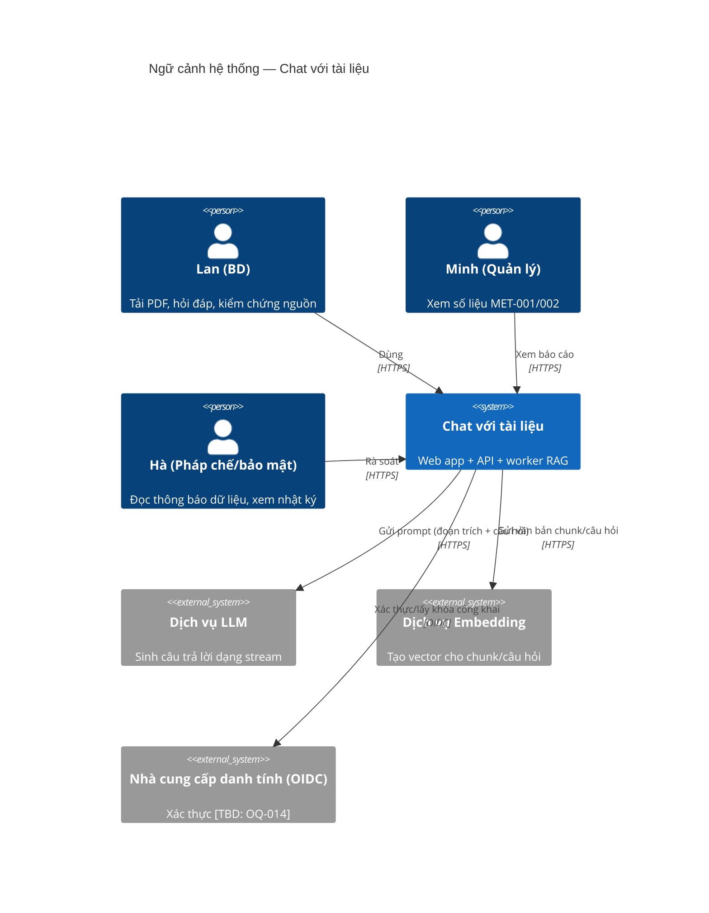
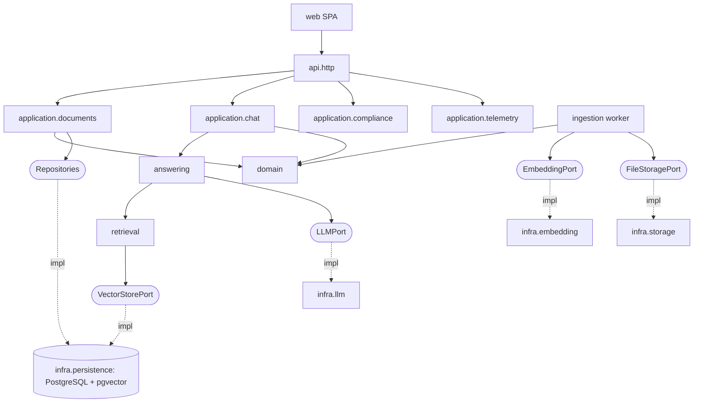

# Tài liệu mô tả kiến trúc phần mềm (SAD) — Công cụ “Chat với tài liệu”

**Chuẩn áp dụng:** IEEE 1016-2009 (Software Design Descriptions)
**Số tài liệu / Phiên bản:** SAD-DOCCHAT-001 / v0.1 — Bản nháp
**Ngày lập:** 2026-10-21
**Nguồn đầu vào:** [PRD.md](../requirements/PRD.md) (`PRD-DOCCHAT-001` v0.1), [BRD.md](../requirements/BRD.md) (`BRD-DOCCHAT-001` v0.1), [UIUX_Blueprint_SDD.md](UIUX_Blueprint_SDD.md) (`SDD-UIUX-DOCCHAT-001` v0.1); prompt [SAD_prompt.md](../../design/SAD_prompt.md), [SAD_Prompt_IEEE_standard.md](../../design/SAD_Prompt_IEEE_standard.md)

> **Quy ước:** **[Đề xuất]** = quyết định kiến trúc do tài liệu này đưa ra, cần Product Owner/Kiến trúc sư xác nhận. **[TBD: OQ-xxx]** = kế thừa từ câu hỏi mở của BRD/PRD, **không** phải quyết định. Mọi con số hiệu năng là ngưỡng khởi điểm [Đề xuất] (PRD 1.2, 5.1).
> Không có tài liệu Business Vision, Stakeholder Interviews, Technical Constraints, Existing Systems hay Regulatory trong repo; kiến trúc chỉ dựa trên BRD/PRD/Blueprint.

---

## 1. Giới thiệu

### 1.1 Mục đích
Xác định kiến trúc phần mềm của MVP “Chat với tài liệu”: người dùng tải PDF, hỏi bằng ngôn ngữ tự nhiên và nhận câu trả lời AI **có nguồn dẫn kiểm chứng được**. Tài liệu là cơ sở cho thiết kế chi tiết, API ([API_Design.md](API_Design.md)), CSDL ([Database_Design_SQL.md](Database_Design_SQL.md), [Database_Design_VectorDB.md](Database_Design_VectorDB.md)), triển khai và kiểm thử.

### 1.2 Phạm vi
- **Trong phạm vi:** các góc nhìn kiến trúc (module, component-connector, thông tin, tương tác, triển khai), quyết định kiến trúc và lý do, truy vết tới mối quan tâm/yêu cầu.
- **Ngoài phạm vi:** thiết kế UI chi tiết (xem Blueprint), kế hoạch kiểm thử, định dạng ngoài PDF, đồng bộ kho ngoài, báo cáo tự động, mobile-native/offline (BRD 4.5; PRD 0).

### 1.3 Đối tượng đọc
| Đối tượng | Mục đích | Mục nên đọc |
|---|---|---|
| Product Owner / BA | Xác nhận kiến trúc đáp ứng yêu cầu | 2, 5, 8 |
| Dev (FE/BE/AI) | Hướng dẫn triển khai | 3, 4 |
| QA | Lập kế hoạch kiểm thử, kịch bản chất lượng | 2.3, 5, 6 |
| DevOps/SRE | Triển khai, vận hành | 4.5, 6 |
| Bảo mật / pháp chế (Hà) | Rà soát cô lập, lưu/xóa dữ liệu | 5.1, 7 |

### 1.4 Thuật ngữ
| Thuật ngữ | Định nghĩa |
|---|---|
| RAG | Retrieval-Augmented Generation — truy xuất đoạn liên quan rồi nhờ LLM trả lời dựa trên đoạn đó |
| Chunk | Đoạn văn bản cắt từ PDF, kèm số trang, là đơn vị lập chỉ mục và trích dẫn |
| Embedding | Vector số biểu diễn ngữ nghĩa của chunk/câu hỏi |
| Grounded | Câu trả lời có căn cứ từ chunk truy xuất được |
| SSE | Server-Sent Events — kênh một chiều server → trình duyệt để stream token |
| ANN / HNSW | Tìm kiếm láng giềng gần đúng / chỉ mục đồ thị phân cấp |
| Kill switch | Cờ cấu hình tắt khẩn cấp tính năng hỏi đáp (PRD 5.1) |

### 1.5 Tài liệu tham chiếu
IEEE 1016-2009; ISO/IEC/IEEE 29148; BRD-DOCCHAT-001 v0.1; PRD-DOCCHAT-001 v0.1; SDD-UIUX-DOCCHAT-001 v0.1.

---

## 2. Tổng quan thiết kế

### 2.1 Ràng buộc kỹ thuật và động lực kiến trúc

**Tóm tắt ràng buộc (từ BRD/PRD/Blueprint):**

| ID | Ràng buộc / yêu cầu | Nguồn | Tác động kiến trúc |
|---|---|---|---|
| DC-01 | Ứng dụng web, desktop-first; Chrome/Edge/Safari 2 phiên bản gần nhất | CON-002, PRD 5.1 | SPA + API HTTP |
| DC-02 | Chỉ PDF; giới hạn kích thước/số lượng/OCR/ngôn ngữ chưa chốt | BRD 4.5, OQ-008 | Giới hạn nằm trong cấu hình, không hard-code |
| DC-03 | Trả lời streaming, token đầu ≤ 5s p95 với ≤ 10 PDF; xử lý PDF ≤ 60s | PRD 5.1 | SSE, xử lý PDF bất đồng bộ |
| DC-04 | Mỗi khẳng định có trích dẫn (tên tệp, trang); “không tìm thấy” khi ngoài phạm vi | US-202, US-301 | RAG có metadata trang; prompt ràng buộc nguồn |
| DC-05 | Cô lập dữ liệu giữa người dùng; xóa tài liệu; mã hóa truyền/lưu | US-402, PRD 5.1 | Lọc `user_id` ở mọi truy vấn; mã hóa at-rest |
| DC-06 | Không ghi nội dung tài liệu/câu hỏi vào log chung và telemetry | PRD 5.2 | Lớp lọc log/telemetry |
| DC-07 | Kill switch, giám sát, runbook | PRD 5.1 | Feature flag, observability |
| DC-08 | Cơ chế xác thực chưa chốt | OQ-014 | Auth qua OIDC/JWT trừu tượng hóa sau `AuthProvider` |
| DC-09 | Vị trí xử lý dữ liệu, thời hạn lưu/xóa chưa chốt | OQ-012, OQ-013 | Thời hạn lưu cấu hình được; nhà cung cấp LLM chọn sau khi pháp chế duyệt |

**Quy mô [Đề xuất]:** MVP thử nghiệm, vài chục người dùng, ≤ 10 PDF/người dùng được dùng trong một câu hỏi. Chưa có yêu cầu tải cao (`OQ-011`); kiến trúc ưu tiên **đơn giản, đủ dùng, dễ nâng cấp**.

**3 động lực kiến trúc hàng đầu:**
1. **Độ tin cậy của câu trả lời (kiểm chứng được)** — quyết định chunk có số trang, trích dẫn là dữ liệu có cấu trúc, ngưỡng truy xuất tối thiểu để trả “không tìm thấy”.
2. **Quyền riêng tư / cô lập dữ liệu** — một biên bảo mật rõ ràng, lọc theo người dùng ở tầng dữ liệu, không rò nội dung qua log/telemetry.
3. **Đơn giản & thay thế được** — ít thành phần vận hành nhất cho MVP; LLM, embedding, lưu trữ nằm sau cổng (port) để đổi nhà cung cấp khi OQ-012/013 được chốt.

### 2.2 Tầm nhìn và phong cách kiến trúc

- **Phong cách [Đề xuất]:** *Modular monolith* (một dịch vụ API phân module theo miền) + *worker bất đồng bộ* cho xử lý PDF, theo **Hexagonal/Clean Architecture** (domain không phụ thuộc hạ tầng). Giao tiếp FE ↔ BE bằng REST + SSE.
- **Lý do chọn modular monolith thay vì microservices:** MVP, quy mô nhỏ, đội nhỏ (`OQ-006`); microservices làm tăng chi phí vận hành, khó đảm bảo cô lập/telemetry nhất quán, không có yêu cầu mở rộng độc lập. Ranh giới module được giữ rõ để tách dịch vụ sau này (Section 8, ADR-01).
- **Pipeline RAG:** *Ingest* (PDF → văn bản theo trang → chunk → embedding → lưu) và *Query* (câu hỏi → embedding → tìm top-k trong phạm vi người dùng/tài liệu → dựng prompt → LLM stream → trích dẫn).

**Ngăn xếp công nghệ [Đề xuất — chưa có ràng buộc công nghệ trong BRD/PRD]:**

| Lớp | Lựa chọn | Lý do |
|---|---|---|
| Frontend | React + TypeScript + Vite, SSE qua `fetch` stream | Khớp component hóa trong Blueprint 3.1; test được |
| Backend API | Python 3.12 + FastAPI (async) | Hệ sinh thái PDF/AI, hỗ trợ SSE/streaming tốt |
| Worker | Python worker đọc hàng đợi (hàng đợi trên PostgreSQL: `SELECT … FOR UPDATE SKIP LOCKED`) | Tránh thêm broker cho MVP |
| CSDL quan hệ + vector | PostgreSQL 16 + `pgvector` (HNSW) | Một kho duy nhất: ACID, lọc theo `user_id`/`document_id` bằng SQL, xóa theo cascade (xem Database_Design_VectorDB) |
| Lưu tệp PDF | Object storage tương thích S3, mã hóa SSE | Tách tệp nhị phân khỏi CSDL |
| Trích xuất PDF | `pypdf`/`pdfminer.six` (không OCR trong MVP, `OQ-008`) | PDF quét → báo “Không trích xuất được văn bản” |
| LLM | Claude (Anthropic API) qua `LLMPort` — model **[TBD: OQ-012/013 vị trí xử lý]** | Streaming, tuân thủ chỉ dẫn “chỉ dùng nguồn” |
| Embedding | Mô hình embedding đa ngữ qua `EmbeddingPort`, **[TBD]** nhà cung cấp/chiều vector | Anthropic không cung cấp embedding; cần hỗ trợ tiếng Việt |
| Xác thực | OIDC/JWT qua `AuthProvider` **[TBD: OQ-014]** | Trung lập nhà cung cấp |
| Telemetry | Endpoint sự kiện nội bộ → bảng `telemetry_events` | Không gửi ra dịch vụ phân tích ngoài (PRD 5.2) |
| Triển khai | Docker; Kubernetes hoặc dịch vụ container được quản lý **[TBD]** | Xem 4.5 |

### 2.3 Ngữ cảnh hệ thống

### 2.4 Kịch bản thuộc tính chất lượng
| Thuộc tính | Mục tiêu [Đề xuất] | Chiến thuật kiến trúc |
|---|---|---|
| Hiệu năng | Token đầu ≤ 5s p95 (≤ 10 PDF); xử lý PDF ≤ 60s | Embedding câu hỏi + ANN trong cùng CSDL; SSE; worker bất đồng bộ; chunk embed theo lô |
| Độ tin cậy câu trả lời | ≥ 90% trả lời có trích dẫn hợp lệ; 0 trích dẫn tới trang không tồn tại | Trích dẫn sinh từ ID chunk truy xuất (không do LLM tự bịa); kiểm tra hậu xử lý loại trích dẫn không thuộc tập chunk |
| Bảo mật/cô lập | 0 rò rỉ liên người dùng (US-402) | `user_id` bắt buộc trong repository; Row-Level Security PostgreSQL; kiểm thử tự động |
| Quyền riêng tư | 0 nội dung trong log/telemetry | Bộ lọc log allow-list; telemetry schema cố định |
| Phục hồi | Mất kết nối giữa stream không mất câu hỏi | Lưu câu hỏi trước khi gọi LLM; trạng thái message `interrupted`; idempotency key khi tải lên |
| Khả bảo trì/kiểm thử | Bao phủ ≥ 70% logic nghiệp vụ | Hexagonal: domain thuần, port/adapter có thể giả lập |
| Vận hành | Có giám sát, kill switch, runbook | Metrics + log có cấu trúc + feature flag `qa_enabled` |
| Khả năng mở rộng | Đủ cho MVP; có đường nâng cấp | API stateless nhân bản ngang; worker nhân bản; tách vector DB chuyên dụng nếu cần (ADR-02) |

---

## 3. Các góc nhìn thiết kế

### 3.1 Module View (cấu trúc phân rã)

**Mối quan tâm:** khả bảo trì, kiểm thử, ranh giới tách dịch vụ.

| Module | Lớp | Trách nhiệm | Phụ thuộc |
|---|---|---|---|
| `web` (SPA) | Presentation | Màn hình, trạng thái UI, SSE client, TelemetryClient (Blueprint 3.1) | API |
| `api.http` | Interface adapter | Routing, validate, xác thực JWT, rate limit, SSE, RFC 7807 lỗi | `application` |
| `application.documents` | Application | Use case: tải lên, liệt kê, xóa, cấu hình | `domain`, ports |
| `application.chat` | Application | Use case: hỏi đáp, dừng sinh, lấy nguồn, phản hồi | `domain`, ports |
| `application.compliance` | Application | Xác nhận thông báo dữ liệu, nhật ký tải/xóa | `domain`, ports |
| `application.telemetry` | Application | Nhận sự kiện, kiểm allow-list thuộc tính, ghi | ports |
| `domain` | Domain | Thực thể `Document`, `Chunk`, `Conversation`, `Message`, `Citation`; quy tắc trạng thái | — |
| `ingestion` (worker) | Application | Trích xuất văn bản, chunk, embed, ghi chỉ mục, cập nhật trạng thái | ports |
| `retrieval` | Domain service | Truy xuất top-k, ngưỡng liên quan, dựng ngữ cảnh | `VectorStorePort` |
| `answering` | Domain service | Dựng prompt “chỉ dùng nguồn”, gọi LLM, ghép trích dẫn, đặt `grounded` | `LLMPort`, `retrieval` |
| `infra.persistence` | Adapter | Repository PostgreSQL, hàng đợi, RLS | PostgreSQL |
| `infra.storage` | Adapter | `FileStoragePort` → object storage | S3 |
| `infra.llm` / `infra.embedding` | Adapter | Gọi nhà cung cấp ngoài, retry/timeout/circuit breaker | Dịch vụ ngoài |
| `infra.auth` | Adapter | `AuthProvider` xác thực JWT/OIDC | IdP |
| `infra.observability` | Adapter | Log có cấu trúc đã lọc, metrics, tracing | — |

> Sơ đồ UML tương ứng: [component_diagram.drawio](component_diagram.drawio), [class_diagram.drawio](class_diagram.drawio).

### 3.2 Component-and-Connector View (runtime)

| Thành phần runtime | Công nghệ | Giao tiếp | Ghi chú |
|---|---|---|---|
| Trình duyệt (SPA) | React | HTTPS REST + SSE → API | Không tin cậy |
| API service | FastAPI (stateless, ≥ 2 bản sao ở prod) | PostgreSQL (SQL), S3, LLM/Embedding (HTTPS) | Xác thực JWT từng yêu cầu |
| Ingestion worker | Python | Hàng đợi PostgreSQL, S3, Embedding | Nhân bản ngang theo độ dài hàng đợi |
| PostgreSQL + pgvector | PG 16 | SQL/TCP 5432 (TLS) | Một primary + replica đọc/backup [Đề xuất] |
| Object storage | S3-compatible | HTTPS | Mã hóa SSE, khóa theo `user_id/doc_id` |
| LLM service | Ngoài hệ thống | HTTPS streaming | Timeout + circuit breaker |
| Embedding service | Ngoài hệ thống | HTTPS | Gọi theo lô |

**Connector:** (1) REST JSON, phiên bản hóa `/api/v1`; (2) SSE cho `POST /conversations/{id}/messages` (sự kiện `token`, `citations`, `done`, `error`); (3) hàng đợi công việc ingest trong PostgreSQL; (4) SQL qua pool kết nối.

### 3.3 Information View (dữ liệu)

**Chiến lược dữ liệu:** một CSDL PostgreSQL cho dữ liệu quan hệ và vector (cùng giao dịch → xóa tài liệu xóa luôn chunk/embedding bằng `ON DELETE CASCADE`); PDF gốc trong object storage; không sao chép nội dung sang hệ thống khác.

| Nhóm dữ liệu | Nơi lưu | Vòng đời | Nhạy cảm |
|---|---|---|---|
| Người dùng, phiên xác nhận thông báo | PostgreSQL | Theo tài khoản | Trung bình |
| Tài liệu (metadata) | PostgreSQL | Đến khi người dùng xóa / hết hạn `[TBD: OQ-012]` | Cao |
| PDF gốc | Object storage | Như trên | Cao |
| Chunk + embedding | PostgreSQL/pgvector | Gắn tài liệu (cascade) | Cao |
| Hội thoại, tin nhắn, trích dẫn | PostgreSQL | Theo phiên hay bền `[TBD: OQ-012]` | Cao |
| Phản hồi, sự kiện telemetry | PostgreSQL | Theo chính sách đánh giá MVP | Thấp (chỉ siêu dữ liệu) |
| Nhật ký kiểm toán tải/xóa | PostgreSQL (bảng chỉ thêm) | Dài hạn | Thấp |

Chi tiết lược đồ: [Database_Design_SQL.md](Database_Design_SQL.md) và [Database_Design_VectorDB.md](Database_Design_VectorDB.md).

### 3.4 Interaction View (luồng chính)

**A. Tải lên và xử lý PDF** — chi tiết: [sequence_diagram_upload.drawio](sequence_diagram_upload.drawio)

1. SPA gửi `POST /api/v1/documents` (multipart + `Idempotency-Key`). API kiểm tra JWT, loại tệp, kích thước (giới hạn từ cấu hình), thông báo dữ liệu đã được xác nhận.
2. API ghi PDF vào object storage, tạo bản ghi `documents(status=processing)`, đưa công việc vào hàng đợi, trả `202` trong ≤ 2s.
3. Worker nhận công việc: trích xuất văn bản theo trang → chunk (≈ 800 token, chồng 100 [Đề xuất]) → embed theo lô → ghi `chunks` (kèm `page_start`, `page_end`) → `status=ready`; nếu không trích được văn bản/PDF hỏng/mật khẩu → `status=error` + `error_code`.
4. SPA nhận cập nhật trạng thái qua polling `GET /documents` (SSE trạng thái là P2).

**B. Hỏi đáp có trích dẫn** — chi tiết: [sequence_diagram_chat.drawio](sequence_diagram_chat.drawio), [activity_diagram.drawio](activity_diagram.drawio)

1. SPA gửi `POST /api/v1/conversations/{id}/messages` {câu hỏi, `documentIds[]`}. API kiểm tra kill switch, JWT, quyền sở hữu mọi `documentId`.
2. Lưu tin nhắn người dùng (trạng thái `sending`) **trước** khi gọi dịch vụ ngoài.
3. Embed câu hỏi → `retrieval` tìm top-k (k=8 [Đề xuất]) chunk trong tài liệu `ready` của người dùng, lọc theo ngưỡng tương đồng tối thiểu.
4. Nếu không còn chunk đạt ngưỡng → trả ngay “không tìm thấy trong tài liệu đã tải” (`grounded=false`), không gọi LLM.
5. Ngược lại dựng prompt (chỉ thị chỉ dùng nguồn; mỗi đoạn có nhãn `[S1]…[Sn]`) → gọi LLM stream → chuyển token qua SSE.
6. Khi kết thúc: ánh xạ nhãn `[Sx]` → `citations` (documentId, tên tệp, trang, snippet); loại nhãn không tồn tại; lưu `messages` + `citations`; gửi sự kiện `citations`, `done`.
7. Ngắt kết nối giữa chừng → message `interrupted`, phần đã nhận được giữ lại; người dùng “Tạo lại”.

**C. Xem nguồn dẫn:** `GET /api/v1/citations/{id}` → snippet + tên tệp + trang; nếu tài liệu đã xóa → `valid=false` (“Nguồn không còn khả dụng”).

**D. Xóa tài liệu:** `DELETE /api/v1/documents/{id}` → xóa chunk (cascade), xóa PDF gốc, đánh dấu citation `valid=false`, ghi nhật ký kiểm toán. Thời hạn xóa vật lý toàn bộ (kể cả bản sao lưu) `[TBD: OQ-012]`.

### 3.5 Deployment View

Chi tiết: [deployment_diagram.drawio](deployment_diagram.drawio).

| Môi trường | Mục đích | Cấu hình [Đề xuất] |
|---|---|---|
| Dev | Phát triển cục bộ | Docker Compose: web, api, worker, postgres+pgvector, MinIO; LLM/embedding giả lập hoặc khóa thử |
| Staging | Kiểm thử chấp nhận, bộ câu hỏi chuẩn (`OQ-009`) | Như prod thu nhỏ; dữ liệu thử đã được duyệt |
| Production (thử nghiệm MVP) | Người dùng thật | Reverse proxy/WAF → 2 API → 1–2 worker → PostgreSQL (primary + backup) → object storage; **dữ liệu thật chỉ sau khi pháp chế duyệt** (PRD 5.1) |

Mạng: Internet → TLS 1.2+ tại reverse proxy → mạng riêng cho API/worker/DB; chỉ API/worker có đường ra tới LLM/Embedding/IdP (egress allow-list). Chi tiết vùng/đám mây `[TBD: OQ-012]`.

### 3.6 Allocation View (cấp phát tài nguyên)
| Phần tử | Tài nguyên khởi điểm [Đề xuất] | Ghi chú |
|---|---|---|
| API (mỗi bản sao) | 1 vCPU, 1 GB RAM | Chủ yếu I/O (SSE) |
| Worker (mỗi bản sao) | 2 vCPU, 2 GB RAM | Trích xuất PDF tốn CPU |
| PostgreSQL | 2 vCPU, 8 GB RAM, SSD | HNSW nằm trong bộ nhớ; kích thước chỉ mục xem Vector DB design |
| Object storage | Theo `maxFileSize × maxFiles × người dùng` | Giới hạn `[TBD: OQ-008]` |

---

## 4. Quyết định kiến trúc (Design Rationale)

| ID | Quyết định | Phương án đã cân nhắc | Lý do / đánh đổi | Mối quan tâm |
|---|---|---|---|---|
| ADR-01 | Modular monolith + worker, Hexagonal | Microservices; serverless | Đơn giản, đủ cho MVP, ranh giới port/adapter giữ khả năng tách. Đánh đổi: mở rộng độc lập kém hơn | CN-10, vận hành |
| ADR-02 | pgvector trong PostgreSQL cho vector | Qdrant/Pinecone/Milvus riêng | Một kho, ACID, xóa cascade, lọc theo `user_id` bằng SQL/RLS, ít vận hành. Đánh đổi: giới hạn quy mô vector (đủ cho MVP); có đường nâng cấp qua `VectorStorePort` | CN-06, CN-07 |
| ADR-03 | RAG với chunk có số trang; trích dẫn sinh từ ID chunk, kiểm tra hậu xử lý | Để LLM tự ghi nguồn; dán toàn bộ PDF vào ngữ cảnh | Trích dẫn kiểm chứng được, giảm RSK-001; tiết kiệm token. Đánh đổi: chất lượng phụ thuộc chunking/truy xuất | CN-03, CN-04 |
| ADR-04 | Ngưỡng liên quan tối thiểu → trả “không tìm thấy” không qua LLM | Luôn gọi LLM | Chặn bịa đặt, tiết kiệm chi phí. Đánh đổi: có thể bỏ sót; ngưỡng cần hiệu chỉnh bằng bộ câu hỏi chuẩn `OQ-009` | US-202 |
| ADR-05 | SSE cho streaming | WebSocket | Một chiều, qua proxy dễ, đủ cho token stream; Dừng sinh dùng yêu cầu `POST …/stop` riêng | CN-02, CN-12 |
| ADR-06 | Hàng đợi ingest trên PostgreSQL | Redis/RabbitMQ/SQS | Ít thành phần; công việc cùng giao dịch với bản ghi tài liệu. Đánh đổi: thông lượng thấp hơn broker chuyên dụng | Vận hành |
| ADR-07 | Cô lập đa người dùng bằng `user_id` + PostgreSQL Row-Level Security | Chỉ kiểm tra ở tầng ứng dụng | Phòng thủ nhiều lớp cho US-402. Đánh đổi: cần đặt `app.user_id` mỗi giao dịch | CN-07 |
| ADR-08 | LLM & embedding sau Port, nhà cung cấp chọn sau OQ-012/013 | Gắn cứng nhà cung cấp | Vị trí xử lý dữ liệu chưa được pháp chế duyệt | CN-06 |
| ADR-09 | Không OCR trong MVP | Tích hợp OCR | Giảm phạm vi; PDF quét báo lỗi rõ. Phụ thuộc `OQ-008` | R-UX-01 |
| ADR-10 | Telemetry nội bộ, schema allow-list | Gửi sang dịch vụ phân tích ngoài | PRD 5.2: không rò nội dung; chủ động đo MET-001/002 | CN-08 |

---

## 5. Cross-cutting concerns

### 5.1 Bảo mật và tuân thủ
- **Xác thực:** JWT (OIDC) xác thực ở API cho mọi endpoint trừ health; phiên hết hạn → `401`, UI giữ bản nháp. Cơ chế cụ thể `[TBD: OQ-014]`.
- **Phân quyền:** mọi tài nguyên thuộc một `user_id`; truy cập tài nguyên của người khác trả `404` (không lộ sự tồn tại). Vai trò `evaluator` (Minh) chỉ xem báo cáo tổng hợp, không xem nội dung.
- **Mã hóa:** TLS 1.2+ khi truyền (kể cả tới DB và dịch vụ ngoài); mã hóa at-rest cho DB và object storage (AES-256); khóa/secret trong secret manager, không trong mã nguồn.
- **Dữ liệu gửi ra ngoài:** chỉ đoạn trích cần thiết và câu hỏi gửi tới LLM/Embedding; hợp đồng nhà cung cấp phải loại trừ việc dùng dữ liệu để huấn luyện `[TBD: OQ-012/013]`.
- **Chống lạm dụng:** rate limit theo người dùng (ví dụ 30 câu hỏi/phút, 20 tải lên/giờ [Đề xuất]); kiểm tra MIME + chữ ký tệp `%PDF-`; giới hạn kích thước; quét mã độc tệp tải lên `[Đề xuất]`; chống prompt injection: nội dung PDF được đưa vào prompt như *dữ liệu* trong khối được phân định, LLM không có công cụ/hành động ghi.
- **Kiểm toán:** bảng chỉ thêm ghi tải/xóa tài liệu và xác nhận thông báo (US-403, P1).

### 5.2 Độ tin cậy và chịu lỗi
- Timeout + retry có backoff + circuit breaker cho LLM/Embedding; lỗi → message `failed`, thông báo thân thiện, cho phép thử lại.
- Tải lên idempotent theo `Idempotency-Key`; công việc ingest có thể chạy lại (xóa chunk cũ trước khi ghi).
- Sao lưu PostgreSQL hằng ngày + WAL (RPO ≤ 15 phút [Đề xuất]); object storage bật versioning tùy chính sách xóa `[TBD: OQ-012]`.
- Kill switch `qa_enabled=false` → API trả `503` mã `QA_DISABLED`, UI hiện banner (SCR-08).

### 5.3 Khả năng quan sát
- **Log:** JSON có cấu trúc; allow-list trường; tuyệt đối không có `question`, `snippet`, nội dung PDF, tên tệp.
- **Metrics (Prometheus):** độ trễ API, thời gian tới token đầu, độ dài hàng đợi ingest, thời gian xử lý PDF, tỷ lệ lỗi theo `stage`, tỷ lệ `grounded=false`.
- **Tracing:** OpenTelemetry với `trace_id` truyền qua worker; không gắn nội dung vào span.
- **Cảnh báo:** vượt p95 token đầu 5s, tỷ lệ `answer_failed` cao, hàng đợi ingest tồn đọng, lỗi nhà cung cấp LLM.

### 5.4 Telemetry và đo lường (BR-004)
`TelemetryClient` (UI) → `POST /api/v1/telemetry/events` → kiểm allow-list thuộc tính (Blueprint 3.6) → bảng `telemetry_events`; `user_id` được băm một chiều với muối. Báo cáo MET-001/MET-002 là truy vấn SQL trên bảng này (SCR-09 hoặc dashboard riêng, `OQ-005`).

---

## 6. Phần tử thiết kế và tài nguyên

| Phần tử | Kích thước/giới hạn | Nguồn giá trị |
|---|---|---|
| Kích thước tệp / số tệp / số trang | `[TBD: OQ-008]` | Bảng `app_config` |
| Độ dài câu hỏi tối đa | `[TBD]` (UI giả định 2000 ký tự) | `app_config` |
| Chunk | ~800 token, chồng 100 | Cấu hình ingest |
| top-k / ngưỡng tương đồng | 8 / hiệu chỉnh bằng bộ câu hỏi chuẩn | Cấu hình retrieval |
| Số tài liệu tối đa trong một câu hỏi | 10 (khớp phạm vi hiệu năng PRD) | Cấu hình |

---

## 7. Truy vết

### 7.1 Mối quan tâm → quyết định/góc nhìn
| Mối quan tâm (Blueprint 2.2) | Góc nhìn | Quyết định/Phần tử |
|---|---|---|
| CN-01 Tải PDF, trạng thái | 3.2, 3.4A | Worker bất đồng bộ, `202`, polling, ADR-06 |
| CN-02 Trả lời nhanh | 3.2, 3.4B | SSE (ADR-05), ANN trong DB (ADR-02) |
| CN-03 Kiểm chứng nguồn | 3.3, 3.4B/C | ADR-03, bảng `citations` |
| CN-04 Không bịa | 3.4B | ADR-03, ADR-04, prompt “chỉ dùng nguồn” |
| CN-05 Phục hồi lỗi | 3.4B, 5.2 | Lưu câu hỏi trước, idempotency, trạng thái message |
| CN-06 Thông báo/xóa dữ liệu | 3.4D, 5.1 | `compliance` module, cascade, ADR-08 |
| CN-07 Cô lập | 5.1 | ADR-07, RLS |
| CN-08 Đo lường | 5.4 | ADR-10 |
| CN-09 Tiếp cận | — | Thuộc UI (Blueprint) |
| CN-10 Test được | 3.1 | ADR-01 Hexagonal |

### 7.2 Story P0 → phần tử kiến trúc
| Story | Phần tử |
|---|---|
| US-101, US-102 | `api.http` documents, `application.documents`, `ingestion`, `FileStoragePort` |
| US-103 | `application.documents.delete`, cascade, audit |
| US-201, US-203 | `application.chat`, `retrieval`, `answering` |
| US-202 | `retrieval` (ngưỡng), `answering` (`grounded`) |
| US-301, US-302 | `citations`, `GET /citations/{id}` |
| US-401 | `application.compliance`, kiểm tra trước upload |
| US-402 | `AuthProvider`, RLS, repository có `user_id` |
| US-501 | `application.telemetry`, `telemetry_events` |

---

## 8. Tiến hóa, rủi ro và câu hỏi mở

| ID | Nội dung | Tác động kiến trúc | Liên kết |
|---|---|---|---|
| R-A-01 | Vị trí xử lý/nhà cung cấp LLM, embedding chưa được duyệt | Có thể phải đổi adapter hoặc dùng mô hình tự host | OQ-012, OQ-013 |
| R-A-02 | Giới hạn PDF, OCR, ngôn ngữ chưa chốt | Kích thước hàng đợi/lưu trữ; chọn mô hình embedding đa ngữ; có thể cần OCR | OQ-008 |
| R-A-03 | Cơ chế xác thực chưa chốt | `AuthProvider` có thể là SSO công ty hoặc tài khoản nội bộ | OQ-014 |
| R-A-04 | Chất lượng truy xuất chưa đo (bộ câu hỏi chuẩn) | Ngưỡng, k, chunking cần hiệu chỉnh | OQ-009 |
| R-A-05 | Hội thoại lưu bền hay theo phiên | Thay đổi vòng đời bảng `conversations/messages` | OQ-012 |
| R-A-06 | Yêu cầu hiệu năng/sẵn sàng chỉ là đề xuất | Có thể cần tách vector DB / thêm replica | OQ-011 |

**Đường tiến hóa:** (1) tách `ingestion` thành dịch vụ riêng khi tải tăng; (2) thay `VectorStorePort` sang vector DB chuyên dụng nếu > vài triệu chunk; (3) thêm OCR và định dạng khác sau MVP (`OQ-007`); (4) workspace chia sẻ cần mô hình quyền mới (hiện ngoài phạm vi).

**Tuyên bố sẵn sàng:** SAD v0.1 đủ để khởi động thiết kế chi tiết và ước lượng; **chưa sẵn sàng baseline** do kế thừa các câu hỏi mở chặn của PRD v0.1.

---

## 9. Danh mục tài liệu thiết kế liên quan

| Tài liệu | Tệp |
|---|---|
| Use Case | [use_case_diagram_chat_with_document.drawio](use_case_diagram_chat_with_document.drawio) |
| Component | [component_diagram.drawio](component_diagram.drawio) |
| Class | [class_diagram.drawio](class_diagram.drawio) |
| Sequence | [sequence_diagram_upload.drawio](sequence_diagram_upload.drawio), [sequence_diagram_chat.drawio](sequence_diagram_chat.drawio) |
| Activity | [activity_diagram.drawio](activity_diagram.drawio) |
| Deployment | [deployment_diagram.drawio](deployment_diagram.drawio) |
| API | [API_Design.md](API_Design.md) |
| CSDL | [Database_Design_SQL.md](Database_Design_SQL.md), [Database_Design_VectorDB.md](Database_Design_VectorDB.md) |
