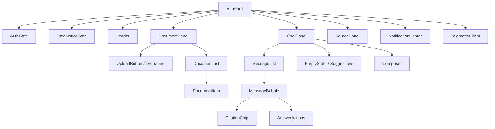
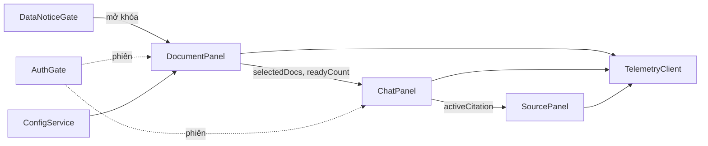
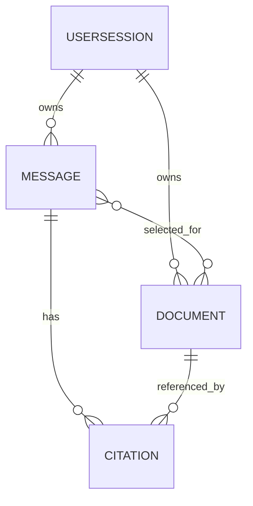
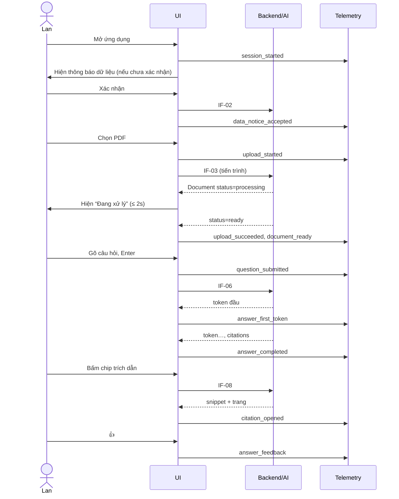
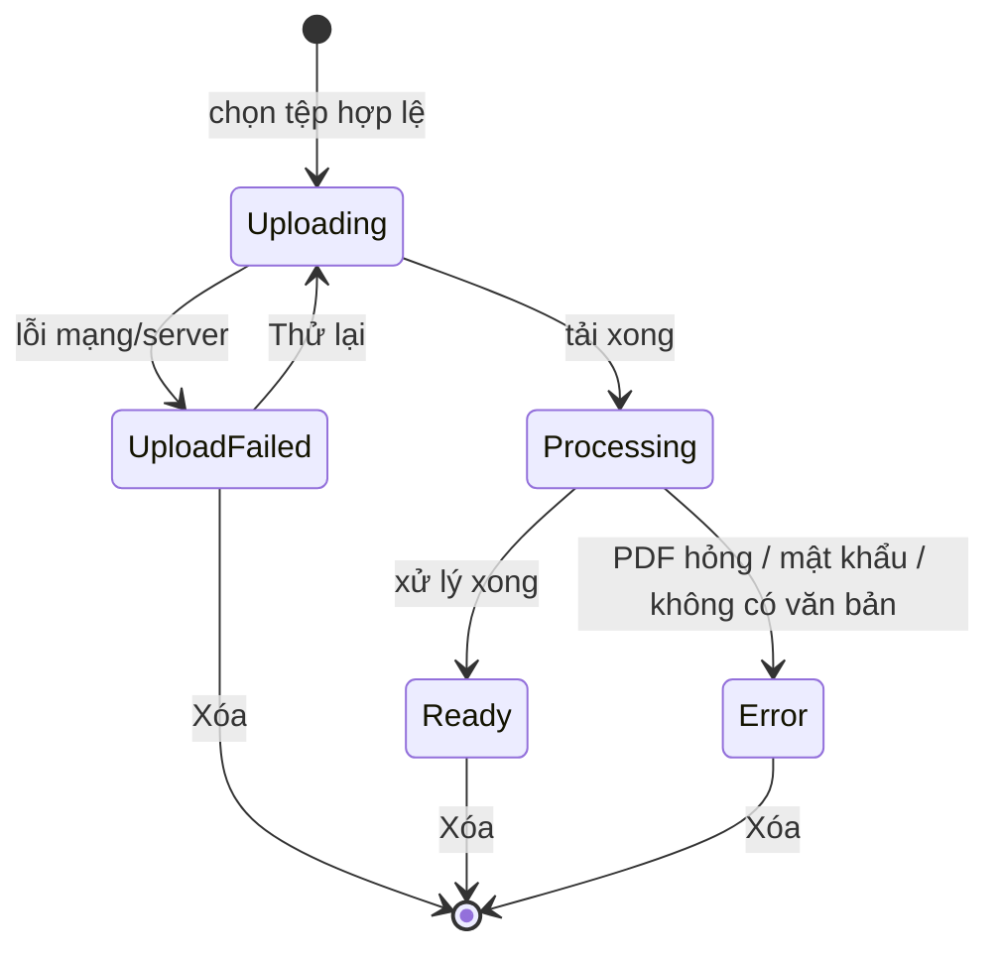
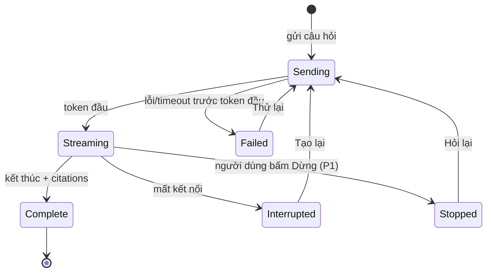

# Blueprint thiết kế UI/UX (SDD) — Công cụ “Chat với tài liệu”

**Chuẩn áp dụng:** IEEE 1016-2009 (Software Design Descriptions)
**Nguồn đầu vào:** [PRD.md](../requirements/PRD.md) (`PRD-DOCCHAT-001` v0.1), [BRD.md](../requirements/BRD.md) (`BRD-DOCCHAT-001` v0.1), prompt [bluePrint_design_prompt.md](../../bluePrint_design_prompt.md)

> **Quy ước:** Nội dung gắn **[Đề xuất]** là quyết định thiết kế khởi điểm do tài liệu này đưa ra, cần Product Owner/Design xác nhận. Nội dung gắn **[TBD: OQ-xxx]** kế thừa từ câu hỏi mở của BRD/PRD và **không** phải quyết định. Phạm vi tài liệu: **lớp UI/UX của ứng dụng web MVP** (không mô tả chi tiết backend/AI pipeline, chỉ mô tả hợp đồng giao diện mà UI cần).

---

## 1. Bối cảnh và đối tượng thiết kế

### 1.1 Định danh hệ thống

| Thuộc tính | Giá trị |
|---|---|
| **Tên hệ thống** | Công cụ “Chat với tài liệu” (tên tạm; chính thức: `OQ-002`) |
| **Số tài liệu / Phiên bản SDD** | SDD-UIUX-DOCCHAT-001 / v0.1 — Bản nháp |
| **Ngày lập** | 2026-10-19 |
| **Chủ sở hữu tài liệu** | [TBD: OQ-001] |
| **Tài liệu nguồn** | PRD-DOCCHAT-001 v0.1; BRD-DOCCHAT-001 v0.1 |
| **Trạng thái** | Chưa sẵn sàng baseline (kế thừa tình trạng của PRD) |

**Lịch sử phiên bản**

| Phiên bản | Ngày | Tác giả | Thay đổi |
|---|---|---|---|
| 0.1 | 2026-10-19 | [TBD: OQ-001] | Tạo bản nháp blueprint UI/UX từ PRD v0.1 |

### 1.2 Phạm vi hệ thống và ranh giới bên ngoài

| Loại ranh giới | Mô tả |
|---|---|
| **Mục đích** | Cho phép nhân sự phát triển kinh doanh tải PDF lên, hỏi bằng ngôn ngữ tự nhiên và nhận câu trả lời AI **kèm nguồn dẫn kiểm chứng được** (PRD 1.1). |
| **Trong phạm vi UI** | Màn hình chào/đồng ý dữ liệu, quản lý tài liệu, khung chat streaming, chip trích dẫn, panel nguồn, phản hồi (hữu ích/không), trạng thái lỗi/rỗng/tải. |
| **Ngoài phạm vi MVP** | Định dạng ngoài PDF, đồng bộ kho ngoài, báo cáo tự động, tích hợp quy trình bán hàng, mobile-native/offline (BRD 4.5; PRD 0). |
| **Hệ thống bên ngoài** | (1) Dịch vụ AI/LLM và xử lý PDF (backend, UI chỉ thấy qua API); (2) Dịch vụ xác thực `[TBD: OQ-014]`; (3) Hệ thống telemetry (PRD 5.2). |
| **Loại người dùng** | Lan – chuyên viên BD (chính); Minh – quản lý (xem báo cáo, gián tiếp); Hà – chủ dữ liệu/pháp chế (đọc thông báo, nhật ký). |
| **Giao diện bên ngoài (UI cần)** | REST/stream (SSE hoặc tương đương) cho: upload, danh sách tài liệu, hỏi đáp streaming, lấy đoạn nguồn, xóa, gửi phản hồi, gửi telemetry. Hợp đồng chi tiết xem 3.5. |
| **Ranh giới tin cậy** | Trình duyệt người dùng (không tin cậy) ↔ API (xác thực phiên) ↔ kho dữ liệu cô lập theo người dùng. Không đưa nội dung tài liệu/câu hỏi vào telemetry (PRD 5.2). |
| **Môi trường triển khai UI** | Ứng dụng web; Chrome/Edge/Safari 2 phiên bản gần nhất **[Đề xuất, PRD 5.1]**; desktop là thiết bị chính. |

### 1.3 Giả định và ràng buộc

| Loại | Mô tả |
|---|---|
| **Ràng buộc kỹ thuật** | Web-first (CON-002); giao diện tiếng Việt; câu trả lời dạng streaming; không rời trang khi xem nguồn (PRD 4.1). |
| **Ràng buộc nghiệp vụ** | Phạm vi MVP (CON-001); chưa có ngân sách/thời hạn (`OQ-006`); chỉ dùng PDF có quyền (BRU-001). |
| **Giả định môi trường** | Người dùng dùng màn hình ≥ 1280px là chính; mạng văn phòng ổn định; token đầu ≤ 5s (p95) là mục tiêu **[Đề xuất]**. |
| **Giả định dữ liệu** | Giới hạn kích thước/số lượng/ngôn ngữ PDF **[TBD: OQ-008]** — UI phải đọc giới hạn từ cấu hình, không hard-code. PDF quét/OCR **[TBD: OQ-008]**. Thời hạn lưu/xóa **[TBD: OQ-012]**. |
| **Giả định thiết kế** | UI hiển thị trạng thái xác thực tối thiểu; cơ chế đăng nhập cụ thể chưa chốt (`OQ-014`) nên thiết kế một “khung đăng nhập/hết phiên” trung lập. |

---

## 2. Các bên liên quan và mối quan tâm

### 2.1 Nhận diện bên liên quan

| Bên liên quan | Vai trò | Mối quan tâm chính (UI/UX) |
|---|---|---|
| Lan (STK-001) | Người dùng cuối – BD | Hỏi tự nhiên, nhanh, thấy ngay nguồn để kiểm chứng; ít thao tác |
| Minh (STK-002) | Quản lý / người yêu cầu | Số liệu đo được (MET-001/002), telemetry đúng, báo cáo thử nghiệm |
| BA / Product Owner (STK-003) | Làm rõ yêu cầu | Truy vết yêu cầu → thiết kế, phạm vi MVP rõ |
| Hà (STK-004) | Chủ dữ liệu / pháp chế / bảo mật | Thông báo dữ liệu minh bạch, xóa dễ, cô lập, nhật ký |
| Đội kỹ thuật/vận hành (STK-005) | Dev, QA, Ops | Component tái sử dụng, dễ test, lỗi quan sát được, kill switch |
| Designer/UX | Sở hữu design system | Nhất quán thị giác, khả năng tiếp cận |

### 2.2 Mối quan tâm của bên liên quan

| ID | Bên liên quan | Mối quan tâm | Ưu tiên | Tiêu chí chấp nhận | Truy vết |
|---|---|---|---|---|---|
| CN-01 | Lan | Tải PDF nhanh, thấy trạng thái từng tệp | Cao | Tệp hiện trong danh sách ≤ 2s sau khi xác nhận; trạng thái tự cập nhật không reload | US-101, US-102, AC-001 |
| CN-02 | Lan | Nhận câu trả lời nhanh, thấy tiến độ | Cao | Token đầu ≤ 5s (p95) với ≤ 10 PDF **[Đề xuất]**; có chỉ báo “đang tạo” | US-201, KR1.2 |
| CN-03 | Lan | Kiểm chứng câu trả lời bằng nguồn | Cao | ≥ 90% câu trả lời có chip trích dẫn hợp lệ; bấm chip mở đoạn gốc + tên tệp + trang, không rời trang | US-301, US-302, KR2.2 |
| CN-04 | Lan | Không bị tin nhầm AI | Cao | Nhãn AI cố định luôn hiển thị; câu trả lời “không tìm thấy” khi ngoài phạm vi | US-202, BRU-002 |
| CN-05 | Lan | Phục hồi khi lỗi mà không mất công | Cao | Mọi lỗi giữ lại đầu vào (câu hỏi, tệp) và có hành động “Thử lại” | PRD 4.2 |
| CN-06 | Hà | Biết dữ liệu được xử lý thế nào, xóa được | Cao | Phải xác nhận thông báo trước khi tải; xóa tài liệu trong ≤ 2 thao tác | US-401, US-103 |
| CN-07 | Hà | Dữ liệu cô lập giữa người dùng | Cao | UI không bao giờ hiển thị tài liệu/hội thoại của người khác; phiên hết hạn → từ chối | US-402 |
| CN-08 | Minh | Đo được MET-001/002 từ UI | Cao | 100% sự kiện telemetry PRD 5.2 phát đúng thời điểm; không chứa nội dung tài liệu/câu hỏi | US-501, AC-004 |
| CN-09 | Mọi người dùng | Tiếp cận được | Trung | WCAG 2.1 AA **[Đề xuất; OQ-011]** | PRD 4.1(6) |
| CN-10 | Dev/QA | Component hóa, test được | Trung | Mọi component có trạng thái được định nghĩa và test hồi quy cho AC P0 | PRD 5.1 (QA) |
| CN-11 | Lan | Chọn tài liệu tham gia câu hỏi | Thấp (P1) | Checkbox từng tệp, chỉ tệp “Sẵn sàng” chọn được | US-104 |
| CN-12 | Lan | Dừng/tạo lại câu trả lời | Thấp (P1) | Nút Dừng khi đang stream; nút Tạo lại khi bị gián đoạn | US-205 |

### 2.3 Kịch bản thuộc tính chất lượng (hệ thống)

| Thuộc tính | Kịch bản (Nguồn → Kích thích → Thành phần → Môi trường → Phản hồi → Thước đo) |
|---|---|
| **Hiệu năng** | Lan → gửi câu hỏi → khung chat → ≤ 10 PDF sẵn sàng, mạng văn phòng → hiển thị token đầu → p95 ≤ 5s **[Đề xuất]** |
| **Tin cậy / Phục hồi** | Mất kết nối → đang stream → khung chat → bất kỳ → giữ phần đã nhận, gắn “Bị gián đoạn”, hiện “Tạo lại” → 0 câu hỏi bị mất |
| **Bảo mật** | Người dùng B → truy cập URL/ID tài liệu của A → API/UI → phiên hợp lệ → từ chối, không lộ metadata → 0 rò rỉ trong kiểm thử US-402 |
| **Quyền riêng tư** | Telemetry → sự kiện UI → pipeline phân tích → vận hành → chỉ gửi siêu dữ liệu → 0 trường chứa nội dung tài liệu/câu hỏi |
| **Khả bảo trì** | Designer → đổi token màu/spacing → design system → phát triển → áp dụng toàn app → không sửa từng màn hình |
| **Khả kiểm thử** | QA → chạy hồi quy → component → CI → 100% AC P0 có test tự động; độ bao phủ logic UI ≥ 70% **[Đề xuất]** |
| **Quan sát** | Ops → lỗi AI → UI/telemetry → vận hành → sự kiện `answer_failed` kèm `error_code`, `stage` → cảnh báo vượt ngưỡng `[TBD]` |

### 2.4 Kịch bản chất lượng UX/UI

| Thuộc tính | Kịch bản UX/UI | Truy vết |
|---|---|---|
| **Khả dụng** | Người dùng lần đầu hoàn thành chuỗi *xác nhận thông báo → tải 1 PDF → hỏi câu đầu tiên* ≤ 90s, 0 lỗi **[Đề xuất]** | KR3.1, US-401/101/201 |
| **Tiếp cận** | 100% điều khiển thao tác được bằng bàn phím; thứ tự Tab hợp lý; vùng trả lời stream dùng `aria-live="polite"`; WCAG 2.1 AA **[Đề xuất]** | PRD 4.1(6) |
| **Hiệu năng cảm nhận** | FCP < 1.5s, LCP < 2.5s trên 4G; tải trang đầu ≤ 2s (p95) | PRD 5.1 |
| **Đáp ứng bố cục** | Bố cục thích ứng 1024–2560px không cuộn ngang; < 1024px chuyển sang chế độ ngăn kéo (drawer) cho danh sách tài liệu **[Đề xuất]**; mobile < 768px: “khả dụng cơ bản”, không phải mục tiêu MVP | CON-002 |
| **Nhất quán thị giác** | 100% component dùng token của design system (màu, chữ, khoảng cách, bo góc) | — |
| **Phục hồi lỗi** | Mọi lỗi hiển thị cục bộ (inline/toast) với lý do dễ hiểu + hành động kế tiếp; không cần tải lại trang | PRD 4.2 |
| **Phản hồi & affordance** | Mọi phần tử bấm được có hover/focus/active/disabled; hiển thị skeleton/spinner ≤ 300ms với tác vụ bất đồng bộ | — |
| **Kiến trúc thông tin** | Mọi chức năng chính (tải, hỏi, xem nguồn, xóa) đạt được ≤ 2 thao tác từ màn hình chính | PRD 4.1 |
| **Minh bạch AI** | Nhãn “Câu trả lời do AI tạo, hãy kiểm tra nguồn trước khi sử dụng” hiển thị trên 100% câu trả lời, không thể đóng | BRU-002 |
| **Quốc tế hóa** | Giao diện tiếng Việt; chuỗi giao diện tách file ngôn ngữ để mở rộng; hỗ trợ dấu tiếng Việt đầy đủ; text giãn +30% không vỡ bố cục. Ngôn ngữ tài liệu **[TBD: OQ-008]** | PRD 4.1(7) |
| **Thiết bị cảm ứng** | Touch target ≥ 44×44px cho điều khiển chính; không phụ thuộc hover để thao tác | — |

### 2.5 Ma trận ràng buộc UX/UI

| Ràng buộc | Yêu cầu | Công cụ / Chuẩn | Phương pháp xác minh |
|---|---|---|---|
| **Tương phản màu** | ≥ 4.5:1 chữ thường; ≥ 3:1 chữ lớn và thành phần UI | WCAG 2.1 AA | Công cụ tự động + kiểm tra thủ công |
| **Kiểu chữ** | Thân bài ≥ 16px, hỗ trợ phóng 200%; font hỗ trợ tiếng Việt | Design system | Design audit |
| **Vùng chạm** | ≥ 44×44px (mục tiêu 24×24 tối thiểu theo WCAG 2.2) | Apple HIG / Material | UI test |
| **Trạng thái tải** | Skeleton/spinner trong ≤ 300ms; không dùng màn trắng | UX best practice | Giám sát hiệu năng, UI test |
| **Thông báo lỗi** | Rõ, hành động được, không thuật ngữ kỹ thuật, không lộ nội dung tài liệu | Hướng dẫn UX writing | Rà soát nội dung |
| **Trạng thái rỗng** | Mỗi trạng thái rỗng chỉ ra hành động tiếp theo | UX best practice | Kiểm kê UI (3.5) |
| **Thông báo/toast** | Không chặn thao tác; lỗi nghiêm trọng giữ lại đến khi xử lý; tự ẩn thông báo thành công sau 5s | UX best practice | Kiểm thử người dùng |
| **Trợ giúp / Onboarding** | Màn chào ngắn + gợi ý câu hỏi mẫu; trợ giúp theo ngữ cảnh tại ô tải và ô chat | UX best practice | Chỉ số hoàn thành tác vụ |
| **Chuyển động** | Tôn trọng `prefers-reduced-motion`; không nhấp nháy > 3 lần/giây | WCAG 2.3.1 | Kiểm tra thủ công |
| **Quyền riêng tư UI** | Không đặt nội dung tài liệu/câu hỏi trong URL, tiêu đề tab, telemetry | PRD 5.2 | Review mã + kiểm thử |

---

## 3. Các góc nhìn thiết kế (IEEE 1016-2009)

Tám góc nhìn dưới đây được chọn từ các viewpoint của IEEE 1016-2009 là phù hợp nhất cho thiết kế UI/UX: Composition, Logical, Dependency, Information, Interface, Interaction, State Dynamics, Resource. Mỗi góc nhìn nêu rõ mối quan tâm (CN-xx) mà nó giải quyết.

### 3.1 Composition View — Phân rã giao diện

**Mối quan tâm:** CN-10 (khả bảo trì/kiểm thử), CN-09, CN-01…CN-05.

| Phần tử | Loại | Cha | Trách nhiệm | Phụ thuộc |
|---|---|---|---|---|
| AppShell | Layout | Root | Khung trang, header, vùng chính, xử lý phiên | AuthGate, ThemeProvider |
| AuthGate | Module | AppShell | Kiểm tra phiên; hiển thị đăng nhập/hết phiên `[TBD: OQ-014]` | SessionService |
| DataNoticeGate | Module | AppShell | Bắt buộc xác nhận thông báo dữ liệu trước khi bật tải lên (US-401) | PolicyService |
| Header | Component | AppShell | Tên công cụ, nút “Thông báo dữ liệu”, menu người dùng | — |
| DocumentPanel | Module | AppShell | Quản lý tài liệu (khu bên trái) | DocumentService |
| ├ UploadButton / DropZone | Component | DocumentPanel | Chọn tệp (P0), kéo-thả (P2), kiểm tra hợp lệ phía client | ConfigService |
| ├ DocumentList | Component | DocumentPanel | Danh sách tệp + trạng thái + chọn + xóa | DocumentService |
| └ DocumentItem | Component | DocumentList | Một tệp: tên, kích thước, thời điểm, trạng thái, tiến trình, checkbox, xóa | — |
| ChatPanel | Module | AppShell | Hội thoại (khu giữa/phải) | ChatService |
| ├ MessageList | Component | ChatPanel | Cuộn, hiển thị câu hỏi/trả lời, `aria-live` | — |
| ├ MessageBubble (User/AI) | Component | MessageList | Nội dung; AI có streaming, nhãn AI, chip trích dẫn, hành động | — |
| ├ CitationChip | Component | MessageBubble | Hiển thị `tên tệp · tr.N`, bấm mở SourcePanel | — |
| ├ AnswerActions | Component | MessageBubble | Sao chép, Hữu ích/Không, Tạo lại | FeedbackService |
| ├ EmptyState / Suggestions | Component | ChatPanel | Hướng dẫn khi chưa có tài liệu / gợi ý câu hỏi mẫu | — |
| └ Composer | Component | ChatPanel | Ô nhập, Gửi/Dừng, bộ đếm độ dài, trạng thái vô hiệu hóa kèm lý do | ChatService |
| SourcePanel | Module | AppShell | Hiển thị đoạn gốc + tên tệp + trang; trạng thái “Nguồn không còn khả dụng” | CitationService |
| NotificationCenter | Component | AppShell | Toast & banner lỗi/thành công | — |
| TelemetryClient | Service | AppShell | Phát sự kiện PRD 5.2, lọc thuộc tính cấm | — |



### 3.2 Logical View — Design system và component

**Mối quan tâm:** Nhất quán thị giác, khả bảo trì, tiếp cận (CN-09, CN-10).

**Tầng thiết kế:** Design tokens → Primitives → Components → Modules → Screens.

**Design tokens [Đề xuất]**

| Nhóm | Token | Giá trị khởi điểm | Ghi chú |
|---|---|---|---|
| Màu thương hiệu | `color-primary` | `#1F5FBF` | Tương phản 4.5:1 với nền trắng |
| Màu ngữ nghĩa | `color-success / warning / danger / info` | `#1B7F3B / #8A5A00 / #B3261E / #1F5FBF` | Luôn đi kèm biểu tượng + chữ, không chỉ màu |
| Bề mặt | `surface-bg / surface-panel / surface-ai` | `#F7F8FA / #FFFFFF / #F0F4FA` | Hỗ trợ chế độ tối **[P2]** |
| Chữ | `font-family` | Hệ thống sans-serif hỗ trợ tiếng Việt (vd. Inter/Segoe UI/Roboto) | Thân 16px, line-height 1.5 |
| Thang chữ | `text-sm/base/lg/xl` | 14 / 16 / 18 / 24 px | Phóng được 200% |
| Khoảng cách | `space-1…8` | 4, 8, 12, 16, 24, 32, 48, 64 px | Lưới 4px |
| Bo góc / đổ bóng | `radius-md`, `shadow-1` | 8px / nhẹ | — |
| Focus | `focus-ring` | 2px `color-primary` + offset 2px | Luôn hiển thị khi điều hướng bàn phím |

**Bảng trạng thái ngữ nghĩa dùng chung**

| Trạng thái tài liệu | Nhãn UI | Biểu tượng | Màu | Hành động hợp lệ |
|---|---|---|---|---|
| Đang tải lên | Đang tải lên… (x%) | ⏫ | info | Hủy |
| Tải thất bại | Tải thất bại | ⚠ | danger | Thử lại, Xóa |
| Đang xử lý | Đang xử lý | ⏳ | warning | — (không chọn được) |
| Sẵn sàng | Sẵn sàng | ✔ | success | Chọn, Xóa |
| Lỗi | Lỗi: {nguyên nhân dễ hiểu} | ✖ | danger | Xóa |

**Nguyên tắc component:** (1) Mọi component có đủ trạng thái: default, hover, focus, active, disabled, loading, error, empty. (2) Không đặt logic nghiệp vụ trong component hiển thị. (3) Chuỗi giao diện lấy từ tệp ngôn ngữ (i18n). (4) Vai trò/nhãn ARIA là một phần của định nghĩa component.

### 3.3 Dependency View — Phụ thuộc

**Mối quan tâm:** Khả bảo trì, rủi ro tích hợp.

| Từ | Đến | Loại | Mô tả |
|---|---|---|---|
| ChatPanel | DocumentPanel (qua state `selectedDocs`) | Dữ liệu | Composer chỉ bật khi có ≥ 1 tệp “Sẵn sàng”; ChatPanel gửi danh sách tệp được chọn |
| MessageBubble | SourcePanel (qua `activeCitation`) | Sự kiện | Bấm chip → mở panel |
| DocumentPanel | ConfigService | Cấu hình | Giới hạn kích thước/số lượng/loại **[TBD: OQ-008]** |
| DataNoticeGate | DocumentPanel | Chặn | Chưa xác nhận → UploadButton vô hiệu hóa (US-401) |
| Mọi module | TelemetryClient | Sự kiện | Phát sự kiện PRD 5.2 |
| Mọi module | AuthGate | Phiên | Phiên hết hạn → khóa thao tác, giữ bản nháp |
| UI | API backend | Hợp đồng | Xem 3.5; thay đổi hợp đồng cần phiên bản hóa |
| UI | Design tokens | Biên dịch | Component chỉ tham chiếu token, không dùng giá trị thô |



### 3.4 Information View — Thông tin và trạng thái dữ liệu phía UI

**Mối quan tâm:** CN-01, CN-03, CN-07, CN-08.

**Mô hình dữ liệu phía client**

| Thực thể | Trường chính | Ghi chú |
|---|---|---|
| `Document` | `id`, `name`, `sizeBytes`, `uploadedAt`, `status` (`uploading/upload_failed/processing/ready/error`), `progress`, `pageCount`, `errorCode`, `selected` | `selected` chỉ khi `ready` |
| `Message` | `id`, `role` (`user/ai`), `text`, `status` (`sending/streaming/complete/interrupted/failed/stopped`), `createdAt`, `citations[]`, `grounded`, `feedback` | AI `grounded=false` ⇒ “không tìm thấy trong tài liệu đã tải” |
| `Citation` | `id`, `documentId`, `documentName`, `page`, `snippet`, `valid` | `valid=false` ⇒ “Nguồn không còn khả dụng” |
| `Draft` | `text`, `updatedAt` | Giữ khi mất phiên |
| `UserSession` | `userId` (ẩn danh hóa cho telemetry), `expiresAt`, `noticeAcceptedVersion` | — |
| `AppConfig` | `maxFileSize`, `maxFiles`, `maxQuestionLength`, `acceptedTypes` | **[TBD: OQ-008]** |



**Quy tắc thông tin**
1. Dữ liệu hội thoại: lưu bền hay chỉ trong phiên là **[TBD: OQ-012]**; UI mặc định hiển thị hội thoại của phiên hiện tại.
2. Không đưa `text`, `snippet`, `name` tài liệu vào URL, tiêu đề tab hay telemetry.
3. Telemetry chỉ gồm siêu dữ liệu (độ dài, số lượng, mã lỗi) — ánh xạ ở 3.6.
4. Sắp xếp danh sách tài liệu: mới nhất lên đầu **[Đề xuất]**.

### 3.5 Interface View — Màn hình, wireframe và hợp đồng giao diện

**Mối quan tâm:** CN-01…CN-07, CN-09.

#### 3.5.1 Kiểm kê màn hình/trạng thái

| ID | Màn hình / trạng thái | Mục đích | Truy vết |
|---|---|---|---|
| SCR-01 | Màn chào + Thông báo dữ liệu | Giải thích công cụ; bắt buộc xác nhận trước khi tải | US-401 |
| SCR-02 | Màn chính — trạng thái rỗng | Hướng dẫn “Tải PDF đầu tiên”; ô chat bị vô hiệu hóa kèm lý do | US-201, PRD 4.2 |
| SCR-03 | Màn chính — đang xử lý | Tệp đang tải/xử lý; hỏi được trên tệp đã sẵn sàng | US-102 |
| SCR-04 | Màn chính — hỏi đáp | Chat streaming + chip trích dẫn | US-201…203, 301 |
| SCR-05 | SourcePanel mở | Xem đoạn gốc + tên tệp + trang | US-302 |
| SCR-06 | Hộp thoại xác nhận xóa | Xác nhận xóa tài liệu | US-103 |
| SCR-07 | Hết phiên / đăng nhập lại | Khôi phục, giữ bản nháp | US-402 |
| SCR-08 | Banner lỗi toàn cục / chế độ tắt khẩn cấp | Khi tính năng hỏi đáp bị tắt (kill switch) | PRD 5.1 |
| SCR-09 | Báo cáo đánh giá MVP (cho Minh) | Xem MET-001/002 — **ngoài UI chính, có thể là dashboard riêng** | US-501 |

#### 3.5.2 Wireframe — SCR-04 (màn chính, desktop ≥ 1280px)

```
┌──────────────────────────────────────────────────────────────────────────┐
│ ☰  Chat với tài liệu             [ⓘ Thông báo dữ liệu]   [👤 Lan ▾]      │ Header
├─────────────────────┬──────────────────────────────────┬─────────────────┤
│ TÀI LIỆU CỦA TÔI (3)│  KHUNG CHAT                      │ NGUỒN DẪN       │
│ [＋ Tải PDF lên]    │ ┌──────────────────────────────┐ │ (mở khi bấm chip│
│ ─────────────────── │ │ ⓘ Câu trả lời do AI tạo, hãy │ │  trích dẫn)     │
│ ☑ baogia.pdf     ✔  │ │   kiểm tra nguồn trước khi   │ │                 │
│   1.2MB · 2 phút    │ │   sử dụng                    │ │ baogia.pdf      │
│ ☑ hopdong.pdf    ⏳ │ ├──────────────────────────────┤ │ Trang 4         │
│   ▓▓▓▓░░ 60%        │ │            Bạn: Điều khoản   │ │ ─────────────── │
│ ☐ catalog.pdf    ✖  │ │            thanh toán là gì? │ │ “Thanh toán      │
│   Lỗi: PDF có mật   │ │ AI: Thanh toán trong 30 ngày…│ │  trong 30 ngày   │
│   khẩu     [Xóa]    │ │   [baogia.pdf · tr.4]        │ │  kể từ ngày…”   │
│                     │ │   [hopdong.pdf · tr.2]       │ │                 │
│                     │ │   📋 Sao chép  👍  👎        │ │ [Đóng ✕]        │
│                     │ └──────────────────────────────┘ │                 │
│                     │ [ Nhập câu hỏi…        ] [ Gửi ➤]│                 │
│                     │  0/2000 · Shift+Enter xuống dòng │                 │
└─────────────────────┴──────────────────────────────────┴─────────────────┘
```

**Hành vi theo trạng thái (SCR-04)**

| Khu vực | Quy tắc |
|---|---|
| Header | Nút “Thông báo dữ liệu” luôn truy cập được; hiển thị phiên bản thông báo đã xác nhận |
| DocumentPanel | Tệp chưa “Sẵn sàng” không có checkbox hoạt động; xóa cần hộp thoại xác nhận (SCR-06); tiến trình bằng thanh + văn bản (không chỉ màu) |
| ChatPanel | Tin nhắn mới nhất tự cuộn trừ khi người dùng đã cuộn lên; nút “Cuộn xuống” khi có nội dung mới |
| Composer | Enter gửi, Shift+Enter xuống dòng; Gửi bị vô hiệu hóa khi rỗng/quá dài/chưa có tệp sẵn sàng (kèm lý do dạng văn bản gần ô nhập); khi đang stream, nút Gửi → Dừng (P1) |
| SourcePanel | Mở dạng panel bên phải (desktop) hoặc bottom sheet (< 1024px); `Esc` đóng; focus trả về chip đã bấm |

#### 3.5.3 Wireframe — SCR-01 (Thông báo dữ liệu) và SCR-02 (rỗng)

```
SCR-01                                   SCR-02
┌──────────────────────────────────┐    ┌──────────────────────────────────┐
│ Chào mừng đến “Chat với tài liệu”│    │ TÀI LIỆU CỦA TÔI   │ KHUNG CHAT  │
│ • Hỏi đáp trên PDF bạn tải lên   │    │ Chưa có tài liệu   │ ┌─────────┐ │
│ • Câu trả lời có nguồn dẫn       │    │ [＋ Tải PDF đầu    │ │ Hãy tải │ │
│                                  │    │    tiên]           │ │ PDF để  │ │
│ LƯU Ý DỮ LIỆU [TBD: OQ-012/013]  │    │ Giới hạn: ≤ {N} MB │ │ bắt đầu │ │
│ • Chỉ tải tài liệu bạn có quyền  │    │ {TBD: OQ-008}      │ └─────────┘ │
│ • Cách lưu / xóa dữ liệu: …      │    │                    │ [Nhập câu   │
│ ☐ Tôi đã đọc và đồng ý           │    │                    │  hỏi… (tắt)]│
│            [Tiếp tục] (tắt đến   │    │                    │ “Tải ít nhất│
│             khi tích chọn)       │    │                    │ 1 PDF”      │
└──────────────────────────────────┘    └──────────────────────────────────┘
```

#### 3.5.4 Hợp đồng giao diện UI ↔ Backend (mức khái niệm, chưa phải thiết kế API)

| ID | Chức năng | Đầu vào | Đầu ra/Sự kiện UI cần | Lỗi UI phải xử lý |
|---|---|---|---|---|
| IF-01 | Lấy cấu hình & trạng thái thông báo | — | `AppConfig`, `noticeVersion`, `accepted` | Không tải được → banner, dùng giá trị an toàn |
| IF-02 | Xác nhận thông báo | `noticeVersion` | OK | Thất bại → thử lại |
| IF-03 | Tải tệp | PDF + client-id | Tiến trình %, `Document(id,status)` | Sai định dạng, quá giới hạn, mạng, trùng (idempotent theo client-id) |
| IF-04 | Danh sách/trạng thái tài liệu | — | Cập nhật `status` theo thời gian thực (push hoặc polling) | Mất kết nối → polling lại |
| IF-05 | Xóa tài liệu | `documentId` | OK | Lỗi → giữ tệp, báo lỗi |
| IF-06 | Hỏi đáp | `question`, `documentIds[]`, `conversationId` | Luồng: token…, `citations[]`, `grounded`, kết thúc | Ngắt kết nối, hết thời gian chờ, quá tải, kill switch |
| IF-07 | Dừng sinh | `messageId` | Xác nhận dừng | — |
| IF-08 | Lấy nguồn | `citationId` | `snippet`, `documentName`, `page`, `valid` | Tệp đã xóa → “Nguồn không còn khả dụng” |
| IF-09 | Gửi phản hồi | `messageId`, `rating`, `reasonCode?` | OK | Thất bại âm thầm, thử lại nền |
| IF-10 | Telemetry | Sự kiện PRD 5.2 | — | Không chặn UI; có bộ đệm |

### 3.6 Interaction View — Luồng tương tác

**Mối quan tâm:** CN-01…CN-08.

#### Luồng chính: tải → hỏi → kiểm chứng



#### Ánh xạ sự kiện telemetry ↔ tương tác UI

| Tương tác UI | Sự kiện (PRD 5.2) | Thuộc tính được phép |
|---|---|---|
| Mở app | `session_started` | `entry_source` |
| Xác nhận thông báo | `data_notice_accepted` | `notice_version` |
| Bắt đầu / xong / lỗi tải | `upload_started` / `upload_succeeded` / `upload_failed` | `file_size`, `file_index`, `duration_ms`, `error_code` |
| Tài liệu sẵn sàng / lỗi | `document_ready` / `document_processing_failed` | `page_count`, `processing_ms`, `error_code` |
| Xóa tài liệu | `document_deleted` | `document_age_days` |
| Gửi câu hỏi | `question_submitted` | `question_length`, `docs_selected_count` |
| Token đầu / hoàn tất / lỗi / dừng | `answer_first_token` / `answer_completed` / `answer_failed` / `answer_stopped` | `latency_ms`, `total_ms`, `citation_count`, `grounded`, `error_code`, `stage`, `elapsed_ms` |
| Mở nguồn | `citation_opened` | `citation_index` |
| Phản hồi | `answer_feedback` | `rating`, `reason_code` |
| Sao chép | `copy_answer` | `answer_id` |
| “Đã có thông tin cần” | `task_marked_done` | `task_id`, `elapsed_ms`, `success` |

> **Khoảng trống cần quyết định:** `task_marked_done` (đo MET-001/002) cần một điều khiển UI rõ ràng (vd. nút “Tôi đã có thông tin cần tìm” trong phiên thử nghiệm) — PRD chưa mô tả vị trí. **[Đề xuất]** đặt dưới Composer trong chế độ thử nghiệm, chỉ bật theo cờ cấu hình `[TBD: OQ-005]`.

#### Luồng ngoại lệ chính

| Tình huống | Luồng UI |
|---|---|
| Tệp sai định dạng/quá giới hạn | Chặn client trước khi tải → toast + giải thích giới hạn → danh sách không đổi |
| Mất mạng khi tải | `upload_failed` → “Tải thất bại” + [Thử lại] (idempotent) |
| Mất mạng khi stream | Giữ phần nhận được → nhãn “Bị gián đoạn” → [Tạo lại] (câu hỏi không mất) |
| AI lỗi/timeout | Thông báo thân thiện, giữ câu hỏi, [Thử lại], phát `answer_failed` |
| Phiên hết hạn | Overlay đăng nhập lại, giữ `Draft`; sau đăng nhập khôi phục ô nhập |
| Bấm chip khi nguồn không hợp lệ | SourcePanel hiện “Nguồn không còn khả dụng” (không trống) |
| Tải nhầm tài liệu nhạy cảm | Xóa trong 1 thao tác (menu ⋯ → Xóa → Xác nhận) + liên kết hướng dẫn báo cáo `[TBD: OQ-012]` |

### 3.7 State Dynamics View — Động học trạng thái

**Mối quan tâm:** CN-01, CN-02, CN-05, CN-12.

#### Trạng thái tài liệu



#### Trạng thái tin nhắn AI



#### Trạng thái Composer

| Điều kiện | Trạng thái | Thông báo/lý do hiển thị |
|---|---|---|
| Chưa xác nhận thông báo | Tắt | “Xác nhận thông báo dữ liệu để bắt đầu” |
| Chưa có tệp “Sẵn sàng” | Tắt | “Tải ít nhất 1 PDF và chờ ở trạng thái Sẵn sàng” |
| Ô rỗng | Gửi tắt | — |
| Vượt độ dài tối đa | Gửi tắt | “Tối đa {N} ký tự” `[TBD]` |
| Đang stream | Gửi → Dừng | “Đang tạo câu trả lời…” |
| Kill switch bật | Tắt | “Tính năng hỏi đáp tạm thời không khả dụng” |
| Bình thường | Bật | — |

### 3.8 Resource View — Ngân sách hiệu năng, tiếp cận và tài nguyên

**Mối quan tâm:** CN-02, CN-09, CN-10; hiệu năng cảm nhận.

| Tài nguyên | Ngân sách / Yêu cầu **[Đề xuất]** | Cách kiểm soát |
|---|---|---|
| Tải trang đầu | ≤ 2s (p95); FCP < 1.5s; LCP < 2.5s (4G) | Code-splitting; SourcePanel & dashboard tải lười; font subset tiếng Việt |
| Độ trễ tương tác | Phản hồi thao tác UI ≤ 100ms; skeleton ≤ 300ms | Cập nhật lạc quan (optimistic) cho gửi câu hỏi |
| Streaming | Render tăng dần theo khối; tránh re-render toàn bộ danh sách | Virtualize `MessageList` khi hội thoại dài |
| Bộ nhớ | Không giữ toàn bộ nội dung PDF ở client; chỉ giữ `snippet` | — |
| Mạng | Upload tuần tự có giới hạn song song (vd. 3) **[Đề xuất]**; telemetry gom lô | Hàng đợi + backoff |
| Tiếp cận | Quản lý focus (mở/đóng SourcePanel, hộp thoại), `aria-live` cho stream, nhãn cho icon-only | Kiểm thử axe + đọc màn hình (NVDA/VoiceOver) |
| Trình duyệt | Chrome, Edge, Safari 2 phiên bản gần nhất | Ma trận kiểm thử |
| Nhân lực/thời gian | Chưa xác định (`OQ-006`) | — |

---

## 4. Quyết định thiết kế chính và lý do

| ID | Quyết định | Lý do | Mối quan tâm |
|---|---|---|---|
| DD-01 | Bố cục một trang, ba vùng (tài liệu / chat / nguồn), SourcePanel đóng mặc định | Tối thiểu thao tác (CON-002); xác minh nguồn không rời trang | CN-03 |
| DD-02 | Trích dẫn dạng chip `tên tệp · tr.N` gắn từng khẳng định | Kiểm chứng được, giảm RSK-001 | CN-03, CN-04 |
| DD-03 | Nhãn AI cố định, không thể đóng | BRU-002 | CN-04 |
| DD-04 | Cho phép hỏi trên tệp đã sẵn sàng khi tệp khác đang xử lý | Không chặn người dùng (PRD 4.1) | CN-01 |
| DD-05 | Mọi lỗi giữ đầu vào + có hành động phục hồi | PRD 4.2 | CN-05 |
| DD-06 | Cổng thông báo dữ liệu chặn tải lên đến khi xác nhận | US-401, RSK-002 | CN-06 |
| DD-07 | Trạng thái luôn kèm biểu tượng + chữ | WCAG (không chỉ dựa vào màu) | CN-09 |
| DD-08 | Telemetry lọc qua một lớp duy nhất, danh sách thuộc tính cho phép | Không rò nội dung (PRD 5.2) | CN-08 |
| DD-09 | UI đọc giới hạn từ cấu hình | OQ-008 chưa chốt | — |
| DD-10 | Desktop-first; < 1024px dùng drawer/bottom sheet | Web-first, không mobile-first (PRD 0) | CN-09 |

---

## 5. Ma trận truy vết

### 5.1 Mối quan tâm → Góc nhìn → Phần tử thiết kế → Yêu cầu

| Mối quan tâm | Góc nhìn | Phần tử thiết kế | Story/AC (PRD) | BRD |
|---|---|---|---|---|
| CN-01 | 3.1, 3.4, 3.7 | UploadButton, DocumentList, DocumentItem, IF-03/04 | US-101, US-102, AC-001 | BR-001 |
| CN-02 | 3.5, 3.6, 3.7, 3.8 | Composer, MessageBubble, IF-06 | US-201, AC-002 | BR-002 |
| CN-03 | 3.1, 3.5, 3.6 | CitationChip, SourcePanel, IF-08 | US-301, US-302 | BR-003, BRU-002 |
| CN-04 | 3.4, 3.5 | Nhãn AI, `grounded`, DD-02/03 | US-202, US-203, AC-003 | BR-003, BRU-002 |
| CN-05 | 3.6, 3.7 | Luồng ngoại lệ, trạng thái Message/Document | PRD 4.2 | — |
| CN-06 | 3.1, 3.5, 3.6 | DataNoticeGate, xóa tài liệu (SCR-06) | US-401, US-103 | BRU-001, SN-004 |
| CN-07 | 3.3, 3.4, 3.5 | AuthGate, SCR-07, IF-* | US-402 | SN-004 |
| CN-08 | 3.4, 3.6 | TelemetryClient, bảng ánh xạ sự kiện, SCR-09 | US-501, AC-004 | BR-004 |
| CN-09 | 3.2, 3.8 | Token màu/focus, ARIA, quản lý focus | PRD 4.1(6) | — |
| CN-10 | 3.1, 3.2, 3.3 | Phân tầng component, trạng thái chuẩn | PRD 5.1 (QA) | SN-005 |
| CN-11 | 3.1, 3.4 | DocumentItem checkbox, `selectedDocs` | US-104 (P1) | — |
| CN-12 | 3.7 | Nút Dừng/Tạo lại, trạng thái Stopped/Interrupted | US-205 (P1) | — |

### 5.2 Story P0 → Phần tử UI (kiểm tra độ bao phủ)

| Story P0 | Màn hình | Component chính | Phủ |
|---|---|---|---|
| US-101 | SCR-02/03 | UploadButton, DocumentItem | ✔ |
| US-102 | SCR-03 | DocumentList, DocumentItem | ✔ |
| US-103 | SCR-06 | DocumentItem (xóa), dialog | ✔ |
| US-201 | SCR-04 | Composer, MessageList | ✔ |
| US-202 | SCR-04 | MessageBubble (`grounded`), nhãn AI | ✔ |
| US-203 | SCR-04 | MessageBubble + nhiều CitationChip | ✔ |
| US-301 | SCR-04 | CitationChip | ✔ |
| US-302 | SCR-05 | SourcePanel | ✔ |
| US-401 | SCR-01 | DataNoticeGate | ✔ |
| US-402 | SCR-07 | AuthGate | ✔ (cô lập dữ liệu chủ yếu ở backend) |
| US-501 | SCR-09 + telemetry | TelemetryClient, dashboard | ⚠ Cần chốt vị trí `task_marked_done` và hình thức báo cáo (`OQ-005`) |

---

## 6. Rủi ro, câu hỏi mở và việc cần làm tiếp

| ID | Nội dung | Tác động lên thiết kế | Liên kết |
|---|---|---|---|
| R-UX-01 | Giới hạn PDF/OCR/ngôn ngữ chưa chốt | Thông điệp lỗi, DropZone, trạng thái “Không trích xuất được văn bản” | OQ-008 |
| R-UX-02 | Thông báo dữ liệu, thời hạn xóa chưa chốt | Nội dung SCR-01, hộp thoại xóa, banner “tự xóa sau…” | OQ-012, OQ-013 |
| R-UX-03 | Cơ chế xác thực chưa chốt | SCR-07, AuthGate | OQ-014 |
| R-UX-04 | Có cần hiển thị lịch sử hội thoại bền hay không | Thêm danh sách hội thoại ở sidebar nếu có | OQ-012 |
| R-UX-05 | Vị trí/hình thức đo MET-001/002 (`task_marked_done`) | Thêm điều khiển UI hoặc quy trình đo ngoài app | OQ-005 |
| R-UX-06 | Ngưỡng hiệu năng/WCAG mới là đề xuất | Ngân sách 3.8 có thể thay đổi | OQ-011 |
| R-UX-07 | Chưa có brand/design system chính thức | Token 3.2 chỉ là khởi điểm | OQ-002 |

**Bước tiếp theo đề xuất:** (1) Product Owner duyệt các mục **[Đề xuất]** và chốt OQ chặn; (2) Designer dựng wireframe độ trung thực cao cho SCR-01…SCR-07 từ mục 3.5; (3) kiểm thử khả dụng với 3–5 đại diện Lan trên prototype; (4) đặc tả hợp đồng API từ 3.5.4; (5) cập nhật SDD lên v0.2 sau mỗi quyết định OQ.

**Tuyên bố sẵn sàng:** SDD UI/UX v0.1 đủ để khởi động thiết kế chi tiết và ước lượng frontend; **chưa sẵn sàng baseline** do kế thừa các câu hỏi mở chặn của PRD v0.1.
