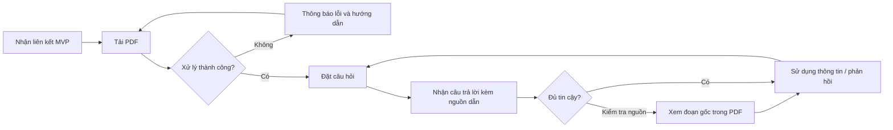

# Tài liệu yêu cầu sản phẩm (PRD) — Công cụ “Chat với tài liệu”

## 0. Xác thực các trụ cột sản phẩm (Product Pillars)

Nguồn đầu vào: [BRD.md](BRD.md) (`BRD-DOCCHAT-001` v0.1, bản nháp) và prompt [PRD_Prompt_IEEE_standard.md](../../../PRD_Prompt_IEEE_standard.md). Phần “Product Foundation” của prompt vẫn là placeholder, nên các trụ cột dưới đây được **suy ra từ BRD** và phải được Product Owner xác nhận.

| Trường nền tảng | Giá trị rút ra từ BRD | Đánh giá |
|---|---|---|
| Tên sản phẩm | Công cụ “Chat với tài liệu” (MVP web) | Tên tạm; chính thức: `OQ-002` |
| Người dùng mục tiêu | Đội phát triển kinh doanh (STK-001) | Hợp lệ, `ASM-001` chưa xác nhận |
| Vấn đề | Khó nắm bắt và tổng hợp thông tin từ nhiều PDF, mất thời gian tra cứu thủ công | Định tính, chưa có số liệu (`OQ-003`, `OQ-004`) |
| Giải pháp cốt lõi | Tải PDF lên → hỏi bằng ngôn ngữ tự nhiên → AI trả lời dựa trên nội dung tài liệu | Khớp BR-001…BR-003 |
| Trụ cột UX | **(1) Web-first, tối giản thao tác** (CON-002); **(2) Câu trả lời kiểm chứng được** (nguồn dẫn); **(3) An toàn dữ liệu theo mặc định** | (1) có trong BRD; (2) và (3) là đề xuất để giảm RSK-001/RSK-002, cần chốt qua `OQ-010`, `OQ-012` |

**Nhận xét xác thực:**
- Trụ cột “mobile-first/offline” trong prompt mẫu **không áp dụng**: BRD chỉ yêu cầu ứng dụng web; offline không nằm trong phạm vi.
- Các con số mục tiêu trong PRD này gắn nhãn **[Đề xuất]**: chúng là ngưỡng khởi điểm để thảo luận, không phải KPI đã được phê duyệt (BRD chưa có baseline, `OQ-005`).
- Các mục **[Chưa xác minh]** và **[TBD: OQ-xxx]** kế thừa trực tiếp từ BRD; không được xem là quyết định.

---

## Kiểm soát tài liệu

| Thuộc tính | Giá trị |
|---|---|
| Số tài liệu | PRD-DOCCHAT-001 |
| Phiên bản | 0.1 — Bản nháp |
| Ngày lập | 19/10/2026 |
| Tài liệu nguồn | BRD-DOCCHAT-001 v0.1 |
| Tác giả / Người duyệt | [TBD: OQ-001] |
| Chuẩn tham chiếu | ISO/IEC/IEEE 29148 |
| Trạng thái sẵn sàng | **Chưa sẵn sàng baseline** — còn các câu hỏi mở chặn (xem mục 6) |

---

## 1. Tóm tắt điều hành và chiến lược

### 1.1 Tầm nhìn sản phẩm

Trở thành cách mặc định để nhân sự phát triển kinh doanh lấy câu trả lời từ kho tài liệu của mình: người dùng hỏi một câu, nhận câu trả lời ngắn gọn kèm vị trí nguồn trong PDF, và không còn phải mở từng tệp để tự tổng hợp. Giá trị dài hạn là rút ngắn thời gian từ “có câu hỏi” đến “có thông tin đáng tin để hành động”, mà vẫn giữ con người chịu trách nhiệm cuối cùng về quyết định (BRU-002).

**Phạm vi MVP:** tải PDF, hỏi đáp bằng AI trên các PDF đã tải, hiển thị nguồn dẫn, trên ứng dụng web. Không gồm định dạng khác PDF, đồng bộ kho ngoài, tạo báo cáo tự động hay tích hợp quy trình bán hàng (BRD 4.5).

### 1.2 Mục tiêu và kết quả then chốt (OKRs)

Tất cả mục tiêu số dưới đây là **[Đề xuất — cần xác nhận qua OQ-005, OQ-006, OQ-009, OQ-011]**.

| Objective | Key Result | Metric (liên kết BRD) | Baseline | Mục tiêu [Đề xuất] |
|---|---|---|---|---|
| **O1.** Giảm công sức tra cứu thông tin trong tập PDF | KR1.1 Giảm trung vị thời gian hoàn tất một tác vụ tra cứu đại diện | MET-001 / BO-001 | Đo trong buổi thử nghiệm không dùng công cụ (`OQ-005`) | Giảm ≥ 50% so với baseline |
| | KR1.2 Phản hồi đầu tiên đến nhanh | Thời gian từ gửi câu hỏi đến token đầu tiên (p95) | — | ≤ 5 giây với tập ≤ 10 PDF |
| **O2.** Câu trả lời đủ tin cậy để dùng | KR2.1 Tỷ lệ tác vụ thử nghiệm được người dùng xác nhận thành công | MET-002 / BO-002 | — | ≥ 80% trên bộ câu hỏi chuẩn |
| | KR2.2 Tỷ lệ câu trả lời có nguồn dẫn đúng vị trí trong PDF | Chấm thủ công trên bộ đáp án tham chiếu (`OQ-009`) | — | ≥ 90% câu trả lời có trích dẫn hợp lệ |
| **O3.** Chứng minh khả năng áp dụng của MVP | KR3.1 Người dùng thử nghiệm quay lại dùng | Số người dùng hoạt động ≥ 3 phiên trong thời gian thử nghiệm | — | ≥ 60% người tham gia |
| | KR3.2 Mức hài lòng | Điểm khảo sát sau thử nghiệm (thang 1–5) | — | ≥ 4,0 |

---

## 2. Persona và hành trình người dùng

### 2.1 Persona mục tiêu

**Persona chính — Lan, chuyên viên phát triển kinh doanh** (STK-001, SN-001)
- Làm việc với nhiều PDF (báo giá, hợp đồng mẫu, tài liệu sản phẩm, báo cáo đối tác — loại cụ thể `[Chưa xác minh: OQ-003]`).
- Mục tiêu: trả lời nhanh câu hỏi của khách hàng/đối tác bằng thông tin chính xác.
- Nỗi đau: phải mở từng tệp, tìm kiếm từ khóa, tự tổng hợp; dễ bỏ sót.
- Kỳ vọng: hỏi tự nhiên, thấy ngay đoạn gốc để tự kiểm tra.

**Persona phụ 1 — Minh, quản lý/người yêu cầu sáng kiến** (STK-002, SN-002)
- Cần xem công cụ có đạt kết quả đo được hay không để quyết định đầu tư tiếp.
- Tương tác với sản phẩm gián tiếp qua số liệu thử nghiệm và báo cáo đánh giá (BR-004).

**Persona phụ 2 — Hà, chủ sở hữu dữ liệu / pháp chế–bảo mật** (STK-004, SN-004)
- Không nhất thiết dùng sản phẩm, nhưng có quyền chặn việc đưa tài liệu vào. Cần minh bạch về lưu trữ, xóa, phạm vi truy cập (`OQ-012`, `OQ-013`).

### 2.2 Hành trình người dùng mức cao (Persona chính)

| Giai đoạn | Hành động của người dùng | Điểm chạm sản phẩm | Kết quả mong muốn |
|---|---|---|---|
| 1. Khám phá | Nhận lời mời/đường dẫn thử nghiệm MVP, đọc hướng dẫn ngắn và lưu ý dữ liệu | Màn hình chào / hướng dẫn | Hiểu công cụ làm gì, không được tải loại tài liệu nào |
| 2. Chuẩn bị | Chọn hoặc kéo-thả một hay nhiều PDF | Khu vực tải lên | PDF xuất hiện trong danh sách “Tài liệu của tôi” với trạng thái xử lý |
| 3. Sẵn sàng | Chờ xử lý xong | Chỉ báo tiến trình | Trạng thái “Sẵn sàng” cho từng tệp |
| 4. Hỏi đáp | Gõ câu hỏi bằng ngôn ngữ tự nhiên | Khung chat | Nhận câu trả lời dạng streaming |
| 5. Kiểm chứng | Bấm vào trích dẫn để xem đoạn gốc trong PDF | Panel nguồn dẫn | Tự xác nhận câu trả lời đúng (BRU-002) |
| 6. Hoàn thành | Sao chép câu trả lời, đánh giá hữu ích/không, hỏi tiếp hoặc xóa tài liệu | Nút sao chép, phản hồi, xóa | Hoàn thành tác vụ tra cứu; dữ liệu có thể xóa theo yêu cầu |



---

## 3. Yêu cầu chức năng và User Story

**Quy ước:** P0 = bắt buộc để ra mắt MVP; P1 = nên có; P2 = nếu còn nguồn lực. Mọi story P0 có tiêu chí chấp nhận Given-When-Then. Cột “Truy vết” trỏ về BRD.

### 3.0 Ma trận Epic

| Epic | Mô tả | Truy vết BRD | Số story P0 / P1 / P2 |
|---|---|---|---|
| E1 Quản lý tài liệu | Tải lên, xem danh sách, xóa PDF | BR-001, BRU-001 | 3 / 1 / 1 |
| E2 Hỏi đáp trên tài liệu | Đặt câu hỏi, nhận trả lời AI | BR-002, BR-003 | 3 / 2 / 1 |
| E3 Nguồn dẫn và kiểm chứng | Trích dẫn đến vị trí trong PDF | BRU-002, OQ-010 | 2 / 0 / 1 |
| E4 Dữ liệu và quyền riêng tư | Thông báo sử dụng, xóa dữ liệu, cô lập người dùng | BRU-001, RSK-002, OQ-012/013 | 2 / 1 / 0 |
| E5 Đo lường và đánh giá MVP | Telemetry, phản hồi, báo cáo đánh giá | BR-004, MET-001/002 | 1 / 1 / 0 |

### E1. Quản lý tài liệu

| ID | User story | Ưu tiên |
|---|---|---|
| US-101 | Là **Lan**, tôi muốn tải một hoặc nhiều tệp PDF lên, để có thể hỏi về nội dung của chúng. | **P0** |
| US-102 | Là **Lan**, tôi muốn xem danh sách PDF đã tải cùng trạng thái xử lý, để biết khi nào có thể bắt đầu hỏi. | **P0** |
| US-103 | Là **Lan**, tôi muốn xóa một PDF khỏi tập tài liệu của mình, để loại bỏ tài liệu không còn dùng hoặc không được phép lưu. | **P0** |
| US-104 | Là **Lan**, tôi muốn chọn tài liệu nào tham gia vào câu hỏi hiện tại, để câu trả lời chỉ dựa trên các tệp liên quan. | P1 |
| US-105 | Là **Lan**, tôi muốn kéo-thả tệp vào trang, để thao tác nhanh hơn. | P2 |

**Acceptance Criteria (P0)**

- **US-101** (AC-001)
  - *Given* tôi đang ở màn hình chính và chọn một PDF hợp lệ (đúng định dạng, trong giới hạn kích thước/số lượng `[TBD: OQ-008]`), *When* tôi xác nhận tải lên, *Then* tệp xuất hiện trong danh sách với trạng thái “Đang xử lý” trong vòng 2 giây.
  - *Given* tôi chọn tệp không phải PDF hoặc vượt giới hạn, *When* tôi xác nhận, *Then* hệ thống từ chối tệp, nêu rõ lý do và giới hạn cho phép, và không làm ảnh hưởng đến các tệp đã tải.
  - *Given* tôi chọn nhiều PDF, *When* một tệp lỗi, *Then* các tệp còn lại vẫn được xử lý bình thường và lỗi được hiển thị riêng cho tệp đó.
- **US-102**
  - *Given* tôi đã tải ít nhất một PDF, *When* tôi mở danh sách tài liệu, *Then* mỗi tệp hiển thị tên, kích thước, thời điểm tải và trạng thái (Đang xử lý / Sẵn sàng / Lỗi).
  - *Given* tệp ở trạng thái “Đang xử lý”, *When* quá trình hoàn tất, *Then* trạng thái tự chuyển thành “Sẵn sàng” mà không cần tải lại trang.
- **US-103**
  - *Given* tôi có một PDF trong danh sách, *When* tôi chọn xóa và xác nhận, *Then* tệp biến mất khỏi danh sách và các câu hỏi mới không còn dùng nội dung tệp đó.
  - *Given* tôi đã xóa một PDF, *When* tôi đặt câu hỏi, *Then* câu trả lời không chứa trích dẫn đến tệp đã xóa. Thời hạn xóa vật lý toàn bộ dữ liệu liên quan theo quyết định `[TBD: OQ-012]`.

### E2. Hỏi đáp trên tài liệu

| ID | User story | Ưu tiên |
|---|---|---|
| US-201 | Là **Lan**, tôi muốn đặt câu hỏi bằng ngôn ngữ tự nhiên về các PDF đã tải, để lấy thông tin mà không phải đọc từng tệp. | **P0** |
| US-202 | Là **Lan**, tôi muốn nhận câu trả lời dựa trên nội dung tài liệu và được báo rõ khi tài liệu không chứa thông tin, để không bị đưa thông tin bịa. | **P0** |
| US-203 | Là **Lan**, tôi muốn hệ thống tổng hợp thông tin từ nhiều PDF trong một câu trả lời, để không phải tự đối chiếu. | **P0** |
| US-204 | Là **Lan**, tôi muốn hỏi tiếp dựa trên ngữ cảnh cuộc hội thoại trước, để không phải lặp lại thông tin. | P1 |
| US-205 | Là **Lan**, tôi muốn dừng một câu trả lời đang được tạo, để không mất thời gian chờ khi tôi đã hỏi sai. | P1 |
| US-206 | Là **Lan**, tôi muốn xuất hoặc sao chép lịch sử hỏi đáp, để dùng lại trong email hoặc ghi chú. | P2 |

**Acceptance Criteria (P0)**

- **US-201** (AC-002)
  - *Given* có ít nhất một PDF ở trạng thái “Sẵn sàng”, *When* tôi gửi một câu hỏi không rỗng, *Then* câu hỏi hiển thị trong khung chat và hệ thống bắt đầu trả lời, có chỉ báo “đang tạo câu trả lời”.
  - *Given* chưa có PDF nào sẵn sàng, *When* tôi cố gửi câu hỏi, *Then* hệ thống chặn gửi và hướng dẫn tôi tải PDF trước.
- **US-202** (AC-003)
  - *Given* câu hỏi có đáp án nằm trong tài liệu, *When* hệ thống trả lời, *Then* nội dung phải nhất quán với đoạn nguồn và đạt ngưỡng đánh giá trên bộ câu hỏi chuẩn `[TBD: OQ-009]`.
  - *Given* câu hỏi không có thông tin trong tập PDF hiện tại, *When* hệ thống trả lời, *Then* nội dung nêu rõ “không tìm thấy trong tài liệu đã tải” thay vì suy đoán từ kiến thức bên ngoài.
- **US-203**
  - *Given* ≥ 2 PDF sẵn sàng và câu hỏi cần thông tin từ nhiều tệp, *When* hệ thống trả lời, *Then* câu trả lời nêu thông tin từ từng tệp liên quan và mỗi ý có nguồn dẫn tương ứng (xem E3).

### E3. Nguồn dẫn và kiểm chứng

| ID | User story | Ưu tiên |
|---|---|---|
| US-301 | Là **Lan**, tôi muốn mỗi câu trả lời kèm trích dẫn (tên tệp, số trang), để tôi biết thông tin đến từ đâu. | **P0** |
| US-302 | Là **Lan**, tôi muốn bấm vào trích dẫn để xem đoạn văn gốc, để tự xác minh trước khi dùng. | **P0** |
| US-303 | Là **Lan**, tôi muốn mở PDF tại đúng trang được trích dẫn, để đọc thêm ngữ cảnh. | P2 |

**Acceptance Criteria (P0)**

- **US-301**
  - *Given* hệ thống đưa ra câu trả lời dựa trên tài liệu, *When* câu trả lời hoàn tất, *Then* mỗi khẳng định chính có ít nhất một trích dẫn gồm tên tệp và số trang.
  - *Given* câu trả lời là “không tìm thấy thông tin”, *When* hiển thị, *Then* không bắt buộc có trích dẫn.
- **US-302**
  - *Given* câu trả lời có trích dẫn, *When* tôi bấm vào một trích dẫn, *Then* hệ thống hiển thị đoạn văn bản gốc được dùng, cùng tên tệp và số trang.
  - *Given* đoạn gốc không thể hiển thị (ví dụ tệp đã bị xóa), *When* tôi bấm, *Then* hệ thống báo rõ lý do thay vì hiển thị trống.

> Yêu cầu nguồn dẫn xuất phát từ đề xuất giảm RSK-001; BRD hiện để mở tại `OQ-010`. **Cần xác nhận trước khi khóa phạm vi P0.**

### E4. Dữ liệu và quyền riêng tư

| ID | User story | Ưu tiên |
|---|---|---|
| US-401 | Là **Lan**, tôi muốn thấy thông báo rõ về loại tài liệu được phép tải và cách dữ liệu được xử lý, để không vô tình tải tài liệu bị cấm. | **P0** |
| US-402 | Là **Hà (chủ dữ liệu)**, tôi muốn tài liệu và hội thoại của mỗi người dùng được tách biệt, để không bị người khác truy cập. | **P0** |
| US-403 | Là **Hà**, tôi muốn có nhật ký ai tải/xóa tài liệu và khi nào, để phục vụ kiểm tra khi cần. | P1 |

**Acceptance Criteria (P0)**

- **US-401**
  - *Given* tôi lần đầu truy cập hoặc chính sách thay đổi, *When* tôi muốn tải tệp, *Then* tôi phải xác nhận đã đọc thông báo sử dụng dữ liệu trước khi tải lên được kích hoạt. Nội dung thông báo theo `[TBD: OQ-012, OQ-013]`.
- **US-402**
  - *Given* hai người dùng A và B, *When* A tải PDF và hỏi đáp, *Then* B không thể thấy, truy vấn hoặc nhận trích dẫn từ tài liệu và hội thoại của A.
  - *Given* một phiên không hợp lệ hoặc hết hạn, *When* gọi truy cập tài liệu, *Then* hệ thống từ chối và yêu cầu đăng nhập lại.

> Cơ chế xác thực/phân quyền chi tiết chưa được BRD yêu cầu rõ (`OQ-014`). Tối thiểu cho MVP: cô lập dữ liệu theo người dùng.

### E5. Đo lường và đánh giá MVP

| ID | User story | Ưu tiên |
|---|---|---|
| US-501 | Là **Minh**, tôi muốn có số liệu MET-001 và MET-002 từ buổi thử nghiệm, để quyết định có tiếp tục đầu tư hay không. | **P0** |
| US-502 | Là **Lan**, tôi muốn đánh giá mỗi câu trả lời (hữu ích / không hữu ích, kèm lý do), để giúp cải thiện chất lượng. | P1 |

**Acceptance Criteria (P0)**

- **US-501** (AC-004)
  - *Given* kết thúc giai đoạn thử nghiệm, *When* Minh xem báo cáo đánh giá, *Then* báo cáo gồm dữ liệu đầu vào, kết quả MET-001/MET-002, so sánh với baseline/mục tiêu và ghi rõ “chưa thể kết luận” nếu mục tiêu chưa được duyệt.
  - *Given* sự kiện telemetry của mục 5.2, *When* trích xuất dữ liệu, *Then* có thể tính được MET-001 và MET-002 mà không cần xử lý thủ công ngoài định nghĩa đã duyệt.

---

## 4. Yêu cầu UX và UI

### 4.1 Luồng và bố cục cốt lõi

Bố cục một trang, hai vùng chính, ưu tiên thao tác tối thiểu:

```
┌──────────────────────────────────────────────────────────────┐
│ Header: Tên công cụ        [Thông báo dữ liệu]   [Người dùng]│
├───────────────────┬──────────────────────────────────────────┤
│ TÀI LIỆU CỦA TÔI  │  KHUNG CHAT                              │
│ [+ Tải PDF lên]   │  ┌────────────────────────────────────┐  │
│ ───────────────── │  │ Bạn: Điều khoản thanh toán là gì?  │  │
│ ☑ baogia.pdf  ✔   │  │ AI: Thanh toán trong 30 ngày…      │  │
│ ☑ hopdong.pdf ⏳  │  │      [baogia.pdf · tr.4] [hd · tr.2]│  │
│ ☐ catalog.pdf ✖   │  └────────────────────────────────────┘  │
│   (xóa)           │  [ Nhập câu hỏi…                 ] [Gửi] │
├───────────────────┴──────────────────────────────────────────┤
│ Panel nguồn dẫn (mở khi bấm trích dẫn): đoạn gốc + trang      │
└──────────────────────────────────────────────────────────────┘
```

**Nguyên tắc tương tác**
1. **Tải lên:** nút chọn tệp (P0); kéo-thả (P2). Mỗi tệp có thanh tiến trình và trạng thái; không chặn người dùng hỏi trên các tệp đã sẵn sàng.
2. **Chat:** trả lời dạng streaming; Enter để gửi, Shift+Enter xuống dòng; có nút Dừng khi đang tạo (P1).
3. **Trích dẫn:** hiển thị dạng chip dưới câu trả lời; bấm để mở panel nguồn. Không dẫn người dùng ra khỏi trang.
4. **Minh bạch AI:** nhãn cố định “Câu trả lời do AI tạo, hãy kiểm tra nguồn trước khi sử dụng” (BRU-002).
5. **Phản hồi:** nút hữu ích / không hữu ích dưới mỗi câu trả lời (P1).
6. **Truy cập:** điều hướng bằng bàn phím, độ tương phản và nhãn đọc màn hình theo WCAG 2.1 AA `[Đề xuất; OQ-011]`.
7. **Ngôn ngữ giao diện:** tiếng Việt; ngôn ngữ tài liệu/câu hỏi được hỗ trợ `[TBD: OQ-008]`.

### 4.2 Trường hợp biên và trạng thái lỗi

| Tình huống | Hành vi bắt buộc |
|---|---|
| **Mất kết nối khi tải lên** | Giữ tệp ở trạng thái “Tải thất bại”, có nút “Thử lại”; không tạo bản ghi trùng khi thử lại. |
| **Mất kết nối khi đang trả lời** | Giữ phần đã nhận, gắn nhãn “Bị gián đoạn”, có nút “Tạo lại”. Câu hỏi của người dùng không bị mất. |
| **Chưa có tài liệu (empty state)** | Hiển thị hướng dẫn ngắn và nút “Tải PDF đầu tiên”; ô nhập câu hỏi bị vô hiệu hóa kèm lý do. |
| **Tài liệu đang xử lý** | Cho phép hỏi trên tệp đã sẵn sàng; thông báo rõ các tệp chưa sẵn sàng không được dùng. |
| **PDF hỏng / có mật khẩu** | Trạng thái “Lỗi”, nêu nguyên nhân dễ hiểu; không làm hỏng các tệp khác. |
| **PDF quét, không có văn bản** | Cảnh báo “Không trích xuất được văn bản” nếu OCR không nằm trong MVP `[TBD: OQ-008]`. |
| **Vượt giới hạn kích thước/số lượng** | Chặn trước khi tải lên và nêu giới hạn cụ thể. |
| **Câu hỏi rỗng / quá dài** | Vô hiệu hóa nút Gửi nếu rỗng; thông báo độ dài tối đa nếu vượt giới hạn. |
| **Câu hỏi ngoài phạm vi tài liệu** | Trả lời “không tìm thấy trong tài liệu đã tải”, không suy đoán. |
| **Dịch vụ AI lỗi/quá tải/hết thời gian chờ** | Hiển thị thông báo thân thiện, giữ câu hỏi, cho phép thử lại; ghi nhận sự kiện lỗi. |
| **Phiên hết hạn** | Yêu cầu đăng nhập lại, giữ nguyên bản nháp câu hỏi chưa gửi. |
| **Nội dung nhạy cảm bị tải nhầm** | Có lối xóa ngay trong một thao tác, kèm hướng dẫn báo cáo (quy trình `[TBD: OQ-012]`). |
| **Trích dẫn không còn hợp lệ** | Hiển thị “Nguồn không còn khả dụng”, không để trống. |

---

## 5. Tiêu chí phát hành và chỉ số sau ra mắt

### 5.1 Tiêu chí cổng phát hành (Launch Gate)

Ngưỡng là **[Đề xuất]**, chờ xác nhận tại `OQ-005`, `OQ-009`, `OQ-011`.

| Nhóm | Tiêu chí bắt buộc |
|---|---|
| **Chức năng** | 100% story P0 đạt toàn bộ Acceptance Criteria; không còn lỗi mức Blocker/Critical; ≤ 3 lỗi Major có phương án khắc phục. |
| **Chất lượng câu trả lời** | Trên bộ câu hỏi chuẩn do chủ nghiệp vụ duyệt: tỷ lệ đạt ≥ 80% (MET-002); ≥ 90% câu trả lời có trích dẫn hợp lệ; 0 trường hợp trích dẫn đến tệp/trang không tồn tại. |
| **Hiệu năng** | Tải trang đầu ≤ 2 giây (p95); token đầu tiên của câu trả lời ≤ 5 giây (p95) với ≤ 10 PDF; xử lý PDF ≤ 60 giây cho tệp trong giới hạn cho phép `[TBD: OQ-008]`. |
| **Bảo mật và dữ liệu** | Cô lập dữ liệu giữa người dùng được kiểm thử (US-402); kết nối mã hóa khi truyền; dữ liệu mã hóa khi lưu; không ghi nội dung tài liệu/câu hỏi vào log chung; chức năng xóa hoạt động; không còn lỗ hổng mức Cao/Nghiêm trọng từ quét bảo mật. |
| **Tuân thủ** | Chủ sở hữu dữ liệu/pháp chế phê duyệt tập tài liệu thử nghiệm, vị trí xử lý và thời hạn lưu/xóa (`OQ-012`, `OQ-013`) **trước khi tải dữ liệu thật**. |
| **QA** | Độ bao phủ test tự động ≥ 70% cho logic nghiệp vụ; 100% AC của story P0 có test hồi quy; kiểm thử trên 2 phiên bản gần nhất của Chrome, Edge, Safari `[Đề xuất]`; kiểm thử khả năng tiếp cận mức cơ bản. |
| **Vận hành** | Có giám sát và cảnh báo lỗi; có runbook xử lý sự cố; có cơ chế tắt khẩn cấp (kill switch) cho tính năng hỏi đáp. |
| **Đo lường** | Toàn bộ sự kiện telemetry mục 5.2 được kiểm tra hoạt động; baseline MET-001 đã được thu thập. |
| **Phê duyệt** | Nhà bảo trợ, chủ nghiệp vụ, PO và (nếu áp dụng) pháp chế/bảo mật ký duyệt (BRD 4.14). |

### 5.2 Phân tích và theo dõi (Telemetry)

Nguyên tắc: không gửi nội dung tài liệu hay nội dung câu hỏi vào hệ thống phân tích; chỉ ghi siêu dữ liệu (độ dài, số lượng, mã lỗi). Mọi sự kiện kèm `user_id` (ẩn danh hóa), `session_id`, `timestamp`, `app_version`.

| Sự kiện | Thời điểm kích hoạt | Thuộc tính chính | Dùng để đo |
|---|---|---|---|
| `session_started` | Mở ứng dụng | `entry_source` | Mức tiếp cận |
| `data_notice_accepted` | Xác nhận thông báo dữ liệu | `notice_version` | Tuân thủ (US-401) |
| `upload_started` | Bắt đầu tải một tệp | `file_size`, `file_index` | Phễu tải lên |
| `upload_succeeded` | Tải xong | `file_size`, `duration_ms` | Phễu tải lên |
| `upload_failed` | Tải lỗi | `error_code`, `file_size` | Chất lượng/lỗi |
| `document_ready` | Xử lý xong | `page_count`, `processing_ms` | Hiệu năng xử lý |
| `document_processing_failed` | Xử lý lỗi | `error_code` | Hỗ trợ PDF (OQ-008) |
| `document_deleted` | Xóa tài liệu | `document_age_days` | Quyền riêng tư |
| `question_submitted` | Gửi câu hỏi | `question_length`, `docs_selected_count` | Mức sử dụng, MET-001 |
| `answer_first_token` | Nhận token đầu | `latency_ms` | KR1.2 |
| `answer_completed` | Câu trả lời hoàn tất | `total_ms`, `citation_count`, `grounded` (true/false) | Chất lượng, KR2.2 |
| `answer_failed` | Lỗi khi trả lời | `error_code`, `stage` | Độ tin cậy |
| `answer_stopped` | Người dùng dừng | `elapsed_ms` | Trải nghiệm |
| `citation_opened` | Bấm xem nguồn | `citation_index` | Mức kiểm chứng (BRU-002) |
| `answer_feedback` | Đánh giá hữu ích/không | `rating`, `reason_code` | MET-002, KR2.1 |
| `task_marked_done` | Người dùng ghi nhận đã có thông tin cần | `task_id`, `elapsed_ms`, `success` | MET-001, MET-002 |
| `copy_answer` | Sao chép câu trả lời | `answer_id` | Giá trị sử dụng |

**Phễu chính cần theo dõi:** `session_started` → `data_notice_accepted` → `upload_succeeded` → `document_ready` → `question_submitted` → `answer_completed` → `citation_opened` / `answer_feedback(useful)`. Cảnh báo khi một bước rớt vượt ngưỡng `[TBD]`.

**Báo cáo sau ra mắt:** bảng điều khiển hằng tuần cho MET-001, MET-002, KR1–KR3, tỷ lệ lỗi theo bước, và danh sách câu hỏi bị đánh giá “không hữu ích” để cải tiến.

---

## 6. Giả định, phụ thuộc, rủi ro và câu hỏi mở chặn PRD

| ID | Nội dung | Liên kết BRD | Chặn |
|---|---|---|---|
| Giả định | Đội phát triển kinh doanh là nhóm người dùng chính; có thể có tập PDF đại diện được phép dùng | ASM-001, ASM-002 | Phạm vi, dữ liệu thử |
| Phụ thuộc | Chốt MET-001/002, baseline, mục tiêu | DEP-001, OQ-005 | O1, O2, cổng phát hành |
| Phụ thuộc | Pháp chế/bảo mật phê duyệt dữ liệu | DEP-002, OQ-012/013 | Tải dữ liệu thật |
| Rủi ro | Câu trả lời sai/thiếu căn cứ | RSK-001 | Giảm bằng nguồn dẫn, thông báo AI, bộ câu hỏi chuẩn |
| Rủi ro | Tài liệu nhạy cảm bị tải lên | RSK-002 | Giảm bằng thông báo, xóa, cô lập |
| Rủi ro | Phạm vi PDF không giới hạn | RSK-004, OQ-008 | Giảm bằng giới hạn kích thước/số lượng |

**Câu hỏi mở cần chốt trước khi baseline PRD:**
`OQ-001` (người chịu trách nhiệm), `OQ-005` (KPI, baseline), `OQ-006` (thời hạn, ngân sách, định nghĩa MVP), `OQ-008` (loại PDF, giới hạn, OCR, ngôn ngữ), `OQ-009` (bộ câu hỏi chuẩn và ngưỡng đạt), `OQ-010` (nguồn dẫn và người xác nhận), `OQ-011` (hiệu năng/sẵn sàng), `OQ-012`–`OQ-014` (dữ liệu, quyền, nhật ký, xác thực).

**Tuyên bố sẵn sàng:** PRD v0.1 đủ để khởi động thiết kế và ước lượng, nhưng **chưa sẵn sàng baseline** cho đến khi các câu hỏi chặn trên được đóng.

---

## 7. Ma trận truy vết BRD → PRD

| BRD | Yêu cầu nghiệp vụ | PRD story | AC |
|---|---|---|---|
| BR-001 | Tải PDF vào tập tra cứu | US-101, US-102, US-103 | AC-001 |
| BR-002 | Đặt câu hỏi ngôn ngữ tự nhiên | US-201 | AC-002 |
| BR-003 | Nhận phản hồi AI liên quan | US-202, US-203, US-301, US-302 | AC-003 |
| BR-004 | Xác nhận kết quả MET-001/002 | US-501 | AC-004 |
| BRU-001 | Chỉ dùng PDF có quyền | US-401, US-103 | — |
| BRU-002 | Người dùng xem xét trước khi dùng | US-301, US-302, nhãn AI (4.1) | — |
| SN-004 | Quản lý dữ liệu | US-401, US-402, US-403 | — |
| SN-005 | Tiêu chí vận hành | Mục 5.1 (Vận hành, Hiệu năng) | — |
