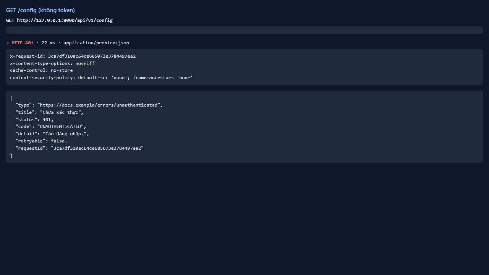
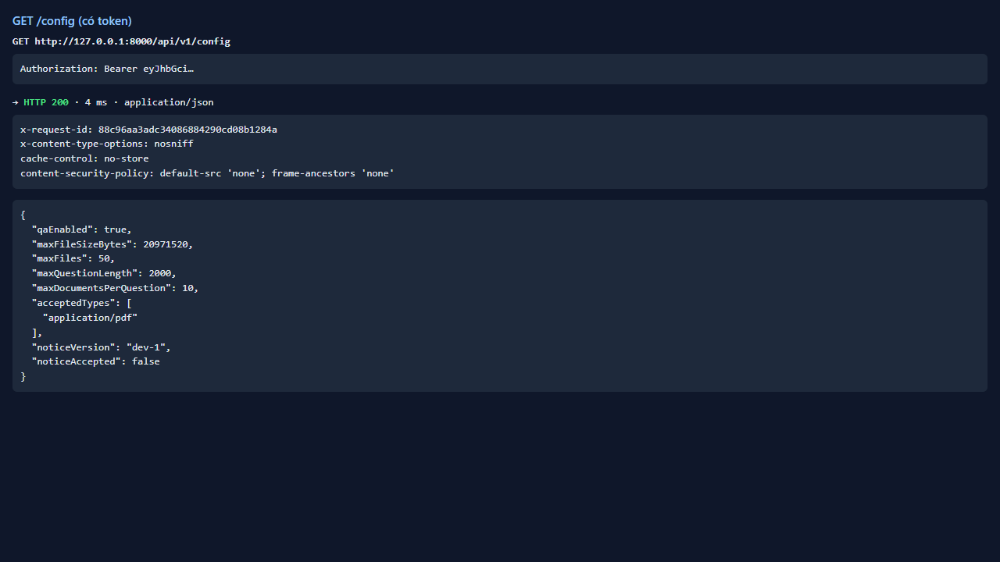
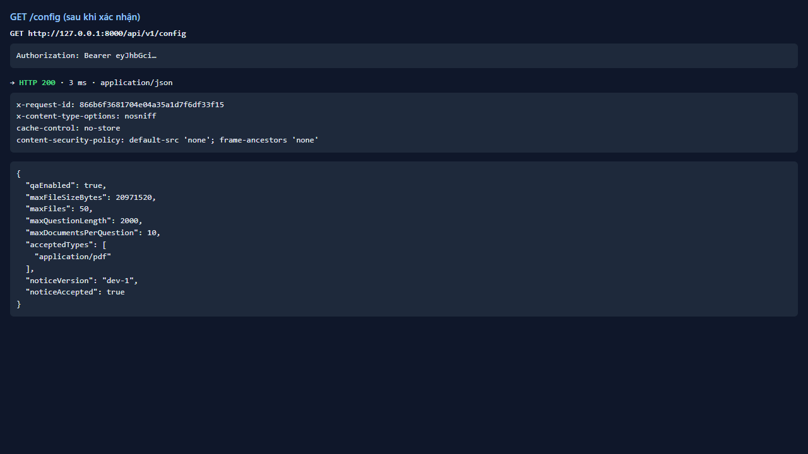
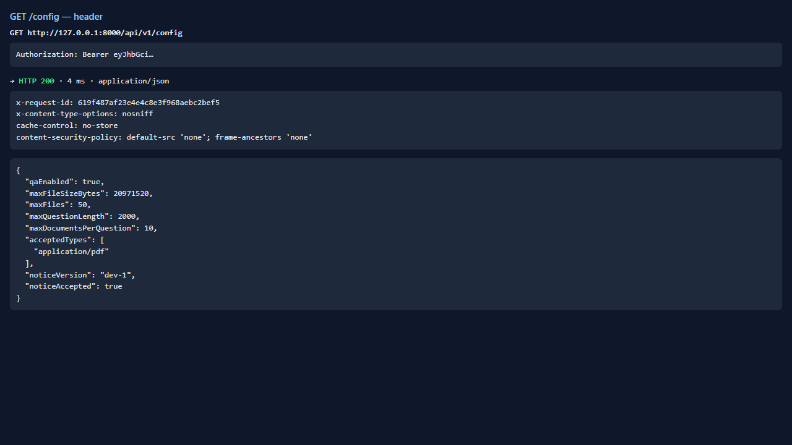

# Test report — API-001: GET /config trả giới hạn và cờ

| Mục | Giá trị |
|---|---|
| **Kết quả** | **PASS** |
| Test case | [API-001](../../cases/API-001.md) |
| URL kiểm thử | http://127.0.0.1:8000 |
| Trình duyệt | Microsoft Edge (Chromium) (1280×720) |
| Bắt đầu / kết thúc | 2026-10-30T11:59:43.202Z → 2026-10-30T11:59:46.317Z (3.1s) |
| Số bước | PASS: 4 · FAIL: 0 · SKIP: 0 |
| Video | [video/API-001.webm](video/API-001.webm) |

<video src="video/API-001.webm" controls width="720"></video>

## Kết quả từng bước

### Bước 1. GET /config không token — ✅ PASS

- **Mong đợi:** 401 problem+json
- **Thực tế:** 401 code=UNAUTHENTICATED

### Bước 2. GET /config có token (chưa xác nhận thông báo) — ✅ PASS

- **Mong đợi:** 200; qaEnabled=true, noticeVersion, noticeAccepted=false, giới hạn 20MB/50 tệp/2000 ký tự
- **Thực tế:** maxFileSizeBytes=20971520, maxFiles=50, maxQuestionLength=2000, maxDocumentsPerQuestion=10

### Bước 3. Xác nhận thông báo rồi GET /config — ✅ PASS

- **Mong đợi:** noticeAccepted=true
- **Thực tế:** Đúng như mong đợi

### Bước 4. Kiểm tra header X-Request-Id — ✅ PASS

- **Mong đợi:** Có X-Request-Id
- **Thực tế:** X-Request-Id=619f487af23e4e4c8e3f968aebc2bef5

