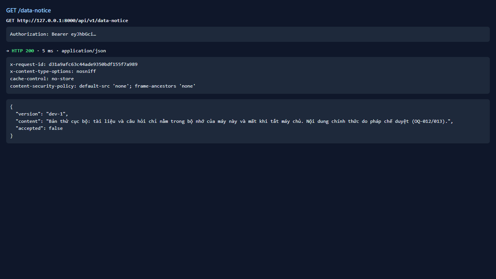
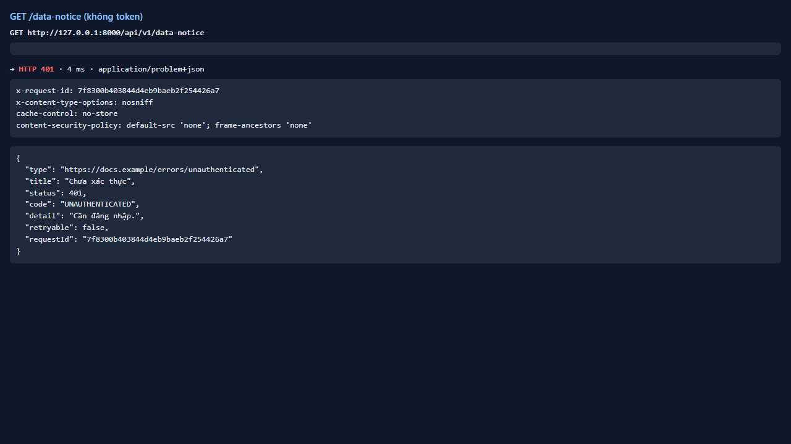

# Test report — API-002: GET /data-notice trả thông báo hiện hành

| Mục | Giá trị |
|---|---|
| **Kết quả** | **PASS** |
| Test case | [API-002](../../cases/API-002.md) |
| URL kiểm thử | http://127.0.0.1:8000 |
| Trình duyệt | Microsoft Edge (Chromium) (1280×720) |
| Bắt đầu / kết thúc | 2026-10-30T11:59:47.964Z → 2026-10-30T11:59:49.543Z (1.6s) |
| Số bước | PASS: 2 · FAIL: 0 · SKIP: 0 |
| Video | [video/API-002.webm](video/API-002.webm) |

<video src="video/API-002.webm" controls width="720"></video>

## Kết quả từng bước

### Bước 1. GET /data-notice có token — ✅ PASS

- **Mong đợi:** 200; version + nội dung không rỗng
- **Thực tế:** version=dev-1, accepted=false

### Bước 2. GET /data-notice không token — ✅ PASS

- **Mong đợi:** 401
- **Thực tế:** Đúng như mong đợi

