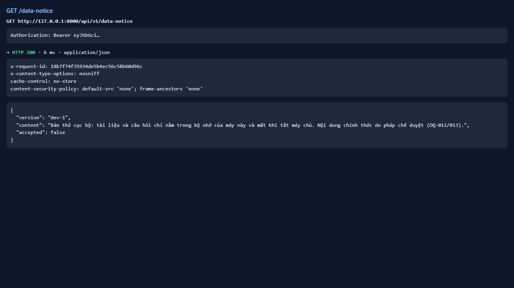
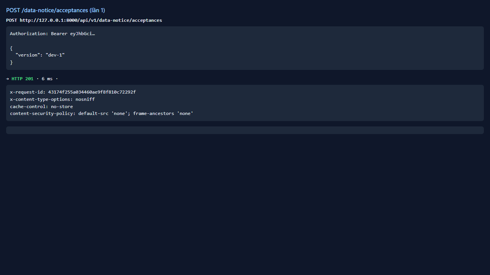
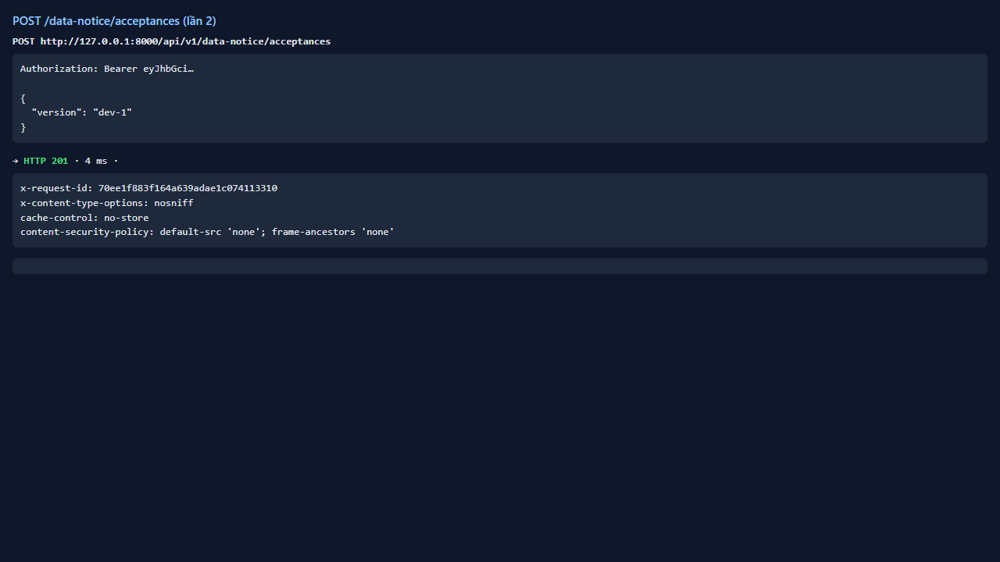
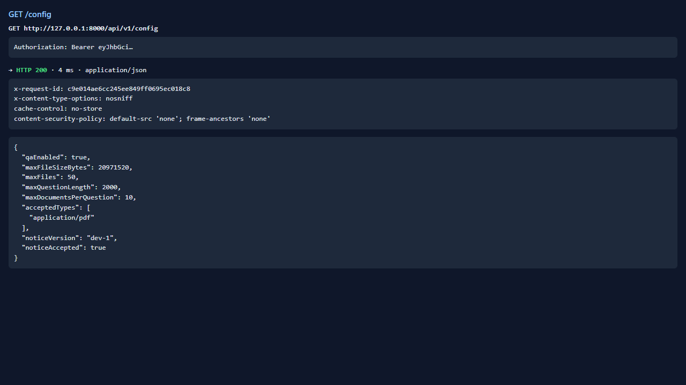
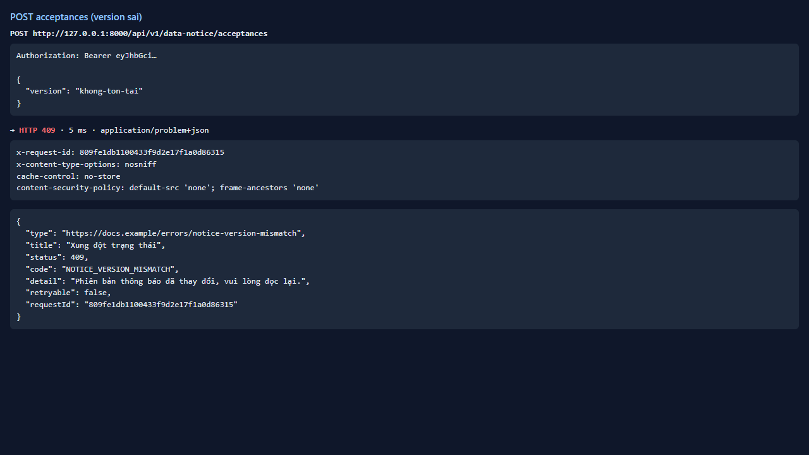

# Test report — API-003: POST /data-notice/acceptances (idempotent)

| Mục | Giá trị |
|---|---|
| **Kết quả** | **PASS** |
| Test case | [API-003](../../cases/API-003.md) |
| URL kiểm thử | http://127.0.0.1:8000 |
| Trình duyệt | Microsoft Edge (Chromium) (1280×720) |
| Bắt đầu / kết thúc | 2026-10-30T11:59:51.148Z → 2026-10-30T11:59:55.008Z (3.9s) |
| Số bước | PASS: 5 · FAIL: 0 · SKIP: 0 |
| Video | [video/API-003.webm](video/API-003.webm) |

<video src="video/API-003.webm" controls width="720"></video>

## Kết quả từng bước

### Bước 1. Lấy version từ GET /data-notice — ✅ PASS

- **Mong đợi:** 200
- **Thực tế:** Đúng như mong đợi

### Bước 2. POST /data-notice/acceptances — ✅ PASS

- **Mong đợi:** 201
- **Thực tế:** Đúng như mong đợi

### Bước 3. Gọi lại lần hai cùng body — ✅ PASS

- **Mong đợi:** 201 hoặc tương đương, không 5xx
- **Thực tế:** HTTP 201

### Bước 4. GET /config — ✅ PASS

- **Mong đợi:** noticeAccepted=true
- **Thực tế:** Đúng như mong đợi

### Bước 5. Gửi version sai — ✅ PASS

- **Mong đợi:** Bị từ chối 4xx problem+json
- **Thực tế:** HTTP 409 code=NOTICE_VERSION_MISMATCH

