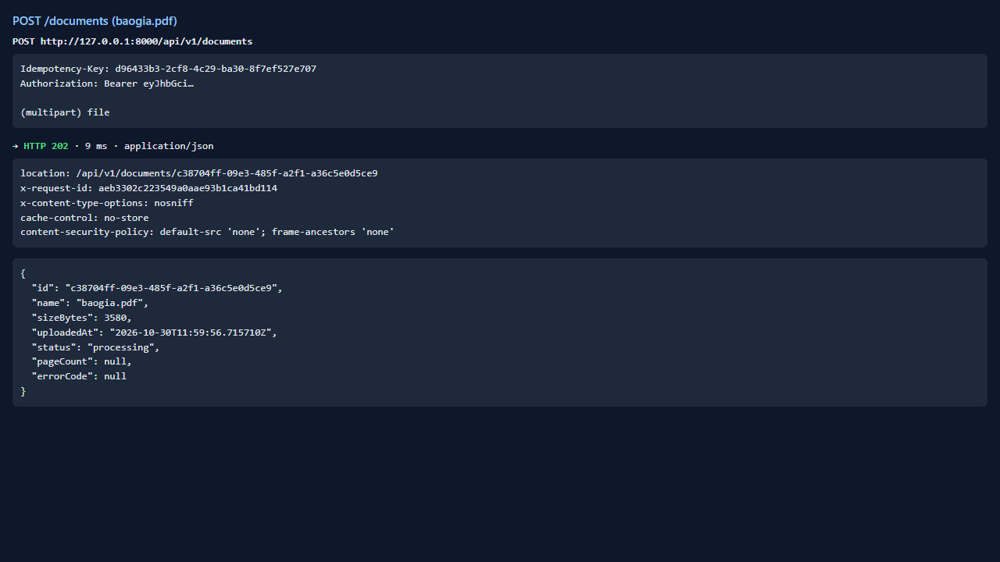
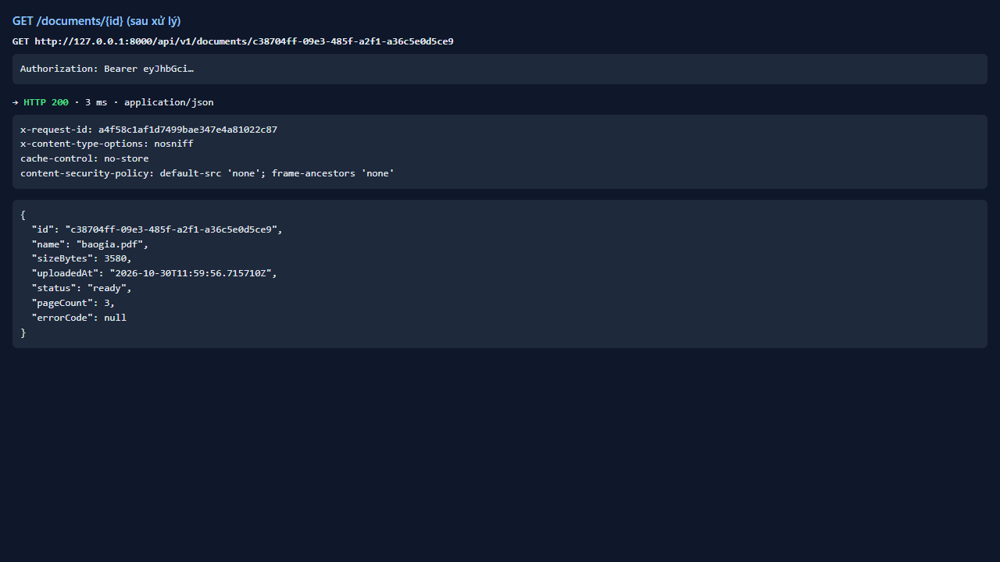
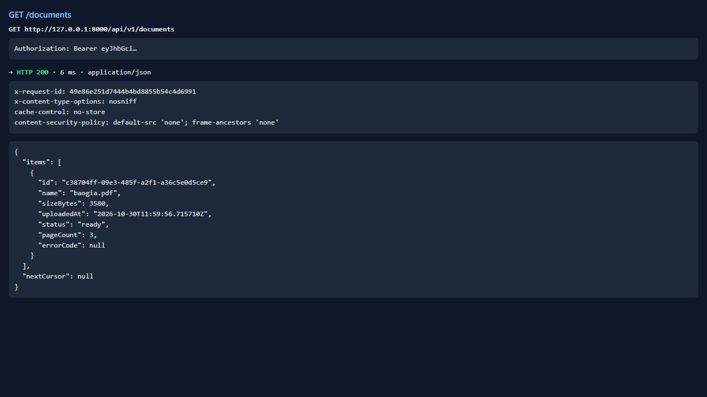

# Test report — API-004: POST /documents tải PDF hợp lệ → 202

| Mục | Giá trị |
|---|---|
| **Kết quả** | **PASS** |
| Test case | [API-004](../../cases/API-004.md) |
| URL kiểm thử | http://127.0.0.1:8000 |
| Trình duyệt | Microsoft Edge (Chromium) (1280×720) |
| Bắt đầu / kết thúc | 2026-10-30T11:59:56.670Z → 2026-10-30T11:59:59.012Z (2.3s) |
| Số bước | PASS: 3 · FAIL: 0 · SKIP: 0 |
| Video | [video/API-004.webm](video/API-004.webm) |

<video src="video/API-004.webm" controls width="720"></video>

## Kết quả từng bước

### Bước 1. POST /documents baogia.pdf + Idempotency-Key — ✅ PASS

- **Mong đợi:** 202; Location; status=processing; ≤ 2s
- **Thực tế:** 202 trong 793 ms; Location=/api/v1/documents/c38704ff-09e3-485f-a2f1-a36c5e0d5ce9

### Bước 2. Poll GET /documents/{id} tới ready — ✅ PASS

- **Mong đợi:** ready; pageCount=3; errorCode=null
- **Thực tế:** status=ready, pageCount=3

### Bước 3. GET /documents — ✅ PASS

- **Mong đợi:** Đúng 1 tài liệu với name, sizeBytes, uploadedAt, status
- **Thực tế:** Đúng như mong đợi

