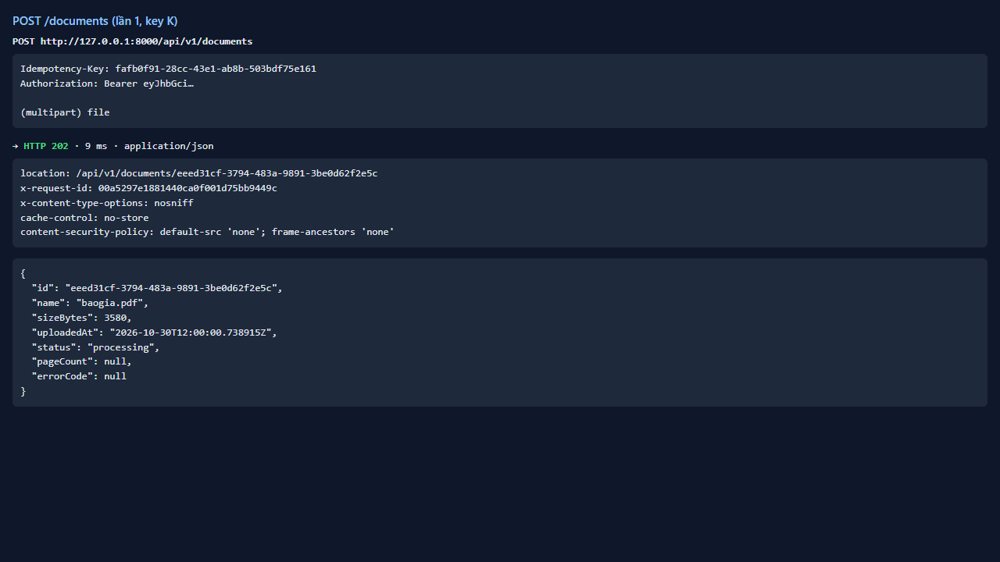
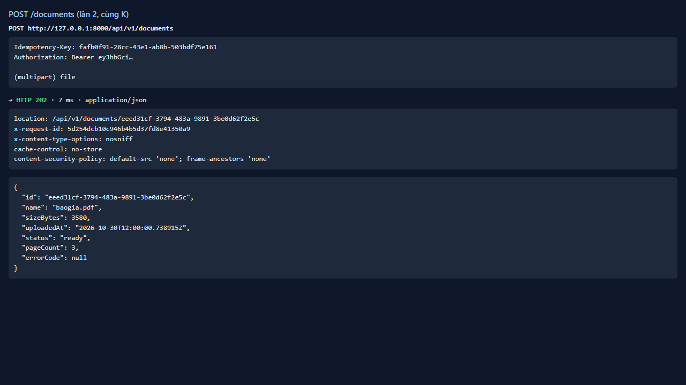
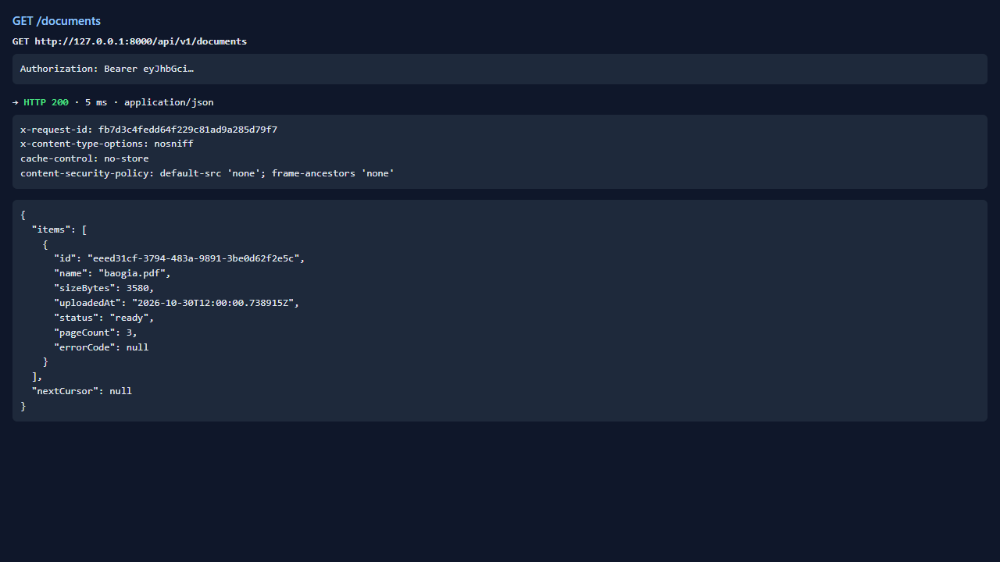
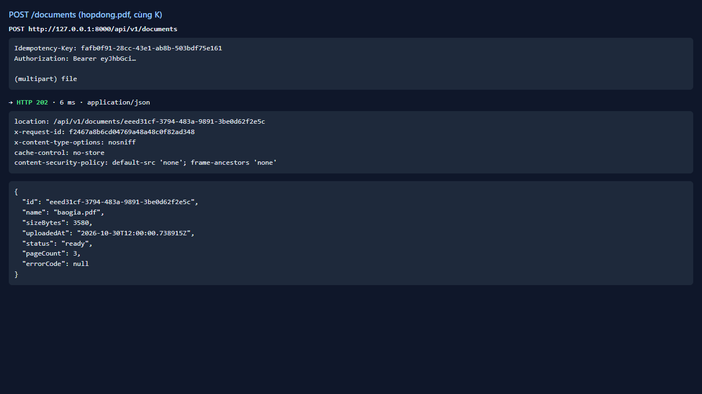
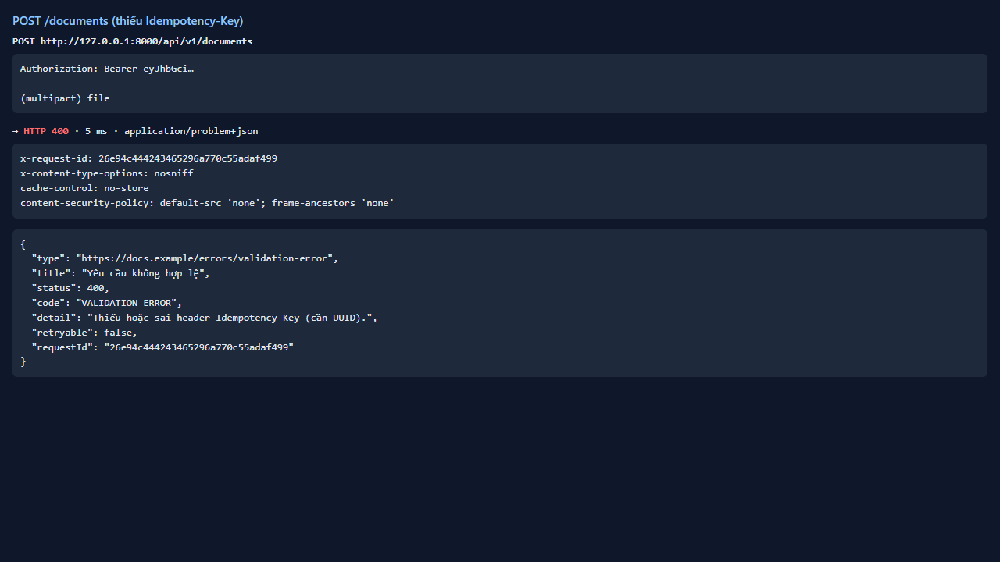

# Test report — API-005: POST /documents idempotent theo Idempotency-Key

| Mục | Giá trị |
|---|---|
| **Kết quả** | **PASS** |
| Test case | [API-005](../../cases/API-005.md) |
| URL kiểm thử | http://127.0.0.1:8000 |
| Trình duyệt | Microsoft Edge (Chromium) (1280×720) |
| Bắt đầu / kết thúc | 2026-10-30T12:00:00.690Z → 2026-10-30T12:00:04.548Z (3.9s) |
| Số bước | PASS: 5 · FAIL: 0 · SKIP: 0 |
| Video | [video/API-005.webm](video/API-005.webm) |

<video src="video/API-005.webm" controls width="720"></video>

## Kết quả từng bước

### Bước 1. Tải baogia.pdf với key K — ✅ PASS

- **Mong đợi:** 202; ghi id
- **Thực tế:** Đúng như mong đợi

### Bước 2. Gửi lại y hệt (cùng K) — ✅ PASS

- **Mong đợi:** Cùng id, không tạo mới
- **Thực tế:** HTTP 202, id trùng

### Bước 3. GET /documents — ✅ PASS

- **Mong đợi:** Chỉ 1 tài liệu
- **Thực tế:** Đúng như mong đợi

### Bước 4. Tệp khác với cùng K — ✅ PASS

- **Mong đợi:** Nhất quán (trả bản ghi cũ hoặc 4xx) — ghi thực tế
- **Thực tế:** HTTP 202; id=trả bản ghi cũ; số tài liệu=1

### Bước 5. Không có header Idempotency-Key — ✅ PASS

- **Mong đợi:** 400/422 VALIDATION_ERROR
- **Thực tế:** HTTP 400 code=VALIDATION_ERROR

