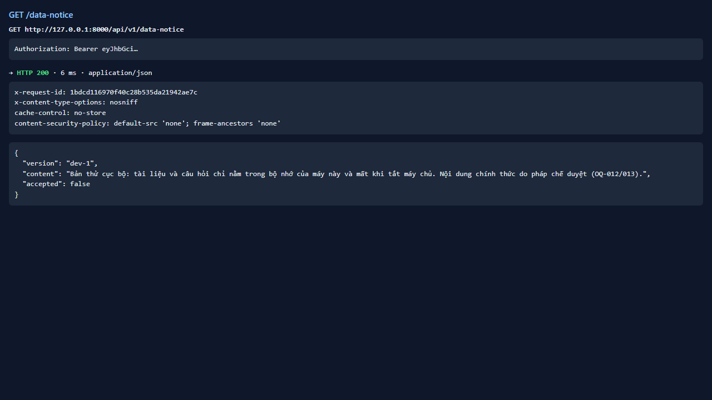
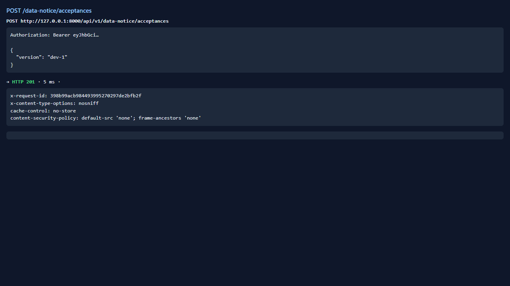
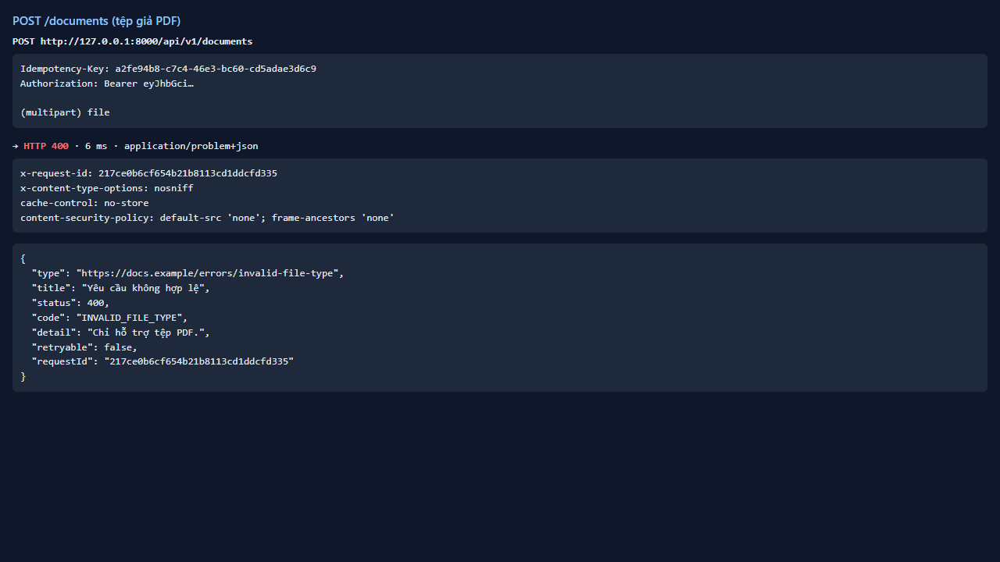
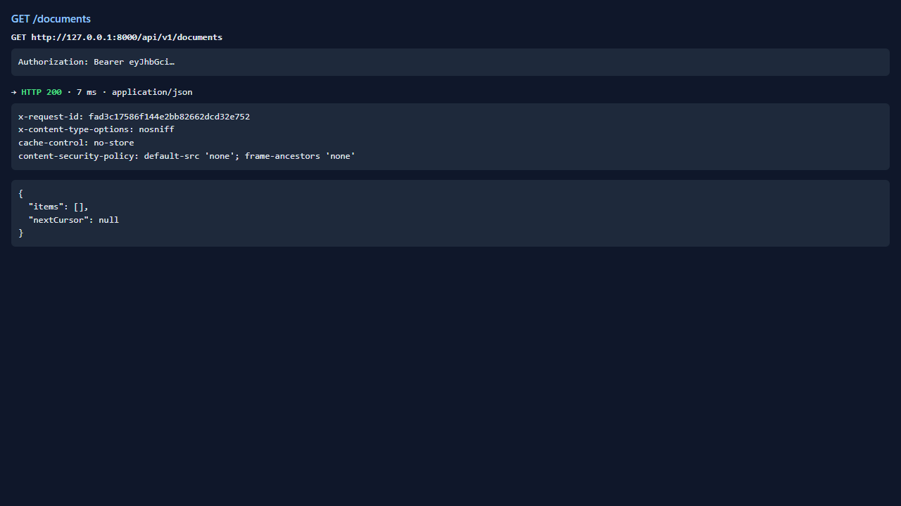

# Test report — API-006: POST /documents từ chối tệp không phải PDF

| Mục | Giá trị |
|---|---|
| **Kết quả** | **PASS** |
| Test case | [API-006](../../cases/API-006.md) |
| URL kiểm thử | http://127.0.0.1:8000 |
| Trình duyệt | Microsoft Edge (Chromium) (1280×720) |
| Bắt đầu / kết thúc | 2026-10-23T13:51:10.941Z → 2026-10-23T13:51:14.881Z (3.9s) |
| Số bước | PASS: 4 · FAIL: 0 · SKIP: 0 |
| Video | [video/API-006.webm](video/API-006.webm) |

<video src="video/API-006.webm" controls width="720"></video>

## Kết quả từng bước

### Bước 1. Chuẩn bị: đăng nhập dev và xác nhận thông báo — ✅ PASS

- **Mong đợi:** Có token; acceptances → 201
- **Thực tế:** Đúng như mong đợi

### Bước 2. Tải khong-phai-pdf.pdf (nội dung văn bản thường) — ✅ PASS

- **Mong đợi:** 400 INVALID_FILE_TYPE, problem+json, có requestId, retryable=false
- **Thực tế:** HTTP 400, code=INVALID_FILE_TYPE, retryable=false

### Bước 3. Tải tệp .txt Content-Type text/plain — ✅ PASS

- **Mong đợi:** 400 INVALID_FILE_TYPE
- **Thực tế:** HTTP 400, code=INVALID_FILE_TYPE

### Bước 4. GET /documents — ✅ PASS

- **Mong đợi:** Không có tài liệu nào được tạo
- **Thực tế:** Đúng như mong đợi

