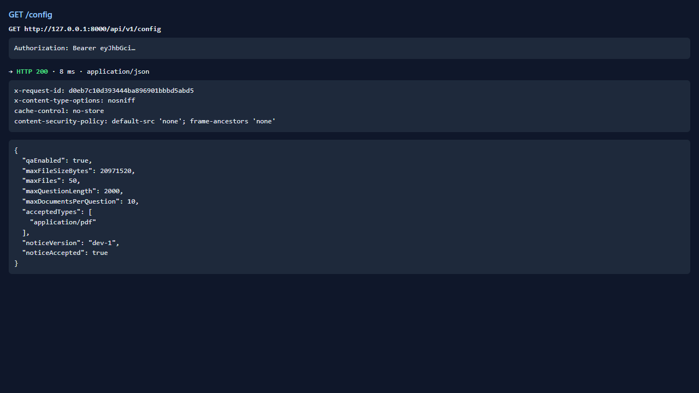
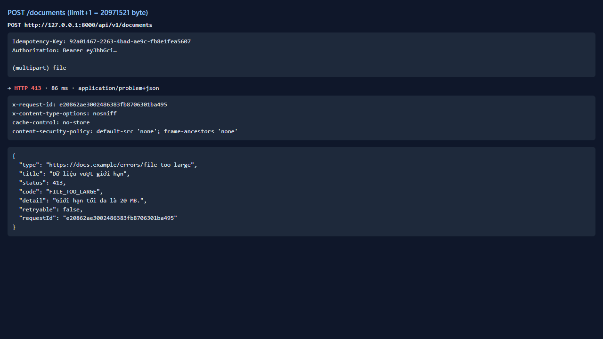
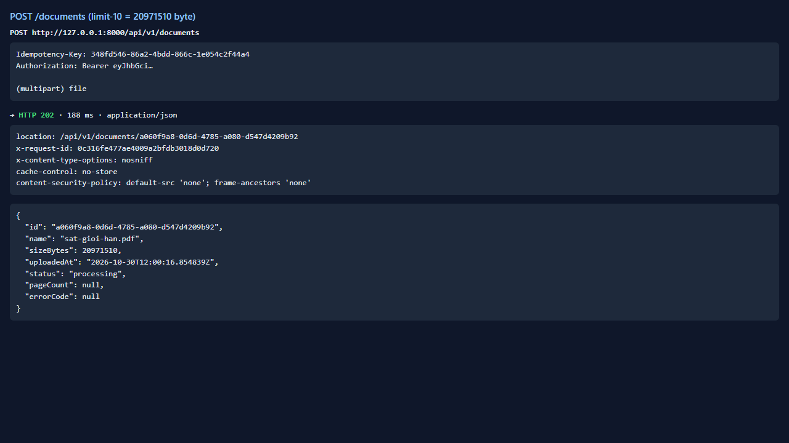

# Test report — API-007: POST /documents từ chối tệp quá kích thước

| Mục | Giá trị |
|---|---|
| **Kết quả** | **PASS** |
| Test case | [API-007](../../cases/API-007.md) |
| URL kiểm thử | http://127.0.0.1:8000 |
| Trình duyệt | Microsoft Edge (Chromium) (1280×720) |
| Bắt đầu / kết thúc | 2026-10-30T12:00:15.076Z → 2026-10-30T12:00:17.713Z (2.6s) |
| Số bước | PASS: 3 · FAIL: 0 · SKIP: 0 |
| Video | [video/API-007.webm](video/API-007.webm) |

<video src="video/API-007.webm" controls width="720"></video>

## Kết quả từng bước

### Bước 1. Đọc giới hạn từ /config — ✅ PASS

- **Mong đợi:** Có maxFileSizeBytes
- **Thực tế:** limit=20971520

### Bước 2. Tải tệp %PDF- dài limit+1 byte — ✅ PASS

- **Mong đợi:** 413 FILE_TOO_LARGE; detail nêu giới hạn
- **Thực tế:** 413 detail="Giới hạn tối đa là 20 MB."

### Bước 3. Tải tệp %PDF- kích thước limit-10 (nội dung không hợp lệ) — ✅ PASS

- **Mong đợi:** Không bị 413 (chứng minh ranh giới)
- **Thực tế:** HTTP 202

