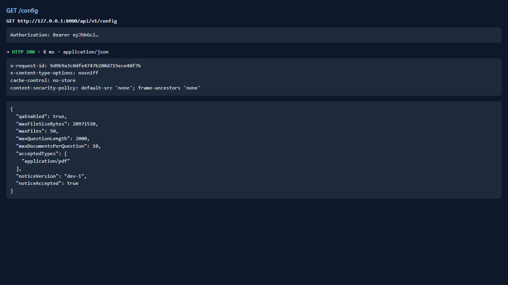
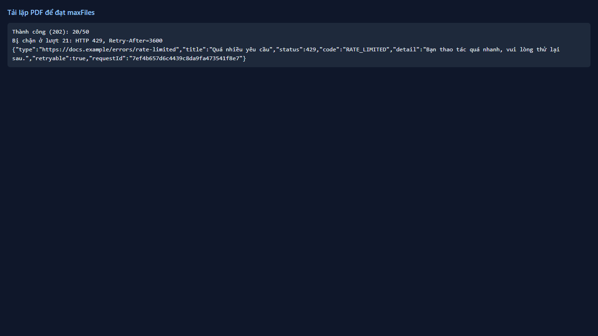

# Test report — API-008: POST /documents vượt số tệp tối đa

| Mục | Giá trị |
|---|---|
| **Kết quả** | **FAIL** |
| Test case | [API-008](../../cases/API-008.md) |
| URL kiểm thử | http://127.0.0.1:8000 |
| Trình duyệt | Microsoft Edge (Chromium) (1280×720) |
| Bắt đầu / kết thúc | 2026-10-30T12:00:19.466Z → 2026-10-30T12:00:21.115Z (1.6s) |
| Số bước | PASS: 1 · FAIL: 1 · SKIP: 1 |
| Video | [video/API-008.webm](video/API-008.webm) |

<video src="video/API-008.webm" controls width="720"></video>

## Kết quả từng bước

### Bước 1. Đọc maxFiles từ /config — ✅ PASS

- **Mong đợi:** Giá trị (mặc định 50)
- **Thực tế:** maxFiles=50

### Bước 2. Tải lặp PDF nhỏ tới khi đạt maxFiles — ❌ FAIL

- **Mong đợi:** Mọi lần đều 202
- **Thực tế:** Bị chặn bởi HTTP 429 sau 20 lượt (trước maxFiles=50)
  
  expect(received).toBeNull()
  
  Received: {"at": 21, "body": "{\"type\":\"https://docs.example/errors/rate-limited\",\"title\":\"Quá nhiều yêu cầu\",\"status\":429,\"code\":\"RATE_LIMITED\",\"detail\":\"Bạn thao tác quá nhanh, vui lòng thử lại sau.\",\"retryable\":true,\"requestId\":\"7ef4b657d6c4439c8da9fa473541f8e7\"}", "retryAfter": "3600", "status": 429}

### Bước 3. Tải thêm 1 tệp — ⏭ SKIP

- **Mong đợi:** 409 LIMIT_EXCEEDED
- **Thực tế:** Bỏ qua do bước trước thất bại

## Lỗi phát hiện

- Xung đột giữa hai giới hạn: rate limit tải lên (HTTP 429, Retry-After=3600s) chặn ở lượt 21, TRƯỚC khi đạt maxFiles=50. Vì vậy giới hạn số tệp (409 LIMIT_EXCEEDED) không thể kiểm chứng bằng một người dùng. Không né bằng cách sửa mã.

