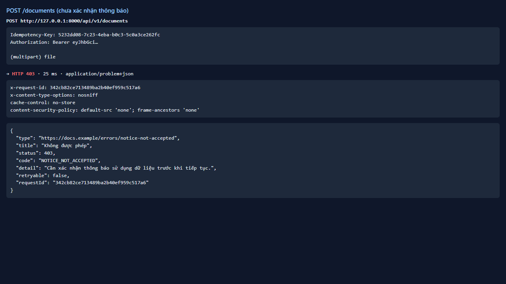
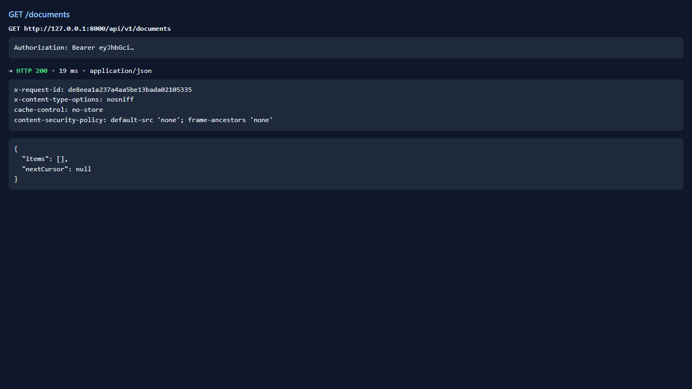
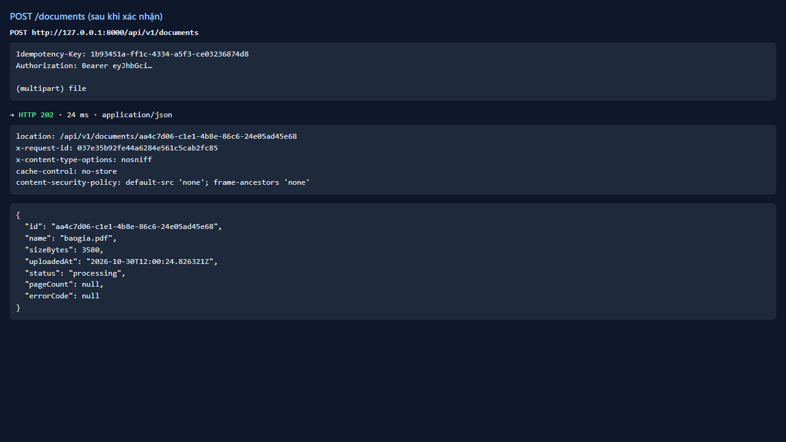

# Test report — API-009: POST /documents bị chặn khi chưa xác nhận thông báo

| Mục | Giá trị |
|---|---|
| **Kết quả** | **PASS** |
| Test case | [API-009](../../cases/API-009.md) |
| URL kiểm thử | http://127.0.0.1:8000 |
| Trình duyệt | Microsoft Edge (Chromium) (1280×720) |
| Bắt đầu / kết thúc | 2026-10-30T12:00:23.149Z → 2026-10-30T12:00:25.578Z (2.4s) |
| Số bước | PASS: 3 · FAIL: 0 · SKIP: 0 |
| Video | [video/API-009.webm](video/API-009.webm) |

<video src="video/API-009.webm" controls width="720"></video>

## Kết quả từng bước

### Bước 1. Tải baogia.pdf khi chưa xác nhận — ✅ PASS

- **Mong đợi:** 403 NOTICE_NOT_ACCEPTED
- **Thực tế:** Đúng như mong đợi

### Bước 2. GET /documents — ✅ PASS

- **Mong đợi:** Rỗng
- **Thực tế:** Đúng như mong đợi

### Bước 3. Xác nhận thông báo rồi tải lại — ✅ PASS

- **Mong đợi:** 202
- **Thực tế:** Đúng như mong đợi

