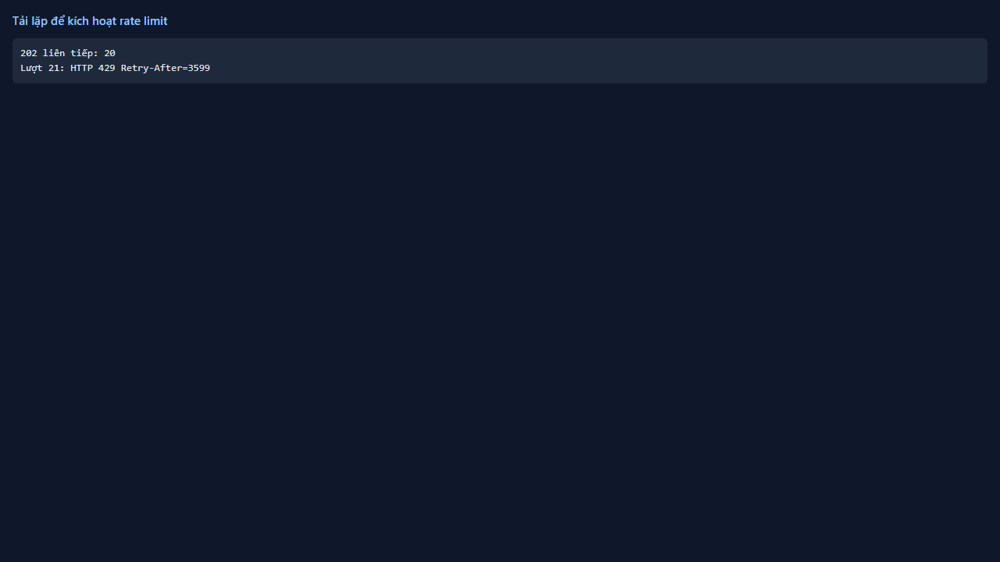
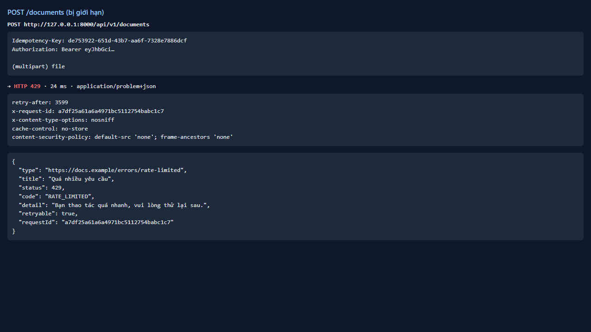
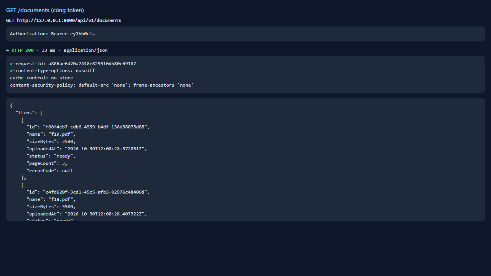
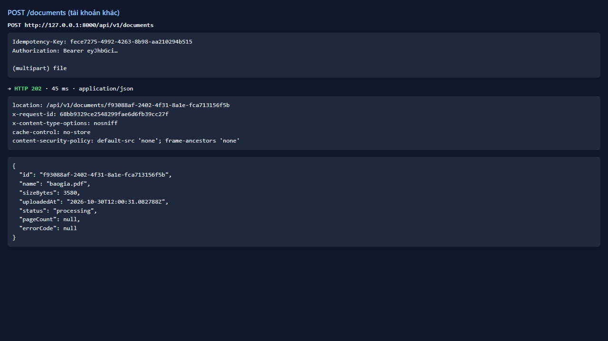

# Test report — API-010: Rate limit tải lên → 429 + Retry-After

| Mục | Giá trị |
|---|---|
| **Kết quả** | **PASS** |
| Test case | [API-010](../../cases/API-010.md) |
| URL kiểm thử | http://127.0.0.1:8000 |
| Trình duyệt | Microsoft Edge (Chromium) (1280×720) |
| Bắt đầu / kết thúc | 2026-10-30T12:00:27.385Z → 2026-10-30T12:00:31.842Z (4.5s) |
| Số bước | PASS: 4 · FAIL: 0 · SKIP: 0 |
| Video | [video/API-010.webm](video/API-010.webm) |

<video src="video/API-010.webm" controls width="720"></video>

## Kết quả từng bước

### Bước 1. Gửi liên tiếp các yêu cầu tải PDF nhỏ tới khi gặp lỗi — ✅ PASS

- **Mong đợi:** Các lượt đầu 202
- **Thực tế:** 20 lượt 202 trước khi bị chặn

### Bước 2. Quan sát lượt bị giới hạn — ✅ PASS

- **Mong đợi:** 429 RATE_LIMITED + Retry-After > 0
- **Thực tế:** 429, Retry-After=3599s; số lượt thực tế trước khi bị chặn = 20 (thiết kế đề xuất: 20/giờ)

### Bước 3. GET /documents cùng token — ✅ PASS

- **Mong đợi:** Vẫn 200
- **Thực tế:** Đúng như mong đợi

### Bước 4. Tài khoản khác tải 1 tệp — ✅ PASS

- **Mong đợi:** 202 (giới hạn theo người dùng)
- **Thực tế:** Đúng như mong đợi

