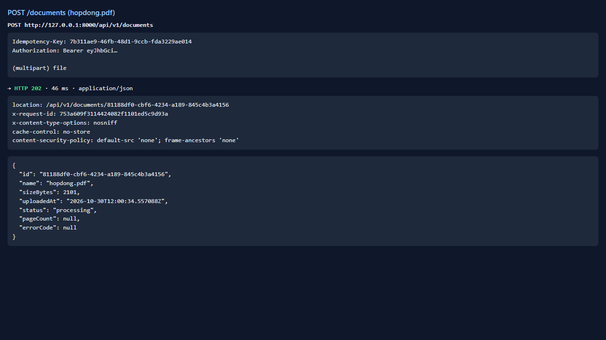
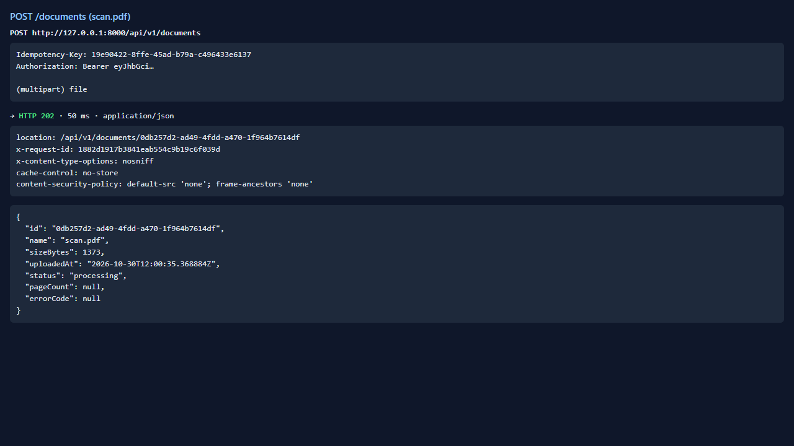
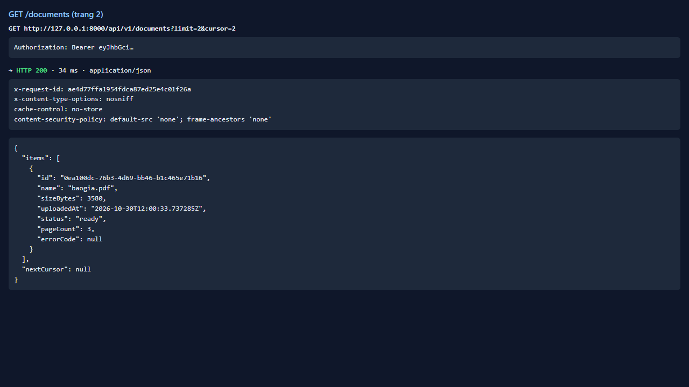
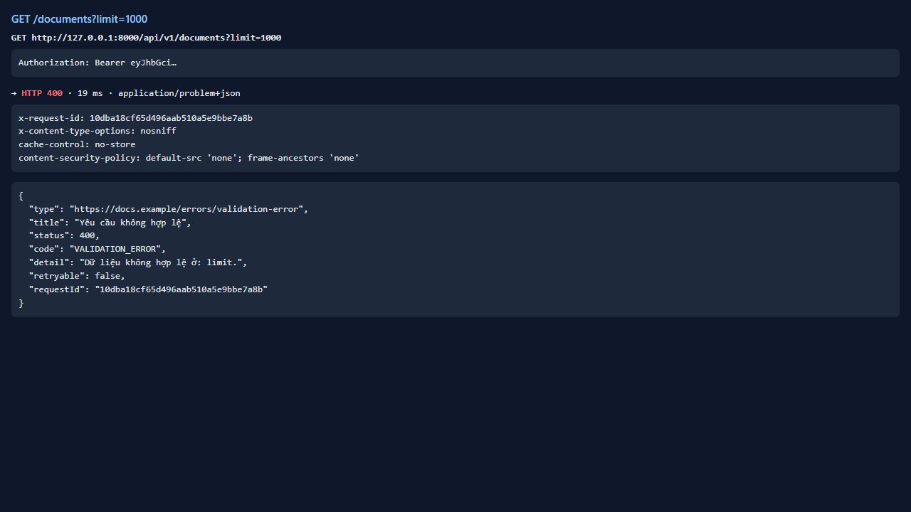
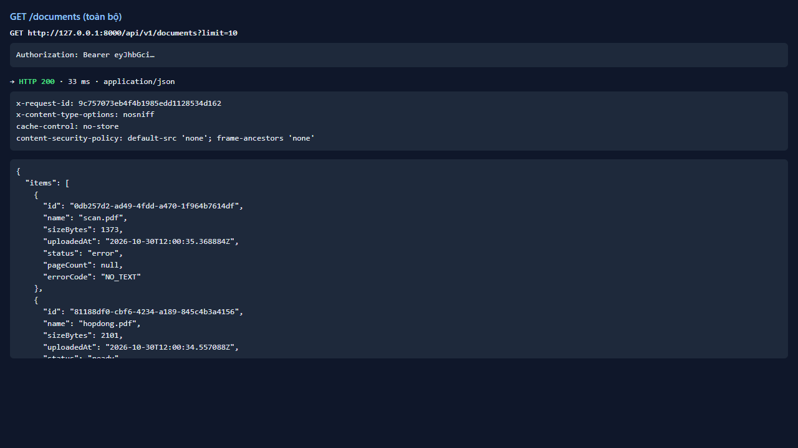

# Test report — API-011: GET /documents: phân trang và trạng thái

| Mục | Giá trị |
|---|---|
| **Kết quả** | **PASS** |
| Test case | [API-011](../../cases/API-011.md) |
| URL kiểm thử | http://127.0.0.1:8000 |
| Trình duyệt | Microsoft Edge (Chromium) (1280×720) |
| Bắt đầu / kết thúc | 2026-10-30T12:00:33.592Z → 2026-10-30T12:00:39.376Z (5.8s) |
| Số bước | PASS: 5 · FAIL: 0 · SKIP: 0 |
| Video | [video/API-011.webm](video/API-011.webm) |

<video src="video/API-011.webm" controls width="720"></video>

## Kết quả từng bước

### Bước 1. Tải baogia, hopdong, scan và đợi xử lý xong — ✅ PASS

- **Mong đợi:** Các tệp tới trạng thái cuối
- **Thực tế:** Đúng như mong đợi

### Bước 2. GET /documents?limit=2 — ✅ PASS

- **Mong đợi:** 200; 2 phần tử; nextCursor khác null
- **Thực tế:** Đúng như mong đợi

### Bước 3. GET /documents?limit=2&cursor=… — ✅ PASS

- **Mong đợi:** Phần tử còn lại, không trùng trang 1
- **Thực tế:** Đúng như mong đợi

### Bước 4. GET /documents?limit=1000 — ✅ PASS

- **Mong đợi:** Bị chặn/kẹp ≤ 100 (ghi thực tế)
- **Thực tế:** HTTP 400 code=VALIDATION_ERROR

### Bước 5. Kiểm tra trạng thái từng tệp — ✅ PASS

- **Mong đợi:** baogia, hopdong: ready; scan: error NO_TEXT
- **Thực tế:** Đúng như mong đợi

