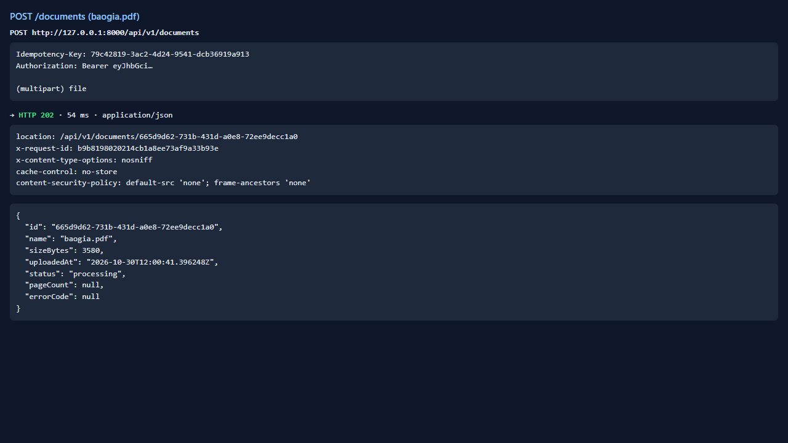
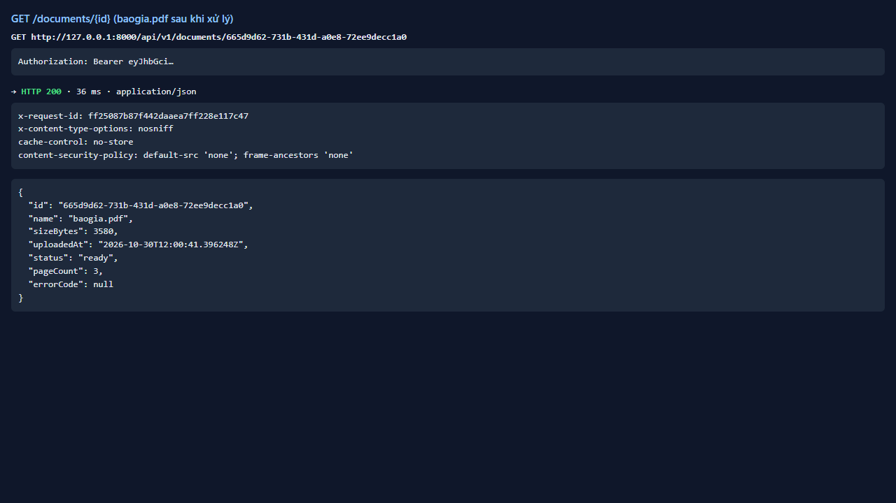
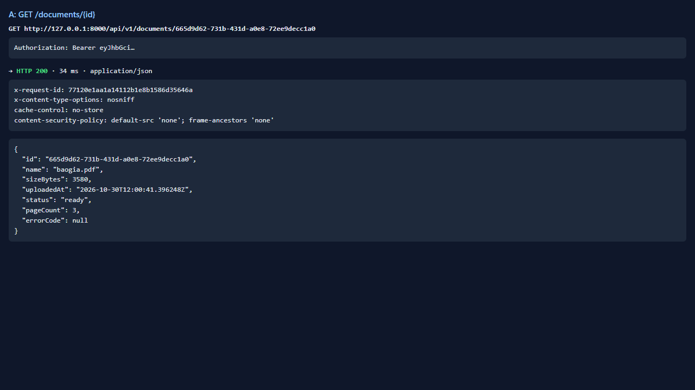
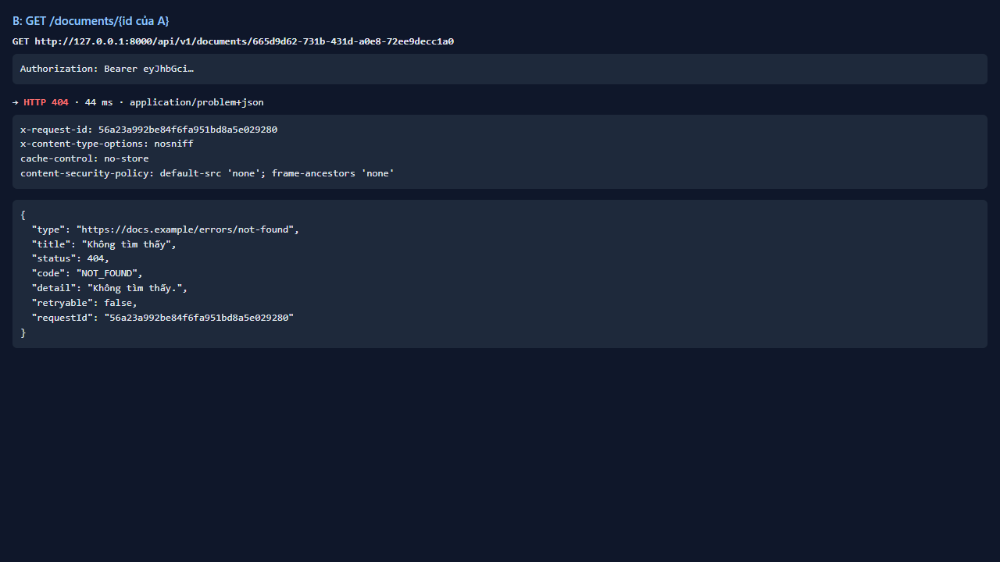
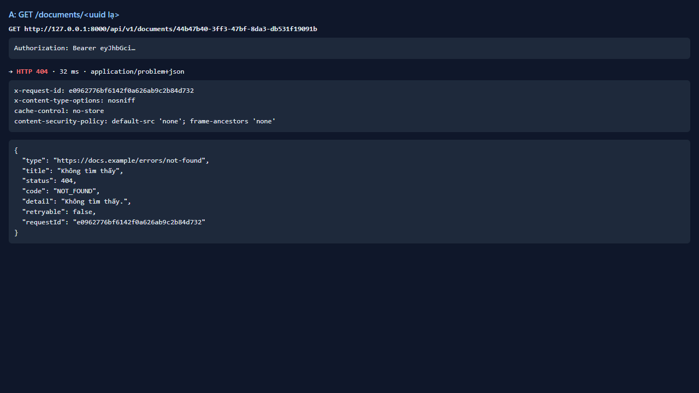
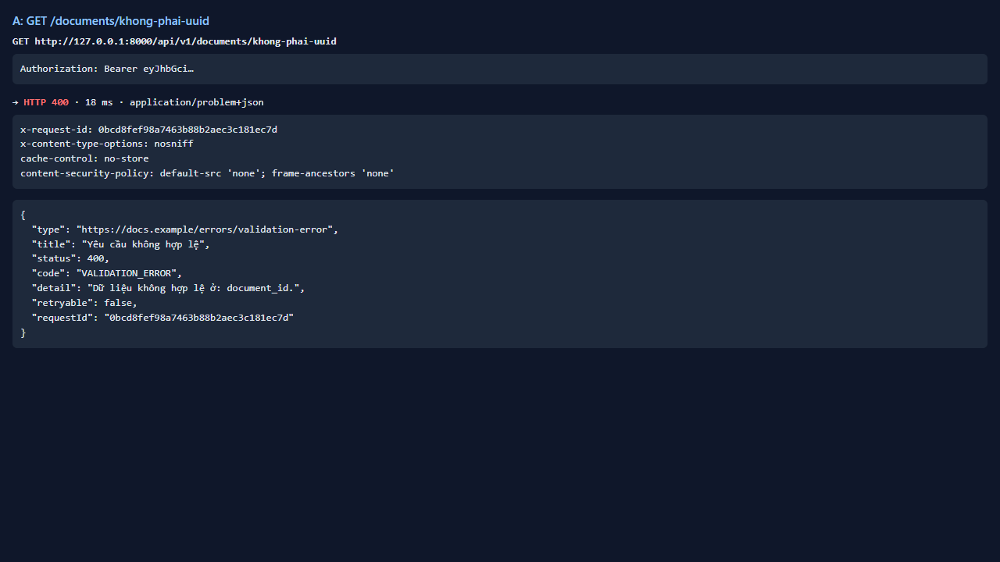

# Test report — API-012: GET /documents/{id}: tồn tại và không tồn tại

| Mục | Giá trị |
|---|---|
| **Kết quả** | **PASS** |
| Test case | [API-012](../../cases/API-012.md) |
| URL kiểm thử | http://127.0.0.1:8000 |
| Trình duyệt | Microsoft Edge (Chromium) (1280×720) |
| Bắt đầu / kết thúc | 2026-10-30T12:00:41.139Z → 2026-10-30T12:00:46.141Z (5.0s) |
| Số bước | PASS: 4 · FAIL: 0 · SKIP: 0 |
| Video | [video/API-012.webm](video/API-012.webm) |

<video src="video/API-012.webm" controls width="720"></video>

## Kết quả từng bước

### Bước 1. A: GET /documents/{id} — ✅ PASS

- **Mong đợi:** 200, đúng schema Document
- **Thực tế:** Đúng như mong đợi

### Bước 2. B: GET /documents/{id của A} — ✅ PASS

- **Mong đợi:** 404 NOT_FOUND
- **Thực tế:** Đúng như mong đợi

### Bước 3. A: GET /documents/<uuid ngẫu nhiên> — ✅ PASS

- **Mong đợi:** 404
- **Thực tế:** Đúng như mong đợi

### Bước 4. A: GET /documents/khong-phai-uuid — ✅ PASS

- **Mong đợi:** 400/422 problem+json
- **Thực tế:** Đúng như mong đợi

