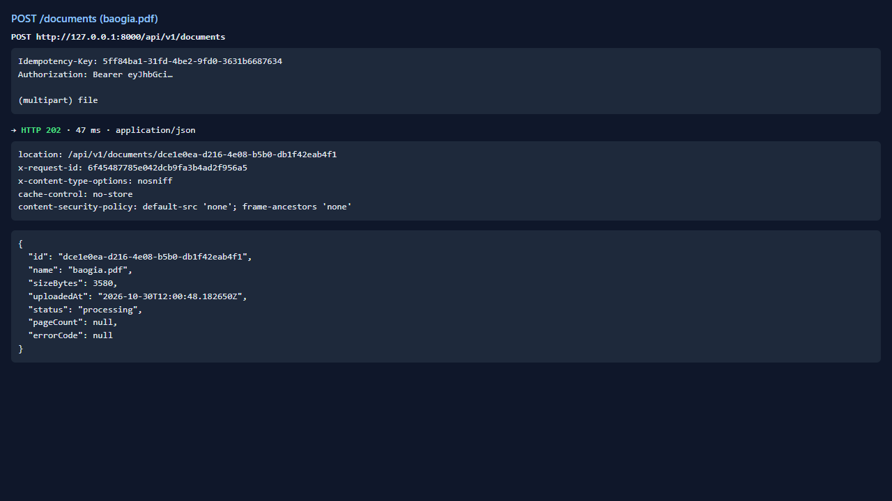
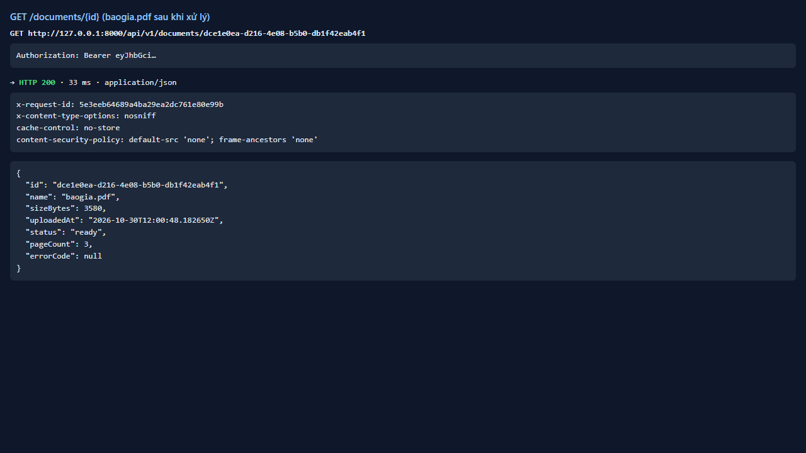
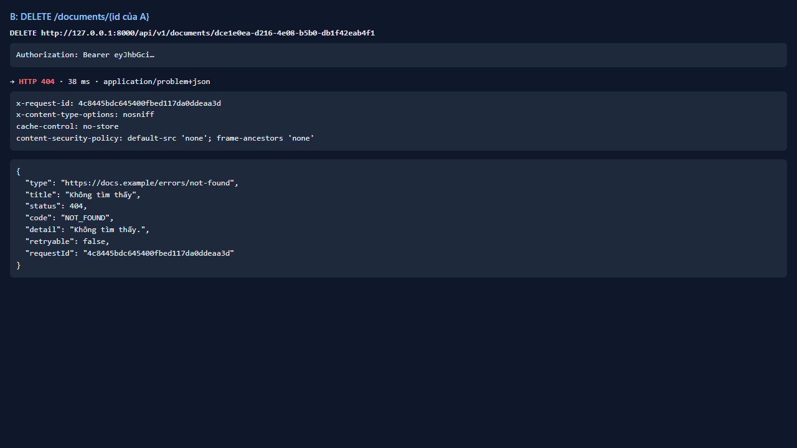
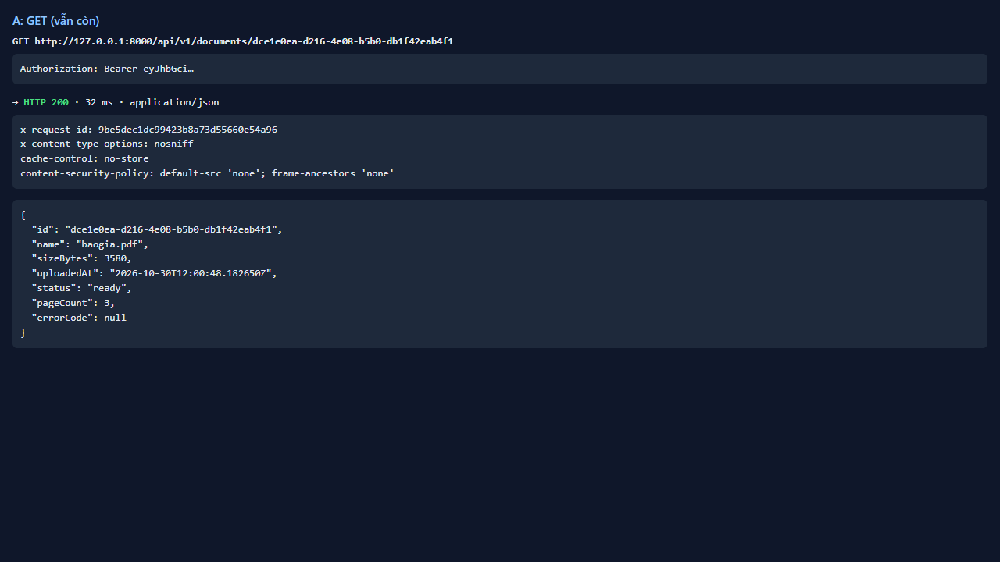
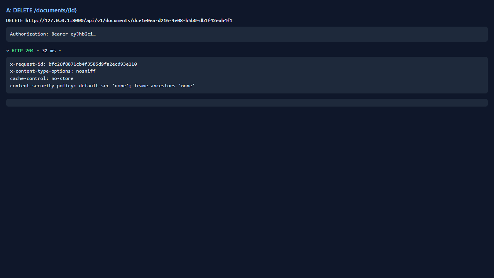
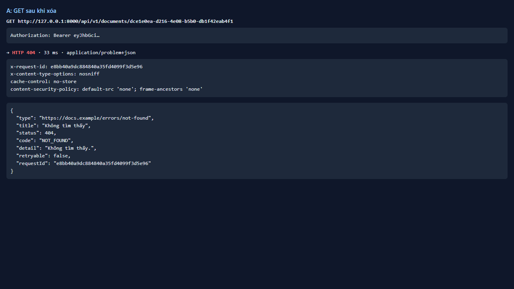
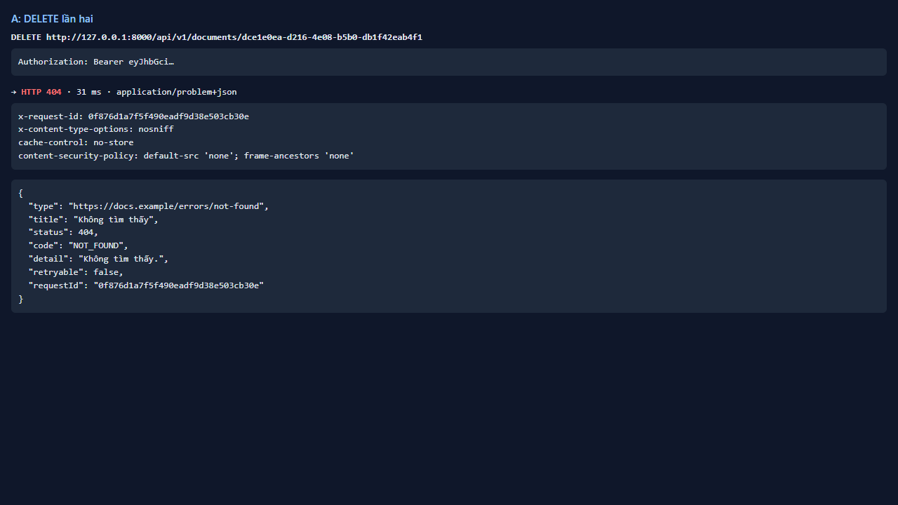
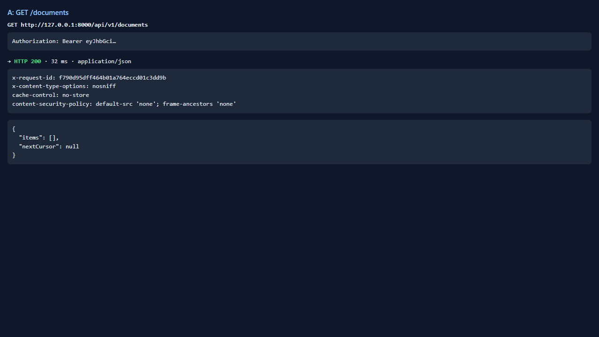

# Test report — API-013: DELETE /documents/{id}

| Mục | Giá trị |
|---|---|
| **Kết quả** | **PASS** |
| Test case | [API-013](../../cases/API-013.md) |
| URL kiểm thử | http://127.0.0.1:8000 |
| Trình duyệt | Microsoft Edge (Chromium) (1280×720) |
| Bắt đầu / kết thúc | 2026-10-30T12:00:47.953Z → 2026-10-30T12:00:54.441Z (6.5s) |
| Số bước | PASS: 5 · FAIL: 0 · SKIP: 0 |
| Video | [video/API-013.webm](video/API-013.webm) |

<video src="video/API-013.webm" controls width="720"></video>

## Kết quả từng bước

### Bước 1. B: DELETE /documents/{id của A} — ✅ PASS

- **Mong đợi:** 404; tài liệu của A vẫn còn
- **Thực tế:** Đúng như mong đợi

### Bước 2. A: DELETE /documents/{id} — ✅ PASS

- **Mong đợi:** 204
- **Thực tế:** Đúng như mong đợi

### Bước 3. A: GET /documents/{id} — ✅ PASS

- **Mong đợi:** 404
- **Thực tế:** Đúng như mong đợi

### Bước 4. A: DELETE lần hai — ✅ PASS

- **Mong đợi:** 404
- **Thực tế:** Đúng như mong đợi

### Bước 5. A: GET /documents — ✅ PASS

- **Mong đợi:** Danh sách không còn tài liệu
- **Thực tế:** Đúng như mong đợi

