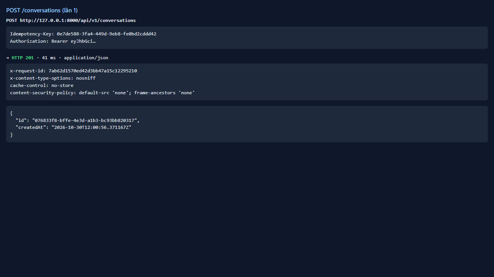
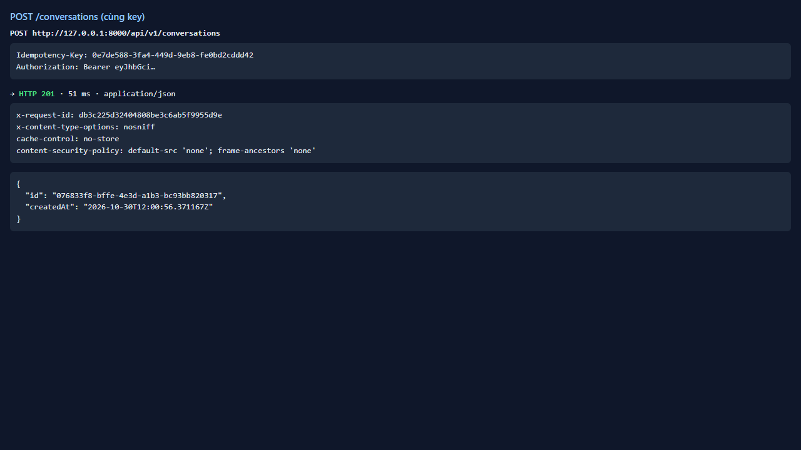
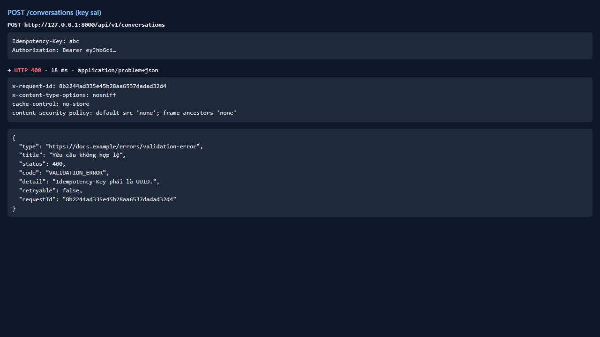
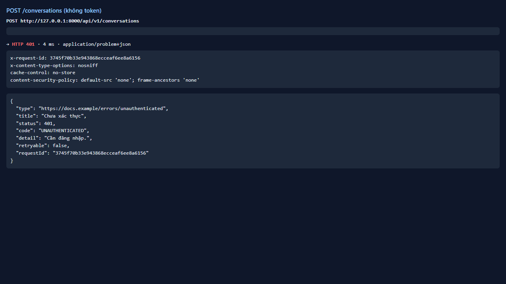

# Test report — API-014: POST /conversations

| Mục | Giá trị |
|---|---|
| **Kết quả** | **PASS** |
| Test case | [API-014](../../cases/API-014.md) |
| URL kiểm thử | http://127.0.0.1:8000 |
| Trình duyệt | Microsoft Edge (Chromium) (1280×720) |
| Bắt đầu / kết thúc | 2026-10-30T12:00:56.207Z → 2026-10-30T12:00:59.477Z (3.3s) |
| Số bước | PASS: 4 · FAIL: 0 · SKIP: 0 |
| Video | [video/API-014.webm](video/API-014.webm) |

<video src="video/API-014.webm" controls width="720"></video>

## Kết quả từng bước

### Bước 1. POST /conversations — ✅ PASS

- **Mong đợi:** 201, id UUID
- **Thực tế:** Đúng như mong đợi

### Bước 2. Gọi lại cùng Idempotency-Key — ✅ PASS

- **Mong đợi:** Cùng hội thoại
- **Thực tế:** Đúng như mong đợi

### Bước 3. Idempotency-Key không phải UUID — ✅ PASS

- **Mong đợi:** 400/422 problem+json
- **Thực tế:** Đúng như mong đợi

### Bước 4. Không token — ✅ PASS

- **Mong đợi:** 401
- **Thực tế:** Đúng như mong đợi

