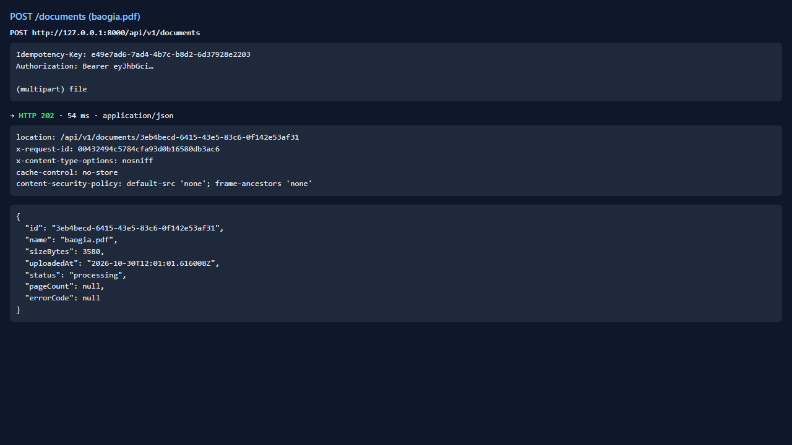
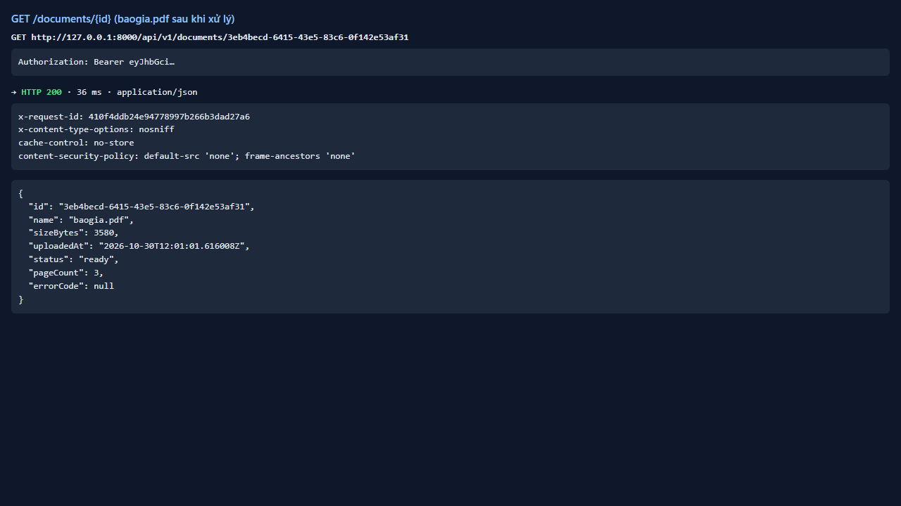
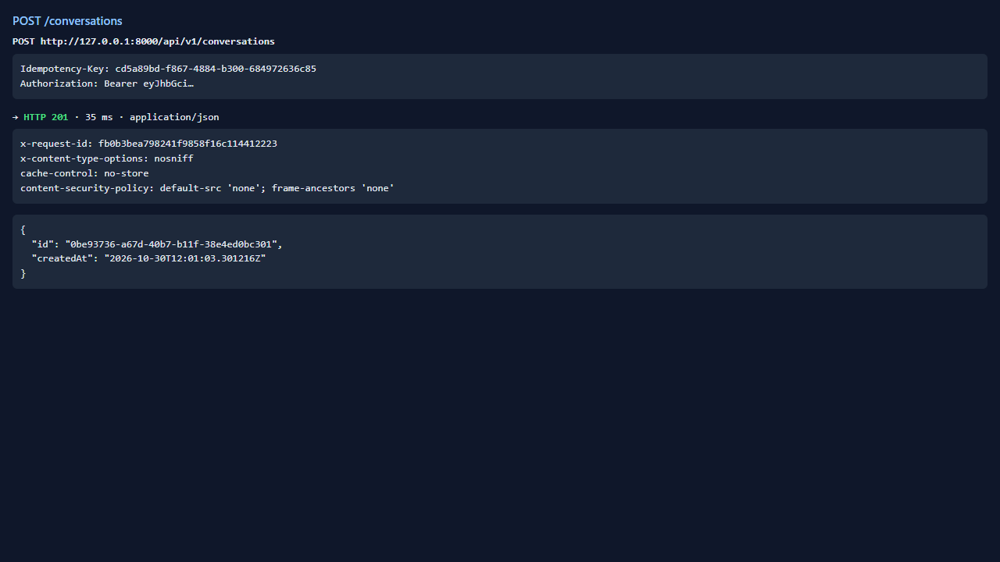
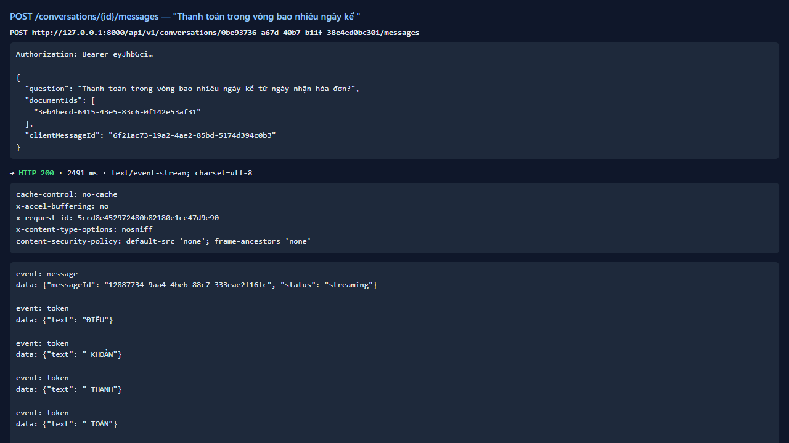

# Test report — API-015: SSE hỏi đáp: đủ chuỗi sự kiện

| Mục | Giá trị |
|---|---|
| **Kết quả** | **PASS** |
| Test case | [API-015](../../cases/API-015.md) |
| URL kiểm thử | http://127.0.0.1:8000 |
| Trình duyệt | Microsoft Edge (Chromium) (1280×720) |
| Bắt đầu / kết thúc | 2026-10-30T12:01:01.457Z → 2026-10-30T12:01:07.411Z (6.0s) |
| Số bước | PASS: 5 · FAIL: 0 · SKIP: 0 |
| Video | [video/API-015.webm](video/API-015.webm) |

<video src="video/API-015.webm" controls width="720"></video>

## Kết quả từng bước

### Bước 1. Chuẩn bị: tải baogia.pdf và tạo hội thoại — ✅ PASS

- **Mong đợi:** ready
- **Thực tế:** Đúng như mong đợi

### Bước 2. POST …/messages với câu hỏi thanh toán — ✅ PASS

- **Mong đợi:** 200 text/event-stream; Cache-Control: no-cache; X-Accel-Buffering: no
- **Thực tế:** Đúng như mong đợi

### Bước 3. Phân tích chuỗi sự kiện — ✅ PASS

- **Mong đợi:** message đầu; token…; một citations; done complete grounded=true
- **Thực tế:** Thứ tự: message → token → citations → done; số token=19

### Bước 4. Văn bản ghép từ token — ✅ PASS

- **Mong đợi:** Chứa “30 ngày”; không có nhãn [Sx]
- **Thực tế:** Văn bản: ĐIỀU KHOẢN THANH TOÁN Thanh toán trong vòng 30 ngày kể từ ngày nhận hóa đơn hợp lệ.

### Bước 5. Kiểm tra citations[0] — ✅ PASS

- **Mong đợi:** baogia.pdf, page=2, valid=true
- **Thực tế:** Đúng như mong đợi

