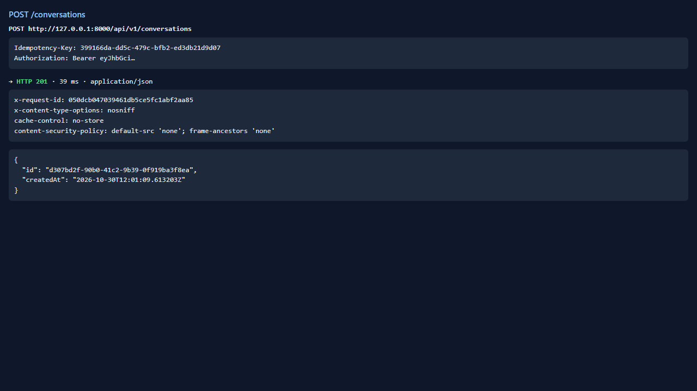
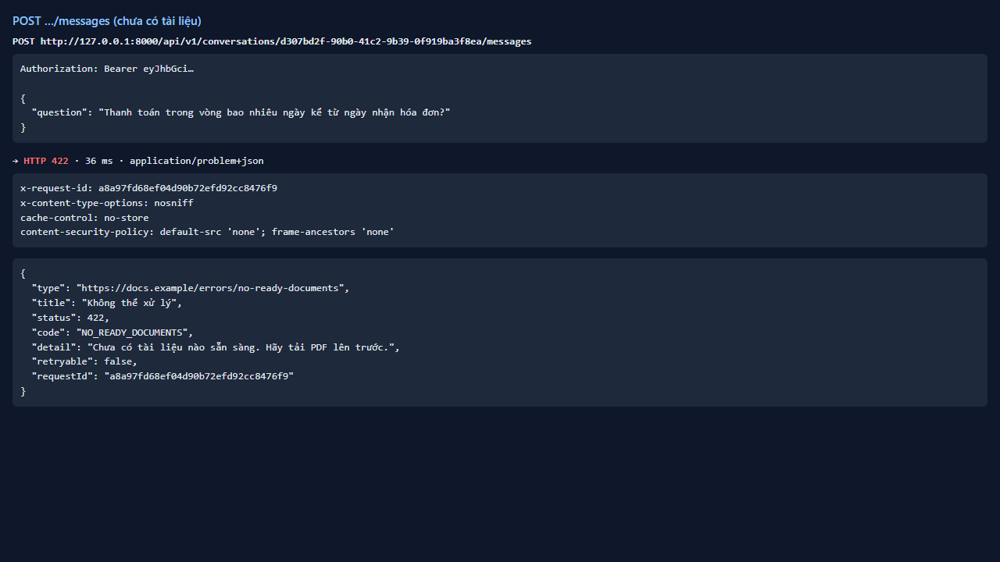
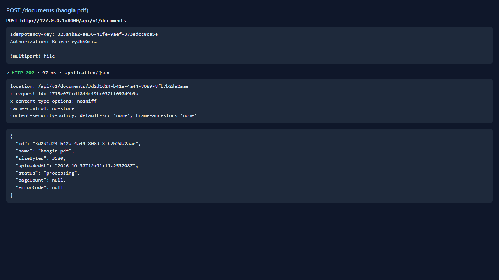
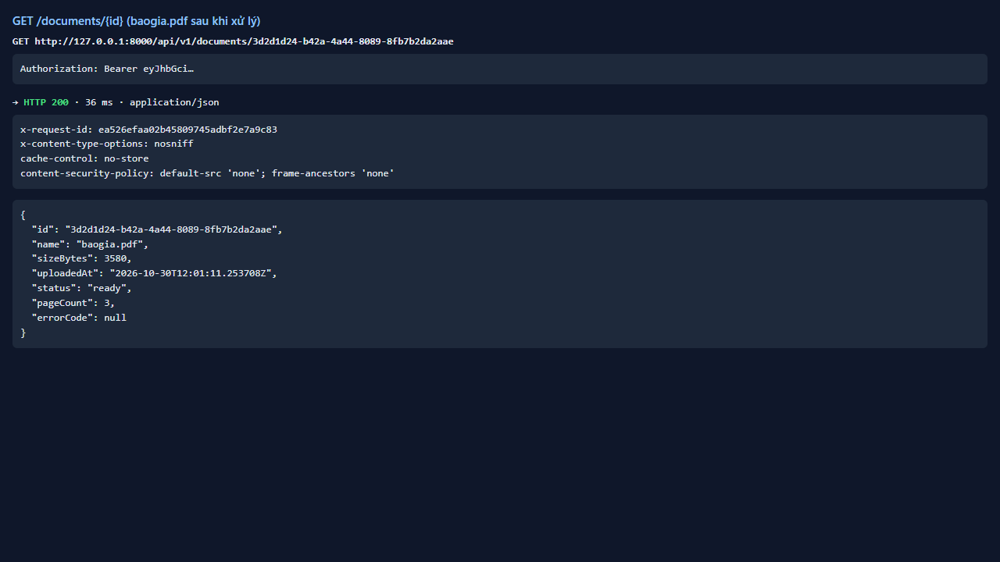
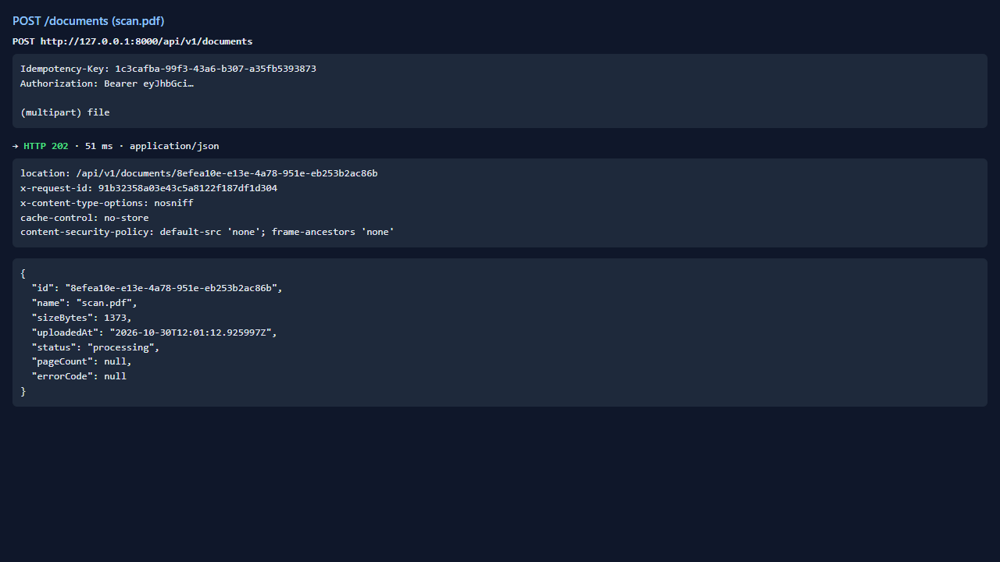
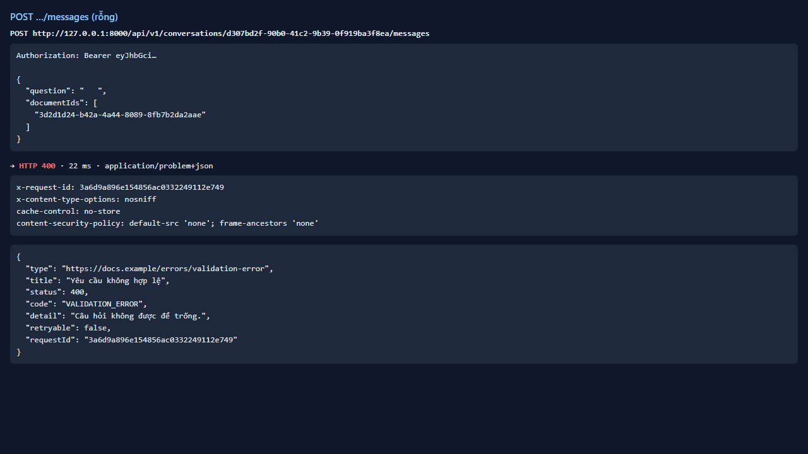
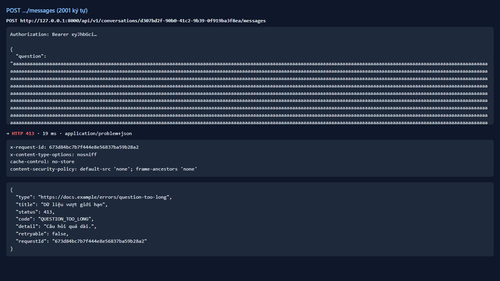
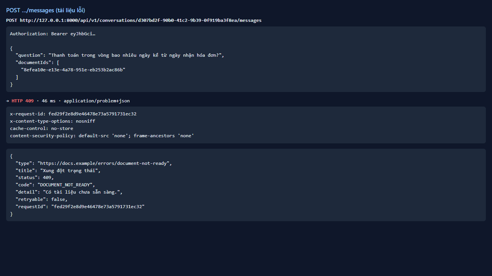

# Test report — API-016: Hỏi đáp: lỗi kiểm tra trước khi mở stream

| Mục | Giá trị |
|---|---|
| **Kết quả** | **PASS** |
| Test case | [API-016](../../cases/API-016.md) |
| URL kiểm thử | http://127.0.0.1:8000 |
| Trình duyệt | Microsoft Edge (Chromium) (1280×720) |
| Bắt đầu / kết thúc | 2026-10-30T12:01:09.427Z → 2026-10-30T12:01:16.067Z (6.6s) |
| Số bước | PASS: 5 · FAIL: 0 · SKIP: 0 |
| Video | [video/API-016.webm](video/API-016.webm) |

<video src="video/API-016.webm" controls width="720"></video>

## Kết quả từng bước

### Bước 1. Hỏi khi chưa có tài liệu ready — ✅ PASS

- **Mong đợi:** 422 NO_READY_DOCUMENTS (problem+json)
- **Thực tế:** Đúng như mong đợi

### Bước 2. Tải baogia (ready) và scan (error) — ✅ PASS

- **Mong đợi:** baogia ready; scan error
- **Thực tế:** Đúng như mong đợi

### Bước 3. Câu hỏi rỗng / toàn khoảng trắng — ✅ PASS

- **Mong đợi:** 400/422 VALIDATION_ERROR
- **Thực tế:** HTTP 400 code=VALIDATION_ERROR

### Bước 4. Câu hỏi dài hơn maxQuestionLength — ✅ PASS

- **Mong đợi:** 413 QUESTION_TOO_LONG
- **Thực tế:** Đúng như mong đợi

### Bước 5. documentIds chứa tài liệu chưa ready (scan) — ✅ PASS

- **Mong đợi:** 409 DOCUMENT_NOT_READY
- **Thực tế:** Đúng như mong đợi

