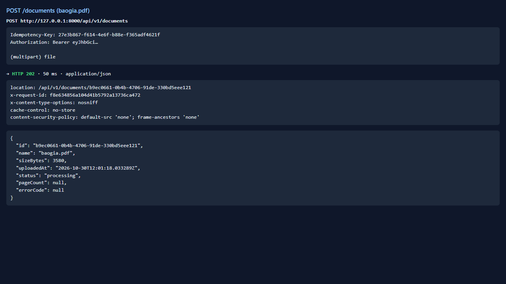
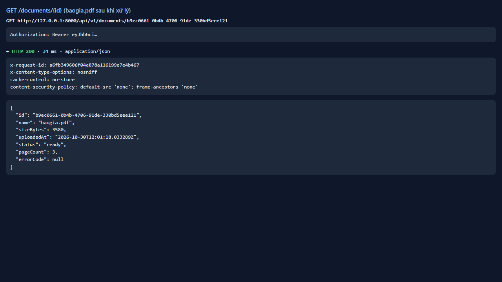
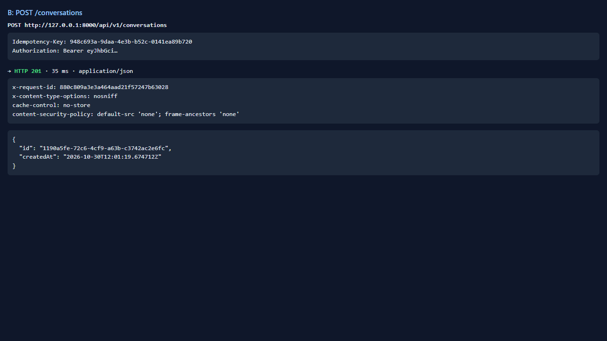
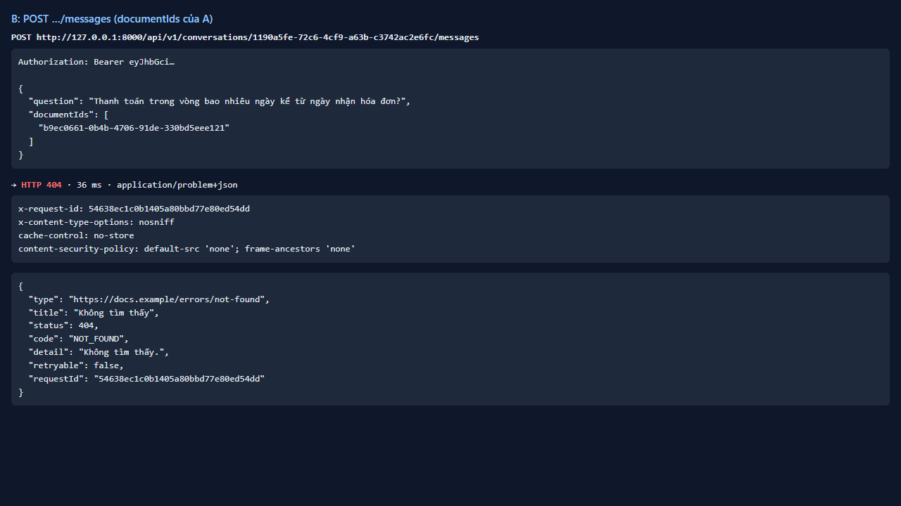
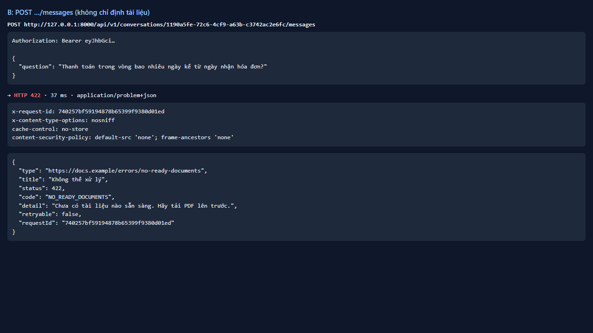
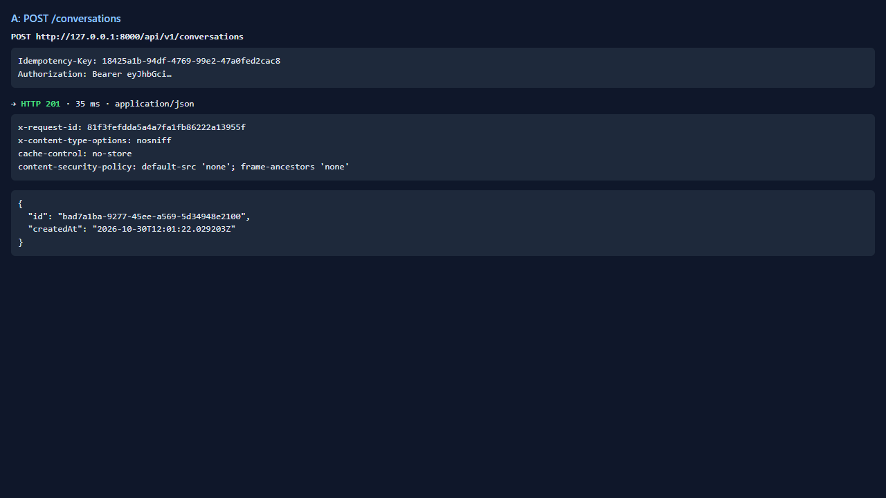
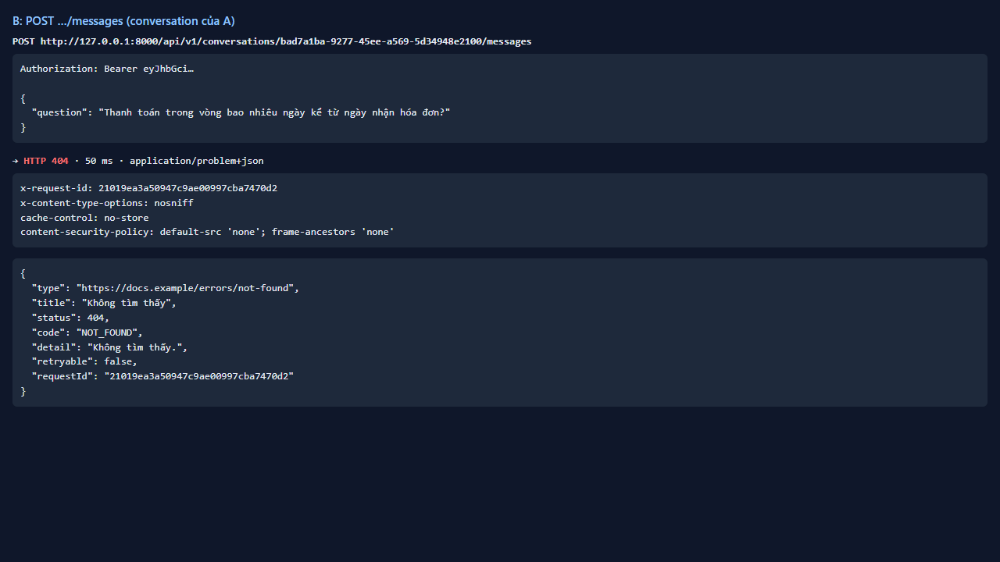

# Test report — API-017: Hỏi đáp với documentIds của người khác → 404

| Mục | Giá trị |
|---|---|
| **Kết quả** | **PASS** |
| Test case | [API-017](../../cases/API-017.md) |
| URL kiểm thử | http://127.0.0.1:8000 |
| Trình duyệt | Microsoft Edge (Chromium) (1280×720) |
| Bắt đầu / kết thúc | 2026-10-30T12:01:17.796Z → 2026-10-30T12:01:23.592Z (5.8s) |
| Số bước | PASS: 4 · FAIL: 0 · SKIP: 0 |
| Video | [video/API-017.webm](video/API-017.webm) |

<video src="video/API-017.webm" controls width="720"></video>

## Kết quả từng bước

### Bước 1. Chuẩn bị: A có baogia ready; B có hội thoại — ✅ PASS

- **Mong đợi:** OK
- **Thực tế:** Đúng như mong đợi

### Bước 2. B hỏi với documentIds của A — ✅ PASS

- **Mong đợi:** 404 NOT_FOUND, không SSE
- **Thực tế:** Đúng như mong đợi

### Bước 3. B hỏi với documentIds rỗng — ✅ PASS

- **Mong đợi:** 422 NO_READY_DOCUMENTS (không dùng tài liệu của A)
- **Thực tế:** Đúng như mong đợi

### Bước 4. B dùng conversationId của A — ✅ PASS

- **Mong đợi:** 404
- **Thực tế:** Đúng như mong đợi

