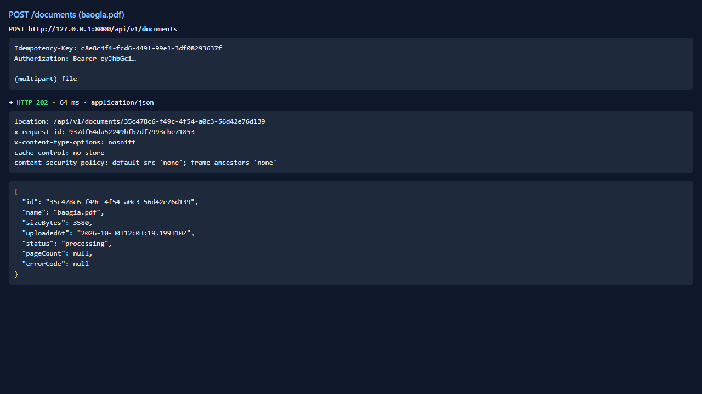
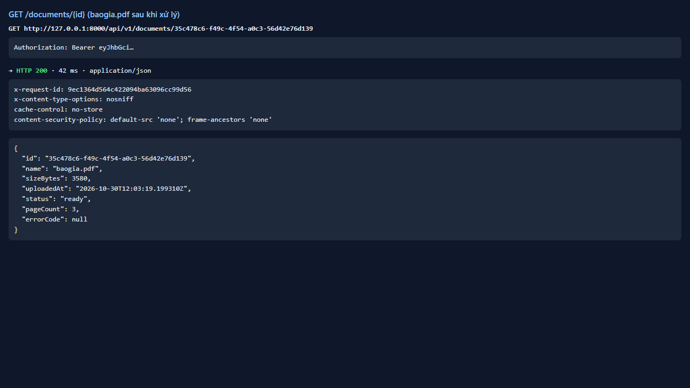
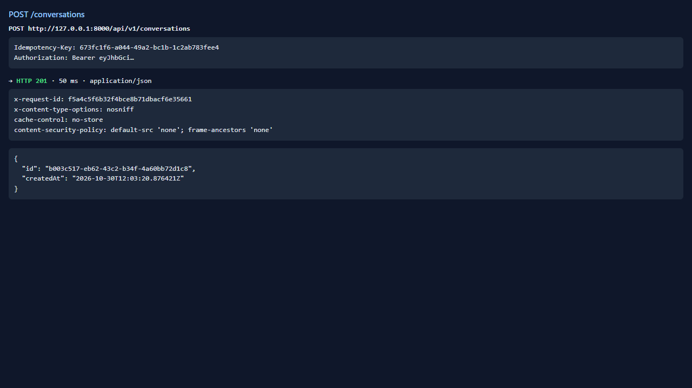
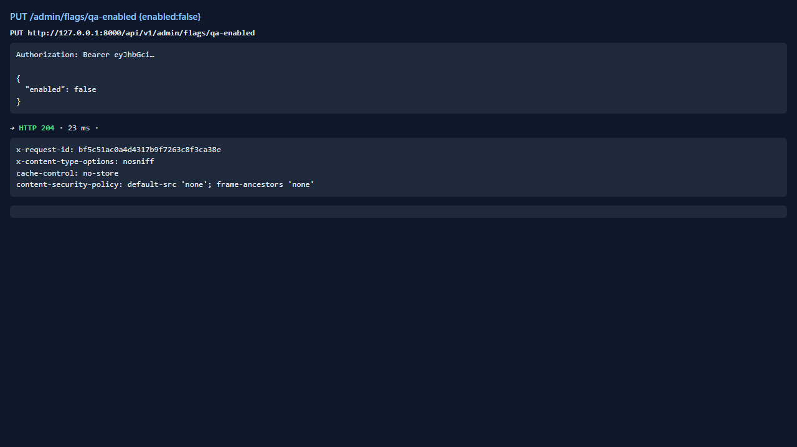
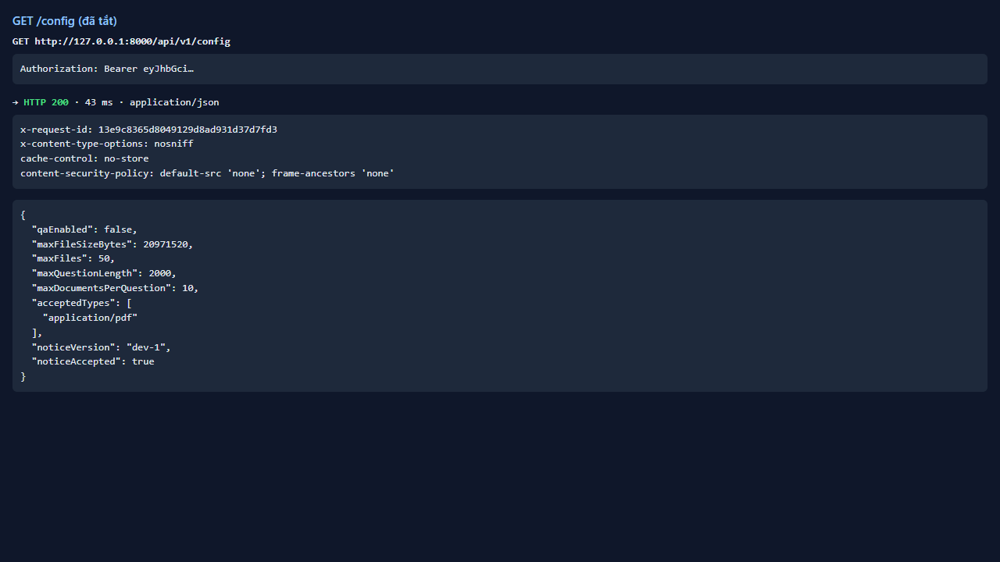
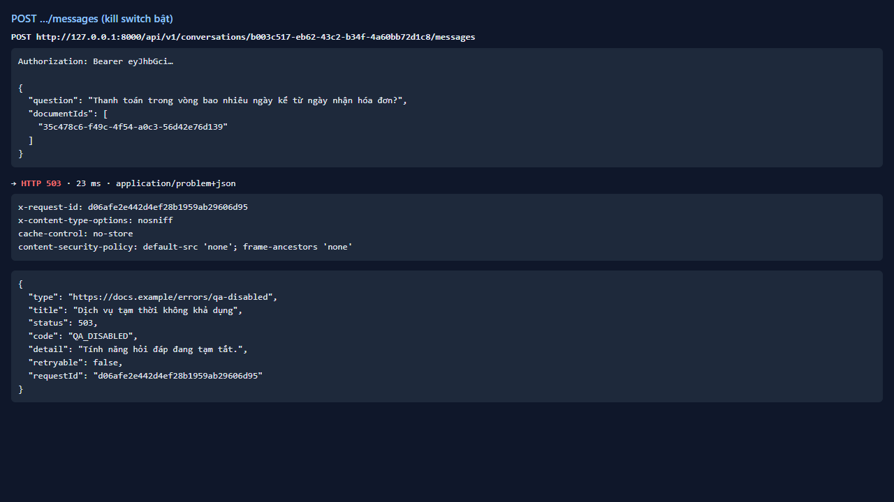
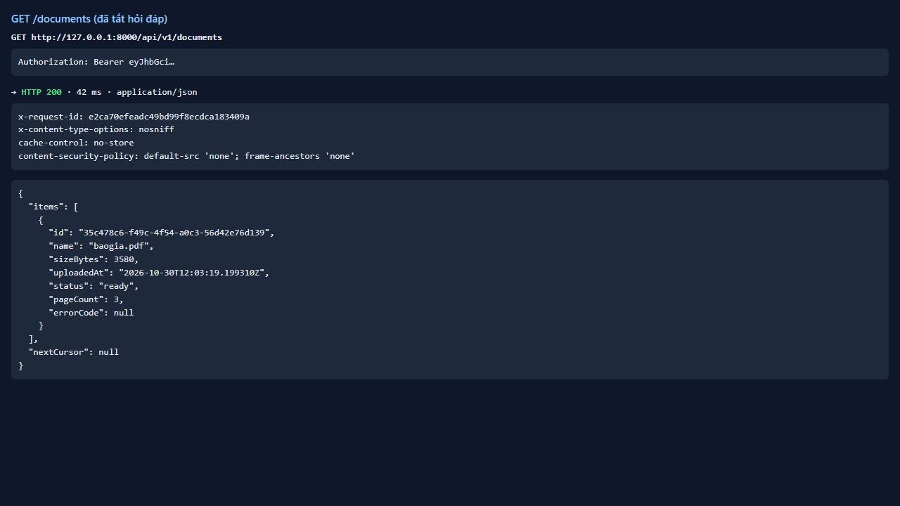
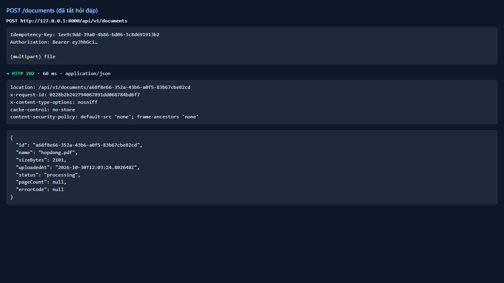
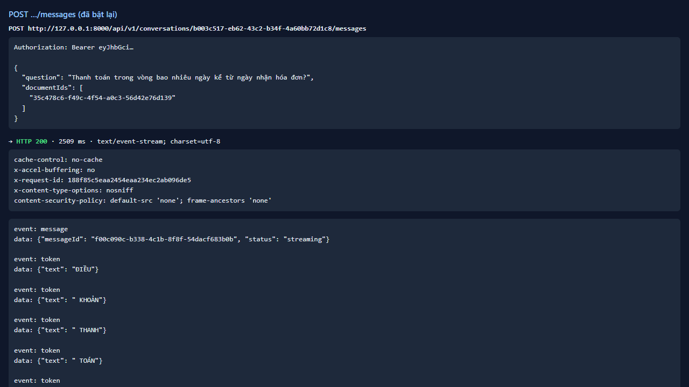

# Test report — API-018: Kill switch: 503 QA_DISABLED

| Mục | Giá trị |
|---|---|
| **Kết quả** | **PASS** |
| Test case | [API-018](../../cases/API-018.md) |
| URL kiểm thử | http://127.0.0.1:8000 |
| Trình duyệt | Microsoft Edge (Chromium) (1280×720) |
| Bắt đầu / kết thúc | 2026-10-30T12:03:18.925Z → 2026-10-30T12:03:29.609Z (10.7s) |
| Số bước | PASS: 6 · FAIL: 0 · SKIP: 0 |
| Video | [video/API-018.webm](video/API-018.webm) |

<video src="video/API-018.webm" controls width="720"></video>

## Kết quả từng bước

### Bước 1. Chuẩn bị: user có baogia ready + hội thoại; tài khoản ops — ✅ PASS

- **Mong đợi:** OK
- **Thực tế:** Đúng như mong đợi

### Bước 2. Ops tắt qa-enabled — ✅ PASS

- **Mong đợi:** 204
- **Thực tế:** Đúng như mong đợi

### Bước 3. GET /config — ✅ PASS

- **Mong đợi:** qaEnabled=false
- **Thực tế:** Đúng như mong đợi

### Bước 4. Hỏi — ✅ PASS

- **Mong đợi:** 503 QA_DISABLED problem+json
- **Thực tế:** Đúng như mong đợi

### Bước 5. GET /documents và tải tệp mới khi đã tắt — ✅ PASS

- **Mong đợi:** Vẫn hoạt động (200/202)
- **Thực tế:** Đúng như mong đợi

### Bước 6. Bật lại qa-enabled và hỏi lại — ✅ PASS

- **Mong đợi:** 204; hỏi trả 200 SSE
- **Thực tế:** Đúng như mong đợi

