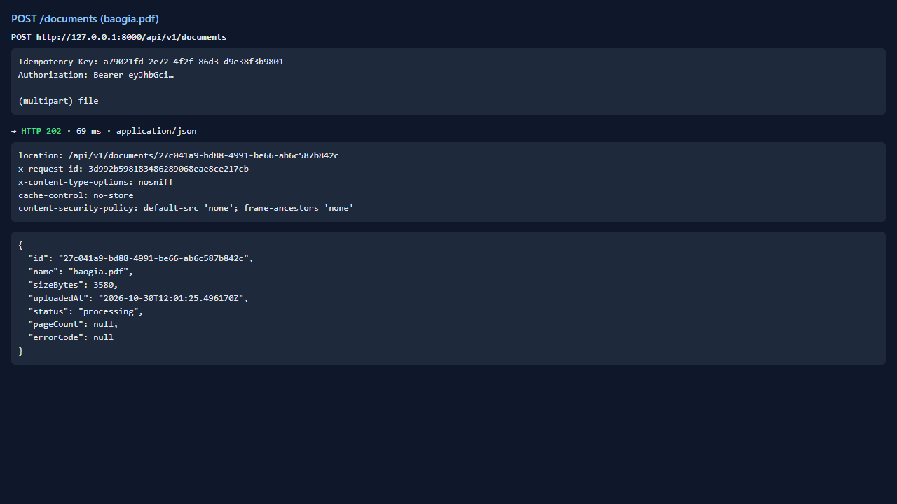
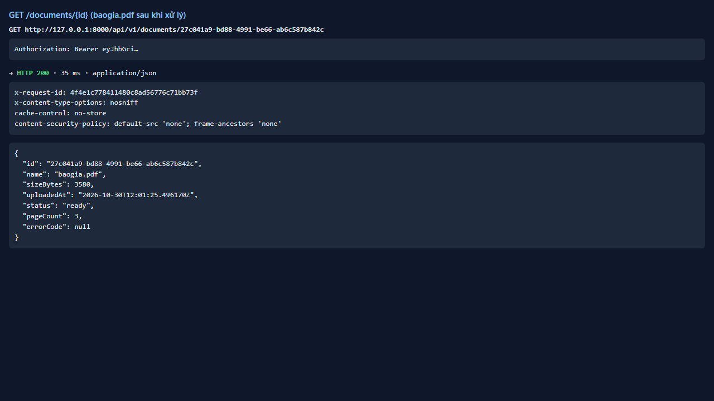
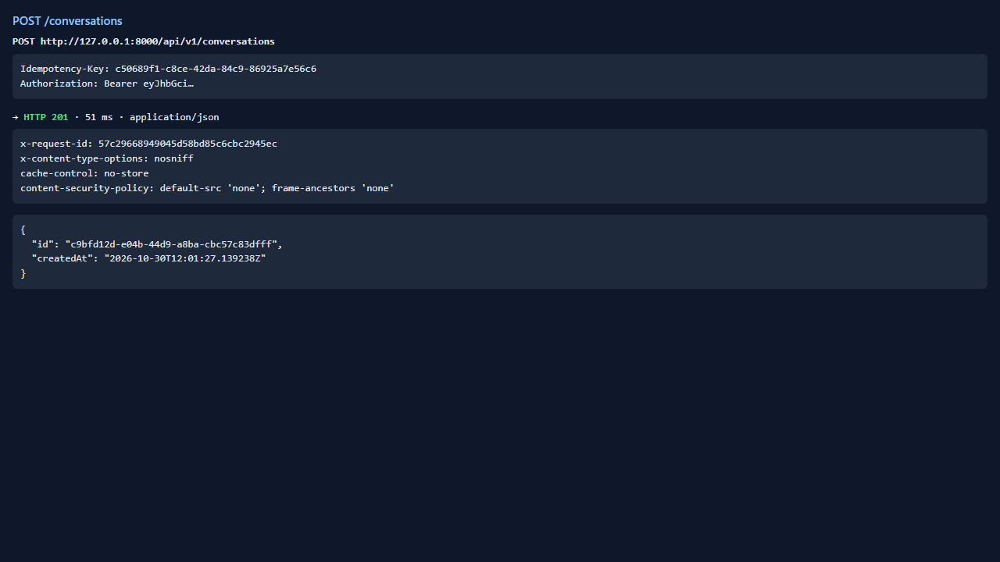
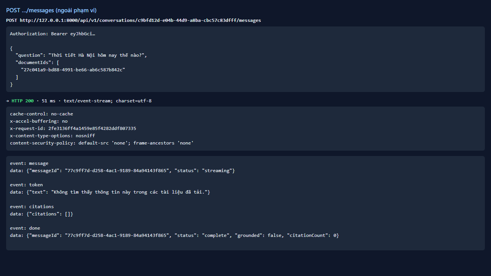
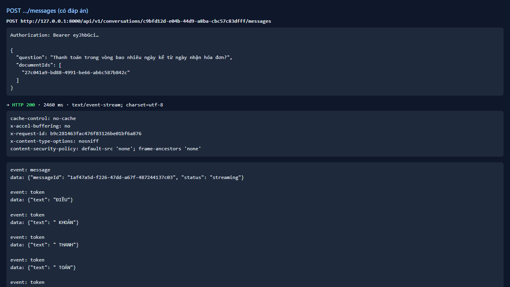

# Test report — API-019: Câu hỏi ngoài tài liệu: grounded=false, không citation

| Mục | Giá trị |
|---|---|
| **Kết quả** | **PASS** |
| Test case | [API-019](../../cases/API-019.md) |
| URL kiểm thử | http://127.0.0.1:8000 |
| Trình duyệt | Microsoft Edge (Chromium) (1280×720) |
| Bắt đầu / kết thúc | 2026-10-30T12:01:25.331Z → 2026-10-30T12:01:31.923Z (6.6s) |
| Số bước | PASS: 3 · FAIL: 0 · SKIP: 0 |
| Video | [video/API-019.webm](video/API-019.webm) |

<video src="video/API-019.webm" controls width="720"></video>

## Kết quả từng bước

### Bước 1. Chuẩn bị — ✅ PASS

- **Mong đợi:** baogia ready + hội thoại
- **Thực tế:** Đúng như mong đợi

### Bước 2. Hỏi ngoài phạm vi — ✅ PASS

- **Mong đợi:** 200 SSE; token “Không tìm thấy thông tin này”; done grounded=false, citationCount=0
- **Thực tế:** Văn bản: Không tìm thấy thông tin này trong các tài liệu đã tải.

### Bước 3. Hỏi câu có đáp án ngay sau đó — ✅ PASS

- **Mong đợi:** grounded=true, citationCount ≥ 1
- **Thực tế:** Đúng như mong đợi

## Ghi chú

- Việc “không gọi LLM” không quan sát được từ bên ngoài; chỉ ghi nhận hành vi quan sát được.
