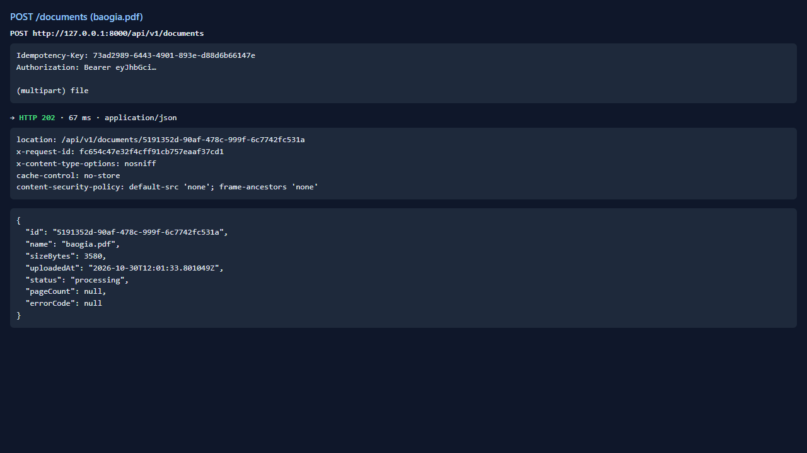
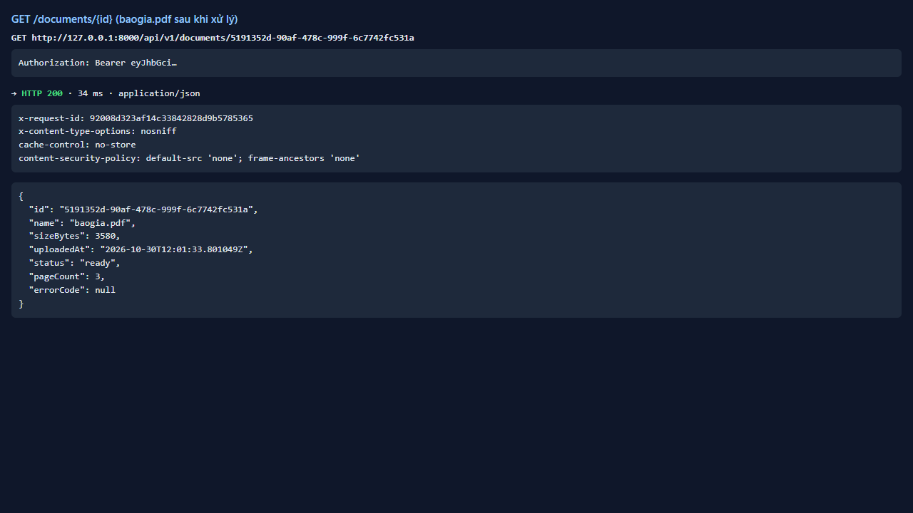
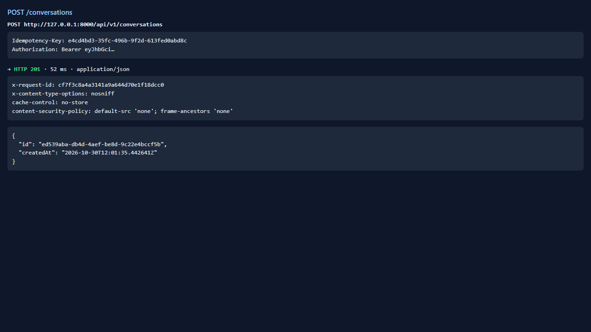
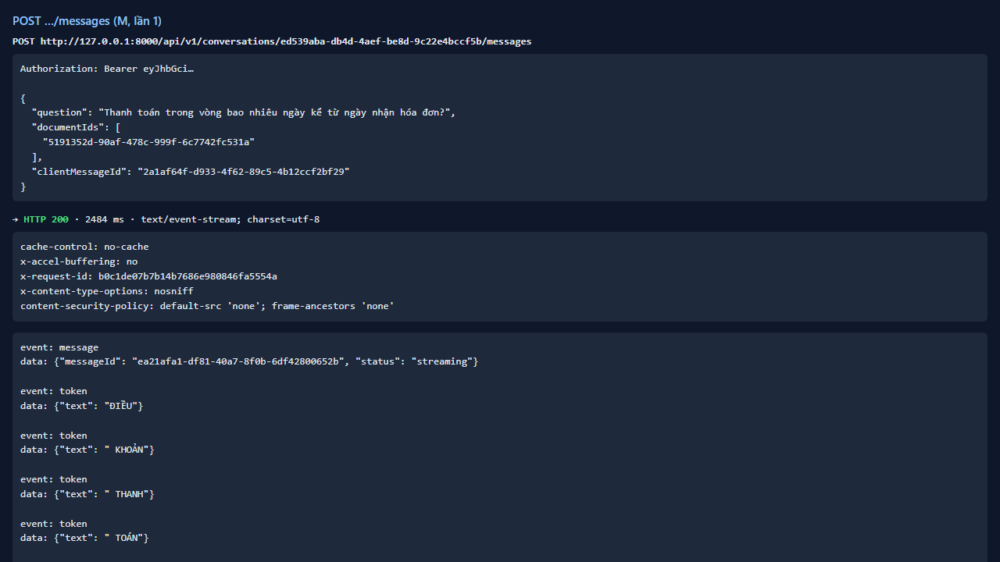
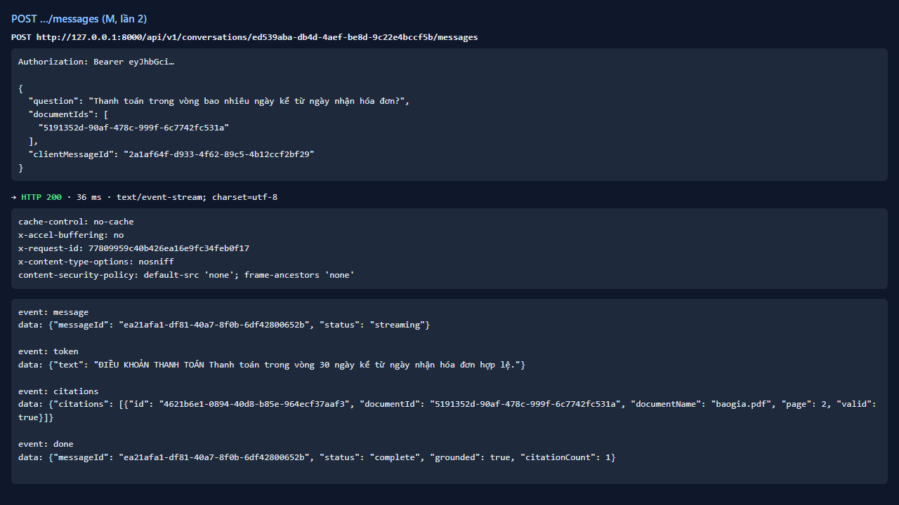
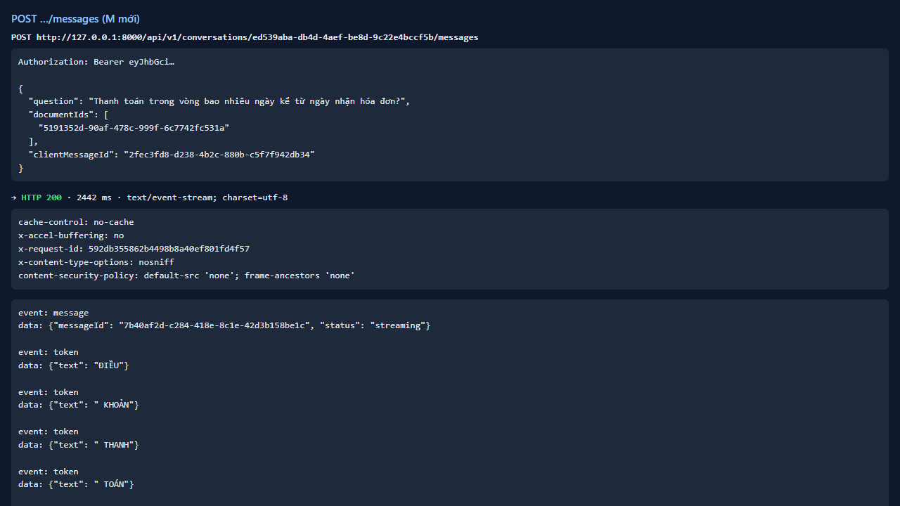

# Test report — API-020: Hỏi đáp idempotent theo clientMessageId

| Mục | Giá trị |
|---|---|
| **Kết quả** | **PASS** |
| Test case | [API-020](../../cases/API-020.md) |
| URL kiểm thử | http://127.0.0.1:8000 |
| Trình duyệt | Microsoft Edge (Chromium) (1280×720) |
| Bắt đầu / kết thúc | 2026-10-30T12:01:33.643Z → 2026-10-30T12:01:43.411Z (9.8s) |
| Số bước | PASS: 4 · FAIL: 0 · SKIP: 0 |
| Video | [video/API-020.webm](video/API-020.webm) |

<video src="video/API-020.webm" controls width="720"></video>

## Kết quả từng bước

### Bước 1. Chuẩn bị — ✅ PASS

- **Mong đợi:** baogia ready + hội thoại
- **Thực tế:** Đúng như mong đợi

### Bước 2. Hỏi với clientMessageId = M — ✅ PASS

- **Mong đợi:** 200 SSE hoàn tất
- **Thực tế:** Đúng như mong đợi

### Bước 3. Gửi lại cùng M và cùng nội dung — ✅ PASS

- **Mong đợi:** Không 5xx; ghi hành vi thực tế
- **Thực tế:** HTTP 200; SSE message→citations→done

### Bước 4. Hỏi với clientMessageId mới — ✅ PASS

- **Mong đợi:** 200 SSE bình thường
- **Thực tế:** Đúng như mong đợi

## Ghi chú

- Chưa có endpoint đọc lịch sử (xem API-039) nên không xác nhận được số câu hỏi lưu; chỉ kết luận từ phản hồi.
