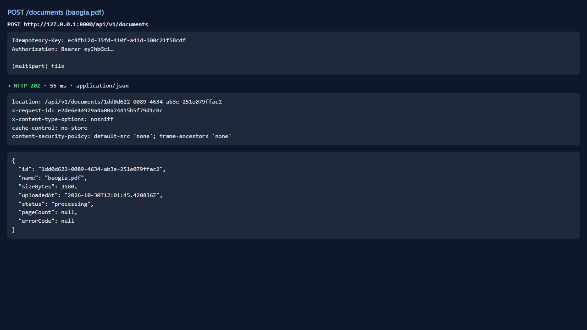
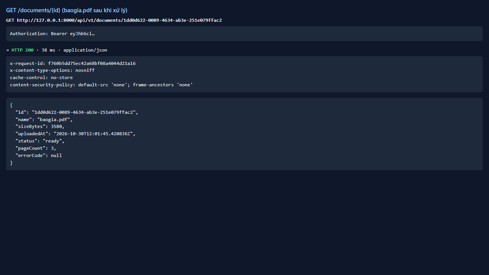
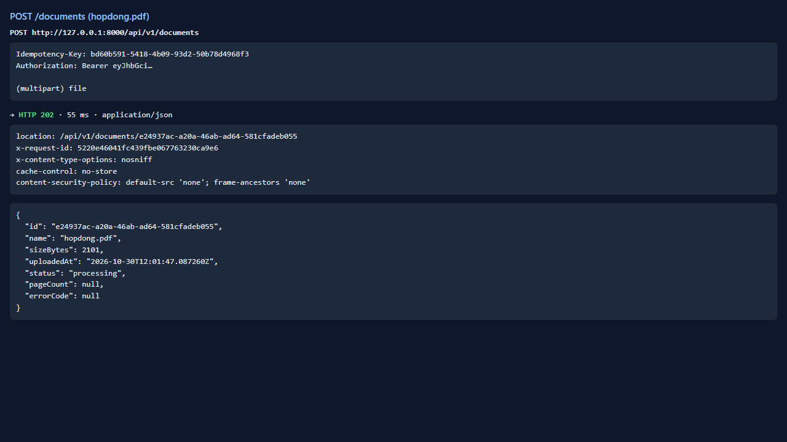
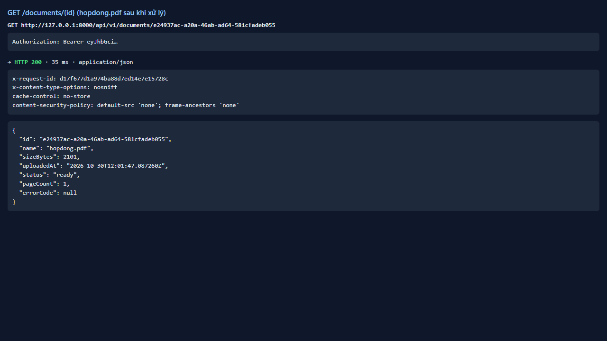
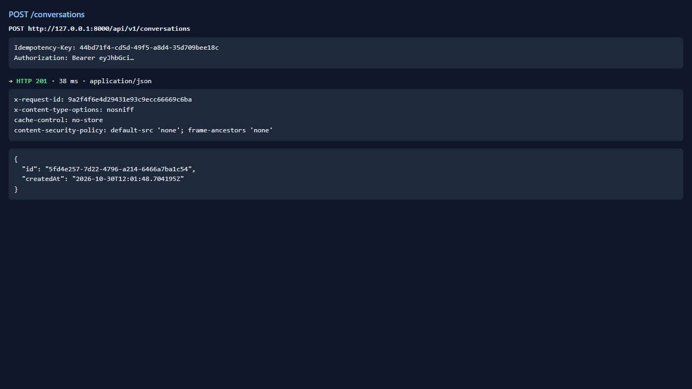
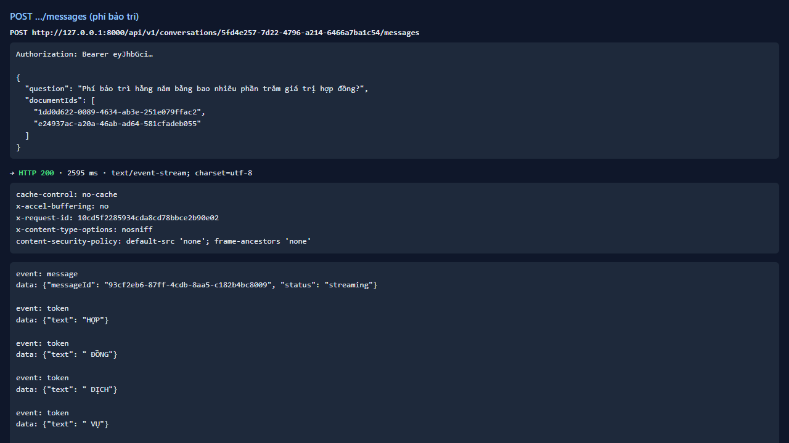
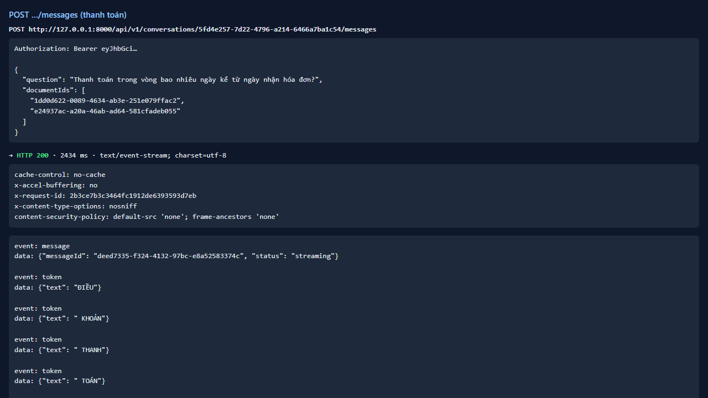

# Test report — API-023: Hỏi đáp trên nhiều tài liệu

| Mục | Giá trị |
|---|---|
| **Kết quả** | **PASS** |
| Test case | [API-023](../../cases/API-023.md) |
| URL kiểm thử | http://127.0.0.1:8000 |
| Trình duyệt | Microsoft Edge (Chromium) (1280×720) |
| Bắt đầu / kết thúc | 2026-10-30T12:01:45.251Z → 2026-10-30T12:01:59.318Z (14.1s) |
| Số bước | PASS: 4 · FAIL: 0 · SKIP: 0 |
| Video | [video/API-023.webm](video/API-023.webm) |

<video src="video/API-023.webm" controls width="720"></video>

## Kết quả từng bước

### Bước 1. Chuẩn bị: baogia + hopdong ready — ✅ PASS

- **Mong đợi:** OK
- **Thực tế:** Đúng như mong đợi

### Bước 2. Hỏi phí bảo trì với cả 2 documentIds — ✅ PASS

- **Mong đợi:** citations có hopdong.pdf
- **Thực tế:** Đúng như mong đợi

### Bước 3. Hỏi thanh toán với cả 2 documentIds — ✅ PASS

- **Mong đợi:** citations có baogia.pdf trang 2
- **Thực tế:** Đúng như mong đợi

### Bước 4. Câu hỏi cần cả hai tài liệu — ✅ PASS

- **Mong đợi:** Ghi số tài liệu trong citations
- **Thực tế:** Tài liệu trong citations: hopdong.pdf

## Ghi chú

- Câu hỏi tổng hợp chỉ dẫn 1 tài liệu (hopdong.pdf). FakeLLM trích câu tốt nhất nên đây là hạn chế của FakeLLM, không kết luận lỗi sản phẩm; cần LLM thật (RAG-002).
