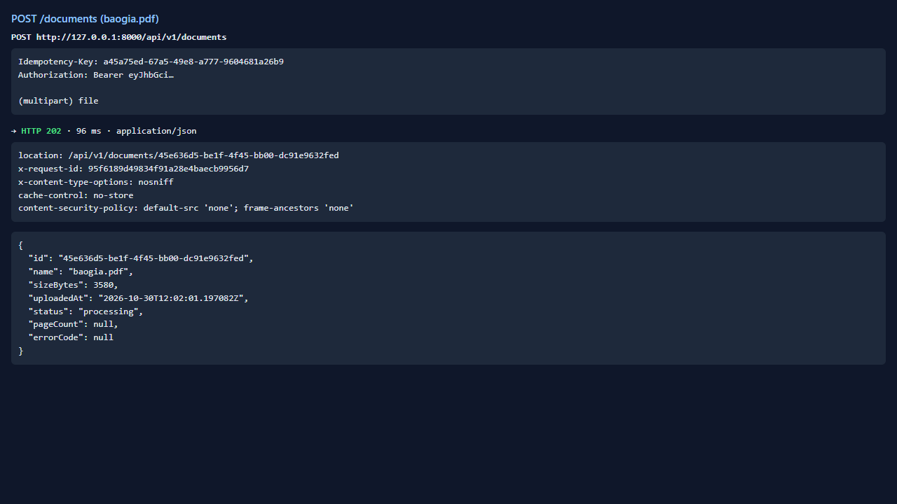
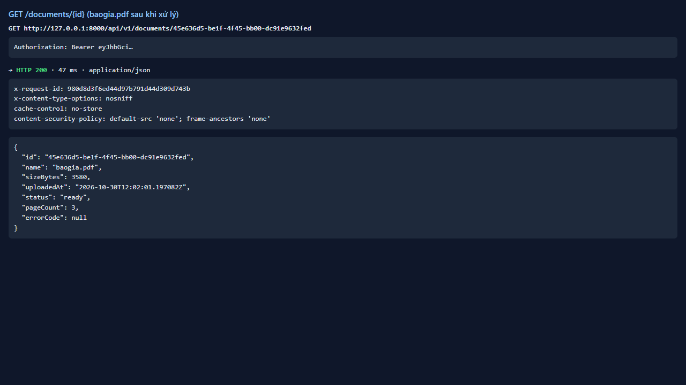
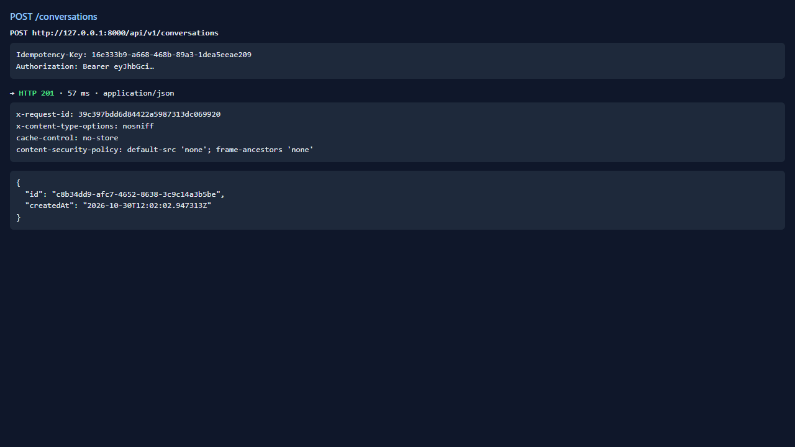
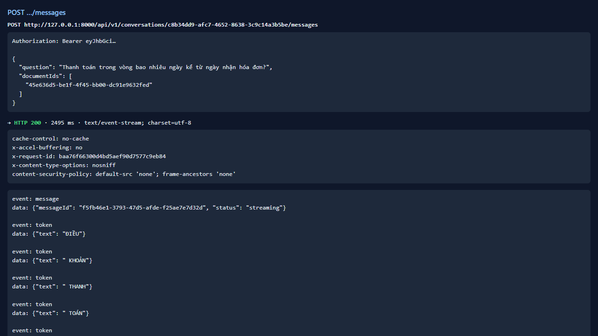
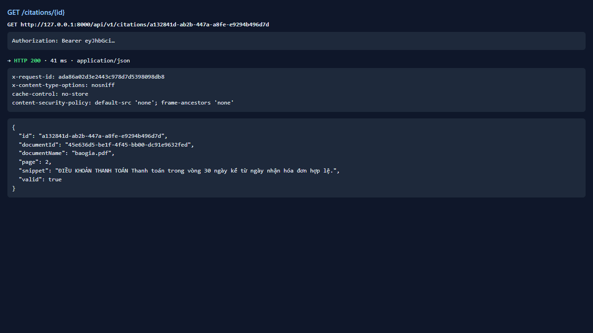

# Test report — API-025: GET /citations/{id}

| Mục | Giá trị |
|---|---|
| **Kết quả** | **PASS** |
| Test case | [API-025](../../cases/API-025.md) |
| URL kiểm thử | http://127.0.0.1:8000 |
| Trình duyệt | Microsoft Edge (Chromium) (1280×720) |
| Bắt đầu / kết thúc | 2026-10-30T12:02:01.036Z → 2026-10-30T12:02:07.743Z (6.7s) |
| Số bước | PASS: 2 · FAIL: 0 · SKIP: 0 |
| Video | [video/API-025.webm](video/API-025.webm) |

<video src="video/API-025.webm" controls width="720"></video>

## Kết quả từng bước

### Bước 1. Chuẩn bị: tạo câu trả lời có citation — ✅ PASS

- **Mong đợi:** citation id
- **Thực tế:** Đúng như mong đợi

### Bước 2. GET /citations/{id} — ✅ PASS

- **Mong đợi:** 200; baogia.pdf, page=2, snippet chứa câu thanh toán, valid=true
- **Thực tế:** snippet 83 ký tự

