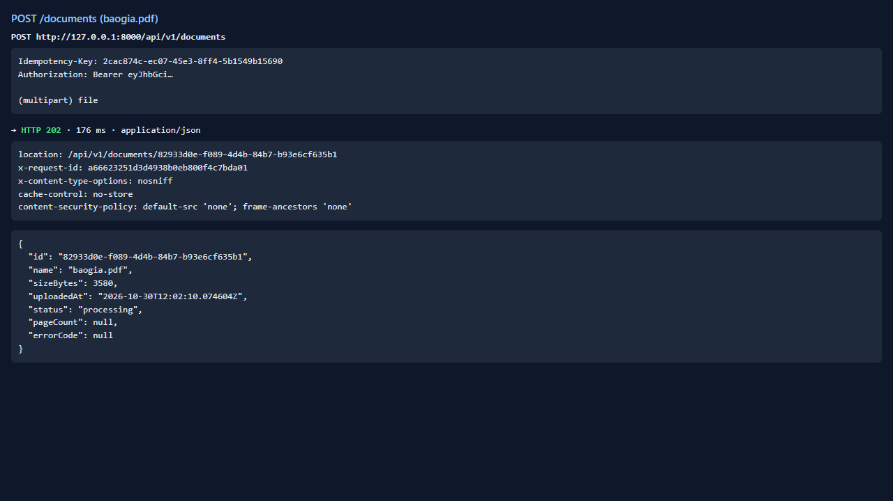
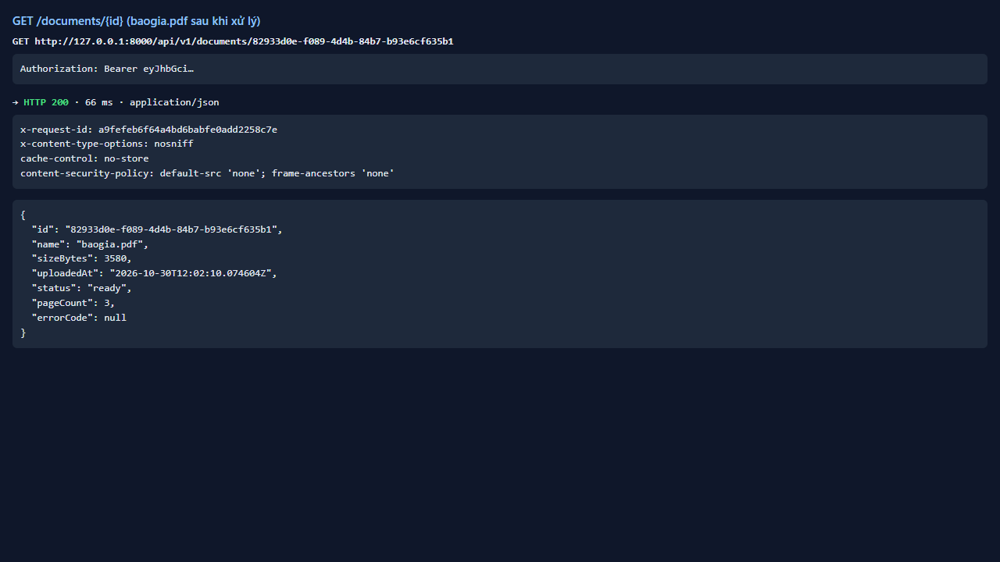
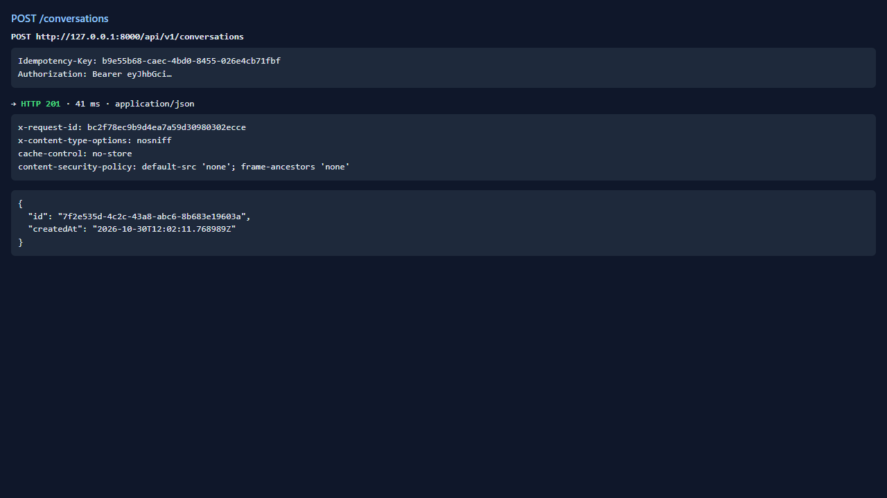
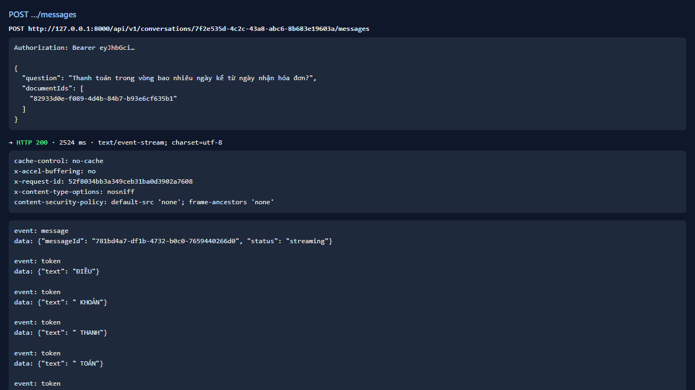
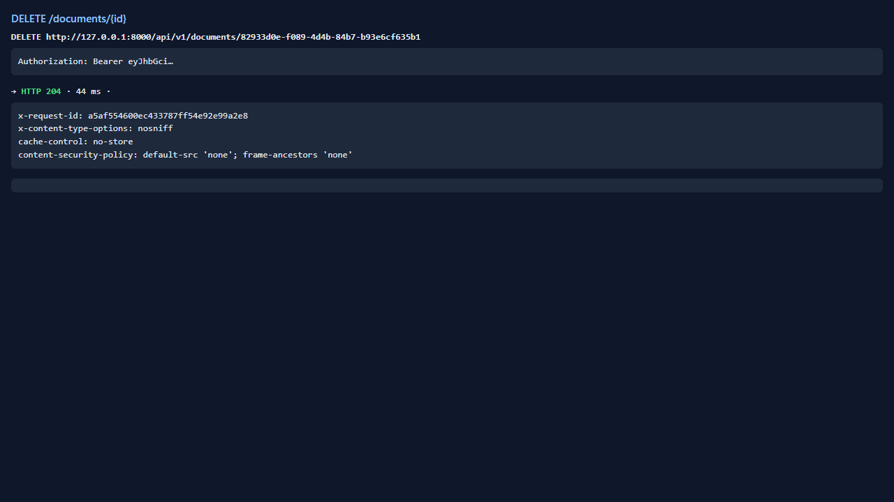
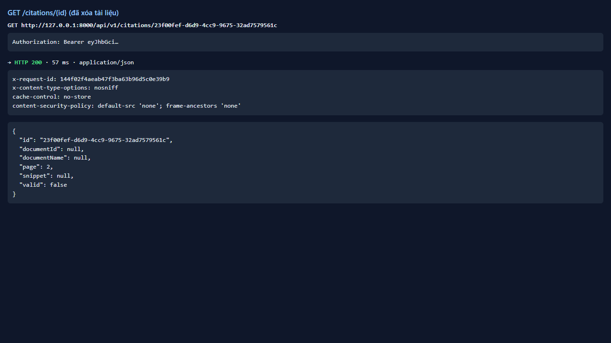

# Test report — API-026: Citation sau khi xóa tài liệu → valid=false

| Mục | Giá trị |
|---|---|
| **Kết quả** | **PASS** |
| Test case | [API-026](../../cases/API-026.md) |
| URL kiểm thử | http://127.0.0.1:8000 |
| Trình duyệt | Microsoft Edge (Chromium) (1280×720) |
| Bắt đầu / kết thúc | 2026-10-30T12:02:09.764Z → 2026-10-30T12:02:17.410Z (7.6s) |
| Số bước | PASS: 3 · FAIL: 0 · SKIP: 0 |
| Video | [video/API-026.webm](video/API-026.webm) |

<video src="video/API-026.webm" controls width="720"></video>

## Kết quả từng bước

### Bước 1. Chuẩn bị: câu trả lời có citation — ✅ PASS

- **Mong đợi:** OK
- **Thực tế:** Đúng như mong đợi

### Bước 2. Xóa baogia.pdf — ✅ PASS

- **Mong đợi:** 204
- **Thực tế:** Đúng như mong đợi

### Bước 3. GET /citations/{id} — ✅ PASS

- **Mong đợi:** 200; valid=false; snippet/documentId/documentName = null
- **Thực tế:** Đúng như mong đợi

