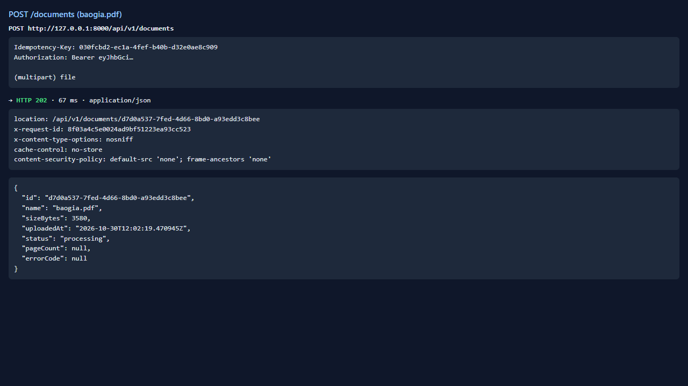
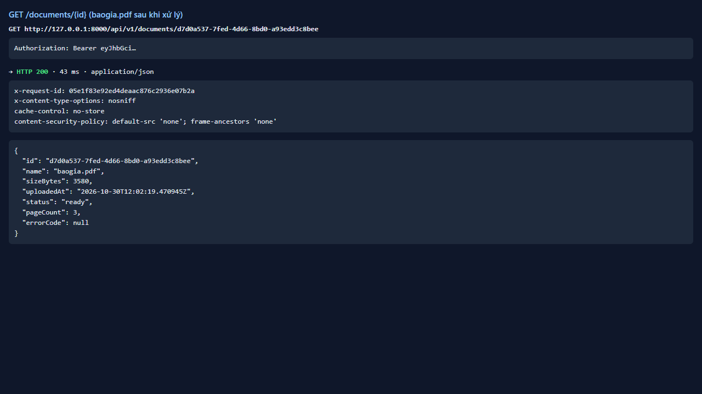
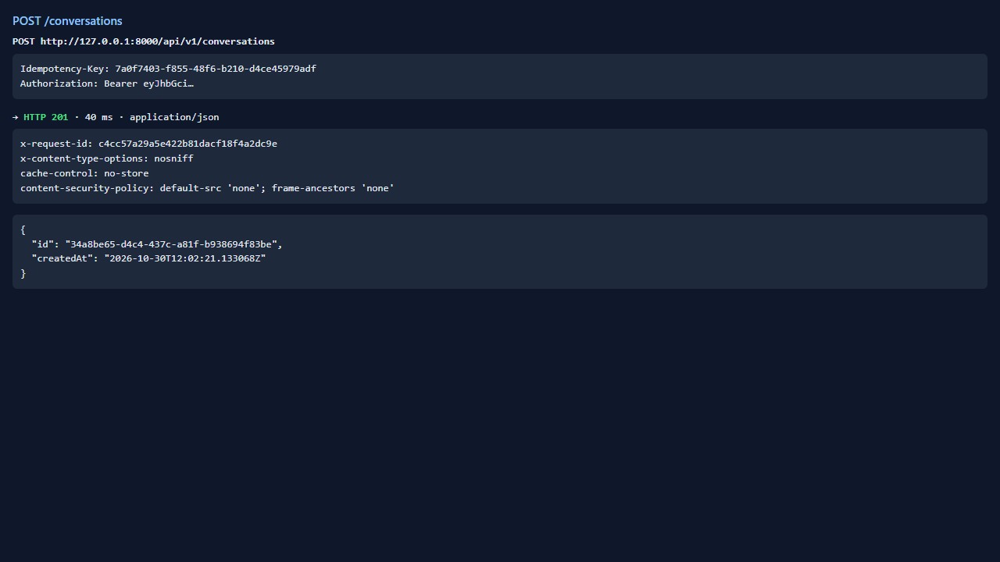
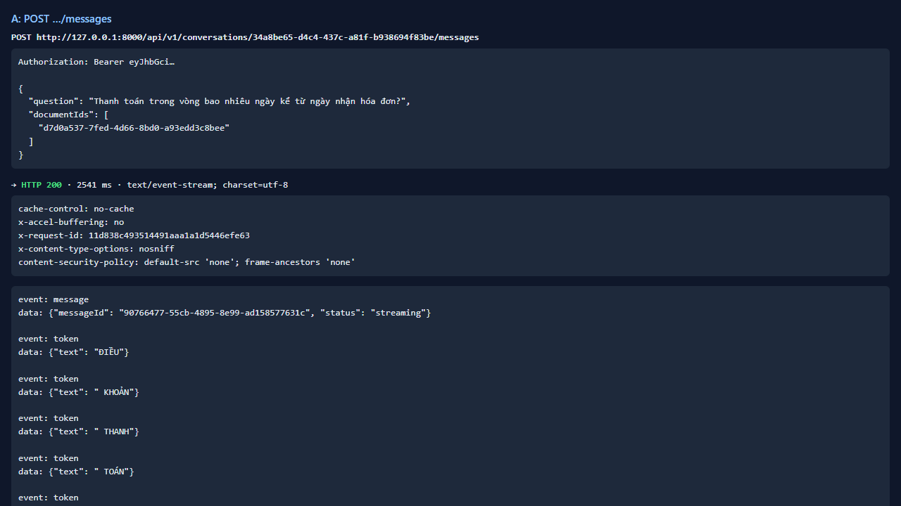
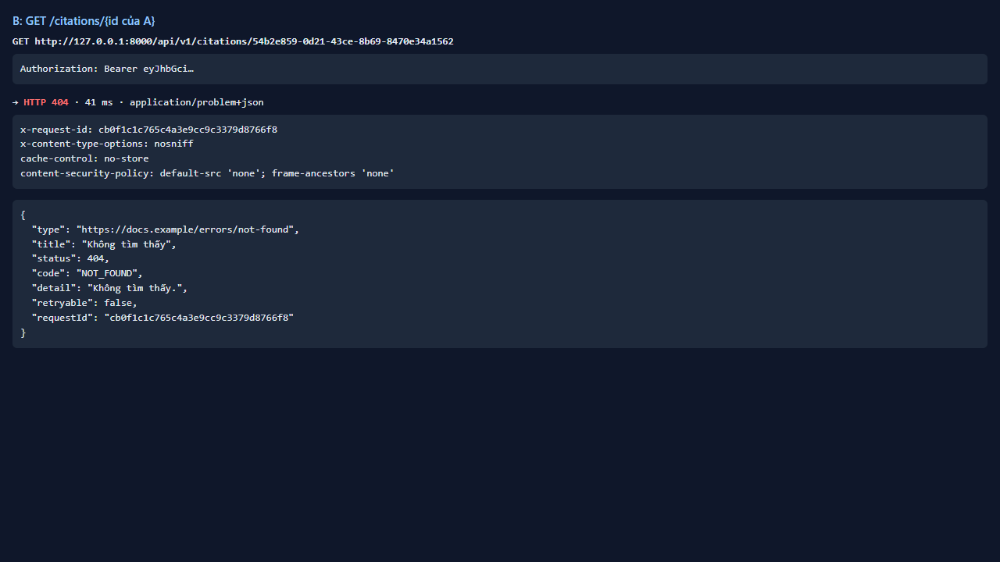
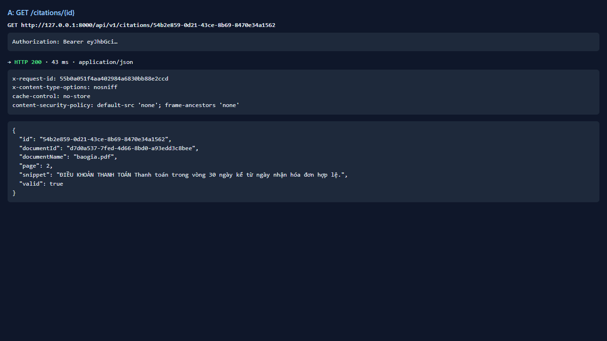

# Test report — API-027: Citation của người khác → 404

| Mục | Giá trị |
|---|---|
| **Kết quả** | **PASS** |
| Test case | [API-027](../../cases/API-027.md) |
| URL kiểm thử | http://127.0.0.1:8000 |
| Trình duyệt | Microsoft Edge (Chromium) (1280×720) |
| Bắt đầu / kết thúc | 2026-10-30T12:02:19.190Z → 2026-10-30T12:02:26.748Z (7.6s) |
| Số bước | PASS: 3 · FAIL: 0 · SKIP: 0 |
| Video | [video/API-027.webm](video/API-027.webm) |

<video src="video/API-027.webm" controls width="720"></video>

## Kết quả từng bước

### Bước 1. Chuẩn bị: A có citation; B là tài khoản khác — ✅ PASS

- **Mong đợi:** OK
- **Thực tế:** Đúng như mong đợi

### Bước 2. B: GET /citations/{id của A} — ✅ PASS

- **Mong đợi:** 404 NOT_FOUND
- **Thực tế:** Đúng như mong đợi

### Bước 3. A: cùng yêu cầu — ✅ PASS

- **Mong đợi:** 200
- **Thực tế:** Đúng như mong đợi

