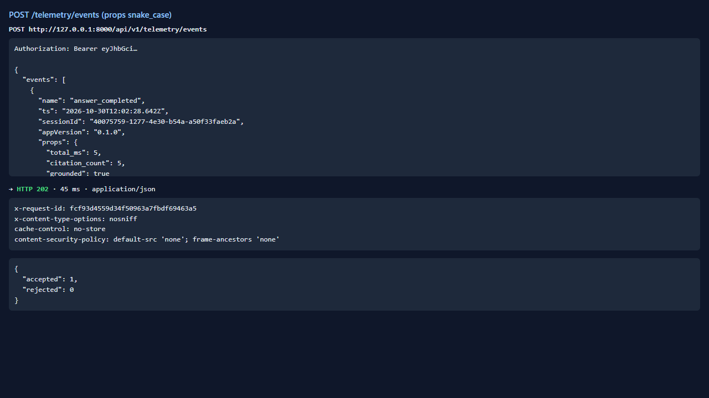
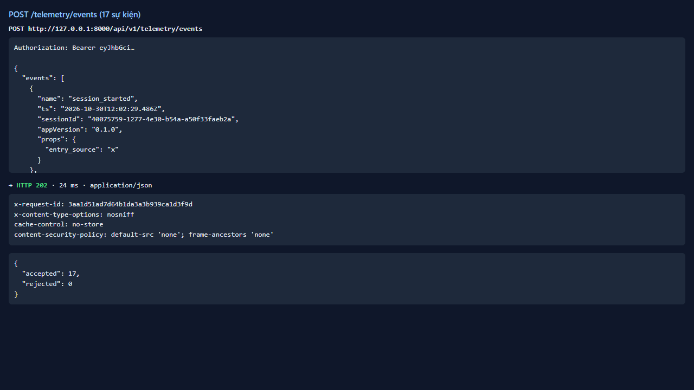
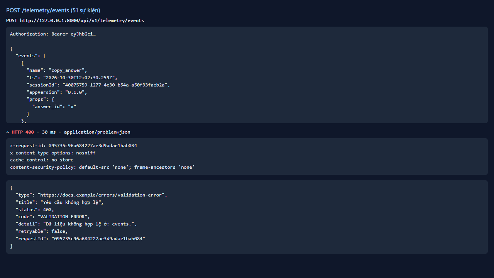

# Test report — API-028: POST /telemetry/events (allow-list)

| Mục | Giá trị |
|---|---|
| **Kết quả** | **PASS** |
| Test case | [API-028](../../cases/API-028.md) |
| URL kiểm thử | http://127.0.0.1:8000 |
| Trình duyệt | Microsoft Edge (Chromium) (1280×720) |
| Bắt đầu / kết thúc | 2026-10-30T12:02:28.512Z → 2026-10-30T12:02:31.050Z (2.5s) |
| Số bước | PASS: 3 · FAIL: 0 · SKIP: 0 |
| Video | [video/API-028.webm](video/API-028.webm) |

<video src="video/API-028.webm" controls width="720"></video>

## Kết quả từng bước

### Bước 1. Gửi answer_completed — ✅ PASS

- **Mong đợi:** 202; accepted=1, rejected=0
- **Thực tế:** Chấp nhận props snake_case

### Bước 2. Gửi 17 sự kiện trong allow-list (1 lô) — ✅ PASS

- **Mong đợi:** accepted=17, rejected=0
- **Thực tế:** Đúng như mong đợi

### Bước 3. Gửi 51 sự kiện trong một lô — ✅ PASS

- **Mong đợi:** Bị từ chối 4xx
- **Thực tế:** HTTP 400 code=VALIDATION_ERROR

