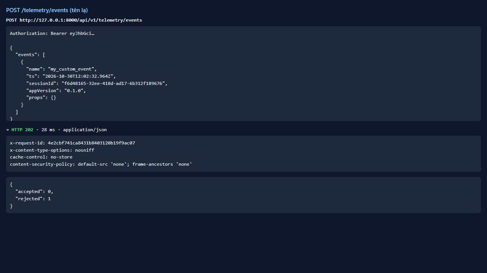
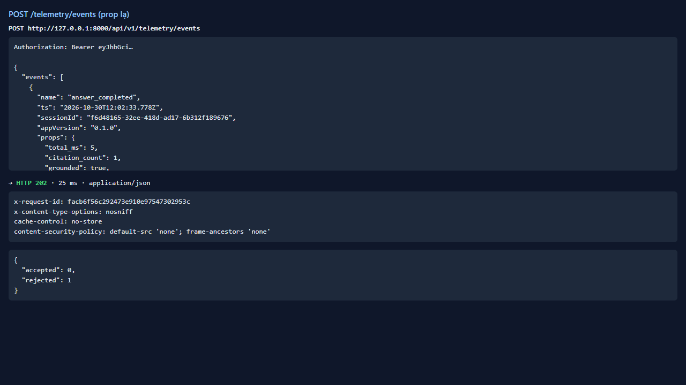
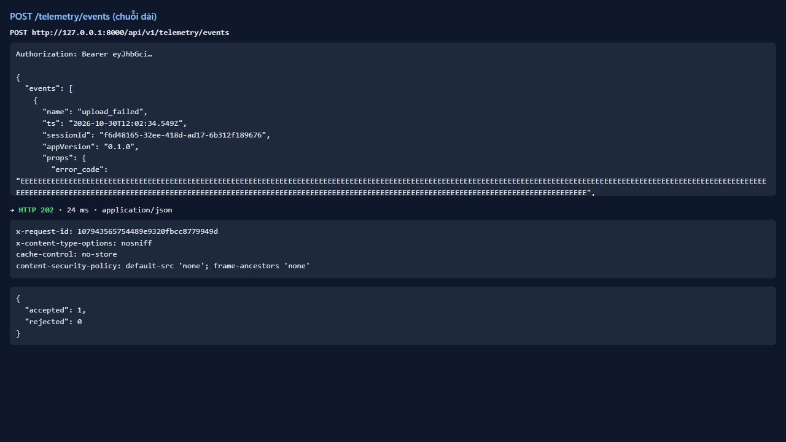
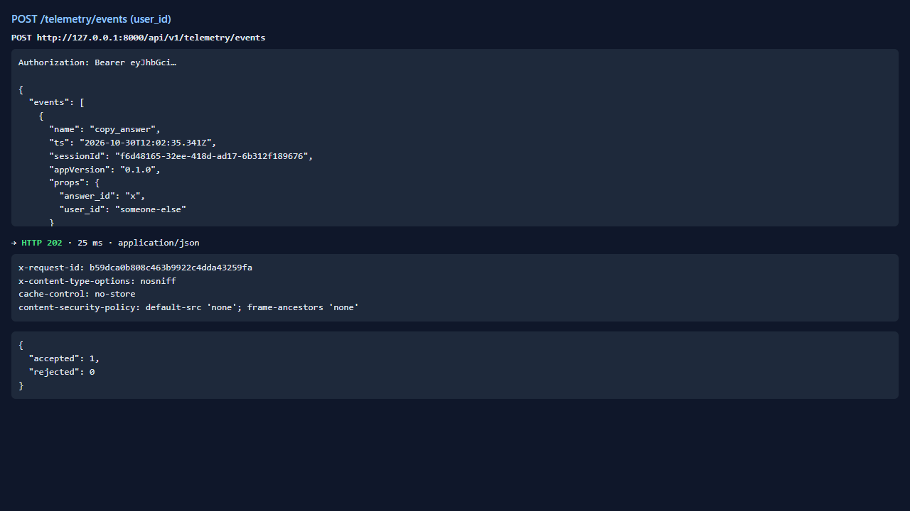

# Test report — API-029: Telemetry từ chối sự kiện/thuộc tính ngoài allow-list

| Mục | Giá trị |
|---|---|
| **Kết quả** | **PASS** |
| Test case | [API-029](../../cases/API-029.md) |
| URL kiểm thử | http://127.0.0.1:8000 |
| Trình duyệt | Microsoft Edge (Chromium) (1280×720) |
| Bắt đầu / kết thúc | 2026-10-30T12:02:32.826Z → 2026-10-30T12:02:36.113Z (3.3s) |
| Số bước | PASS: 4 · FAIL: 0 · SKIP: 0 |
| Video | [video/API-029.webm](video/API-029.webm) |

<video src="video/API-029.webm" controls width="720"></video>

## Kết quả từng bước

### Bước 1. Sự kiện tên lạ — ✅ PASS

- **Mong đợi:** 202, rejected=1
- **Thực tế:** Đúng như mong đợi

### Bước 2. answer_completed kèm prop lạ chứa nội dung — ✅ PASS

- **Mong đợi:** Prop bị loại hoặc cả sự kiện rejected
- **Thực tế:** accepted=0, rejected=1 (cả sự kiện bị từ chối)

### Bước 3. Prop chuỗi tự do dài (> 200 ký tự) — ✅ PASS

- **Mong đợi:** Bị loại/từ chối
- **Thực tế:** accepted=1, rejected=0

### Bước 4. user_id trong props — ✅ PASS

- **Mong đợi:** Bị loại
- **Thực tế:** accepted=1, rejected=0

## Ghi chú

- Giá trị lưu trữ phía server không đọc được qua API; kết luận dựa trên accepted/rejected. Báo cáo /reports chỉ có số tổng hợp (xem API-030).
