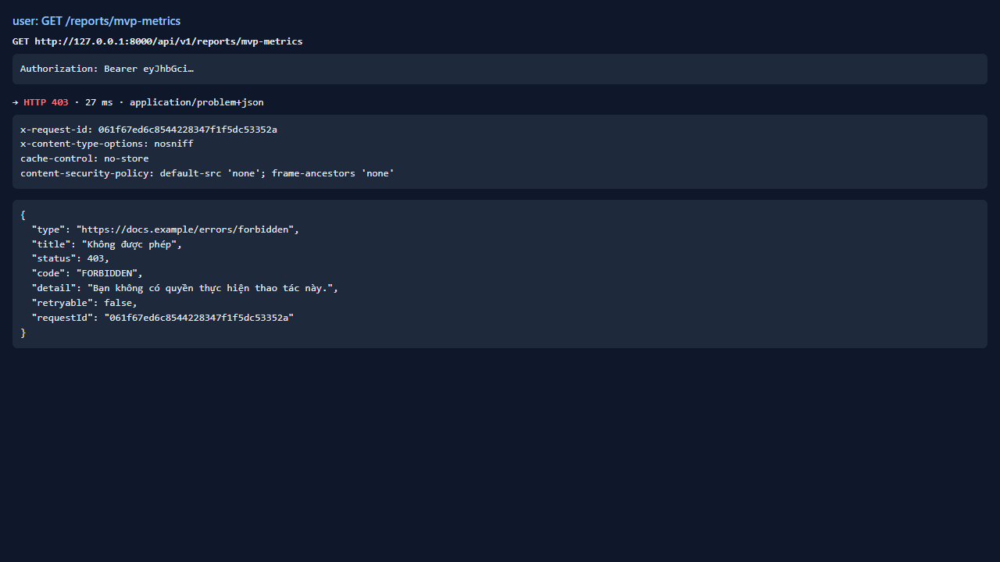
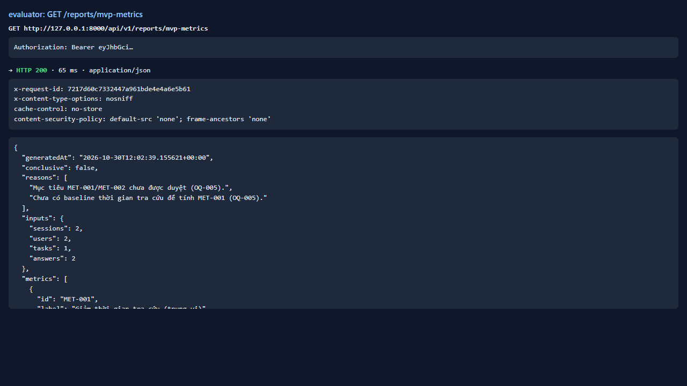

# Test report — API-030: GET /reports/mvp-metrics: phân quyền

| Mục | Giá trị |
|---|---|
| **Kết quả** | **PASS** |
| Test case | [API-030](../../cases/API-030.md) |
| URL kiểm thử | http://127.0.0.1:8000 |
| Trình duyệt | Microsoft Edge (Chromium) (1280×720) |
| Bắt đầu / kết thúc | 2026-10-30T12:02:38.042Z → 2026-10-30T12:02:40.027Z (2.0s) |
| Số bước | PASS: 3 · FAIL: 0 · SKIP: 0 |
| Video | [video/API-030.webm](video/API-030.webm) |

<video src="video/API-030.webm" controls width="720"></video>

## Kết quả từng bước

### Bước 1. User thường GET /reports/mvp-metrics — ✅ PASS

- **Mong đợi:** 403 FORBIDDEN
- **Thực tế:** Đúng như mong đợi

### Bước 2. Evaluator GET /reports/mvp-metrics — ✅ PASS

- **Mong đợi:** 200; có MET-001, MET-002, KR1.2, KR2.2; ghi chưa thể kết luận
- **Thực tế:** Đúng như mong đợi

### Bước 3. Rà soát JSON: không có nội dung/định danh — ✅ PASS

- **Mong đợi:** Không có tên tệp, câu hỏi, định danh người dùng
- **Thực tế:** Đúng như mong đợi

