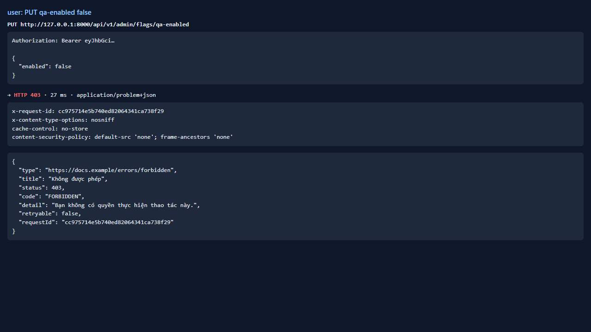
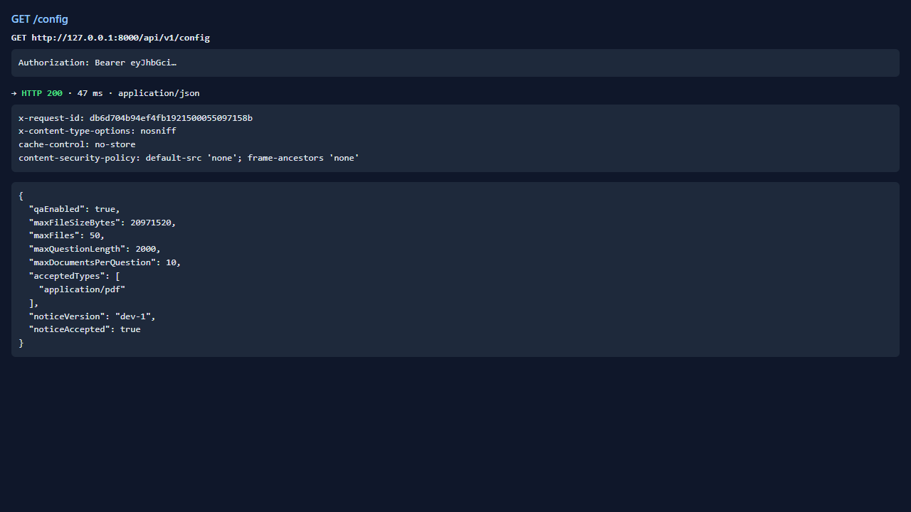
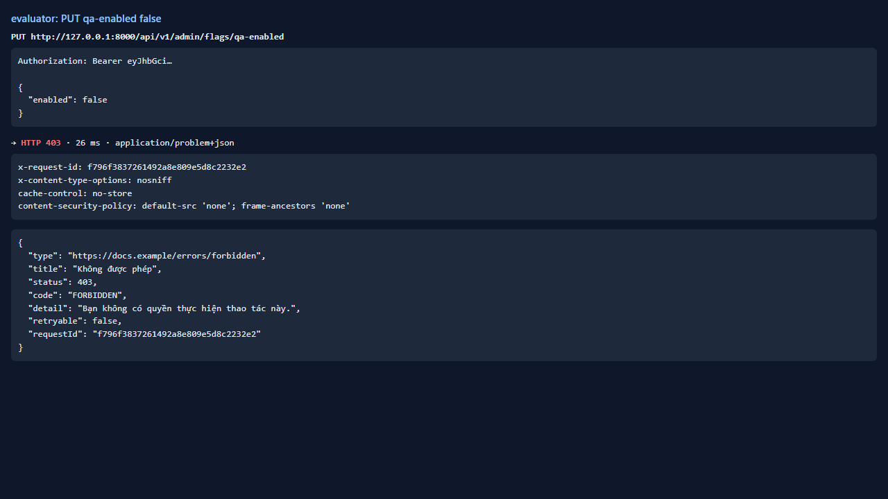
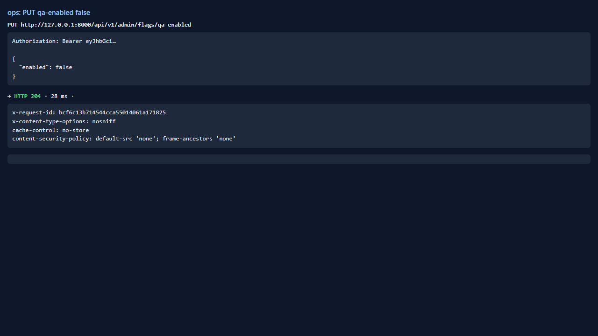
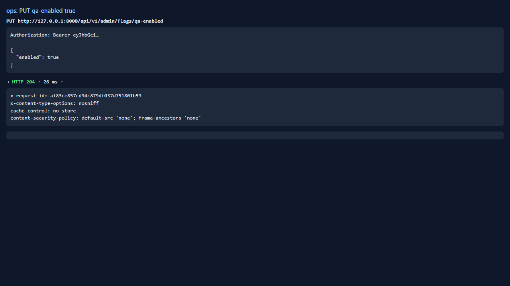
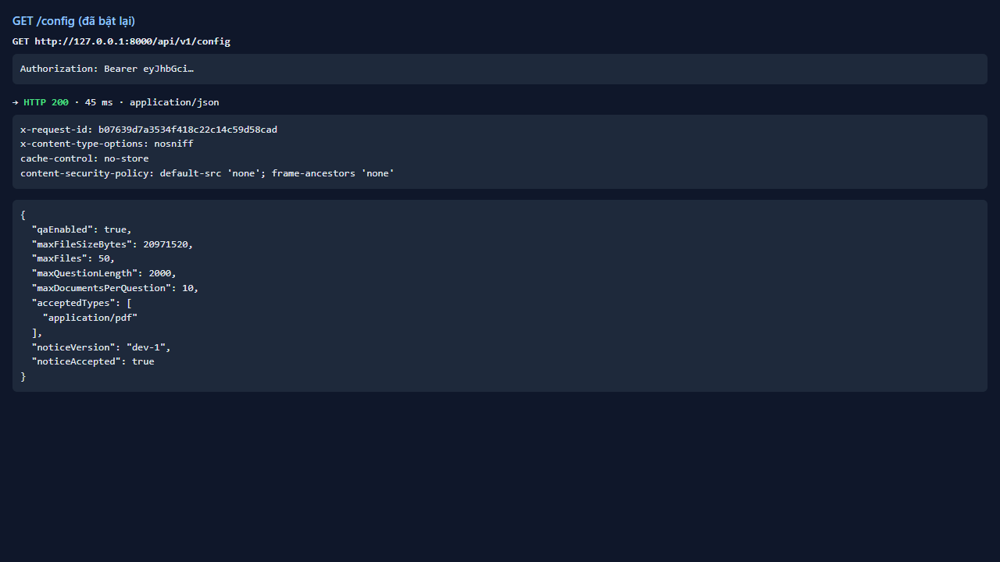
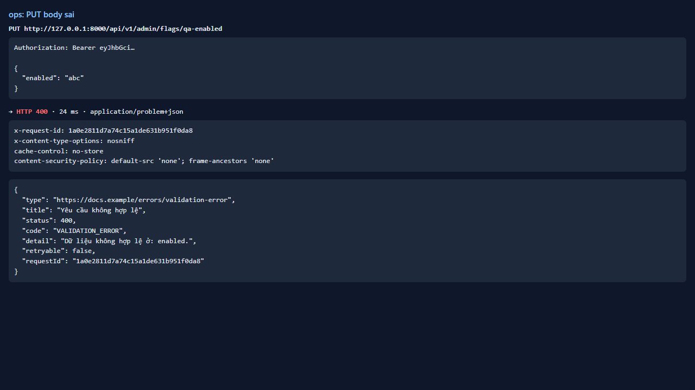
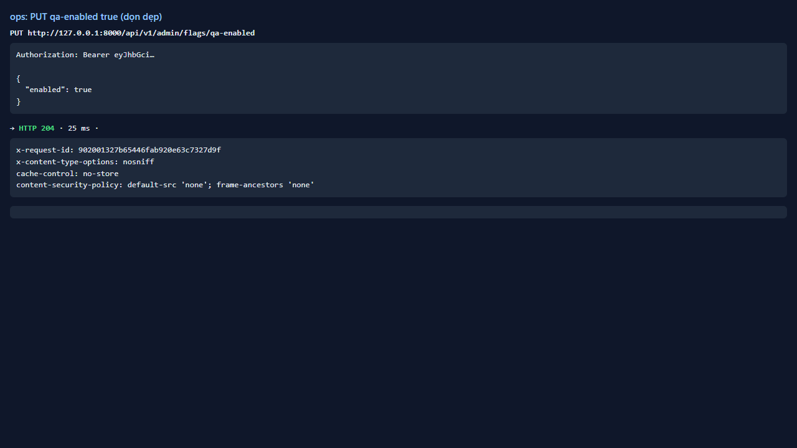

# Test report — API-031: PUT /admin/flags/qa-enabled: phân quyền

| Mục | Giá trị |
|---|---|
| **Kết quả** | **PASS** |
| Test case | [API-031](../../cases/API-031.md) |
| URL kiểm thử | http://127.0.0.1:8000 |
| Trình duyệt | Microsoft Edge (Chromium) (1280×720) |
| Bắt đầu / kết thúc | 2026-10-30T12:04:31.412Z → 2026-10-30T12:04:38.089Z (6.7s) |
| Số bước | PASS: 5 · FAIL: 0 · SKIP: 0 |
| Video | [video/API-031.webm](video/API-031.webm) |

<video src="video/API-031.webm" controls width="720"></video>

## Kết quả từng bước

### Bước 1. User: PUT {enabled:false} — ✅ PASS

- **Mong đợi:** 403; /config vẫn qaEnabled=true
- **Thực tế:** Đúng như mong đợi

### Bước 2. Evaluator: PUT {enabled:false} — ✅ PASS

- **Mong đợi:** 403
- **Thực tế:** Đúng như mong đợi

### Bước 3. Ops: false rồi true — ✅ PASS

- **Mong đợi:** Cả hai 204; /config phản ánh
- **Thực tế:** Đúng như mong đợi

### Bước 4. Body sai {enabled:"abc"} — ✅ PASS

- **Mong đợi:** 400 VALIDATION_ERROR
- **Thực tế:** Đúng như mong đợi

### Bước 5. Dọn dẹp: bảo đảm qaEnabled=true — ✅ PASS

- **Mong đợi:** 204
- **Thực tế:** Đúng như mong đợi

