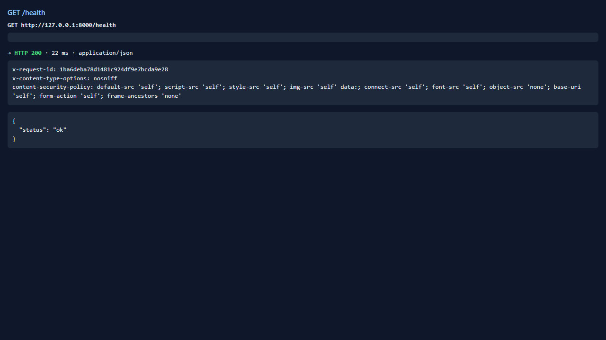
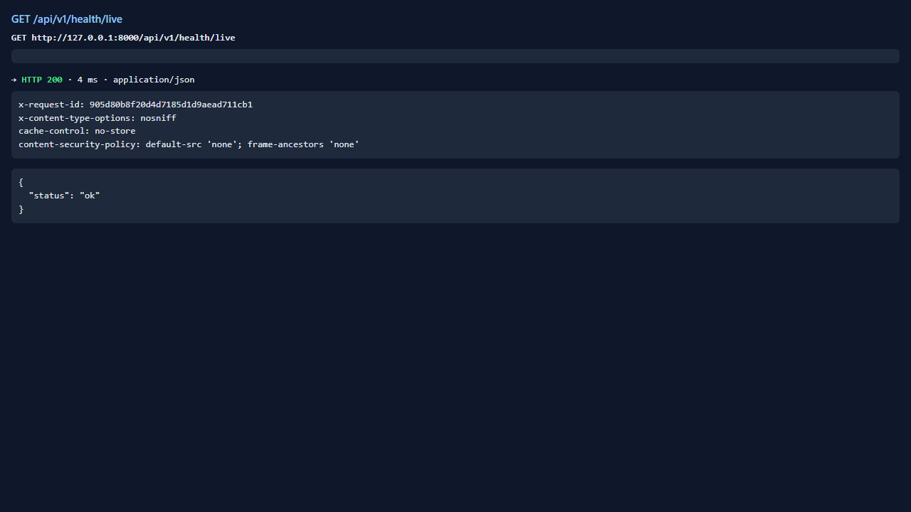
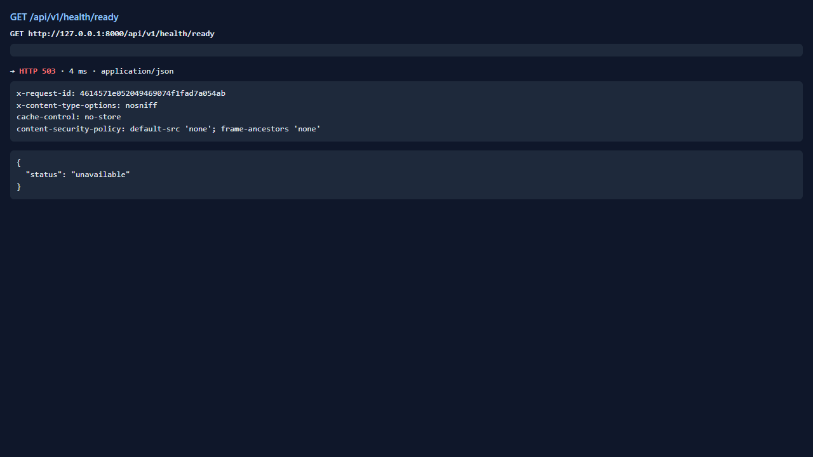
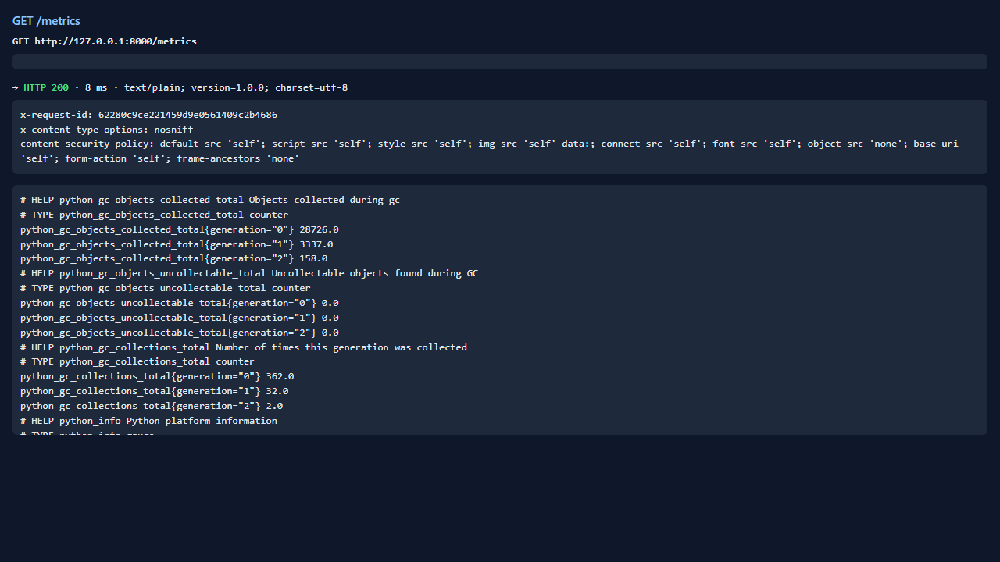
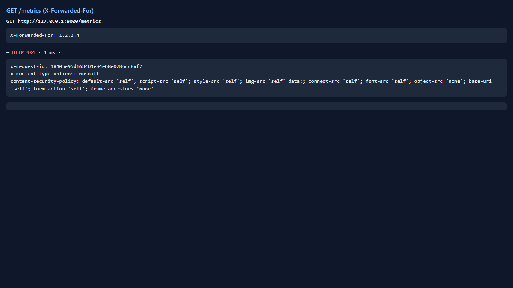

# Test report — API-032: Health & metrics endpoints

| Mục | Giá trị |
|---|---|
| **Kết quả** | **PASS** |
| Test case | [API-032](../../cases/API-032.md) |
| URL kiểm thử | http://127.0.0.1:8000 |
| Trình duyệt | Microsoft Edge (Chromium) (1280×720) |
| Bắt đầu / kết thúc | 2026-10-30T12:02:42.065Z → 2026-10-30T12:02:45.918Z (3.9s) |
| Số bước | PASS: 4 · FAIL: 0 · SKIP: 0 |
| Video | [video/API-032.webm](video/API-032.webm) |

<video src="video/API-032.webm" controls width="720"></video>

## Kết quả từng bước

### Bước 1. GET /health và /api/v1/health/live không token — ✅ PASS

- **Mong đợi:** 200 {status:ok}
- **Thực tế:** Đúng như mong đợi

### Bước 2. GET /api/v1/health/ready không token — ✅ PASS

- **Mong đợi:** 200 ready hoặc 503 unavailable — ghi thực tế
- **Thực tế:** HTTP 503 {"status":"unavailable"}

### Bước 3. GET /metrics trực tiếp — ✅ PASS

- **Mong đợi:** 200 định dạng Prometheus
- **Thực tế:** Đúng như mong đợi

### Bước 4. GET /metrics với X-Forwarded-For — ✅ PASS

- **Mong đợi:** 404
- **Thực tế:** Đúng như mong đợi

## Ghi chú

- health/ready trả HTTP 503 ({"status":"unavailable"}). Devserver không có CSDL nên 503 là hành vi kỳ vọng ở môi trường này; không coi là lỗi sản phẩm nhưng readiness với DB thật chưa được kiểm chứng.
