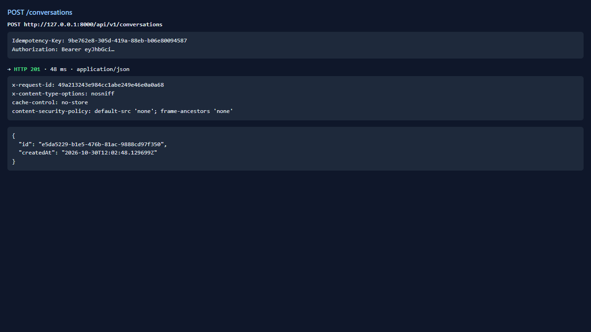
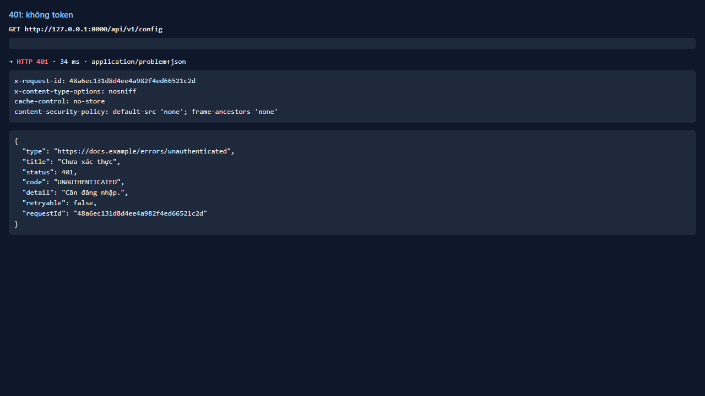
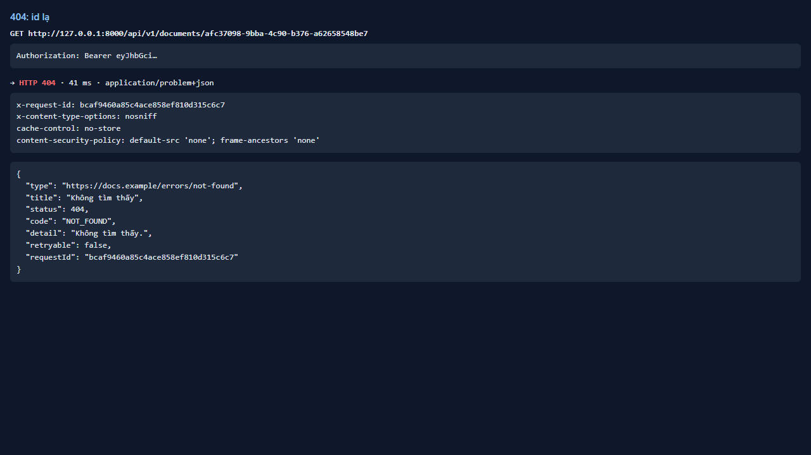
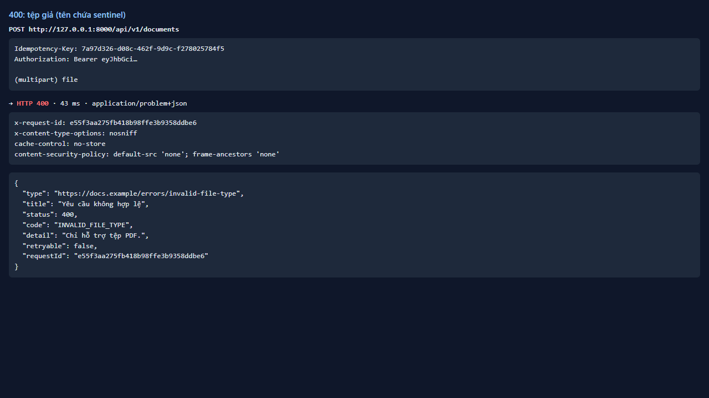
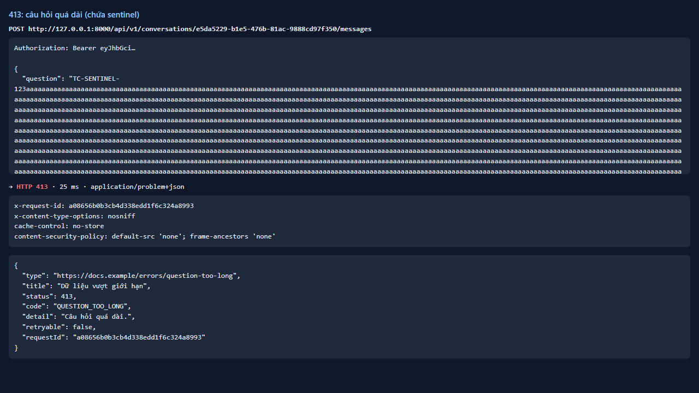
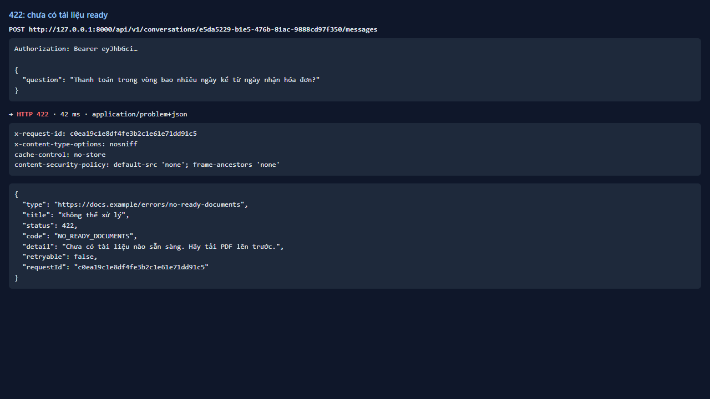
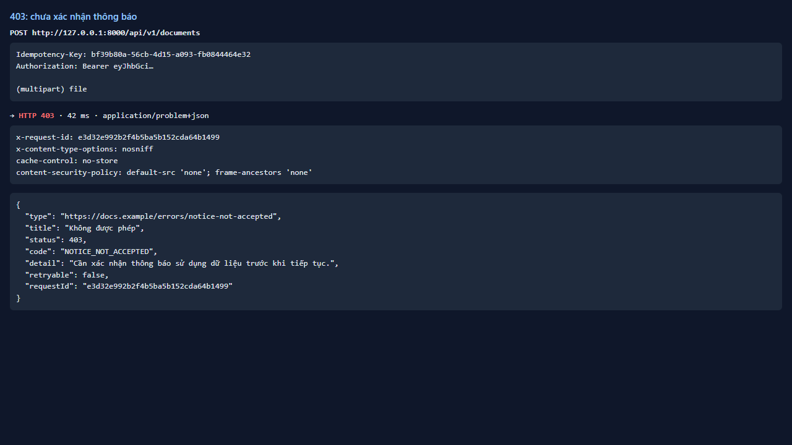

# Test report — API-033: Mô hình lỗi RFC 7807 thống nhất

| Mục | Giá trị |
|---|---|
| **Kết quả** | **PASS** |
| Test case | [API-033](../../cases/API-033.md) |
| URL kiểm thử | http://127.0.0.1:8000 |
| Trình duyệt | Microsoft Edge (Chromium) (1280×720) |
| Bắt đầu / kết thúc | 2026-10-30T12:02:47.913Z → 2026-10-30T12:02:53.732Z (5.8s) |
| Số bước | PASS: 4 · FAIL: 0 · SKIP: 0 |
| Video | [video/API-033.webm](video/API-033.webm) |

<video src="video/API-033.webm" controls width="720"></video>

## Kết quả từng bước

### Bước 1. Gây các lỗi 401, 404, 400, 413, 422, 403 — ✅ PASS

- **Mong đợi:** Mỗi phản hồi là application/problem+json
- **Thực tế:** 401→401, 404→404, 400→400, 413→413, 422→422, 403→403

### Bước 2. Kiểm tra từng body — ✅ PASS

- **Mong đợi:** Có type,title,status(=HTTP),code,detail,retryable,requestId
- **Thực tế:** Đúng như mong đợi

### Bước 3. detail không chứa sentinel — ✅ PASS

- **Mong đợi:** Không chứa TC-SENTINEL-123
- **Thực tế:** Đúng như mong đợi

### Bước 4. requestId trùng X-Request-Id — ✅ PASS

- **Mong đợi:** Trùng nhau
- **Thực tế:** Đúng như mong đợi

