# Test report — API-034: X-Request-Id trên mọi phản hồi

| Mục | Giá trị |
|---|---|
| **Kết quả** | **PASS** |
| Test case | [API-034](../../cases/API-034.md) |
| URL kiểm thử | http://127.0.0.1:8000 |
| Trình duyệt | Microsoft Edge (Chromium) (1280×720) |
| Bắt đầu / kết thúc | 2026-10-30T12:02:55.504Z → 2026-10-30T12:03:05.362Z (9.9s) |
| Số bước | PASS: 3 · FAIL: 0 · SKIP: 0 |
| Video | [video/API-034.webm](video/API-034.webm) |

<video src="video/API-034.webm" controls width="720"></video>

## Kết quả từng bước

### Bước 1. Gọi 6 endpoint khác nhau (200, 201, 202, 204, 4xx, SSE) — ✅ PASS

- **Mong đợi:** Mỗi phản hồi có X-Request-Id
- **Thực tế:** 200, 201, 202, 204, 404, 200

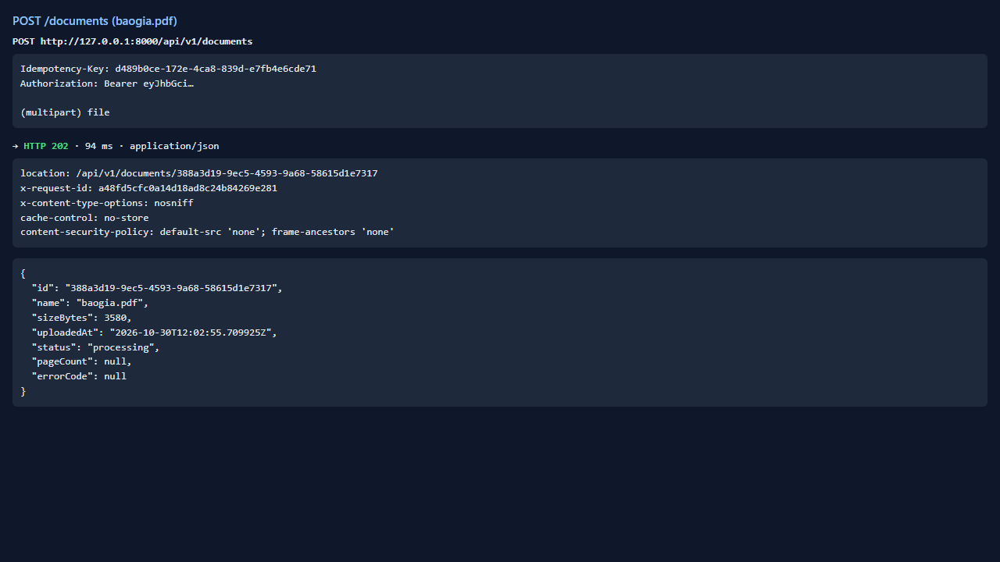

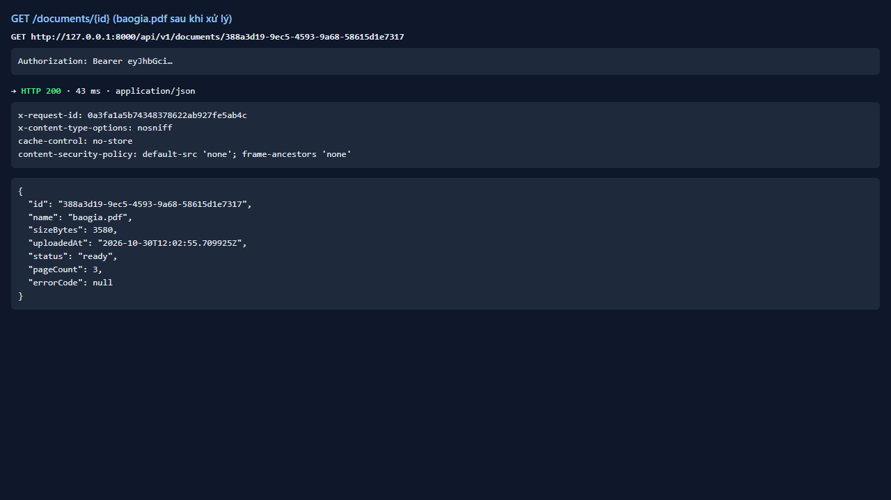

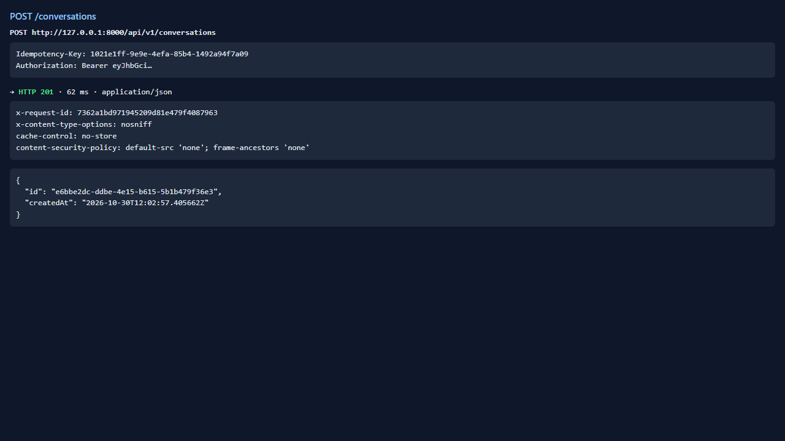

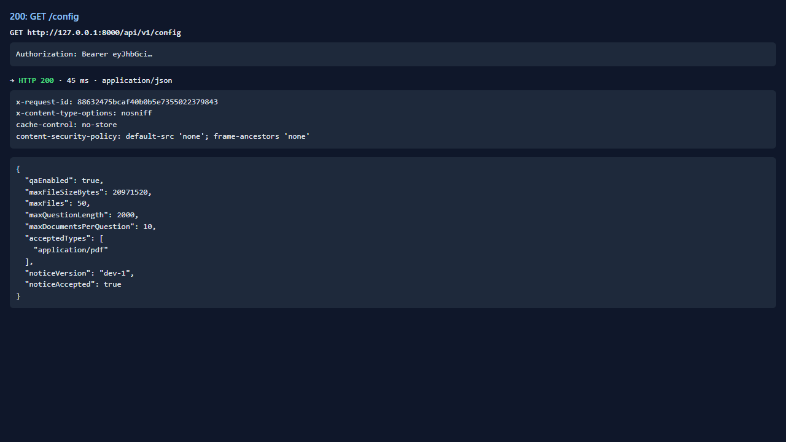

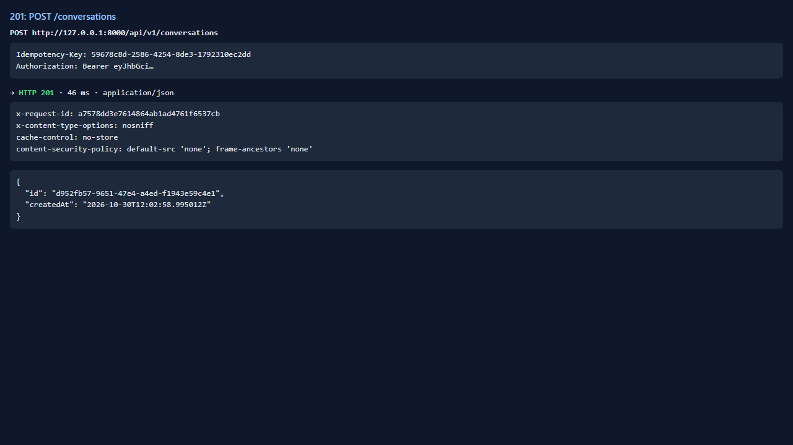

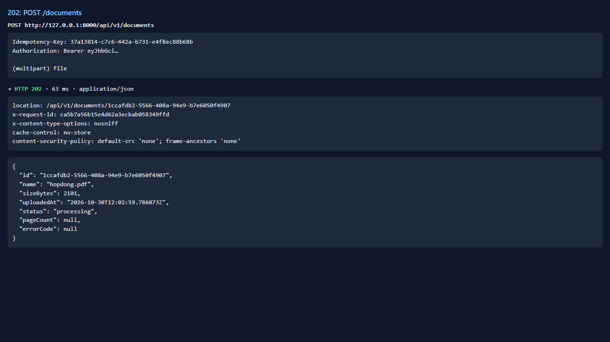

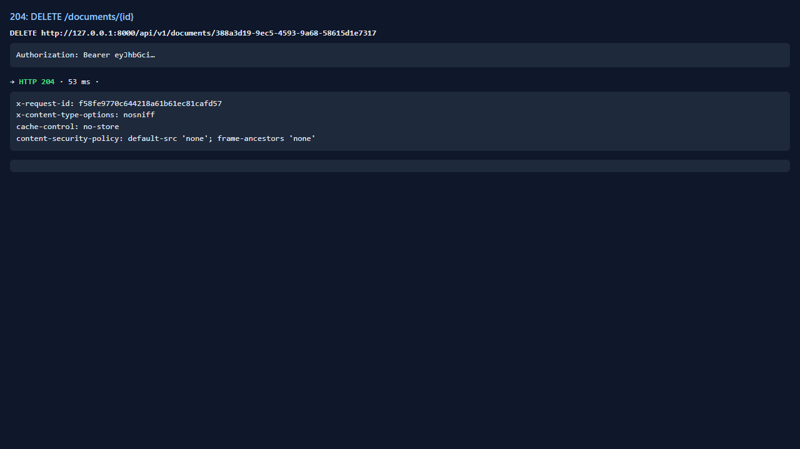

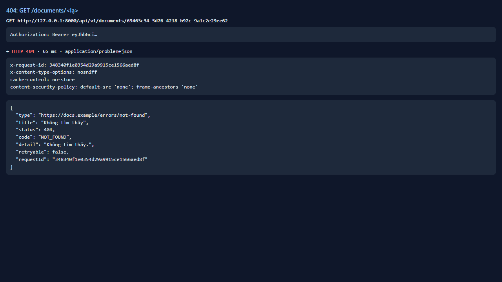

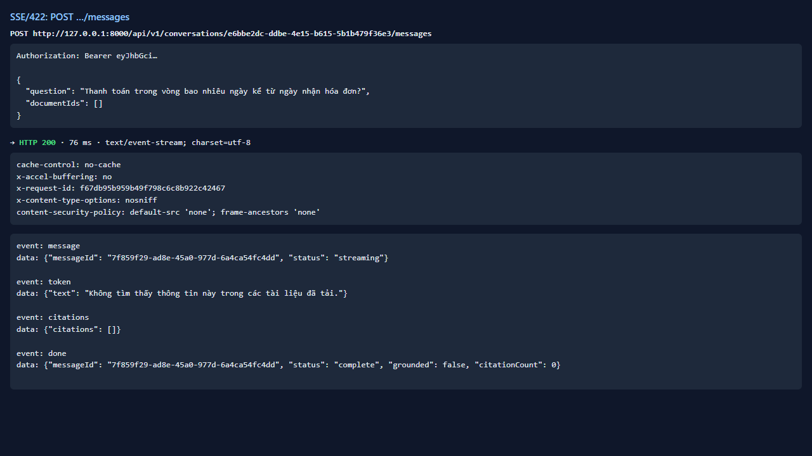

### Bước 2. Gửi X-Request-Id: abc123 — ✅ PASS

- **Mong đợi:** Ghi nhận: giữ nguyên hay sinh mới
- **Thực tế:** Phản hồi X-Request-Id=abc123 (giữ nguyên giá trị client)

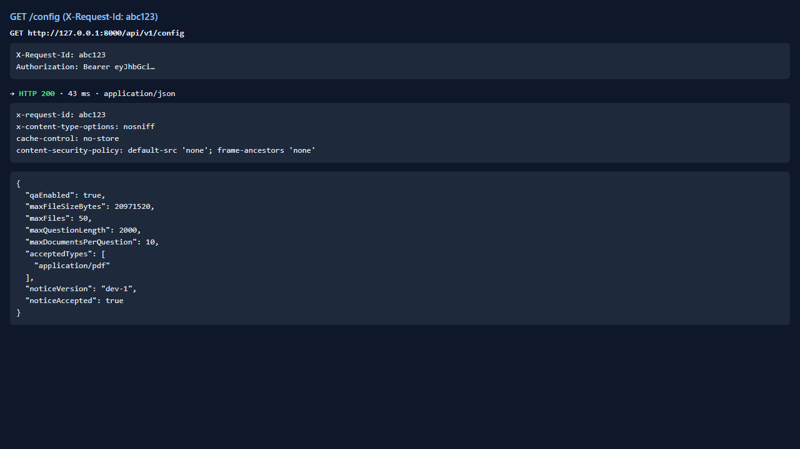

### Bước 3. Hai yêu cầu liên tiếp — ✅ PASS

- **Mong đợi:** Hai giá trị khác nhau
- **Thực tế:** Đúng như mong đợi

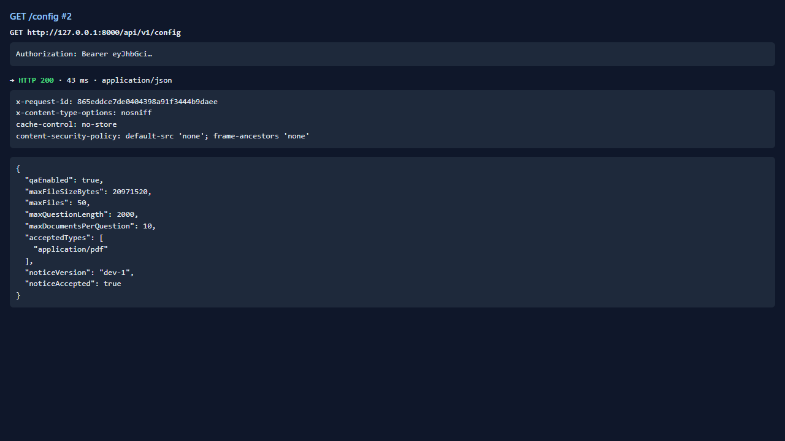

