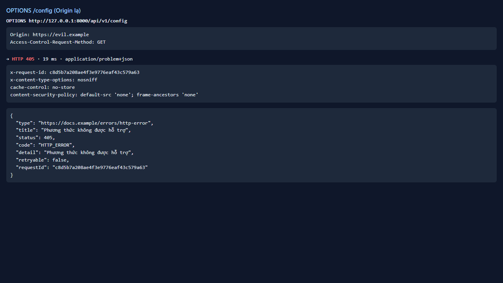
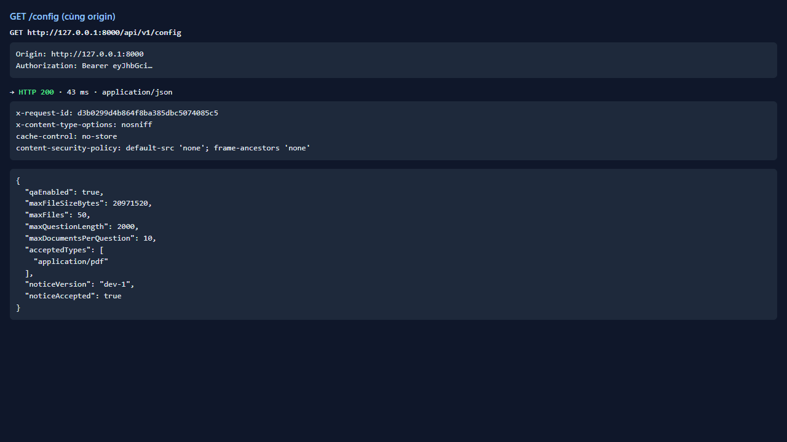

# Test report — API-035: CORS chỉ cho phép origin của SPA

| Mục | Giá trị |
|---|---|
| **Kết quả** | **PASS** |
| Test case | [API-035](../../cases/API-035.md) |
| URL kiểm thử | http://127.0.0.1:8000 |
| Trình duyệt | Microsoft Edge (Chromium) (1280×720) |
| Bắt đầu / kết thúc | 2026-10-30T12:03:07.361Z → 2026-10-30T12:03:09.901Z (2.5s) |
| Số bước | PASS: 3 · FAIL: 0 · SKIP: 0 |
| Video | [video/API-035.webm](video/API-035.webm) |

<video src="video/API-035.webm" controls width="720"></video>

## Kết quả từng bước

### Bước 1. OPTIONS /api/v1/config với Origin lạ — ✅ PASS

- **Mong đợi:** Không có Access-Control-Allow-Origin cho origin này
- **Thực tế:** HTTP 405, ACAO=(không có)

### Bước 2. GET /api/v1/config với Origin lạ — ✅ PASS

- **Mong đợi:** Không ACAO: * và không phản chiếu origin lạ
- **Thực tế:** ACAO=(không có)

### Bước 3. Origin hợp lệ http://127.0.0.1:8000 — ✅ PASS

- **Mong đợi:** Hoạt động bình thường
- **Thực tế:** Đúng như mong đợi

