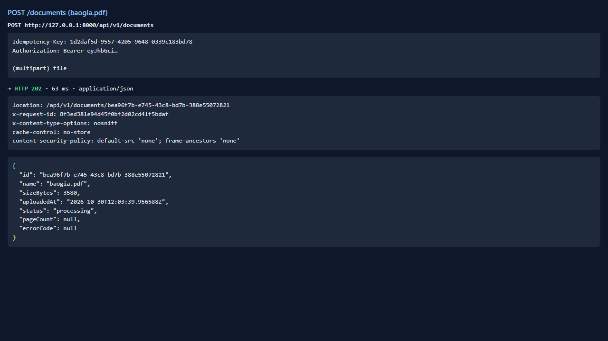
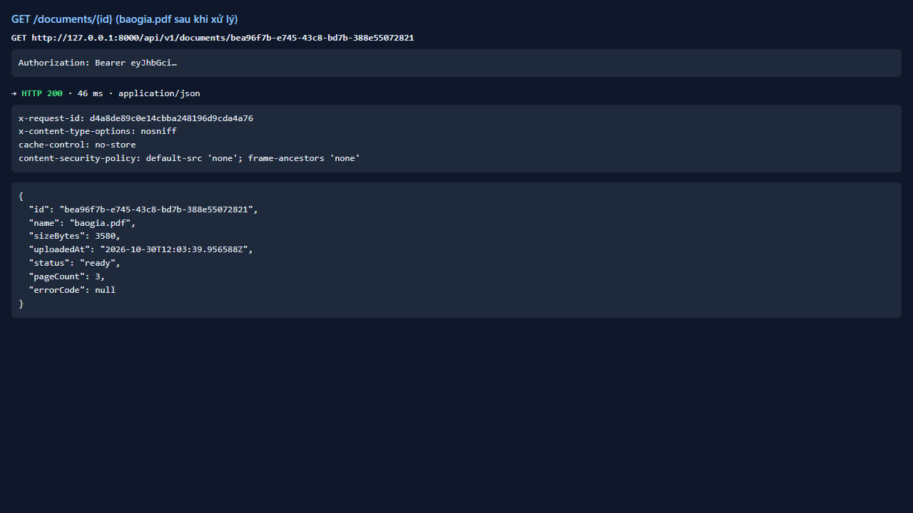
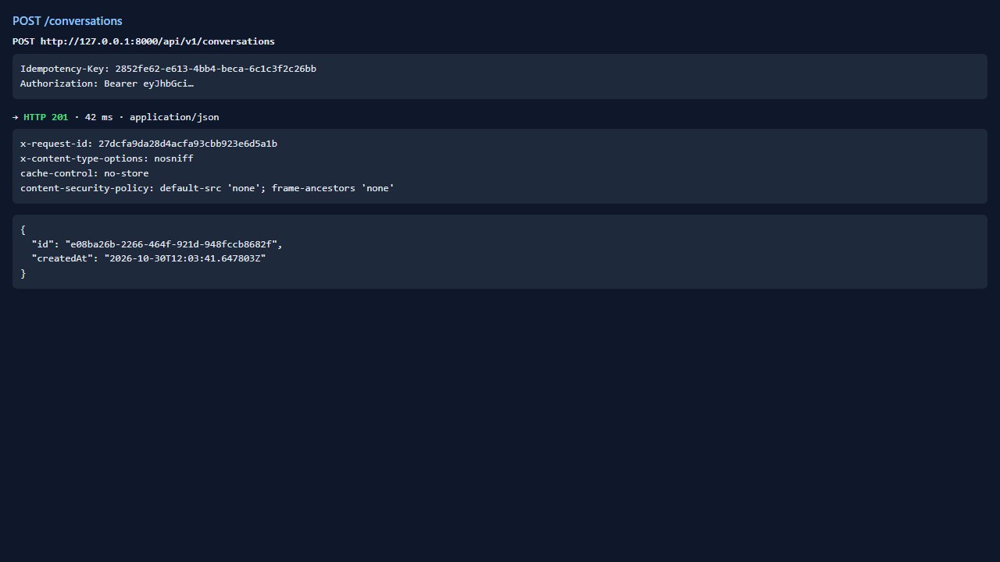
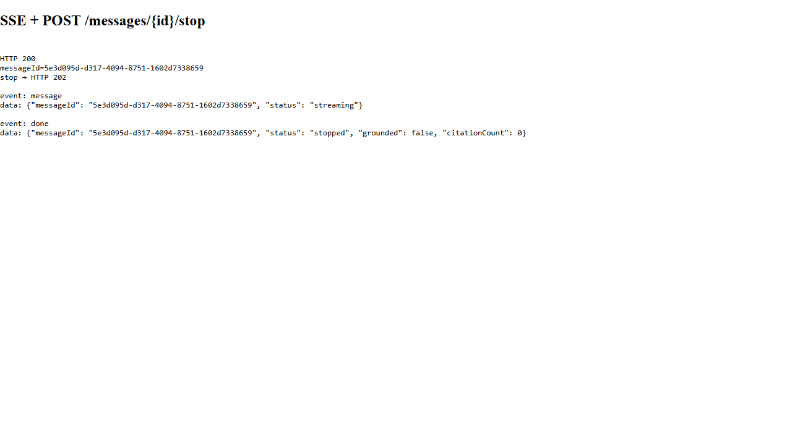
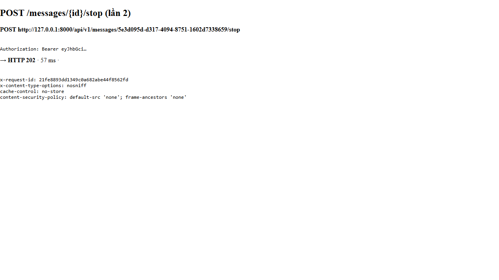
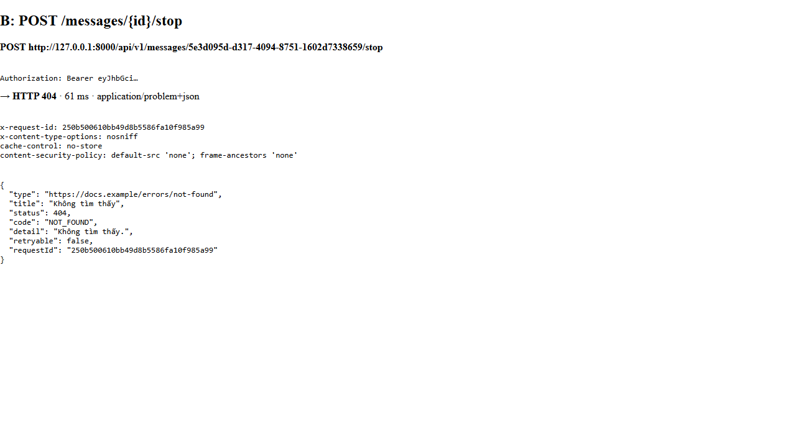

# Test report — API-036: POST /messages/{id}/stop (P1)

| Mục | Giá trị |
|---|---|
| **Kết quả** | **PASS** |
| Test case | [API-036](../../cases/API-036.md) |
| URL kiểm thử | http://127.0.0.1:8000 |
| Trình duyệt | Microsoft Edge (Chromium) (1280×720) |
| Bắt đầu / kết thúc | 2026-10-30T12:03:39.669Z → 2026-10-30T12:03:44.885Z (5.2s) |
| Số bước | PASS: 5 · FAIL: 0 · SKIP: 0 |
| Video | [video/API-036.webm](video/API-036.webm) |

<video src="video/API-036.webm" controls width="720"></video>

## Kết quả từng bước

### Bước 1. Chuẩn bị: baogia ready + hội thoại — ✅ PASS

- **Mong đợi:** OK
- **Thực tế:** Đúng như mong đợi

### Bước 2. Mở SSE (fetch stream trong trình duyệt), lấy messageId và gọi stop ngay — ✅ PASS

- **Mong đợi:** messageId có; stop trả 202
- **Thực tế:** Đúng như mong đợi

### Bước 3. Đọc phần còn lại của luồng — ✅ PASS

- **Mong đợi:** Kết thúc bằng done status=stopped, grounded=false, citationCount=0
- **Thực tế:** Văn bản nhận được trước khi dừng: ""

### Bước 4. stop lần hai trên message đã kết thúc — ✅ PASS

- **Mong đợi:** 202 (idempotent)
- **Thực tế:** Đúng như mong đợi

### Bước 5. stop message của người khác — ✅ PASS

- **Mong đợi:** 404
- **Thực tế:** Đúng như mong đợi

## Lỗi console của trình duyệt (6)

- `Failed to load resource: the server responded with a status of 404 (Not Found)`
- `Applying inline style violates the following Content Security Policy directive 'style-src 'self''. Either the 'unsafe-inline' keyword, a hash ('sha256-EK+SZlIuMZf8cUh+IBy4lh8eovkcnABzCDy0N/SqbS4='), o`
- `Applying inline style violates the following Content Security Policy directive 'style-src 'self''. Either the 'unsafe-inline' keyword, a hash ('sha256-irFBMySPhXR+HTgXgxtSlvMg9lIX6UyQ5ZisOG5mXl8='), o`
- `Applying inline style violates the following Content Security Policy directive 'style-src 'self''. Either the 'unsafe-inline' keyword, a hash ('sha256-VLlNtlGTRiQsnLfeR8aJ4wo/gy/o6rjghN2TEkJm2iQ='), o`
- `Applying inline style violates the following Content Security Policy directive 'style-src 'self''. Either the 'unsafe-inline' keyword, a hash ('sha256-irFBMySPhXR+HTgXgxtSlvMg9lIX6UyQ5ZisOG5mXl8='), o`
- `Applying inline style violates the following Content Security Policy directive 'style-src 'self''. Either the 'unsafe-inline' keyword, a hash ('sha256-VLlNtlGTRiQsnLfeR8aJ4wo/gy/o6rjghN2TEkJm2iQ='), o`

