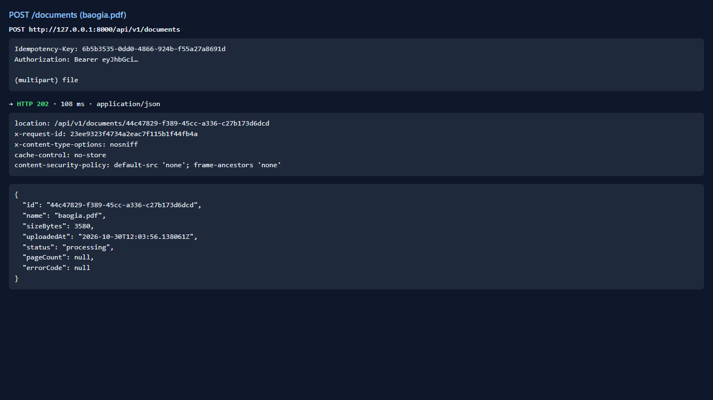
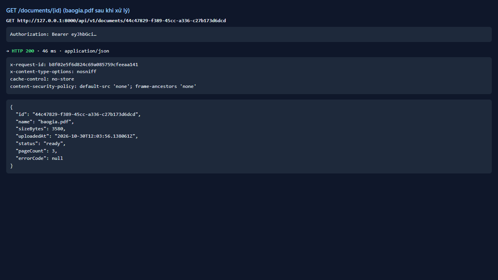
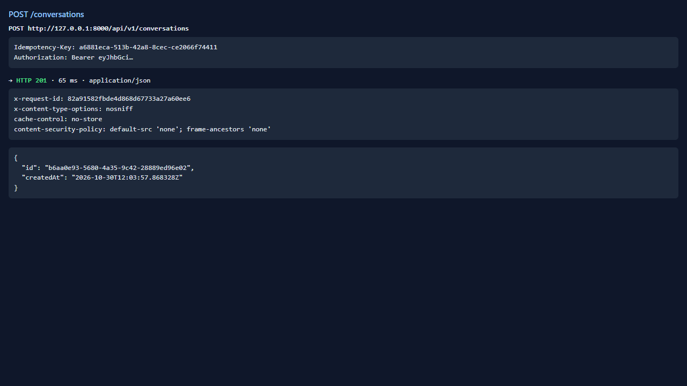
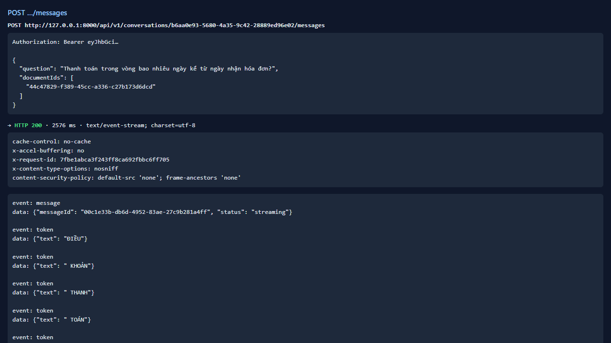
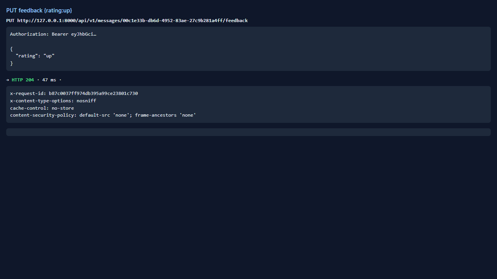
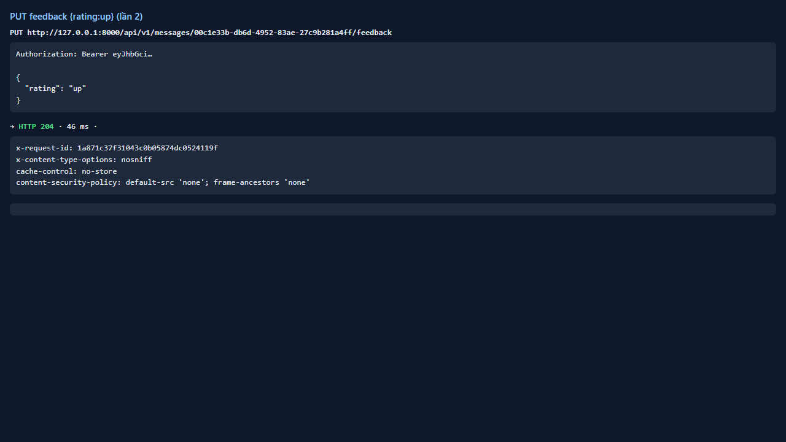
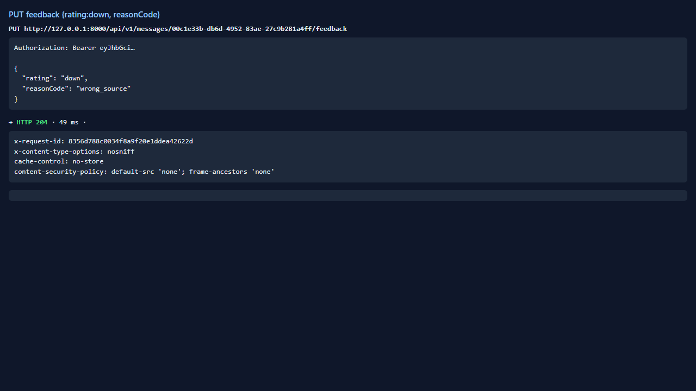
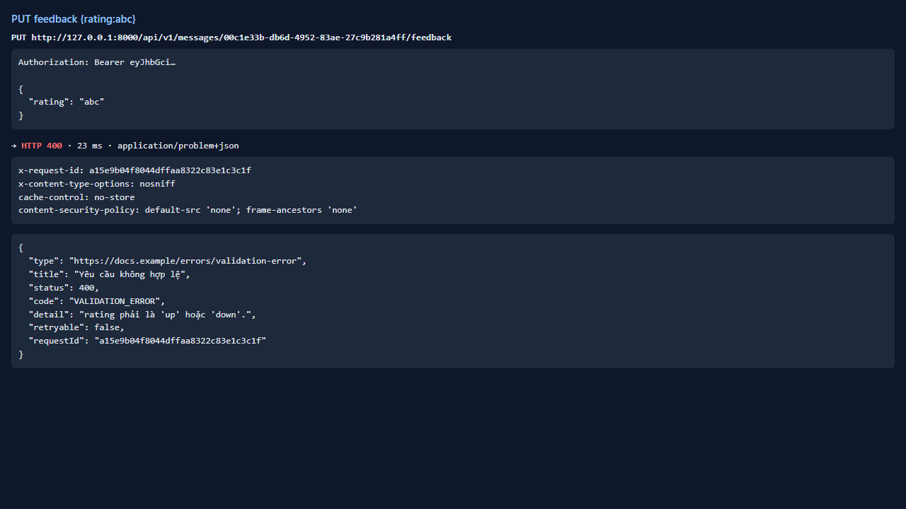
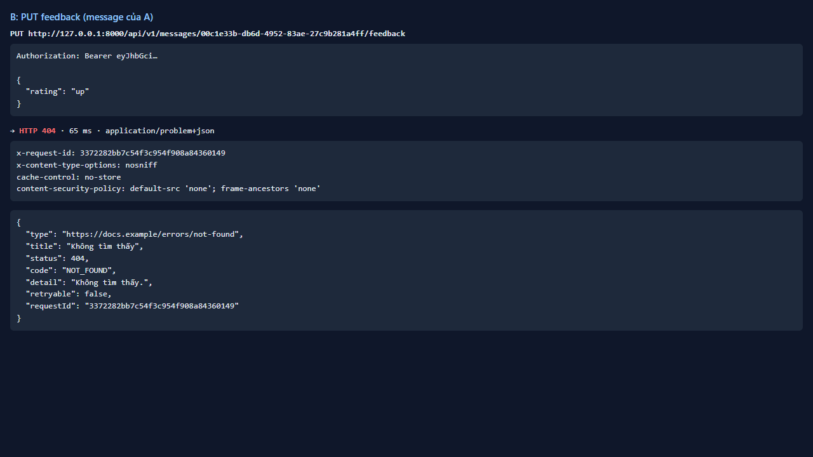

# Test report — API-038: PUT /messages/{id}/feedback (P1)

| Mục | Giá trị |
|---|---|
| **Kết quả** | **PASS** |
| Test case | [API-038](../../cases/API-038.md) |
| URL kiểm thử | http://127.0.0.1:8000 |
| Trình duyệt | Microsoft Edge (Chromium) (1280×720) |
| Bắt đầu / kết thúc | 2026-10-30T12:03:55.866Z → 2026-10-30T12:04:05.908Z (10.0s) |
| Số bước | PASS: 6 · FAIL: 0 · SKIP: 0 |
| Video | [video/API-038.webm](video/API-038.webm) |

<video src="video/API-038.webm" controls width="720"></video>

## Kết quả từng bước

### Bước 1. Chuẩn bị: câu trả lời hoàn tất — ✅ PASS

- **Mong đợi:** messageId
- **Thực tế:** Đúng như mong đợi

### Bước 2. PUT feedback {rating:'up'} — ✅ PASS

- **Mong đợi:** 204
- **Thực tế:** Đúng như mong đợi

### Bước 3. Lặp lại cùng yêu cầu — ✅ PASS

- **Mong đợi:** 204, kết quả như nhau
- **Thực tế:** Đúng như mong đợi

### Bước 4. {rating:'down', reasonCode} — ✅ PASS

- **Mong đợi:** 204
- **Thực tế:** Đúng như mong đợi

### Bước 5. {rating:'abc'} — ✅ PASS

- **Mong đợi:** 400/422 VALIDATION_ERROR
- **Thực tế:** Đúng như mong đợi

### Bước 6. Message của người khác — ✅ PASS

- **Mong đợi:** 404
- **Thực tế:** Đúng như mong đợi

