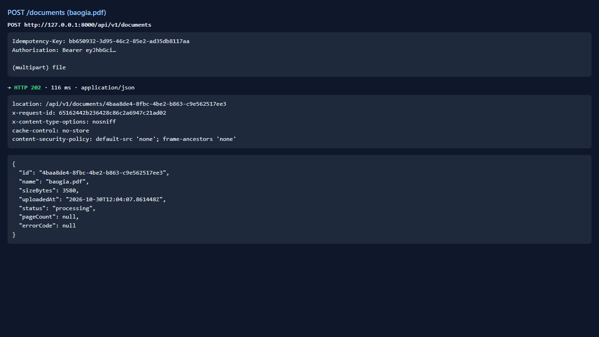
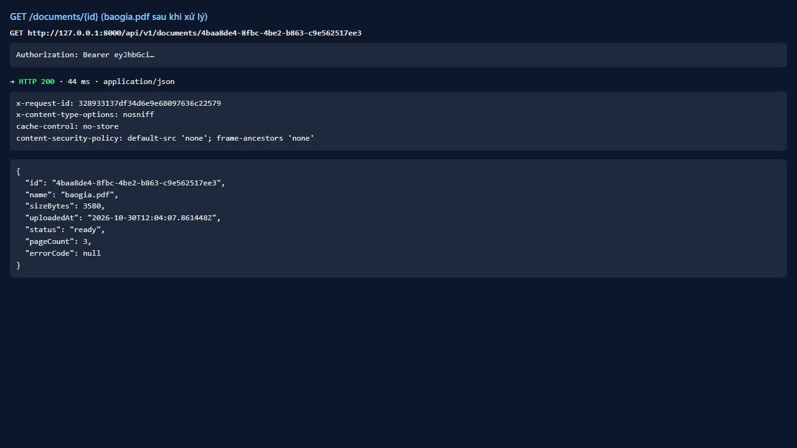
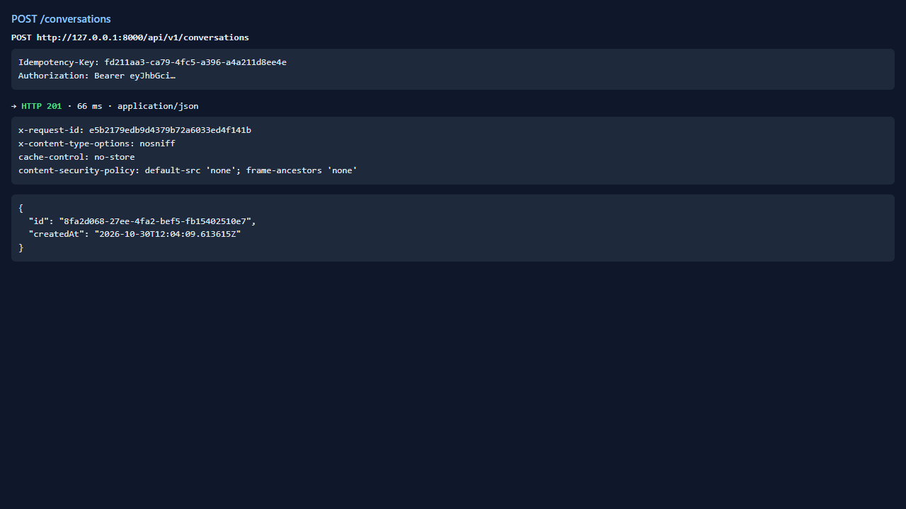
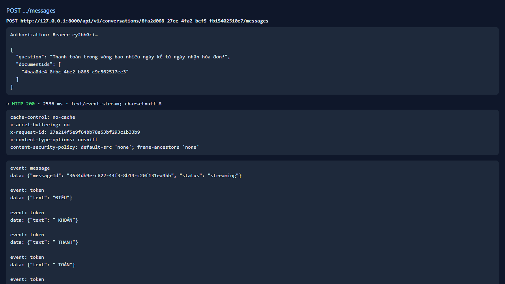
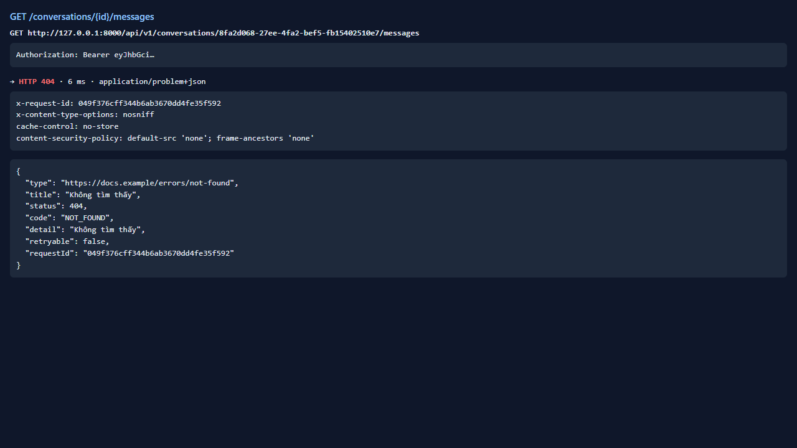

# Test report — API-039: GET /conversations/{id}/messages — lịch sử (P1)

| Mục | Giá trị |
|---|---|
| **Kết quả** | **FAIL** |
| Test case | [API-039](../../cases/API-039.md) |
| URL kiểm thử | http://127.0.0.1:8000 |
| Trình duyệt | Microsoft Edge (Chromium) (1280×720) |
| Bắt đầu / kết thúc | 2026-10-30T12:04:07.668Z → 2026-10-30T12:04:14.472Z (6.8s) |
| Số bước | PASS: 1 · FAIL: 1 · SKIP: 0 |
| Video | [video/API-039.webm](video/API-039.webm) |

<video src="video/API-039.webm" controls width="720"></video>

## Kết quả từng bước

### Bước 1. Chuẩn bị: hội thoại có 1 câu hỏi đã trả lời — ✅ PASS

- **Mong đợi:** OK
- **Thực tế:** Đúng như mong đợi

### Bước 2. GET /conversations/{id}/messages — ❌ FAIL

- **Mong đợi:** 200 {items} gồm câu hỏi và câu trả lời (kèm citations)
- **Thực tế:** Endpoint lịch sử chưa được triển khai
  
  expect(received).toBe(expected) // Object.is equality
  
  Expected: 200
  Received: 404

## Lỗi phát hiện

- API Design 3.3 (IF-06) liệt kê GET /conversations/{id}/messages (lịch sử hội thoại, US-204) nhưng endpoint trả HTTP 404. Có thể do chưa triển khai (P1) hoặc phụ thuộc OQ-012; cần PO xác nhận phạm vi. Mức: Minor (P1, chưa thuộc R1).

