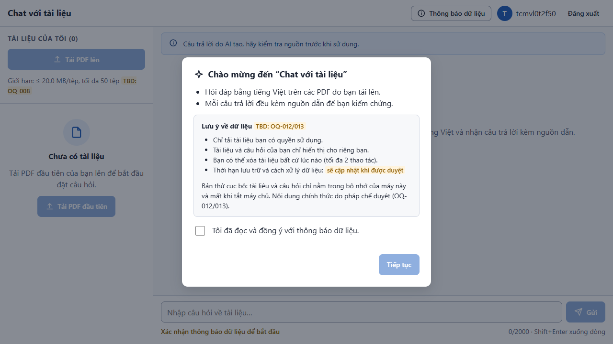
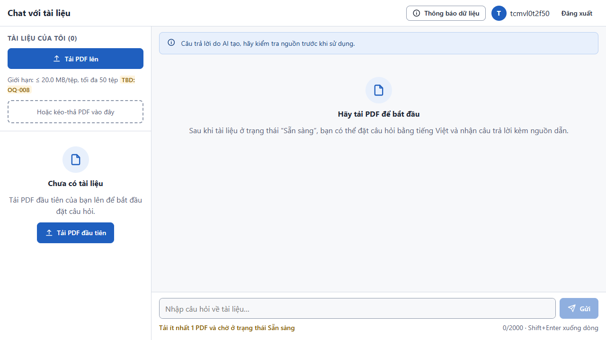
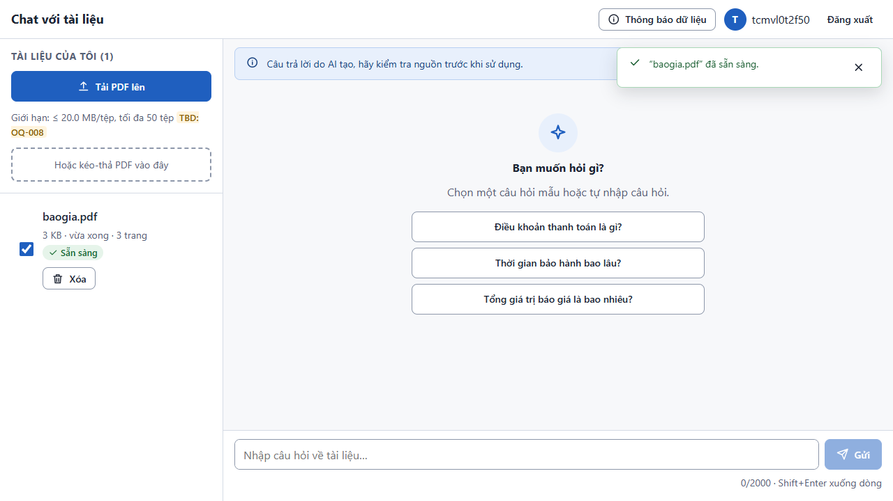
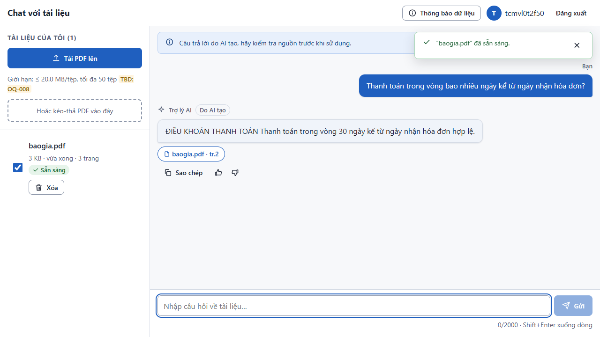
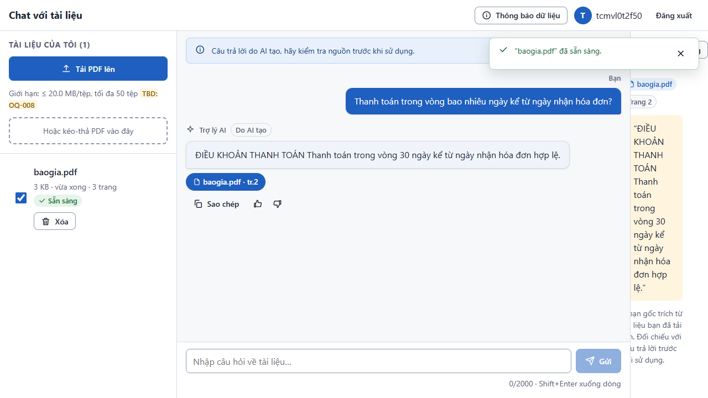
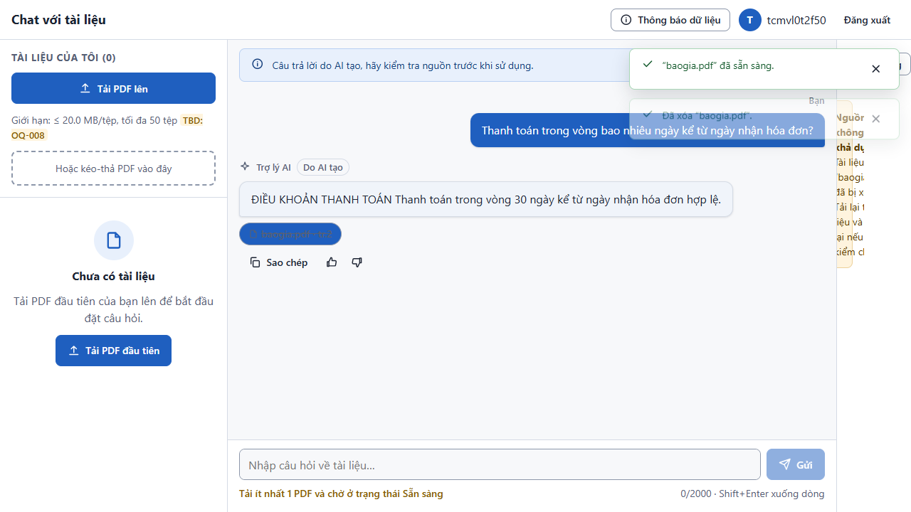

# Test report — E2E-001: Hành trình chính của Lan

| Mục | Giá trị |
|---|---|
| **Kết quả** | **PASS** |
| Test case | [E2E-001](../../cases/E2E-001.md) |
| URL kiểm thử | http://127.0.0.1:8000 |
| Trình duyệt | Microsoft Edge (Chromium) (1280×720) |
| Bắt đầu / kết thúc | 2026-10-23T13:43:28.385Z → 2026-10-23T13:43:35.328Z (6.9s) |
| Số bước | PASS: 6 · FAIL: 0 · SKIP: 0 |
| Video | [video/E2E-001.webm](video/E2E-001.webm) |

<video src="video/E2E-001.webm" controls width="720"></video>

## Kết quả từng bước

### Bước 1. Đăng nhập dev bằng tài khoản mới — ✅ PASS

- **Mong đợi:** Vào được trang chính, thấy hộp thoại thông báo dữ liệu
- **Thực tế:** Đúng như mong đợi

### Bước 2. Xác nhận thông báo dữ liệu — ✅ PASS

- **Mong đợi:** Hộp thoại đóng, nút Tải PDF lên khả dụng
- **Thực tế:** Đúng như mong đợi

### Bước 3. Tải baogia.pdf — ✅ PASS

- **Mong đợi:** Tệp xuất hiện trong danh sách rồi chuyển Sẵn sàng
- **Thực tế:** Đúng như mong đợi

### Bước 4. Hỏi về điều khoản thanh toán — ✅ PASS

- **Mong đợi:** Trả lời streaming, chứa '30 ngày', có chip baogia.pdf · tr.2
- **Thực tế:** Đúng như mong đợi

### Bước 5. Mở panel nguồn dẫn — ✅ PASS

- **Mong đợi:** Panel hiện đúng tệp, Trang 2 và đoạn gốc
- **Thực tế:** Đúng như mong đợi

### Bước 6. Xóa baogia.pdf — ✅ PASS

- **Mong đợi:** Danh sách trống; chip cũ báo 'Nguồn không còn khả dụng'
- **Thực tế:** Đúng như mong đợi

## Lỗi console của trình duyệt (1)

- `Failed to load resource: the server responded with a status of 404 (Not Found)`

